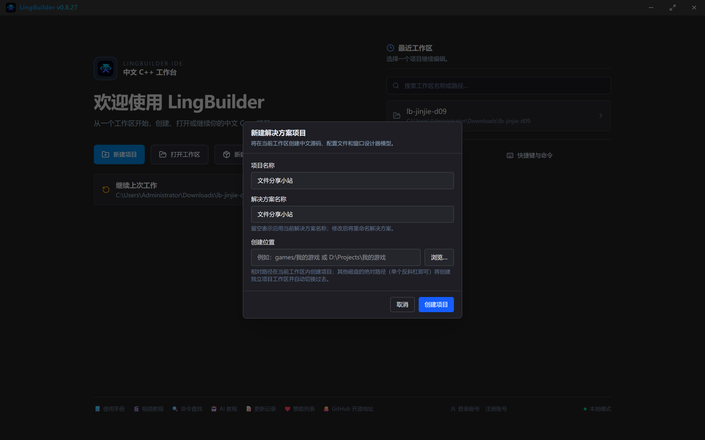
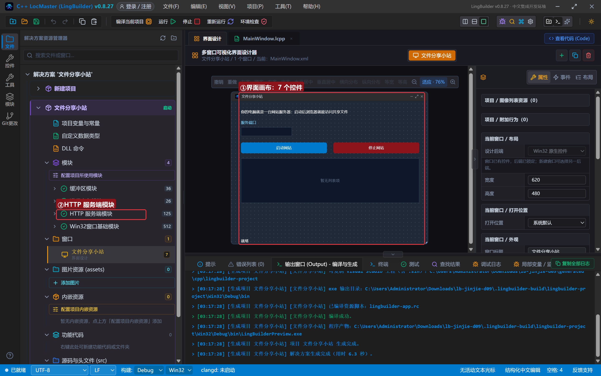
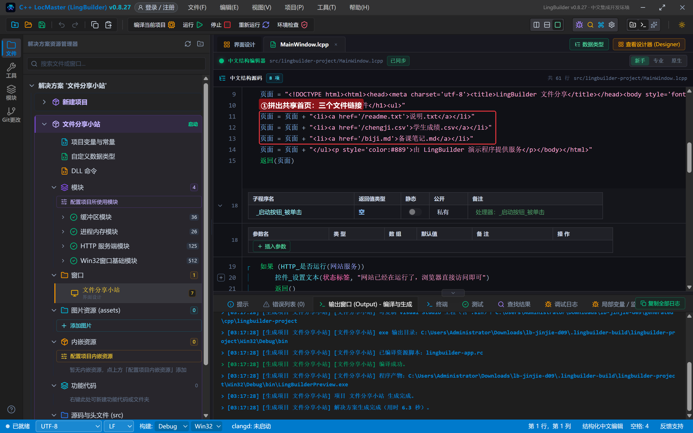
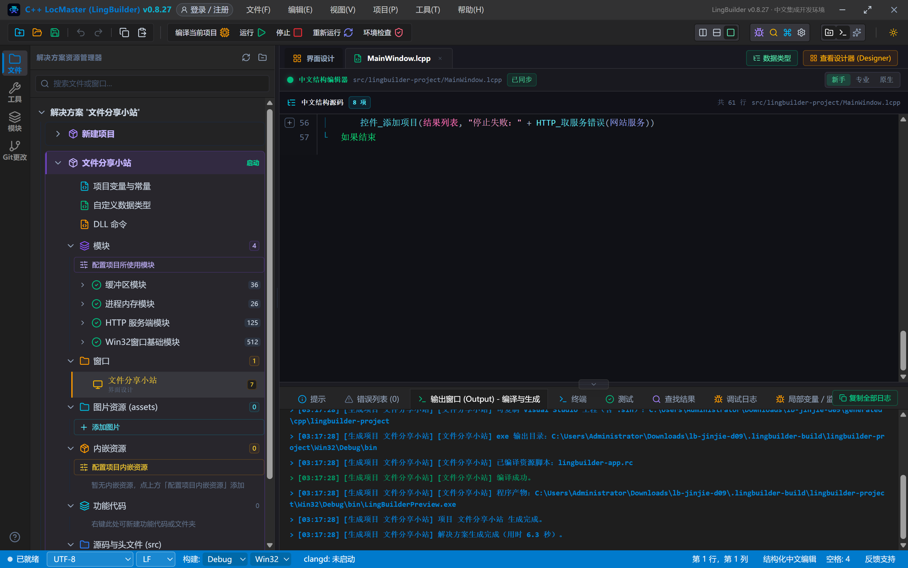
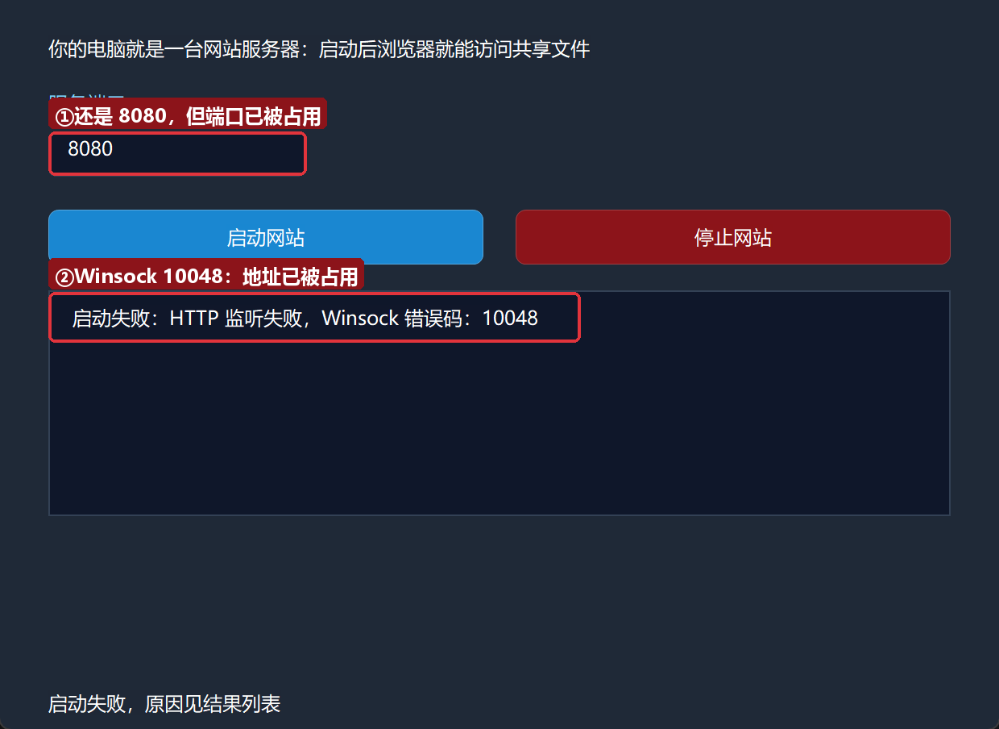
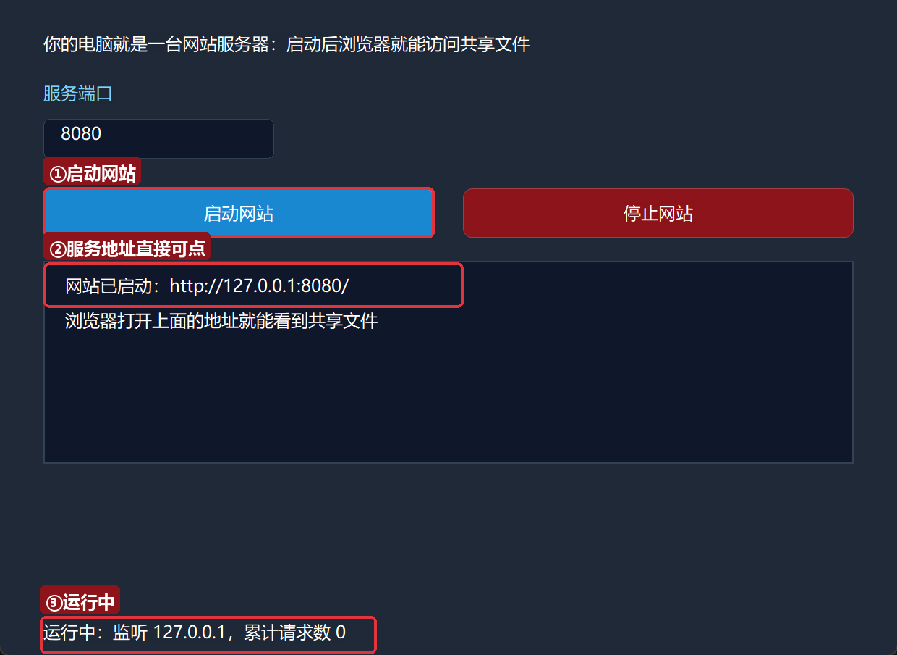
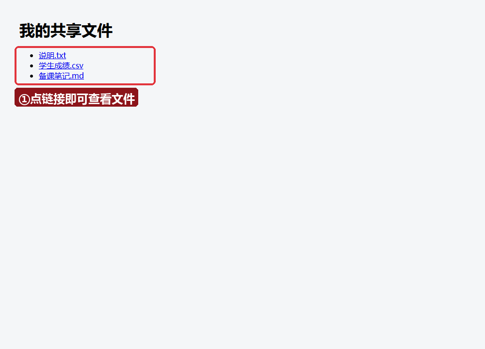
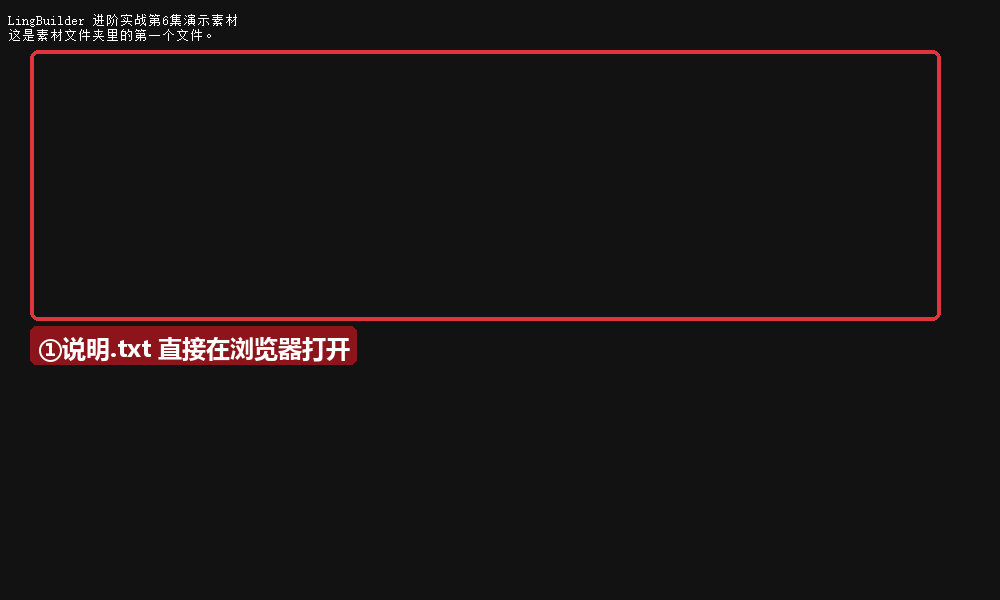
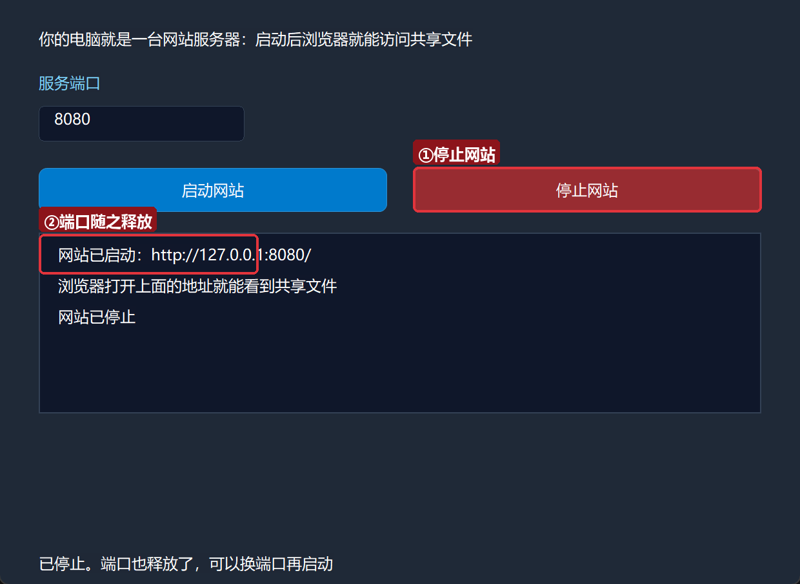

# 进阶实战 09 · HTTP 服务器 http.server：局域网文件分享小站

> 《LingBuilder 进阶实战系列》第 9 集。前几集你的程序都在「当客户端」——发请求、发邮件；这一集反过来：让你的程序**当服务器**。用**HTTP服务端模块（lingbuilder.http.server）**做一个**文件分享小站**：点一下「启动网站」，同一间屋子里的人在浏览器地址栏输入你的 IP，就能看到并下载你共享的文件。全程约 30 分钟。
>
> 前置要求：学完[零基础入门系列](/guide/tutorials/beginner)与进阶前 8 集（特别是第 6 集的「失败就问取错误」）。本集源码包见文末。

## 这一集你将学会

- 服务端四步曲：`HTTP_创建服务` → `HTTP_配置服务` → 注册路由 → `HTTP_启动`
- 两种路由：`HTTP_添加静态路由`（固定内容，工作线程直回不占 UI）和 `HTTP_添加静态文件路由`（直接发磁盘文件，支持断点续传）
- `HTTP_是否运行` / `HTTP_停止` / `HTTP_取监听端口` / `HTTP_取累计请求数` 等状态族
- 真实故障演练：端口被占用（Winsock 10048）长什么样、怎么办
- 红线：回环与局域网的边界、`HTTP_允许外部监听`、防火墙

## 1. 三十秒理解：你的程序当服务器

浏览器访问网页，本质是「浏览器（客户端）向服务器要文件」。之前你的程序都是提需求的一方；现在换它端盘子。三步：

1. `网站服务 = HTTP_创建服务()` —— 创建一个还没启动的服务端；
2. `HTTP_配置服务(网站服务, "127.0.0.1", 8080, 4, 256)` —— 定监听地址、端口、工作线程数和等待队列；
3. 注册路由（谁访问什么路径，得到什么），然后 `HTTP_启动(网站服务)` —— 开张。

路由分两种：**静态路由**返回注册时写死的固定内容（说明页、JSON 接口），由工作线程直接回复、完全不占用界面线程；**静态文件路由**直接从磁盘分块发送文件（自动支持 Range 断点续传），发大文件也不吃内存。

## 2. 新建项目与启用模块

新建窗口项目：名称 **文件分享小站**，模板「Windows 界面设计」，创建位置留空：



启用「**HTTP 服务端模块**」（53 条命令，本集用其中 10 条）。

## 3. 设计界面

| 控件 | 名称 | 显示内容 | 左距 | 顶距 | 宽度 | 高度 |
| --- | --- | --- | --- | --- | --- | --- |
| 标签 | 说明标签 | 你的电脑就是一台网站服务器：启动后浏览器就能访问共享文件 | 30 | 22 | 560 | 24 |
| 标签 | 端口标签 | 服务端口 | 30 | 56 | 200 | 22 |
| 编辑框 | 端口框 | （空） | 30 | 82 | 160 | 28 |
| 按钮 | 启动按钮 | 启动网站 | 30 | 130 | 270 | 34 |
| 按钮 | 停止按钮 | 停止网站 | 320 | 130 | 270 | 34 |
| 列表框 | 结果列表 | — | 30 | 180 | 560 | 140 |
| 标签 | 状态标签 | 就绪 | 30 | 428 | 560 | 22 |

窗口宽 620、高 480。绑 2 个按钮事件 + 窗口「创建完毕」。



## 4. 写代码

先写一个返回共享首页 HTML 的子程序——三个文件链接就是小站的门面：

```lcpp
文本型 首页HTML()
    局部 文本型 页面
    页面 = "<!DOCTYPE html><html><head><meta charset='utf-8'><title>LingBuilder 文件分享</title></head><body style='font-family:Microsoft YaHei;background:#f4f6f8;margin:40px'>"
    页面 = 页面 + "<h1>我的共享文件</h1><ul>"
    页面 = 页面 + "<li><a href='/readme.txt'>说明.txt</a></li>"
    页面 = 页面 + "<li><a href='/chengji.csv'>学生成绩.csv</a></li>"
    页面 = 页面 + "<li><a href='/biji.md'>备课笔记.md</a></li>"
    页面 = 页面 + "</ul><p style='color:#889'>由 LingBuilder 演示程序提供服务</p></body></html>"
    返回(页面)
结束
```



带返回值的子程序：返回值类型写 `文本型`，出口用 `返回(页面)`（进阶第 2 集的括号口径）。然后是启动按钮——配置、注册路由、启动一气呵成：

```lcpp
事件 _启动按钮_被单击()
    如果 (HTTP_是否运行(网站服务))
        控件_设置文本(状态标签, "网站已经在运行了，浏览器直接访问即可")
        返回()
    如果结束
    网站服务 = HTTP_创建服务()
    局部 逻辑型 配好
    配好 = HTTP_配置服务(网站服务, "127.0.0.1", 到整数(控件_取文本(端口框)), 4, 256)
    如果 (配好 = 假)
        控件_添加项目(结果列表, "配置失败：" + HTTP_取服务错误(网站服务))
        返回()
    如果结束
    HTTP_添加静态路由(网站服务, "GET", "/", 首页HTML(), "text/html; charset=utf-8")
    HTTP_添加静态文件路由(网站服务, "GET", "/readme.txt", "C:\演示\素材文件夹\说明.txt", "", "text/plain; charset=utf-8")
    HTTP_添加静态文件路由(网站服务, "GET", "/chengji.csv", "C:\演示\素材文件夹\学生成绩.csv", "", "text/csv; charset=utf-8")
    HTTP_添加静态文件路由(网站服务, "GET", "/biji.md", "C:\演示\素材文件夹\备课笔记.md", "", "text/markdown; charset=utf-8")
    局部 逻辑型 启好
    启好 = HTTP_启动(网站服务)
    控件_清空项目(结果列表)
    如果 (启好)
        控件_添加项目(结果列表, "网站已启动：http://127.0.0.1:" + 到文本(HTTP_取监听端口(网站服务)) + "/")
        控件_添加项目(结果列表, "浏览器打开上面的地址就能看到共享文件")
        控件_设置文本(状态标签, "运行中：监听 127.0.0.1，累计请求数 " + 到文本(HTTP_取累计请求数(网站服务)))
    否则
        控件_添加项目(结果列表, "启动失败：" + HTTP_取服务错误(网站服务))
        控件_设置文本(状态标签, "启动失败，原因见结果列表")
    如果结束
结束
```

`网站服务` 是项目全局变量（`全局 HTTP服务端 网站服务`）——服务端句柄要跨按钮使用。四个 `HTTP_添加静态*` 调用就是本站的全部业务逻辑：`/` 给首页，其余三条把磁盘文件挂到路径上。停止按钮用 `HTTP_是否运行` 守卫后调 `HTTP_停止(网站服务)`。

## 5. 编译与运行

点「编译当前项目」，错误列表 (0)、输出窗口「编译成功」：



### 5.1 真实故障演练：端口被占用

8080 是热门端口。先故意让别的程序占住它，再点「启动网站」：



「启动失败：HTTP 监听失败，Winsock 错误码：10048」——10048 就是 Windows 的「地址已被占用」。新手最常撞的墙，程序稳稳接住并说清楚了。换一个端口（或关掉占用者）再启动。

### 5.2 启动成功

点「启动网站」：



结果列表给出可直接访问的地址，状态栏汇报运行状态。

### 5.3 浏览器验证

在浏览器地址栏输入 `http://127.0.0.1:8080/`：



这就是你的程序吐出来的网页！点「说明.txt」：



文件内容直接出现在浏览器里——它不是提前放在哪的网页，而是你的 exe 此刻从磁盘读出来发给浏览器的。同一局域网的同事把地址里的 127.0.0.1 换成你的内网 IP，也能访问（见下面红线）。

### 5.4 停止网站

点「停止网站」：



监听关闭、端口释放、连接全部回收——再点「启动网站」可以换个端口重新开张。

## 6. 红线：回环、局域网与防火墙

- **默认只听回环**：监听地址 `127.0.0.1` 表示「只有本机能访问」，最安全。想让局域网访问，把地址改成 `0.0.0.0` 之前必须先调 `HTTP_允许外部监听(网站服务, 真)`——模块故意设了这道闸，防止开发期的服务被无意暴露。
- **防火墙**：首次监听非回环地址时 Windows 会弹防火墙询问，点「允许」；没弹而被拦时去「防火墙 → 允许应用通过防火墙」手动放行你的 exe。
- **只分享该分享的**：静态文件路由把指定文件挂到指定路径，不会暴露整个磁盘；不要把用户参数直接拼进文件路径（命令说明里也专门警告了这一点）。
- **高并发两把旋钮**：固定内容优先用静态路由（工作线程直回）；被大量连接压住时用 `HTTP_设置连接轮转` 放宽默认 100 的单连接请求数上限。

## 7. 常见问题急救表

| 症状 | 原因 | 解法 |
| --- | --- | --- |
| 「HTTP 监听失败，Winsock 错误码：10048」 | 端口被别的程序占用 | 换端口，或关掉占用者（`netstat -ano | findstr 8080` 找它） |
| 本机能访问，同事不行 | 监听地址是 127.0.0.1（回环） | 先 `HTTP_允许外部监听(真)`，配置地址改 `0.0.0.0`，并放行防火墙 |
| 浏览器显示「无法访问此网站」 | 服务没启动 / 端口填错 | 看结果列表里的实际地址；`HTTP_取监听端口` 可查真实端口 |
| 文件路由 404 | 磁盘文件不存在 | 核对绝对路径；每次请求都会重新读文件，补上文件即可恢复 |
| 大文件传输中断后重来 | 普通下载没有断点 | 模块自动支持 Range 续传，配合支持续传的下载器即可 |
| 想推送实时数据（聊天/进度） | 静态路由只会「一问一答」 | 进阶用 SSE 七命令（`HTTP_SSE_开始/推送...`），服务端可单向持续下发 |

## 本集小结

- 服务端四步曲：创建 → 配置 → 注册路由 → 启动；状态问 `HTTP_是否运行`，错误问 `HTTP_取服务错误`。
- 静态路由回固定内容、静态文件路由发磁盘文件，都在工作线程直回，不卡界面。
- 10048 = 端口被占用；换端口或关占用者。
- 局域网分享 = 允许外部监听 + 改监听地址 + 放行防火墙；回环最安全。
- 实时推送的钥匙是 SSE 七命令，进阶再玩。

**下一集预告**：《浏览器自动化 EdgeView（选学）》——让你的程序**操纵浏览器**：打开网页、取标题、取正文、执行 JavaScript，做一个网页自动取数小工具。

[回系列总览](/guide/tutorials/jinjie)
