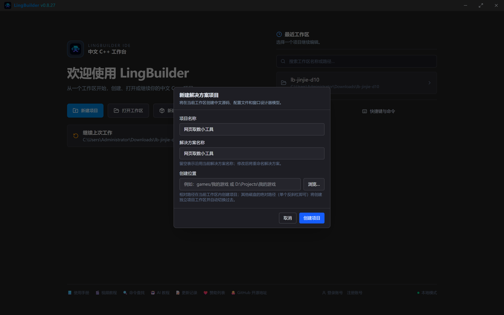
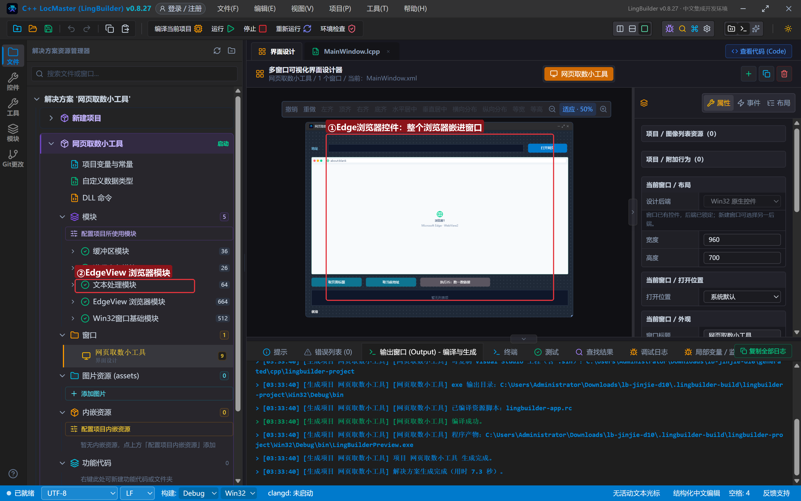
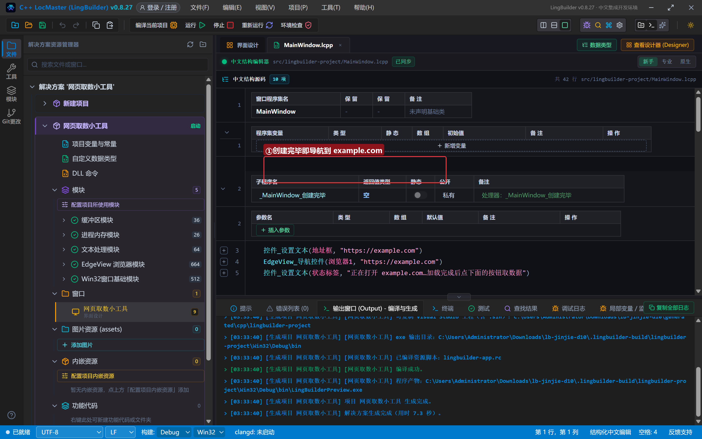
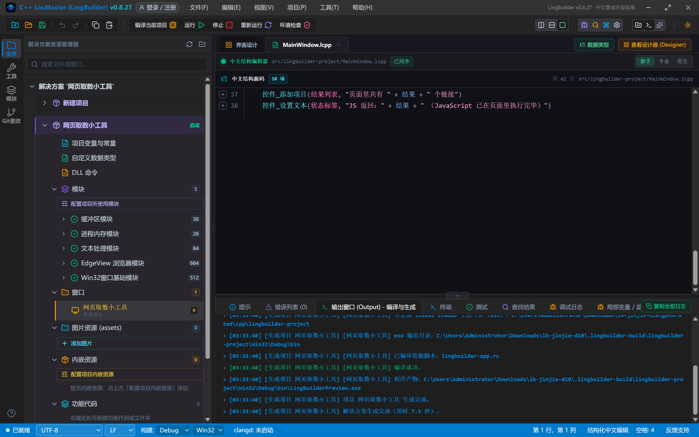
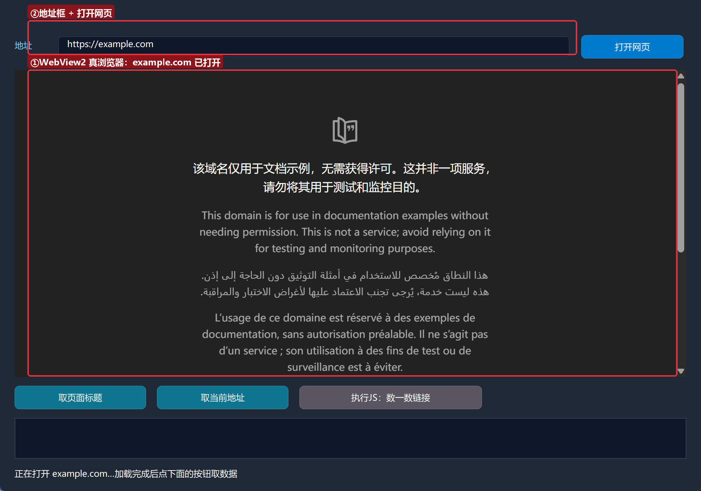
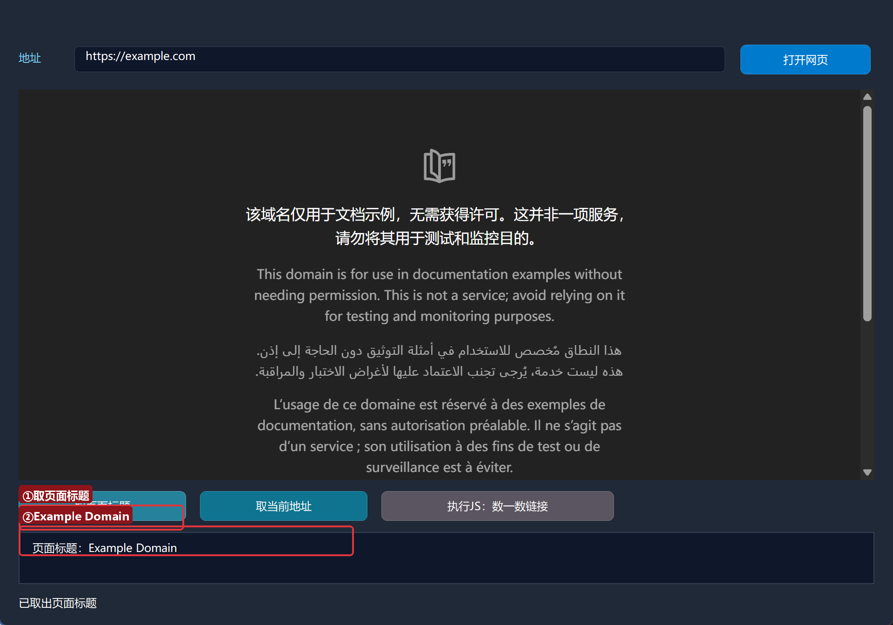
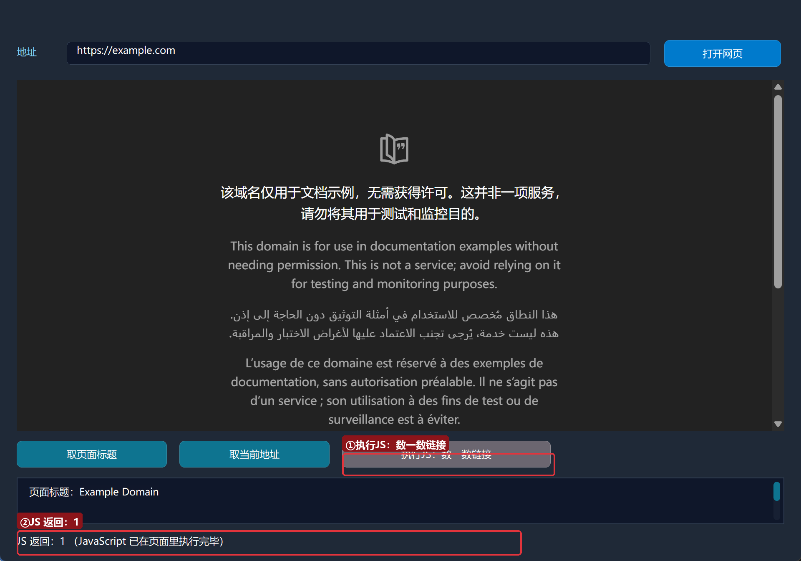

# 进阶实战 10 · 浏览器自动化 EdgeView：网页取数小工具（选学）

> 《LingBuilder 进阶实战系列》第 10 集（选学）。很多自动化的终点是浏览器：打开网页、等它加载完、把标题/地址/数据「取」回来，甚至往页面里注入一段 JavaScript。本集用**EdgeView 浏览器模块（lingbuilder.edgeview）**做一个**网页取数小工具**——把一整个 Edge 浏览器嵌进你自己的窗口，再用三条命令把页面数据取回来。全程约 25 分钟。
>
> 前置要求：学完[零基础入门系列](/guide/tutorials/beginner)与进阶前 9 集。EdgeView 基于 Microsoft Edge WebView2（Windows 10/11 一般自带运行时）。本集源码包见文末。

## 这一集你将学会

- 设计器里的 **Edge浏览器（EdgeBrowser）控件**：把浏览器当普通控件摆进窗口
- `EdgeView_导航控件`：让控件导航到任意网址
- `EdgeView导航_取标题` / `EdgeView导航_取地址`：取页面标题与当前地址
- `EdgeView_执行JS控件`：在页面里执行 JavaScript 并拿回返回值
- 无头形态选型（进阶速览）：什么时候该用哪种「看不见的浏览器」

## 1. 三十秒理解：把浏览器变成一个控件

EdgeView 把 Microsoft Edge（WebView2）装进你窗口里的一个矩形区域。从此你的程序有了「内置浏览器」：可以导航、可以读页面、可以在页面里跑 JavaScript——而用户看到的就是你软件里的一个内嵌网页区。

本集只用到 4 条命令（模块共 324 条，够学到很深，但入门就这四条）：

| 命令 | 作用 |
| --- | --- |
| `EdgeView_导航控件(控件名, 地址)` | 让控件打开一个网址 |
| `EdgeView导航_取标题(控件名)` | 取当前页面的标题 |
| `EdgeView导航_取地址(控件名)` | 取当前页面的地址 |
| `EdgeView_执行JS控件(控件名, 脚本)` | 在页面里执行 JavaScript，返回 JSON 编码结果 |

## 2. 新建项目、启用模块、设计界面

新建窗口项目：名称 **网页取数小工具**，模板「Windows 界面设计」，创建位置留空：



启用「**EdgeView 浏览器模块**」（本集还会用到 `文本_取长度`，文本处理模块一并启用）。

窗口做宽一点（960×700），给浏览器留地方：

| 控件 | 名称 | 显示内容 | 左距 | 顶距 | 宽度 | 高度 |
| --- | --- | --- | --- | --- | --- | --- |
| 标签 | 地址标签 | 地址 | 20 | 54 | 50 | 22 |
| 编辑框 | 地址框 | （空） | 80 | 50 | 700 | 28 |
| 按钮 | 打开按钮 | 打开网页 | 796 | 48 | 140 | 32 |
| **Edge浏览器** | **浏览器1** | （Edge 控件，从控件面板拖入） | 20 | 96 | 920 | 420 |
| 按钮 | 取标题按钮 | 取页面标题 | 20 | 528 | 180 | 32 |
| 按钮 | 取地址按钮 | 取当前地址 | 215 | 528 | 180 | 32 |
| 按钮 | 执行JS按钮 | 执行JS：数一数链接 | 410 | 528 | 250 | 32 |
| 列表框 | 结果列表 | — | 20 | 572 | 920 | 56 |
| 标签 | 状态标签 | 就绪 | 20 | 640 | 920 | 20 |

关键一步：从设计器控件面板把「**Edge浏览器**」拖进窗口——它就是一个普通控件，摆好位置即可。绑 3 个按钮事件 + 窗口「创建完毕」。



## 3. 写代码

窗口一打开就导航；「打开网页」按钮复用同一条命令：

```lcpp
事件 _MainWindow_创建完毕()
    控件_设置文本(地址框, "https://example.com")
    EdgeView_导航控件(浏览器1, "https://example.com")
    控件_设置文本(状态标签, "正在打开 example.com…加载完成后点下面的按钮取数据")
结束

事件 _打开按钮_被单击()
    局部 文本型 地址
    地址 = 控件_取文本(地址框)
    如果 (文本_取长度(地址) = 0)
        控件_设置文本(状态标签, "请先填地址")
        返回()
    如果结束
    EdgeView_导航控件(浏览器1, 地址)
    控件_清空项目(结果列表)
    控件_设置文本(状态标签, "正在导航：" + 地址)
结束
```

三个取数按钮各用一条命令：

```lcpp
事件 _取标题按钮_被单击()
    局部 文本型 标题
    标题 = EdgeView导航_取标题(浏览器1)
    控件_添加项目(结果列表, "页面标题：" + 标题)
    控件_设置文本(状态标签, "已取出页面标题")
结束

事件 _执行JS按钮_被单击()
    局部 文本型 结果
    结果 = EdgeView_执行JS控件(浏览器1, "document.links.length")
    控件_添加项目(结果列表, "页面里共有 " + 结果 + " 个链接")
    控件_设置文本(状态标签, "JS 返回：" + 结果 + " （JavaScript 已在页面里执行完毕）")
结束
```

`EdgeView_执行JS控件` 的脚本是**真 JavaScript**，跑在页面里：`document.links.length` 数出页面里的链接个数；你也可以写 `document.title`、`document.body.innerText.length` 等任何表达式，返回值按 JSON 编码送回。



## 4. 编译与运行

点「编译当前项目」，错误列表 (0)、输出「编译成功」：



点「运行」——窗口里直接打开了 example.com：



这不是截图、不是模拟，是一颗真·Edge 内核在你的软件里渲染网页。

### 4.1 取页面标题

点「取页面标题」：



结果列表报出「页面标题：Example Domain」——页面还没滚动、没复制，标题自己回来了。

### 4.2 执行 JavaScript

点「执行JS：数一数链接」：



状态栏报出「JS 返回：1」——example.com 上确实只有 1 个链接（页脚那个 More information），程序比肉眼数得快。

## 5. 进阶速览：三种「看不见的浏览器」

内嵌控件之外，EdgeView 还能创建**实例编号**形态的浏览器（`EdgeView_创建弹窗浏览器` / `EdgeView_创建无头实例` / `EdgeView_创建区域代理UA`），支持独立缓存目录（多开隔离）、独立代理与 User-Agent。选型一句话：

- **嵌窗口**（本集）：用户要看见网页；
- **弹窗实例**：独立顶层浏览器窗、多实例互相隔离（多账号场景）；
- **无头实例**：完全不可见地跑任务。注意「截图类命令在无头实例上不可用」，要页面图像请改用 CDP_启动浏览器（真无头独立进程）——四形态详细口径见模块文档与规则手册。

## 6. 常见问题急救表

| 症状 | 原因 | 解法 |
| --- | --- | --- |
| 编译报「未知的命令 文本_取长度」 | 文本命令归文本处理模块管 | 一并启用文本处理模块（每个命令都有自己的家） |
| 浏览器区域空白 | WebView2 运行时缺失 / 首次初始化中 | 装 Edge WebView2 Runtime；等几秒再操作 |
| 取标题返回空 | 页面还没加载完 | 等页面渲染出来再点；或用导航完成事件（见模块事件参考） |
| 执行 JS 没有返回值 | 脚本没有返回表达式 | 用 `document.title` 这类「有值」的表达式 |
| 想在不显示窗口的情况下取数 | 本集是内嵌形态 | 用 `EdgeView_创建无头实例`（注意截图限制）或 CDP 模块 |

## 本集小结

- EdgeBrowser 控件把真 Edge 内核嵌进窗口；`导航控件` 一条命令打开网页。
- 取数三板斧：`取标题` / `取地址` / `执行JS控件`（脚本即 JavaScript，返回 JSON 编码）。
- 实例编号形态支持多开、隔离、代理、UA；无头选型看模块文档。
- 模块命令各有所属：文本命令也要启用文本处理模块。

**下一集预告**：《实战整合》——把 SQLite、cron 定时、网络与托盘串成一个完整的个人信息管理系统，最后导出安装包，给整个系列收官。

[回系列总览](/guide/tutorials/jinjie)
