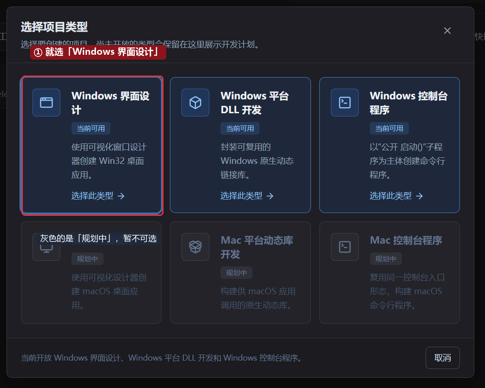
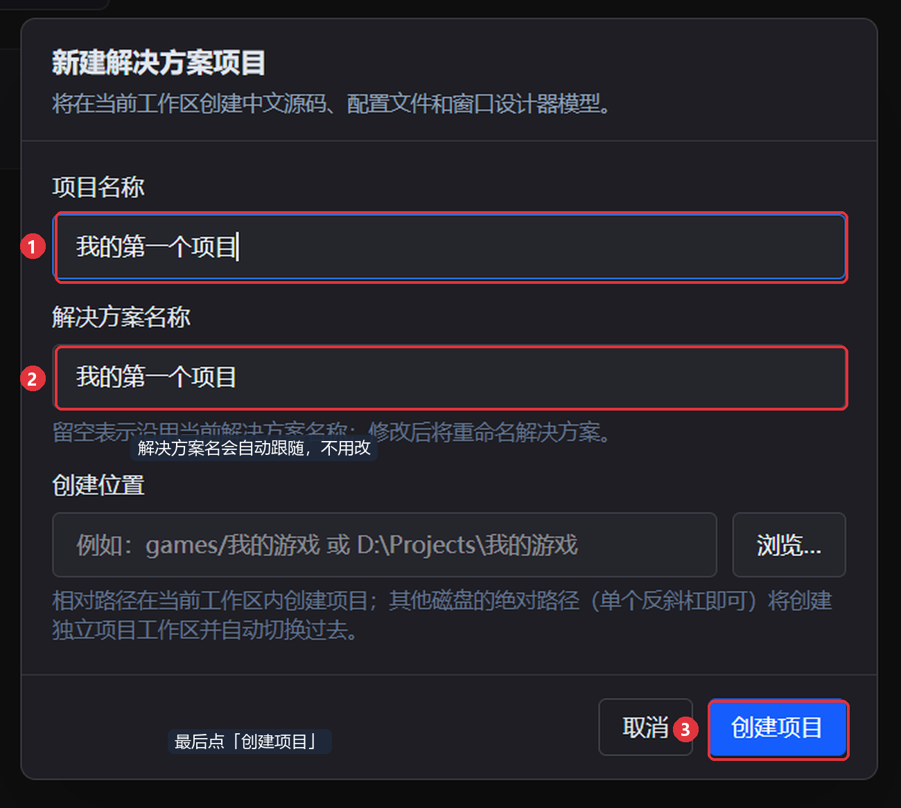
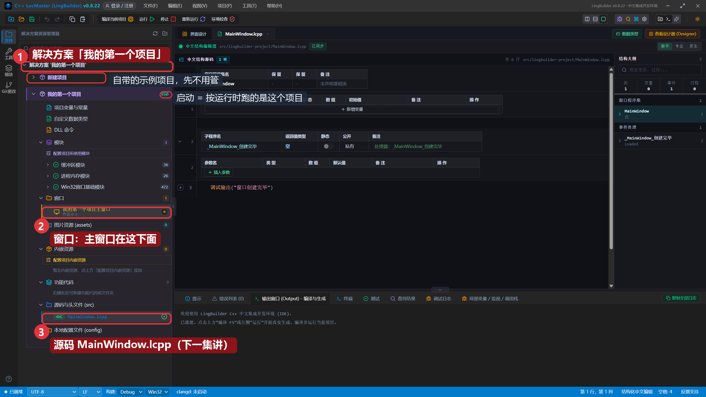
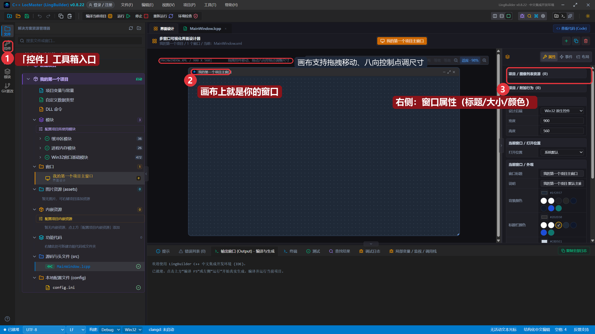
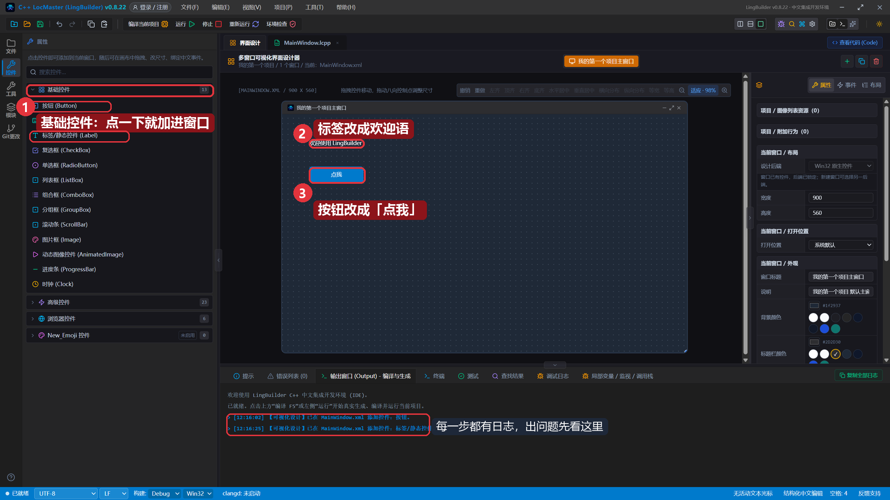
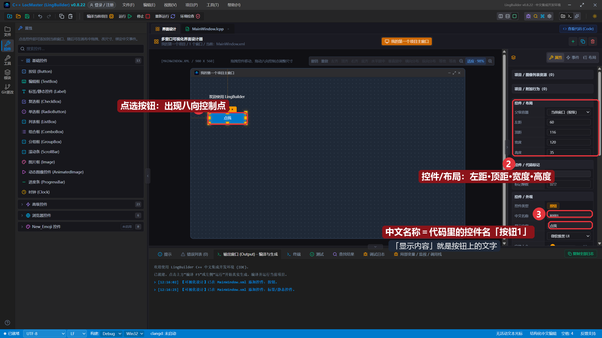
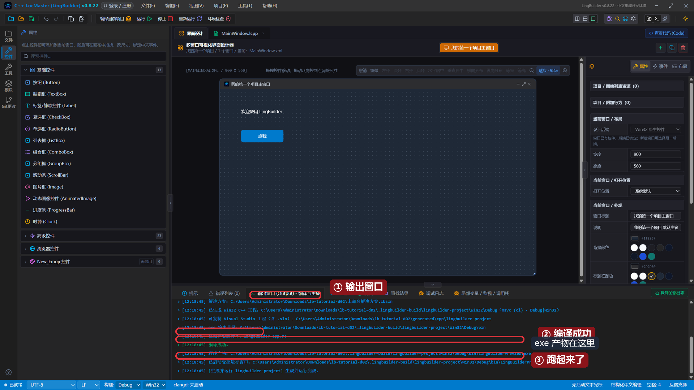
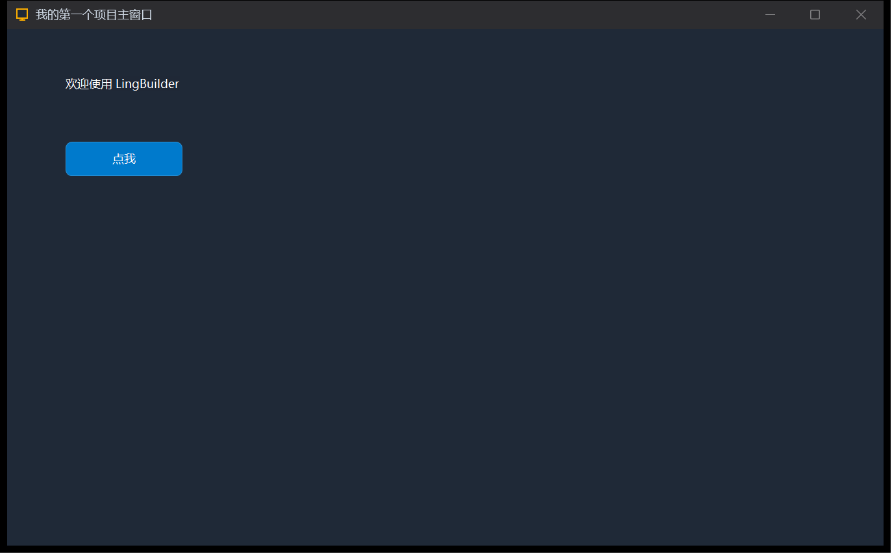

# 02 · 第一个窗口：新建项目与界面设计器

> 《LingBuilder 零基础入门实战》第 2 集。上一集我们装好了 LingBuilder、确认了构建环境就绪；这一集正式创建**你自己的第一个项目**，用可视化设计器摆两个控件，然后按 F5 编译出**真正属于你的 exe**。全集目录见 [课程大纲](../课程大纲.md)。
>
> 本集目标：从「新建项目」到「看到自己设计的窗口跑起来」。全程约 10 分钟。

## 1. 新建项目

打开 LingBuilder，在欢迎页点 **「新建项目」**，先选择项目类型：

本系列做桌面软件，选 **「Windows 界面设计」**（整张卡片都能点）。下面灰色的「规划中」类型暂时不可选，不用管。

接着给项目起名字：

1. **项目名称**：填 `我的第一个项目`（中文名完全没问题）。
2. **解决方案名称**：会自动跟随项目名，不用改。
3. 点右下角 **「创建项目」**。

创建成功会直接进入工作台。

> 说明：「创建位置」留空就建在当前工作区里；以后你想把项目放到别的盘，也可以在这里填绝对路径（比如 `D:\Projects\我的游戏`）。

## 2. 认识解决方案树

创建好之后，看左侧的**解决方案资源管理器**：

1. 最上面是解决方案 **「我的第一个项目」**——它就是你项目的「总目录」。
2. **窗口** 下面有一个「我的第一个项目主窗口」——你要做的界面就是它。
3. **源码与头文件 (src)** 里的 `MainWindow.lcpp` 是窗口对应的中文源码，下一集我们会在这里写代码。
4. 上面那个自带的「新建项目」是工作区自动生成的示例项目，先不用管。
5. 我们的项目旁边有个 **启动** 徽标：按「运行」时跑的就是这个项目。

## 3. 打开界面设计器

点编辑器区上方的 **「界面设计」** 页签，切换到可视化设计器：

- 中间的**画布**上就是你的主窗口（标题、大小都能改）。
- 右侧是**属性面板**，当前显示整个窗口的属性（窗口标题、宽度 900、高度 560、背景颜色……）。
- 画布上可以直接**拖拽控件移动**，选中后拖**八向控制点**调整尺寸——顶部提示条写得很清楚。
- 左侧活动栏多了一个 **「控件」** 图标——那就是控件工具箱的入口。

## 4. 添加两个控件

点活动栏的「控件」打开工具箱。**在控件名上点一下，控件就加进窗口了**：

我们在「基础控件」分组里依次点：

1. **标签/静态控件 (Label)**——窗口会多出一行「新文本标签」。
2. **按钮 (Button)**——窗口会多出一个「新按钮」。

每一步操作在下方输出面板都有日志（`【可视化设计】已在 MainWindow.xml 添加控件: …`），出问题时先看这里。

> 也可以先把两个控件摆开：点选控件后用右侧「控件 / 布局」里的**左距 / 顶距**精确调整位置，或直接在画布上拖。

## 5. 改控件属性

**点选画布上的按钮**，它四周会出现八向控制点，右侧属性面板切换成这个按钮的属性：

改三处：

1. **控件 / 布局**：把「左距」改成 `60`、「顶距」改成 `116`（也可以直接拖）。
2. **中文名称**：保持 `按钮1`——记住这个名字，**它就是以后代码里操作这个控件用的名字**。
3. **显示内容**：把「新按钮」改成 `点我`——这是按钮上显示的文字。

同样把标签的「显示内容」改成 `欢迎使用 LingBuilder`。现在画布上就是最终效果了。

## 6. 运行！你的第一个 exe

点工具栏的 **「运行」** 按钮。LingBuilder 会把你的设计翻译成真实 C++ 代码、调用 MSVC 编译、然后自动启动程序。整个过程在**输出窗口**里全程可见：

看到 **「编译成功」** 和 **「程序产物 …LingBuilder-Preview.exe」**，接着程序窗口就自己弹出来了：

窗口标题是「我的第一个项目主窗口」，里面有「欢迎使用 LingBuilder」和「点我」按钮——**和你设计的完全一致**。这不是截图预览，是一个真正编译出来的 exe，就躺在项目的 `.lingbuilder-build` 目录里，可以直接复制给别人跑。

> 小知识：现在点「点我」按钮没有任何反应，因为还没写代码。下一集我们就打开中文源码，给按钮加上「被单击」事件，让它真的会说话。

## 本集小结

- 会新建项目：选「Windows 界面设计」→ 填项目名 → 创建。
- 认识了解决方案树：窗口、源码、启动徽标。
- 会用界面设计器：工具箱点一下加控件、属性面板改文字和位置。
- 按下「运行」，编译出了第一个真正属于你的 exe。

**下一集预告**：[03 · 新手编辑器：第一行中文代码](../课程大纲.md)——认识中文结构编辑器，写下 `信息框 ("你好")`，让「点我」按钮真正有反应。
