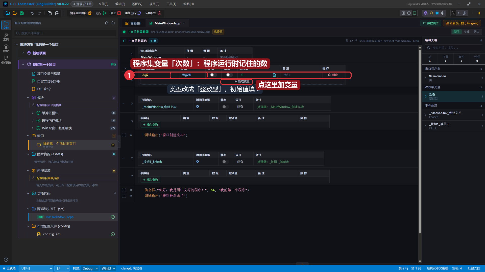
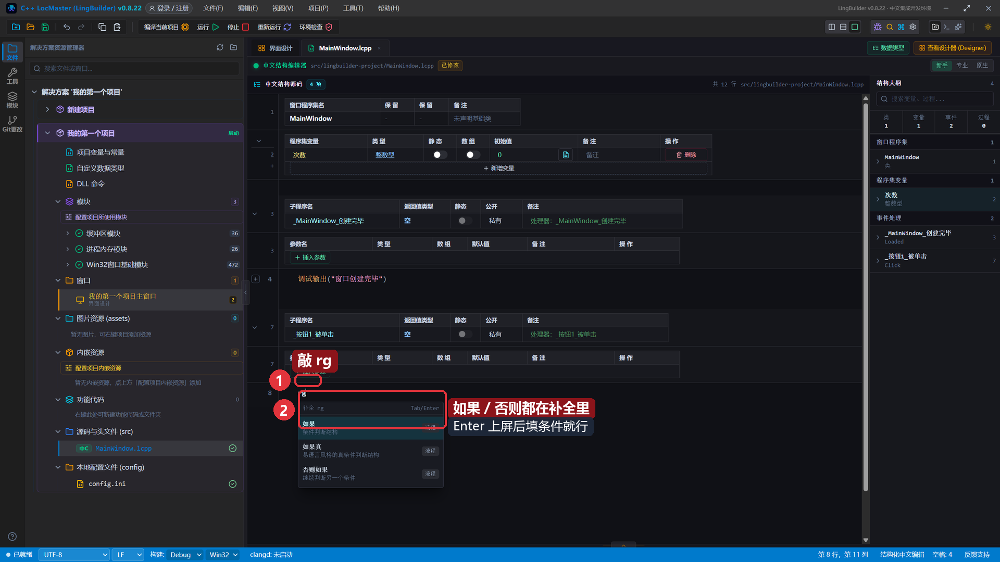
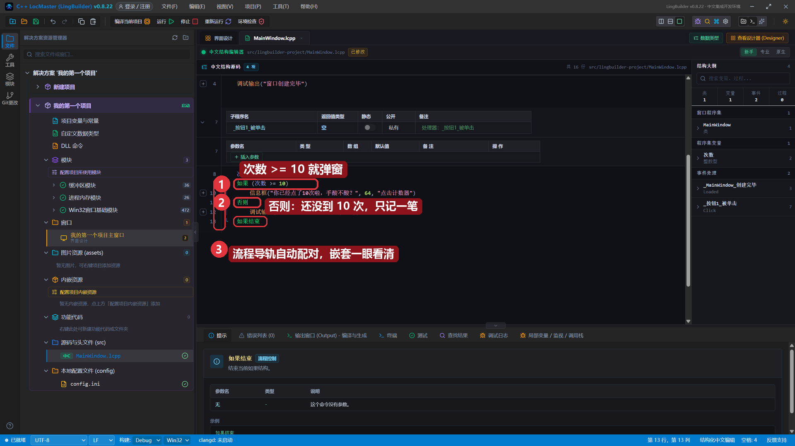
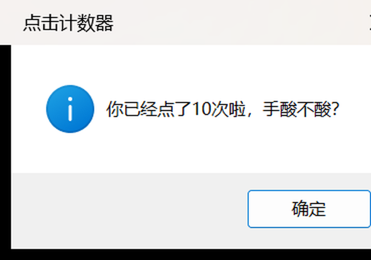
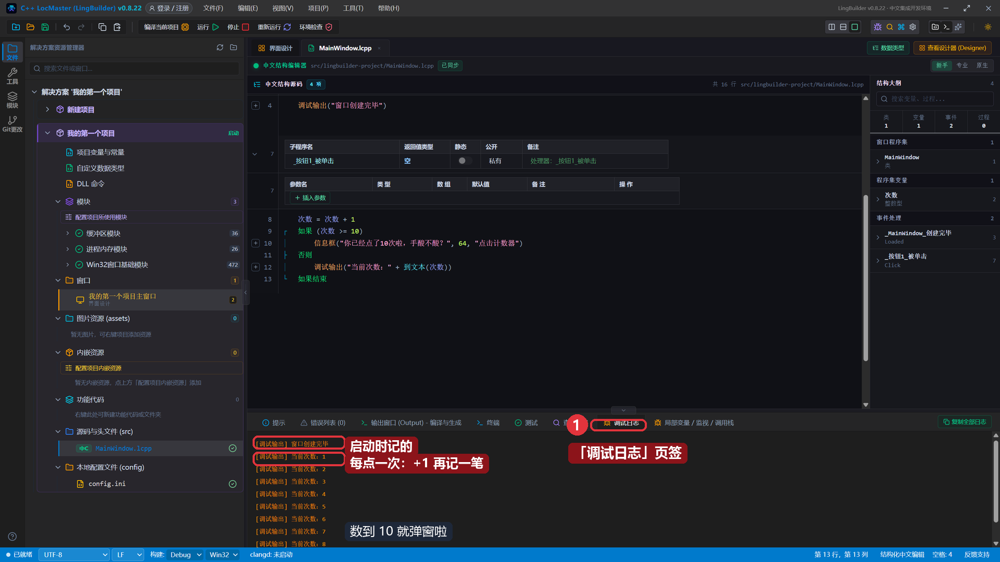
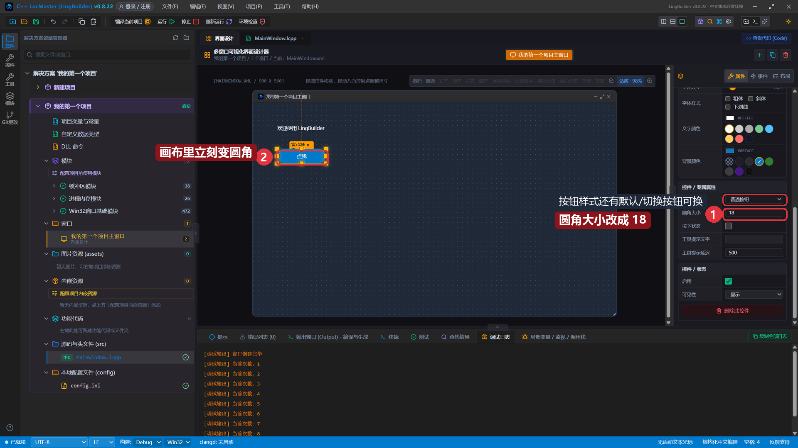
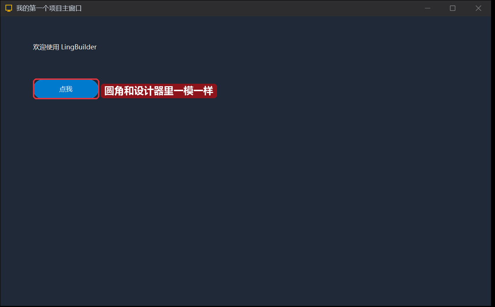

# 04 · 如果流程与按钮进阶

> 《LingBuilder 零基础入门实战》第 4 集。上一集「点我」按钮会弹窗了，但每次弹的都是同一句。这一集教程序学会**做判断**：做一个「点击计数器」，点满 10 次才弹出彩蛋，顺便把按钮打扮成圆角。全集目录见 [课程大纲](../课程大纲.md)。
>
> 本集目标：程序集变量 → `如果 / 否则` → 连点 10 次看彩蛋 → 圆角按钮。全程约 15 分钟。

## 1. 先给程序一个「记事本」：程序集变量

想数清楚用户点了几次，程序得有个地方**记住数字**。打开 `MainWindow.lcpp`，在 **程序集变量** 表里点 **「+ 新增变量」**：



1. 名称填 `次数`；
2. 类型选 **整数型**（默认是文本型，点一下改成整数型）；
3. 初始值填 `0`。

程序集变量就是整个窗口类都能用的「记事本」——不管在哪个事件里改它、读它，记的都是同一个数。

## 2. 写判断：如果 / 否则

把 `_按钮1_被单击` 方法体里的内容删掉，敲 **`rg`**，补全面板里选「如果」：



`如果 / 如果真 / 否则如果` 都在补全里，`Enter` 上屏后把条件填好，最终代码是这样：

```lingbuilder
次数 = 次数 + 1
如果 (次数 >= 10)
    信息框("你已经点了10次啦，手酸不酸？", 64, "点击计数器")
否则
    调试输出("当前次数：" + 到文本(次数))
如果结束
```



逐句看：

- `次数 = 次数 + 1`：每点一次，计数加一（这就是「=」当赋值用）。
- `如果 (次数 >= 10)`：条件成立（次数达到 10）就走下面那段——弹彩蛋。
- `否则`：不成立就走这段——往调试日志记一笔。
- `如果结束`：和「如果」配对收尾，一行都不能少。

注意行号左边的**流程导轨**：`┌` 开始、`│` 中间、`├` 分支、`└` 结束，自动配对，嵌套层次一眼看清。

> 小知识：`调试输出("当前次数：" + 到文本(次数))` 里的 `到文本(次数)` 是把数字变成文字——文字和数字不能直接相加，先用 `到文本` 转一下就行。

## 3. 运行！连点 10 次

保存，点「运行」。前 9 次点击什么都不弹，但调试日志在悄悄计数：

```text
[调试输出] 窗口创建完毕
[调试输出] 当前次数：1
[调试输出] 当前次数：2
……
```

第 10 次点击——彩蛋来了：



关掉弹窗再看调试日志，每一次点击都记得清清楚楚：



> 想再玩一轮？关掉程序重新「运行」，计数又从 0 开始——因为程序集变量的生命周期就是「程序这一次运行」。

## 4. 把按钮打扮一下：圆角

回到「界面设计」，点选「点我」按钮，在右侧属性面板找到 **圆角大小**，从 6 改成 **18**：



画布上的按钮立刻变成圆角。旁边还有 **按钮样式**（普通按钮 / 默认按钮 / 切换按钮）和**背景颜色**可以随便玩。

再点「运行」，编译出来的程序里，按钮就是圆角的：



设计器里看到什么样，编译出来的程序就是什么样——这就是可视化设计的意义。

## 本集小结

- 程序集变量＝程序运行期间的记事本，新增变量选好类型和初始值。
- `如果 (条件) … 否则 … 如果结束`：条件成立走上面，不成立走下面。
- 数字要拼进文字里，用 `到文本()` 转一下。
- 按钮的圆角、样式、颜色都在属性面板，所见即所得。

**下一集预告**：[05 · 编辑框与文本型变量](../课程大纲.md)——让用户自己往程序里输入名字，程序跟他打招呼。
