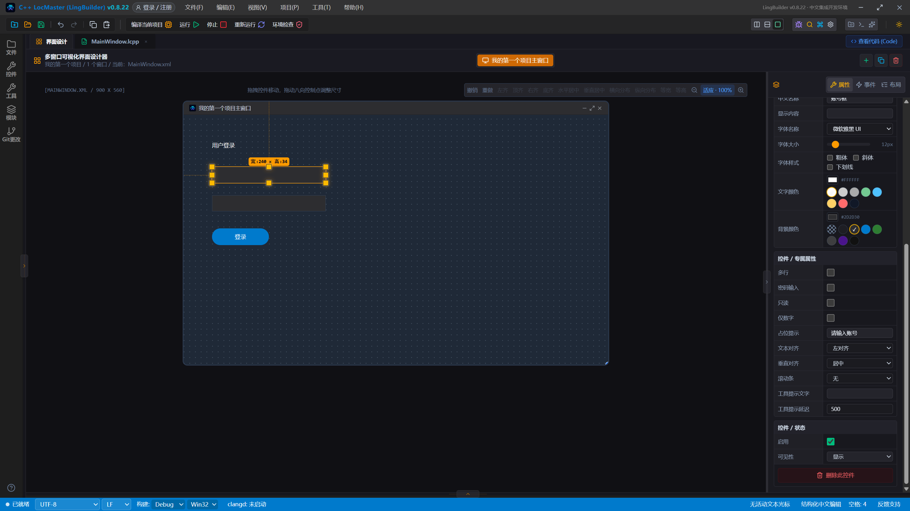
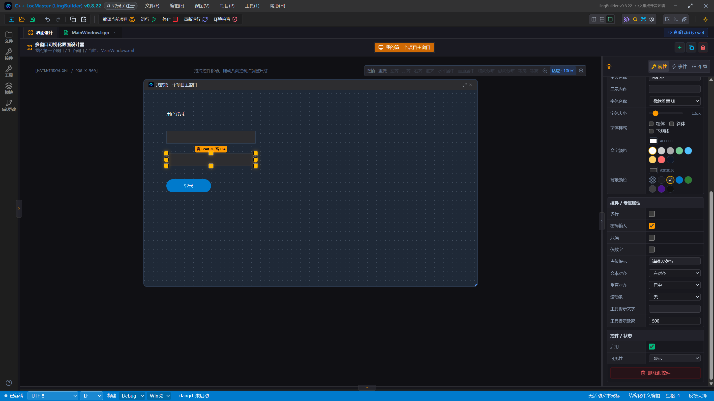
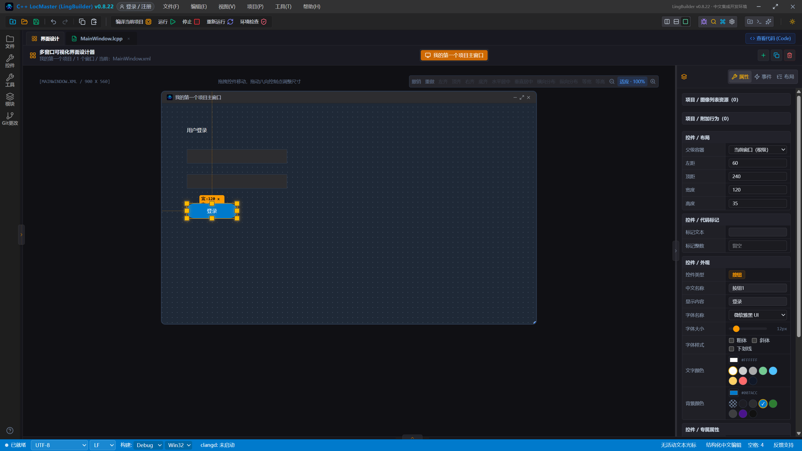
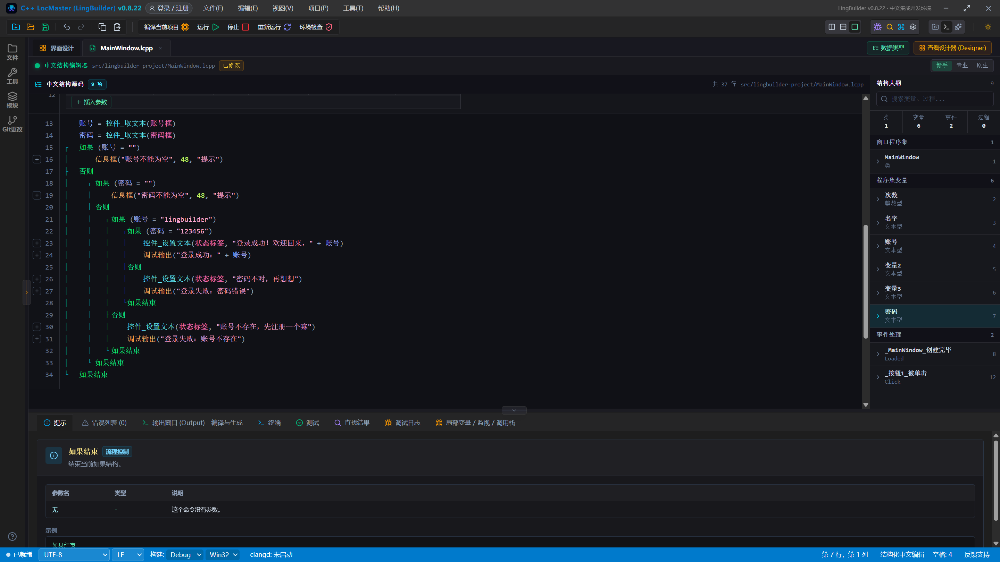
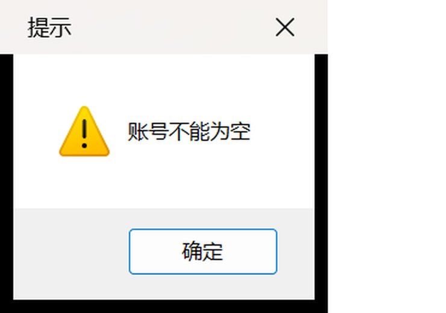
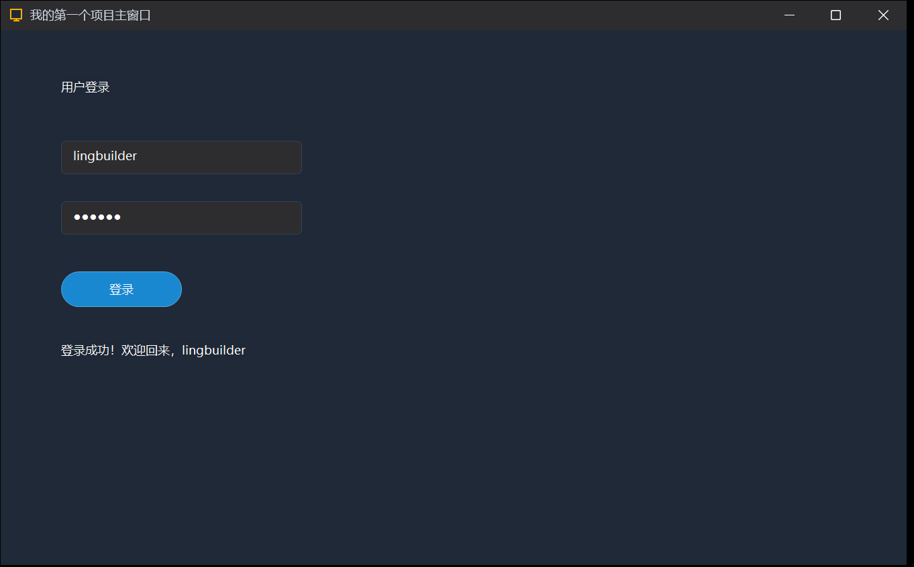
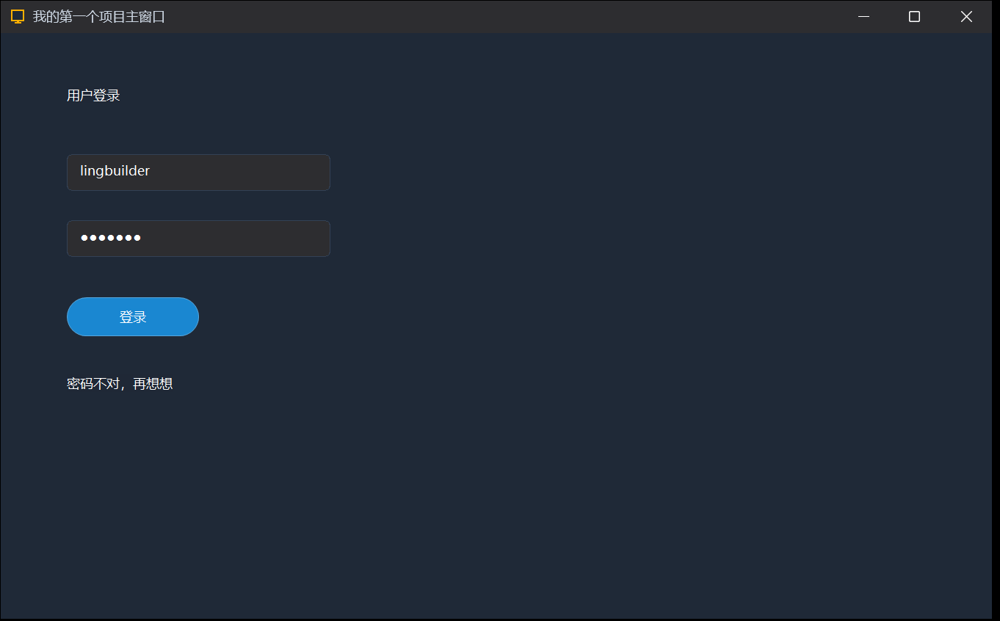
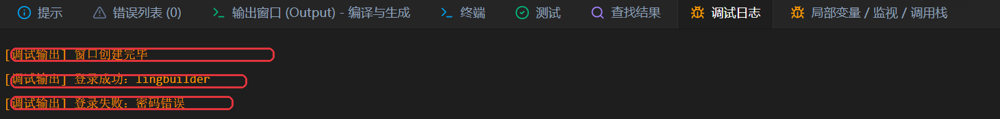

# 06 · 实战：登录界面

> 《LingBuilder 零基础入门实战》第 6 集，阶段一收官之作。这一集把前五集学的东西全部用上：编辑框读输入、密码框、多层如果做判断、文本拼接写标签——做一个像模像样的**登录界面**。全集目录见 [系列总览](/guide/tutorials/beginner)。
>
> 本集目标：搭出登录界面 → 写四层判断的登录逻辑 → 真机验证四种情况。全程约 20 分钟。

## 1. 改造界面：标题与账号框

我们把上一集的演示界面改造成登录界面。先点选标题标签，把「显示内容」改成 **用户登录**；再点选那个输入框，把**中文名称**改成 **账号框**，占位提示填 **请输入账号**：



> ⚠️ **摆位提醒**（上一集的教训）：新加控件会落在画布中间，记得用「左距 / 顶距」错开每一层——本集布局：标题 顶距 48、账号框 顶距 110、密码框 顶距 170、登录按钮 顶距 240、状态标签 顶距 310。

## 2. 加密码框

工具箱再点一个「编辑框」，这次改三个地方：



1. **中文名称**：改成 `密码框`；
2. **占位提示**：填 `请输入密码`；
3. 勾选 **密码输入**——输入密码时只显示圆点，不显示原文。

## 3. 界面完成

把按钮文字改成 **登录**，再加一个空标签（中文名称 `状态标签`，显示内容留空）放在按钮下面——它专门用来显示登录结果。最终布局：



标题、账号框、密码框、登录按钮、状态标签，五层各占一行，整整齐齐。

## 4. 登录逻辑：四层如果

先在程序集变量表加两个文本型变量：`账号`、`密码`。然后把 `_按钮1_被单击` 的方法体改成：

```lingbuilder
账号 = 控件_取文本(账号框)
密码 = 控件_取文本(密码框)
如果 (账号 = "")
    信息框("账号不能为空", 48, "提示")
否则
    如果 (密码 = "")
        信息框("密码不能为空", 48, "提示")
    否则
        如果 (账号 = "lingbuilder")
            如果 (密码 = "123456")
                控件_设置文本(状态标签, "登录成功！欢迎回来，" + 账号)
                调试输出("登录成功：" + 账号)
            否则
                控件_设置文本(状态标签, "密码不对，再想想")
                调试输出("登录失败：密码错误")
            如果结束
        否则
            控件_设置文本(状态标签, "账号不存在，先注册一个嘛")
            调试输出("登录失败：账号不存在")
        如果结束
    如果结束
如果结束
```



这就是**四层如果**：先把两个输入读进变量，然后像过关一样逐层检查——账号空不空 → 密码空不空 → 账号对不对 → 密码对不对。每一层都有「不合格就提醒」的出口，全过关才登录成功。左侧流程导轨把四层嵌套画得清清楚楚。

> 小知识：正确的账号是 `lingbuilder`、密码是 `123456`——写在代码里的，本集先硬编码，以后学了数据簿就能换成真账号。

## 5. 运行！四种情况全试一遍

保存，点「运行」。

**① 什么都不填，直接点「登录」**——第一层拦住：



**② 只填账号，不填密码**——第二层拦住：


**③ 账号 `lingbuilder` + 密码 `123456`，点「登录」**——四层全过：



状态标签显示「登录成功！欢迎回来，lingbuilder」，密码框里是 6 个圆点（密码输入属性生效了）。

**④ 再在密码后面补一个 0（变成 `1234560`），点「登录」**——密码错了：



## 6. 调试日志：程序的记账本

打开「调试日志」页签，刚才的每次尝试都记着：



程序启动记一条，登录成功记一条，密码错误也记一条。以后程序「不听话」，就靠 `调试输出` 留下的记录找原因。

## 本集小结

- 会搭登录界面：标题、账号框、密码框（密码输入属性）、登录按钮、状态标签。
- 会用**多层如果**逐层过滤：每一层负责拦一种不合格的情况。
- 控件的「中文名称」就是代码里的名字——账号框、密码框、状态标签，见名知意。
- 四种情况全部真机验证通过：空账号、空密码、正确登录、密码错误。

**阶段一到此毕业！** 你已经从安装软件一路走到独立写出带判断的登录程序。下一集开始进入新阶段：[07 · 多窗口：登录之后](/guide/tutorials/beginner-07-multi-window)，敬请期待。
