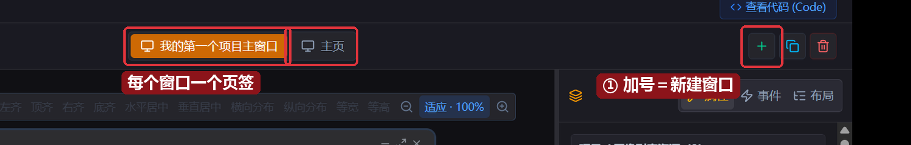
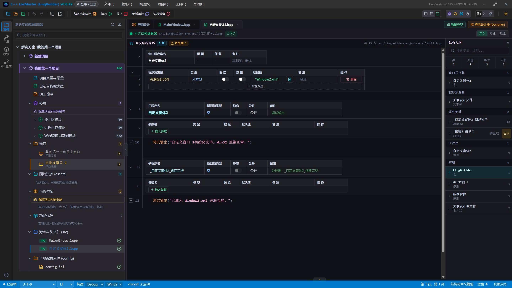
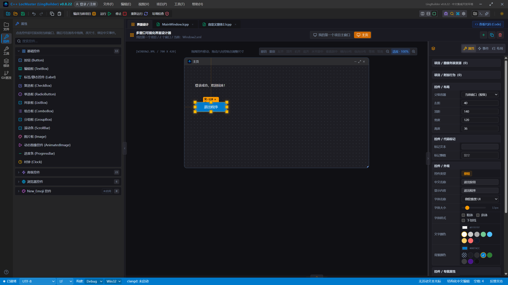
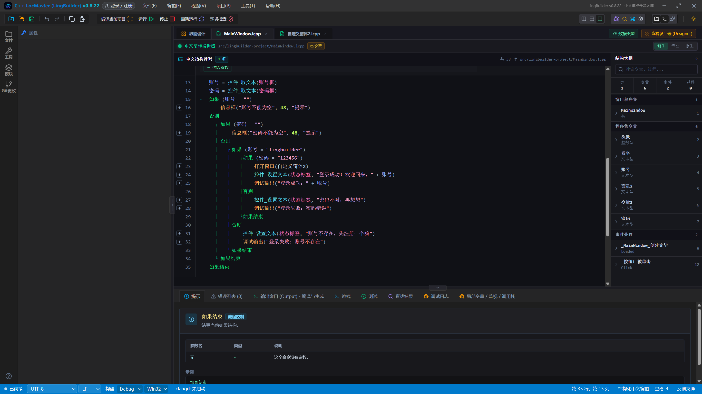
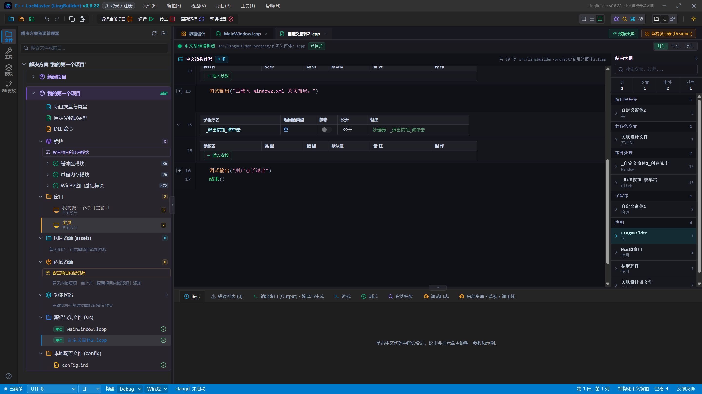
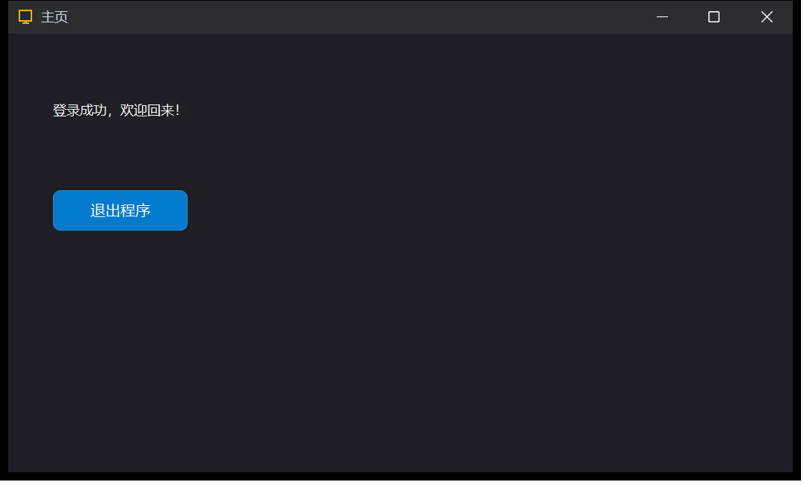
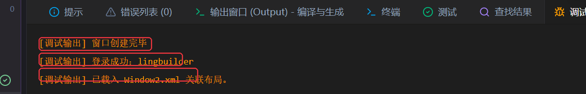

# 07 · 多窗口：登录之后去哪里

> 《LingBuilder 零基础入门实战》第 7 集。登录成功之后，程序不应该还停在登录页——这一集学会**新建第二个窗口**，让登录成功后自动弹出「主页」，再给主页加一个退出按钮。全集目录见 [系列总览](/guide/tutorials/beginner)。
>
> 本集目标：一个项目里放两个窗口 → 登录成功自动跳转 → 主页按钮退出程序。全程约 15 分钟。

## 1. 一个项目可以有好几个窗口

打开上一集的登录项目，切到「界面设计」。看设计器右上角：有一排小按钮，第一个 **加号（新建窗口）** 就是本集的主角：



点它——画布会切换到一个全新的空白窗口（默认叫「自定义窗口 2」），左侧解决方案树的「窗口」组和「源码与头文件 (src)」里也各多了一个成员：



- **窗口**组里多了「自定义窗体 2」——它和主窗口一样，有自己的设计画布和中文源码（`自定义窗体2.lcpp`）。
- 一个项目放几个窗口都可以：登录窗、主窗、设置窗、关于窗……每个窗口都是一个独立的「类」。

> 小知识：LingBuilder 里**启动时显示的窗口**是「启动」徽标标的那个（我们的登录窗口）。其他窗口一开始并不存在，要靠代码「打开」它们——这正是登录跳转的原理。

## 2. 把新窗口布置成「主页」

先在右侧属性面板把 **窗口标题** 改成 `主页`，然后给主页加两个控件：

1. 一个 **标签**：显示内容改成 `登录成功，欢迎回来！`（左距 40、顶距 60）；
2. 一个 **按钮**：显示内容改成 `退出程序`（左距 40、顶距 140）。



> ⚠️ 还记得上一集的提醒吗？新控件默认落在画布中间，会压住已有的控件——拖开或改「左距 / 顶距」，别让控件叠在一起。

## 3. 登录成功 → 打开主页

回到登录窗口的代码（`_按钮1_被单击`），在**最里层**（密码也对了的那个分支）加上一句 `打开窗口`：

```lingbuilder
如果 (密码 = "123456")
    打开窗口(自定义窗体2)
    控件_设置文本(状态标签, "登录成功！欢迎回来，" + 账号)
    调试输出("登录成功：" + 账号)
否则
    …
```



`打开窗口(自定义窗体2)` 就是「把那个窗口创建出来显示在屏幕上」——括号里写窗口的**类名**（新窗口默认类名是「自定义窗体2」，在源码第一行的「窗口程序集名」里可以看到）。

## 4. 主页的退出按钮

点选主页上的「退出程序」按钮，切到「事件」页绑定**被单击**事件，在生成的处理器里写：

```lingbuilder
调试输出("用户点了退出")
结束()
```



`结束()` 是整个程序唯一正规的下场命令——它会让所有窗口一起关闭、进程退出。

## 5. 运行！从登录到主页

保存，点「运行」。输入 `lingbuilder` / `123456`，点「登录」——



**主页窗口弹出来了**！标题「主页」，欢迎语和退出按钮都在。调试日志里也记下了完整过程：



- 「窗口创建完毕」：程序启动，登录窗口创建；
- 「登录成功：lingbuilder」：登录通过；
- 「已载入 Window2.xml 关联布局。」：主页窗口创建完毕（新窗口自己的创建事件输出的）。

点主页上的 **退出程序**——整个程序（连登录窗口一起）干净退出，任务管理器里进程消失。

## 本集小结

- 一个项目可以有多个窗口，设计器右上角「+」新建。
- `打开窗口(窗口类名)` 在运行时创建并显示一个窗口——登录跳转的本质就这一句。
- `结束()` 退出整个程序。
- 每个窗口有自己独立的源码和事件，控件名在各自窗口内不冲突。

**下一集预告**：[08 · 时钟与动态更新](/guide/tutorials/beginner-08-clock)（已上线）——给主页加上真正的菜单和右键菜单。
