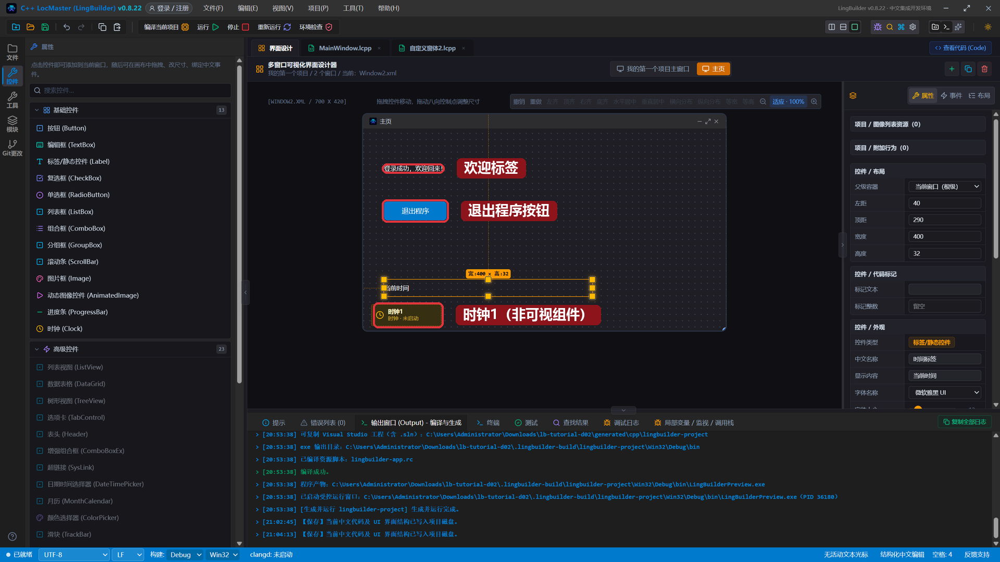
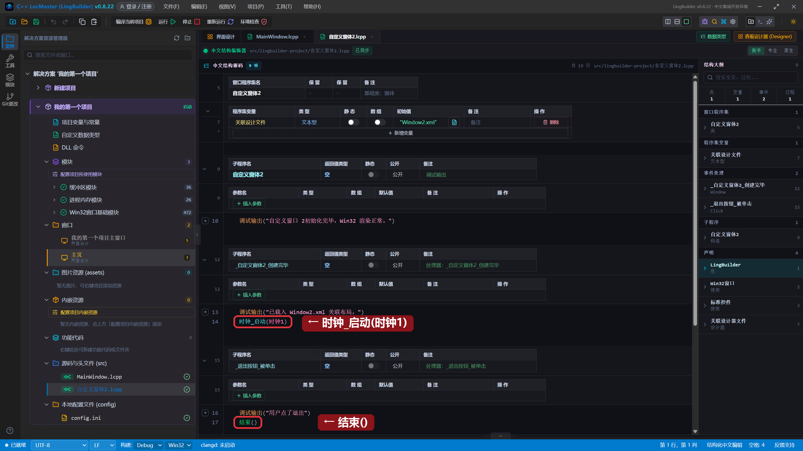
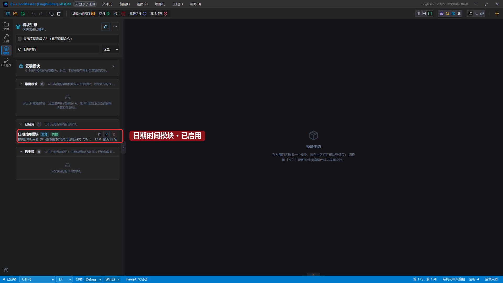
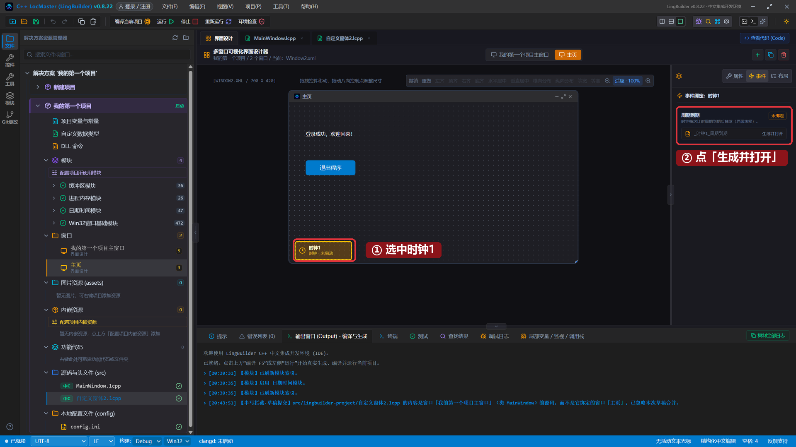
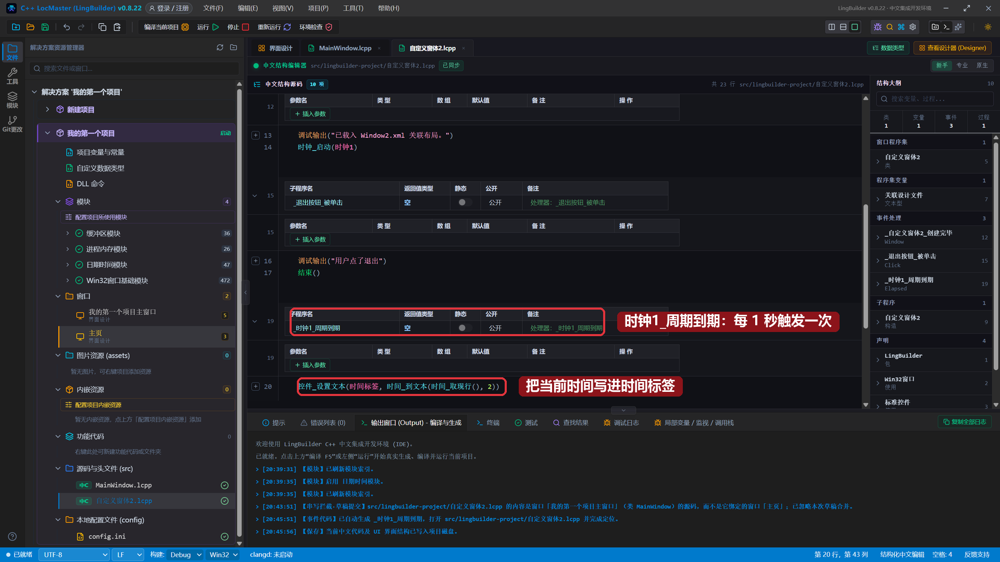
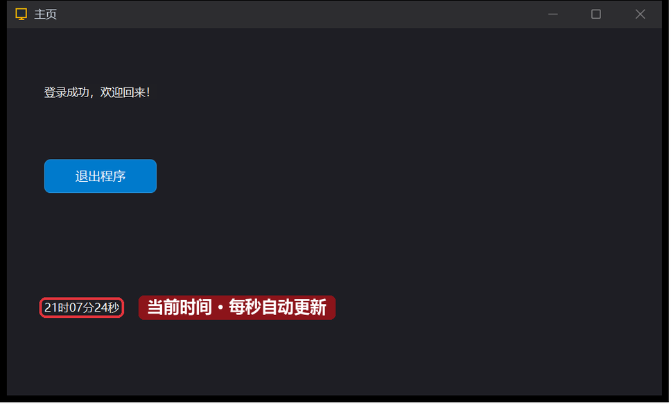

# 08 · 时钟与动态更新

> 《LingBuilder 零基础入门实战》第 8 集。上一集的登录完成后会打开主页。这一集给主页加一个**时钟组件**，让程序学会「按时间做事」——这是第一次接触**非可视组件**，也是第一次让界面上的文字**自己动起来**。全集目录见 [系列总览](/guide/tutorials/beginner)。
>
> 本集目标：认识时钟组件 → 在创建完毕时启动时钟 → 绑定「周期到期」事件，让主页上的时间每秒自动刷新。全程约 10 分钟。

## 1. 什么是非可视组件

之前我们加的按钮、编辑框、标签都是**看得见**的控件——拖到画布上就能看到。但有些功能不需要界面，只要在「后台」按时执行代码。这类功能就叫**非可视组件**。

时钟（Clock）是最常用的非可视组件：它能每隔一段时间自动触发一个事件，就像闹钟一样「到点就叫」。

## 2. 加一个时钟

回到主页的设计画布，在工具箱的**基础控件**组最下面找到 **时钟 (Clock)**，点一下就加进来了：



时钟加进画布后，不会出现在运行起来的窗口里——设计器只给它一个黄色占位标记，提醒你「它在这儿」。同时再加一个**标签**用来显示时间（中文名称 `时间标签`、显示内容 `当前时间`、左距 40、顶距 290、宽度 400）。摆的时候注意离底边留点距离，也别压住时钟的黄色占位。

## 3. 启动时钟

时钟加进来后不会自动开始计时——需要在代码里启动它。打开主页的中文源码（`自定义窗体2.lcpp`），在 **`_自定义窗体2_创建完毕`** 事件的 `调试输出` 后面加一行：

```lingbuilder
时钟_启动(时钟1)
```



`时钟1` 是时钟组件的中文名称。`时钟_启动` 告诉时钟开始按默认周期（约 1 秒）触发。

> 小知识：时钟的周期可以在属性面板调整，也可以用 `时钟_置周期(时钟1, 毫秒数)` 在代码里修改。置周期为 0 就是停止。

## 4. 启用「日期时间」模块

光让时钟空转还不行——我们要把**当前时间**显示到标签上，这需要「取时间」的命令。LingBuilder 的功能是按**模块**提供的，时间相关的命令都在**日期时间模块**里。

打开左侧的**模块**面板，在搜索框输入「日期时间」，找到日期时间模块，点一下行右侧的开关启用它：



启用后马上就能用，不用重启——`时间_取现行()` 取当前时间，`时间_到文本(时间, 2)` 把它转成「21时07分24秒」这样的中文文本。

## 5. 绑定「周期到期」事件

回到界面设计，**单击画布上的时钟1 黄色占位**选中它，右侧切到「**事件**」页，找到「**周期到期**」卡片，点「**生成并打开**」：



IDE 会自动在源码里生成 `事件 _时钟1_周期到期()` 处理器并跳转过去。时钟每走 1 秒，这个事件就触发一次。在里面写一行——把当前时间写进时间标签：

```lingbuilder
控件_设置文本(时间标签, 时间_到文本(时间_取现行(), 2))
```

写完后的完整代码长这样：



- `时间_取现行()`：取当前的系统时间。
- `时间_到文本(时间, 2)`：转成文本，`2` 表示只要时间部分（时分秒）。
- `控件_设置文本(时间标签, ...)`：把文本写到主页的时间标签上。

## 6. 运行！看时间跳起来

保存，点「运行」，登录后主页弹出来。底部的时间标签不再是死的「当前时间」——它显示的是**真实的系统时间，每一秒自动刷新**：



盯着它看一秒：秒数变了。这就是时钟组件在后台每秒触发一次「周期到期」事件，每次都执行我们写的那行代码。

## 本集小结

- 非可视组件没有外观，但能在后台执行功能。
- 时钟组件＝定时器：`时钟_启动` 启动、`时钟_置周期` 调周期、「周期到期」事件每个周期触发一次。
- 功能按模块提供：用时间命令前，先在模块面板启用「日期时间模块」。
- 界面不是只能等用户点——绑定周期事件后，程序可以主动更新界面。
- 创建完毕事件＝窗口启动时的「初始化入口」，适合放启动时钟这类操作。

**下一集预告**：[09 · 文本处理与变量进阶](/guide/tutorials/beginner)——学会用文本命令处理文字：取长度、取左边、替换，做一个文本处理小工具。
