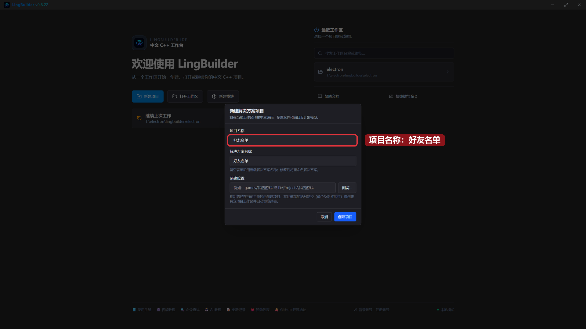
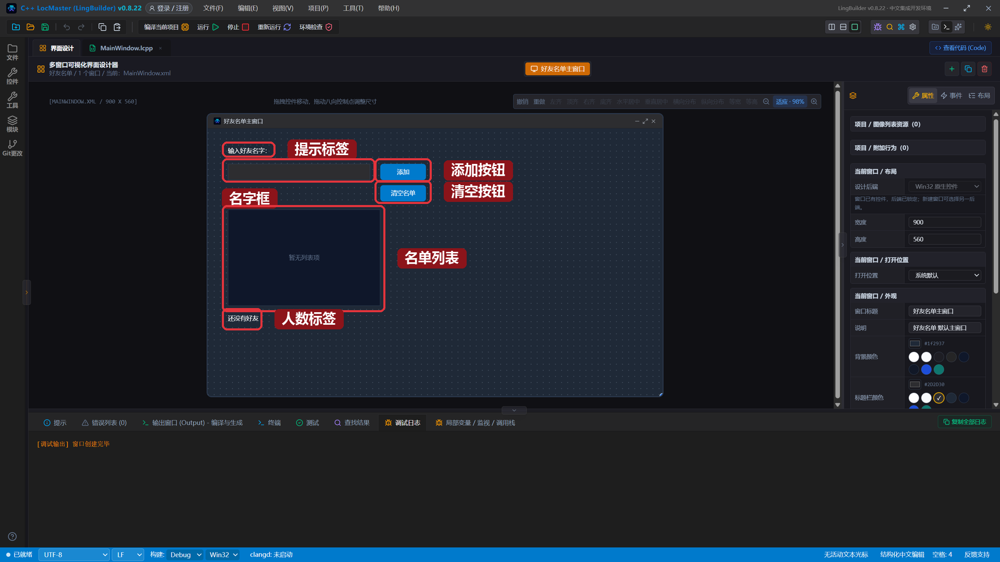
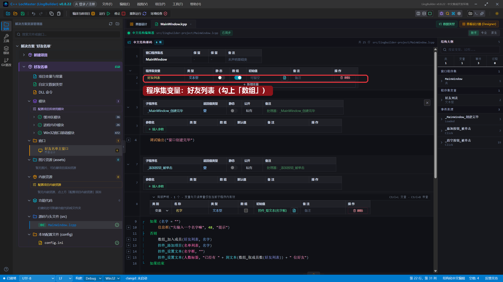
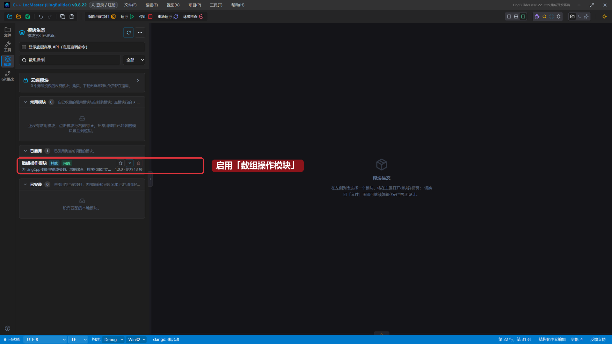
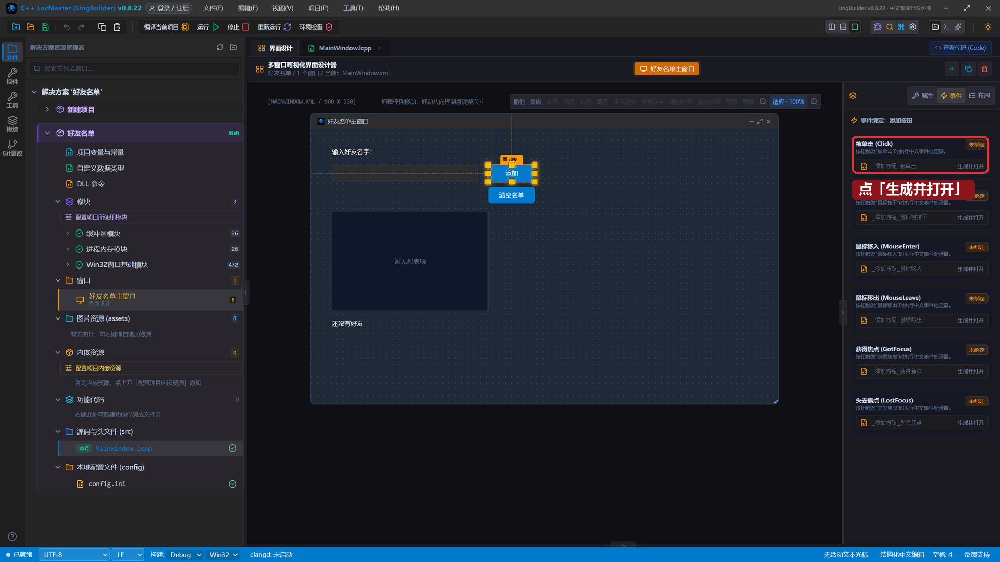
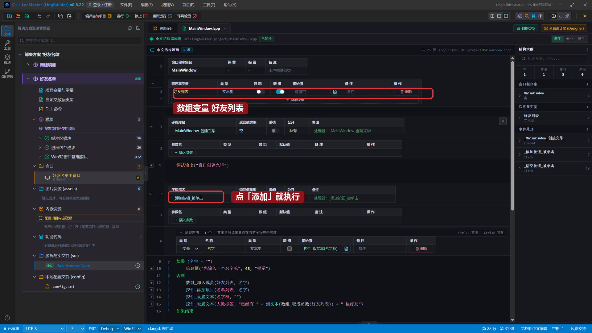
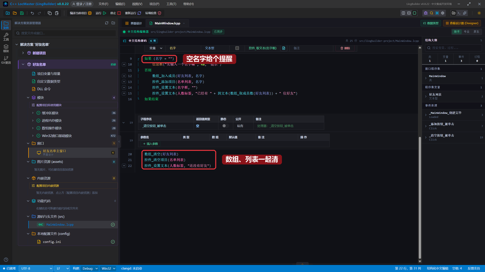
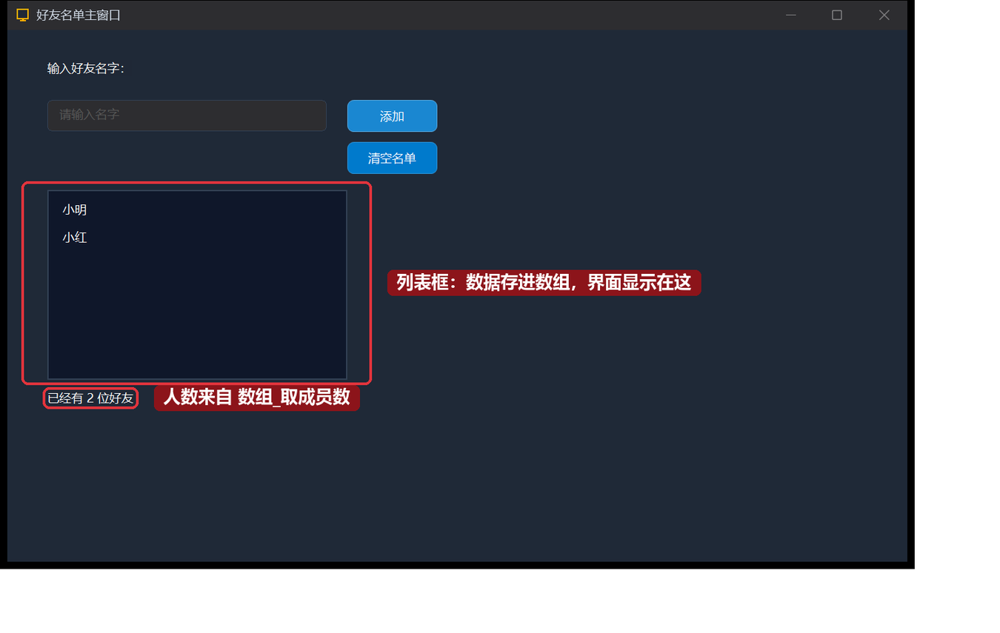
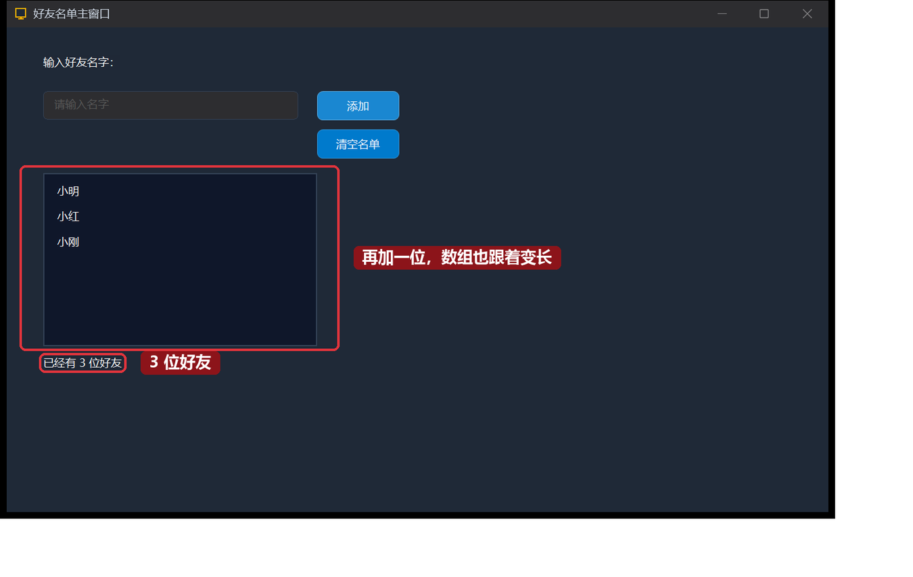

# 10 · 文本数组与列表框

> 《LingBuilder 零基础入门实战》第 10 集。上一集我们学会了处理文字。这一集认识一个能「装一串东西」的变量——**数组**，并用它做一个好友名单小程序：输入名字、点「添加」，名单越来越长。全集目录见 [系列总览](/guide/tutorials/beginner)。
>
> 本集目标：声明数组变量 → 学会 `数组_加入成员`、`数组_取成员数`、`数组_清空` → 让列表框和数组同步。全程约 10 分钟。

## 1. 新建项目

老规矩：欢迎页 →「**新建项目**」→「Windows 界面设计」→ 项目名称 **好友名单** →「创建项目」：



## 2. 搭界面

在界面设计里依次加入 6 个控件，按表设置属性：

| 控件 | 中文名称 | 显示内容 | 左距 | 顶距 | 宽度 | 高度 |
| --- | --- | --- | --- | --- | --- | --- |
| 标签/静态控件 | `提示标签` | `输入好友名字：` | 40 | 30 | 200 | 28 |
| 编辑框 | `名字框` | （留空，占位提示填 `请输入名字`） | 40 | 70 | 280 | 32 |
| 按钮 | `添加按钮` | `添加` | 340 | 70 | 90 | 32 |
| 按钮 | `清空按钮` | `清空名单` | 340 | 112 | 90 | 32 |
| 列表框 | `名单列表` | — | 40 | 160 | 300 | 190 |
| 标签/静态控件 | `人数标签` | `还没有好友` | 40 | 360 | 300 | 28 |

> 「占位提示」是编辑框的属性：没输入内容时显示的灰色提示字，程序跑起来用户一眼就知道该填什么。

摆好后的界面：



## 3. 声明一个数组变量

普通变量只能装一个值，数组变量能装**一串**值。打开 `MainWindow.lcpp` 的源码页，在「**程序集变量**」表点「**＋ 新增变量**」，名称填 `好友列表`，类型已经是 `文本型`——关键一步：把这一行的「**数组**」开关打开（变蓝）：



这一行就声明了「好友列表」——一个能不断变长的文本数组。

## 4. 启用「数组操作模块」

数组怎么加人、数人数？命令都在**数组操作模块**里。老流程：活动栏「**模块**」→ 搜索「数组操作」→ 点开关启用：



## 5. 绑定「添加」按钮的单击事件

界面设计里选中「添加」按钮 → 右侧「**事件**」页 → 「被单击 (Click)」卡片 → 点「**生成并打开**」：



## 6. 写添加好友的代码

在自动生成的 `_添加按钮_被单击` 里写（先别急，下面还有第二个按钮）：

```lingbuilder
局部 文本型 名字 = 控件_取文本(名字框)
如果 (名字 = "")
    信息框("先输入一个名字嘛", 48, "提示")
否则
    数组_加入成员(好友列表, 名字)
    控件_添加项目(名单列表, 名字)
    控件_设置文本(名字框, "")
    控件_设置文本(人数标签, "已经有 " + 到文本(数组_取成员数(好友列表)) + " 位好友")
如果结束
```

逐行看懂它：

- `数组_加入成员(好友列表, 名字)`：把名字**放进数组**——数据这一层记住了。
- `控件_添加项目(名单列表, 名字)`：把名字**显示到列表框**——界面这一层看到了。
- `数组_取成员数(好友列表)`：数一数数组里现在有几个人。

再给「清空名单」按钮生成事件（选中按钮 → 事件页 → 生成并打开），写三行：

```lingbuilder
数组_清空(好友列表)
控件_清空项目(名单列表)
控件_设置文本(人数标签, "还没有好友")
```

完整代码分上下两屏看：





> 小知识：**数组管数据，列表框管显示**。以后学了循环，还能让数组里的名字一键全部刷进列表框。

## 7. 运行！名单越来越长

保存，点「运行」。输入「小明」，点「添加」——名单列表出现小明，输入框自动清空；再输入「小红」点「添加」：



底部的人数标签是 `数组_取成员数` 现场数出来的。再加一位「小刚」：



点一下「清空名单」试试：数组清空、列表框清空、人数归零——一步到位。

## 本集小结

- **数组**＝一个变量装一串值：程序集变量表里勾「数组」就声明好了。
- `数组_加入成员` 添加、`数组_取成员数` 数个数、`数组_清空` 一次清空。
- **数组管数据，列表框管显示**：两边要同步更新。
- 「占位提示」让空编辑框自己会说话。

**下一集预告**：[11 · 循环与数值数组](/guide/tutorials/beginner)——让电脑替你重复做 10 件事：计次循环登场，做一个会算总分平均分的成绩单程序。
