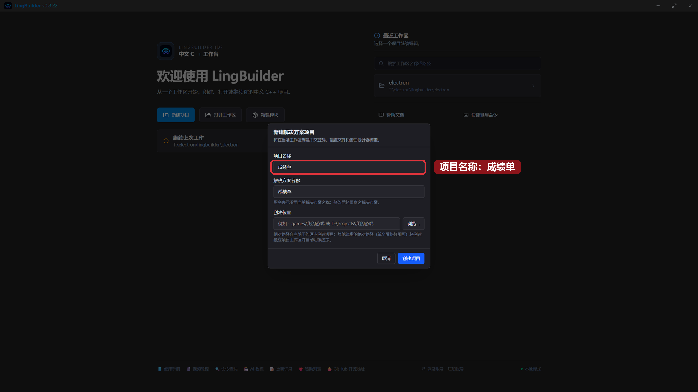
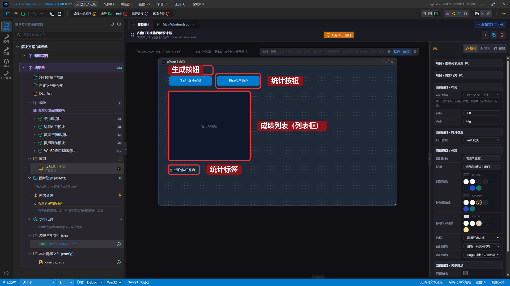
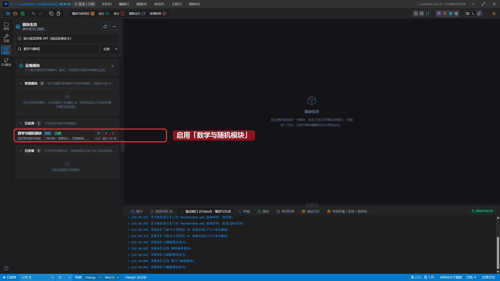
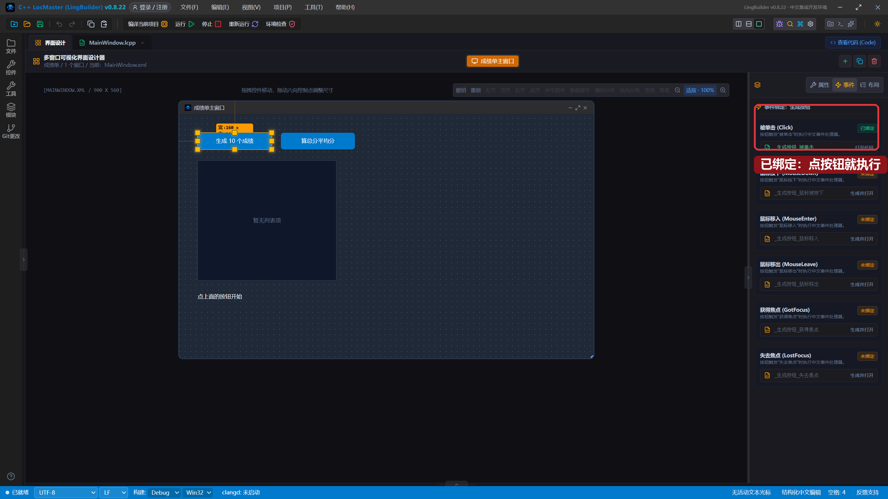
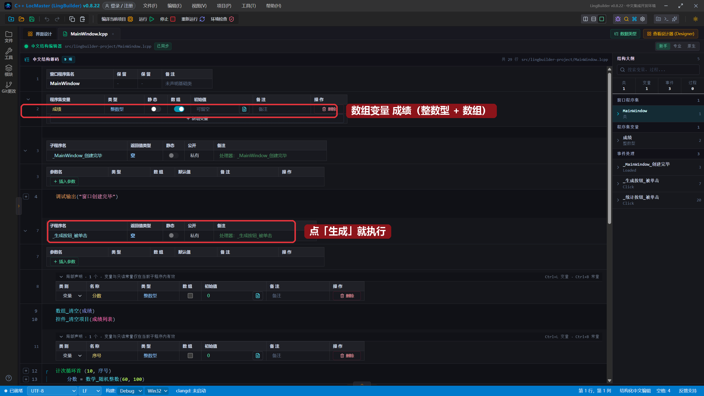
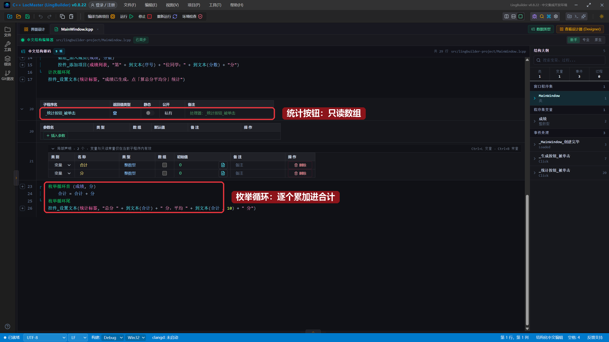
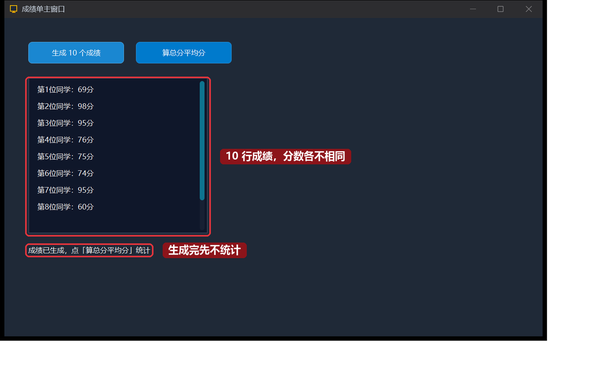
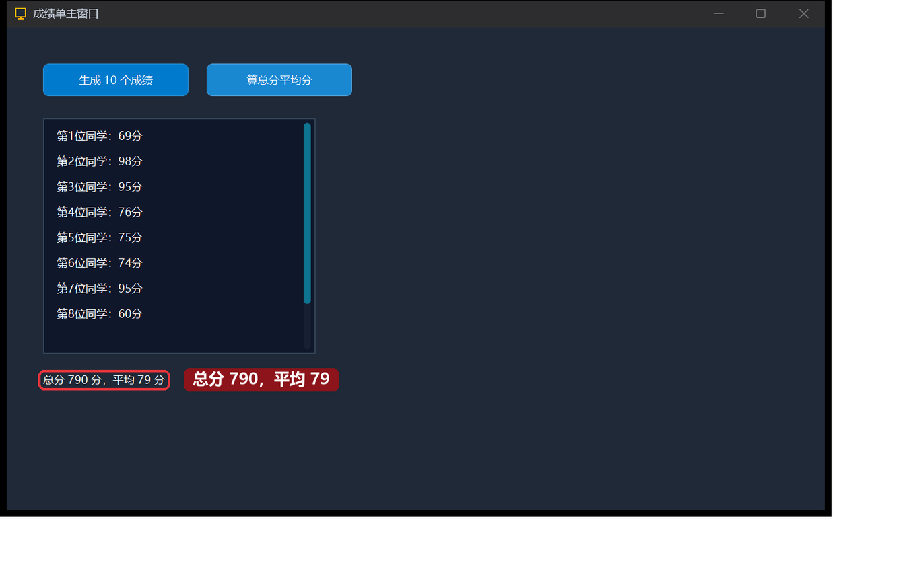

# 11 · 循环与数值数组

> 《LingBuilder 零基础入门实战》第 11 集。上一集的数组能装一串名字。这一集让电脑**替你重复做事**——循环登场，配合**整数数组**做一个成绩单程序：一键生成 10 个随机成绩，再一键算出总分和平均分。全集目录见 [系列总览](/guide/tutorials/beginner)。
>
> 本集目标：学会「声明置零、循环内赋值」的写法 → 掌握 `计次循环首` 和 `枚举循环首` 两种循环 → 会用 `数学_随机整数`。全程约 10 分钟。

## 1. 新建项目

欢迎页 →「**新建项目**」→「Windows 界面设计」→ 项目名称 **成绩单** →「创建项目」：



## 2. 搭界面

两个按钮、一个列表框、一个标签：

| 控件 | 中文名称 | 显示内容 | 左距 | 顶距 | 宽度 | 高度 |
| --- | --- | --- | --- | --- | --- | --- |
| 按钮 | `生成按钮` | `生成 10 个成绩` | 40 | 40 | 160 | 36 |
| 按钮 | `统计按钮` | `算总分平均分` | 220 | 40 | 160 | 36 |
| 列表框 | `成绩列表` | — | 40 | 100 | 300 | 260 |
| 标签/静态控件 | `统计标签` | `点上面的按钮开始` | 40 | 380 | 420 | 28 |



## 3. 声明整数数组 + 启用两个模块

和上一集一样，在程序集变量表新增变量 `成绩`，类型这回选 **整数型**，勾上「**数组**」。

然后启用两个模块（都是老流程：模块面板 → 搜索 → 点开关）：

- **数组操作模块**：`数组_清空`、`数组_加入成员` 要用；
- **数学与随机模块**：`数学_随机整数` 要用。



## 4. 绑定「生成」按钮的单击事件

选中「生成 10 个成绩」按钮 → 右侧「事件」页 → 「被单击 (Click)」卡片 → 「生成并打开」。绑定后卡片会显示「已绑定」：



## 5. 写「生成成绩」的代码：计次循环

在 `_生成按钮_被单击` 里写：

```lingbuilder
局部 整数型 分数 = 0
数组_清空(成绩)
控件_清空项目(成绩列表)
局部 整数型 序号 = 0
计次循环首 (10, 序号)
    分数 = 数学_随机整数(60, 100)
    数组_加入成员(成绩, 分数)
    控件_添加项目(成绩列表, "第" + 到文本(序号) + "位同学：" + 到文本(分数) + "分")
计次循环尾
控件_设置文本(统计标签, "成绩已生成，点「算总分平均分」统计")
```

要点拆解：

- `计次循环首 (10, 序号)` … `计次循环尾`：中间的代码**重复执行 10 次**，`序号` 从 1 数到 10。
- `数学_随机整数(60, 100)`：返回 60 到 100 之间的随机整数，当分数用。
- 每转一圈：随机出一个分数 → 存进数组 → 显示到列表框。

> 小知识：先写 `局部 整数型 分数 = 0` 声明，再在循环里写 `分数 = 数学_随机整数(...)` **赋值**——「声明」和「赋值」分两行写，随机数每次才会重新取值，这是新手最容易踩的小坑。

「算总分平均分」按钮也绑定单击事件，写：

```lingbuilder
局部 整数型 合计 = 0
局部 整数型 分 = 0
枚举循环首 (成绩, 分)
    合计 = 合计 + 分
枚举循环尾
控件_设置文本(统计标签, "总分 " + 到文本(合计) + " 分，平均 " + 到文本(合计 / 10) + " 分")
```

- `枚举循环首 (成绩, 分)`：把数组里的值**一个一个**取出来放进 `分`，直到取完——不用自己数个数。
- 注意它**没有**重新生成成绩，只是把现有数组读一遍。

完整代码分上下两屏：





## 6. 运行！一键生成，一键统计

保存，点「运行」。点「生成 10 个成绩」——列表框唰地出现 10 行，分数各不相同：



再点「算总分平均分」——总分和平均分立刻算出来：



多点几次「生成」再统计，每次的总分都不一样——这就是循环 + 随机数的威力。

## 本集小结

- `计次循环首 (次数, 序号)` … `计次循环尾`：固定次数的重复，序号从 1 开始。
- `枚举循环首 (数组, 当前值)` … `枚举循环尾`：把数组每个成员过一遍。
- `数学_随机整数(最小, 最大)`：随机整数，在数学与随机模块里。
- 局部变量「先声明置零、循环内赋值」，避免每次取到同一个值。
- 整数数组 + 两个循环 = 一分钟写完一个成绩单。

**下一集预告**：[12 · 文件读写与文件对话框](/guide/tutorials/beginner)——程序关掉东西就没了？学会把内容存进文件、再读回来，为记事本打地基。
