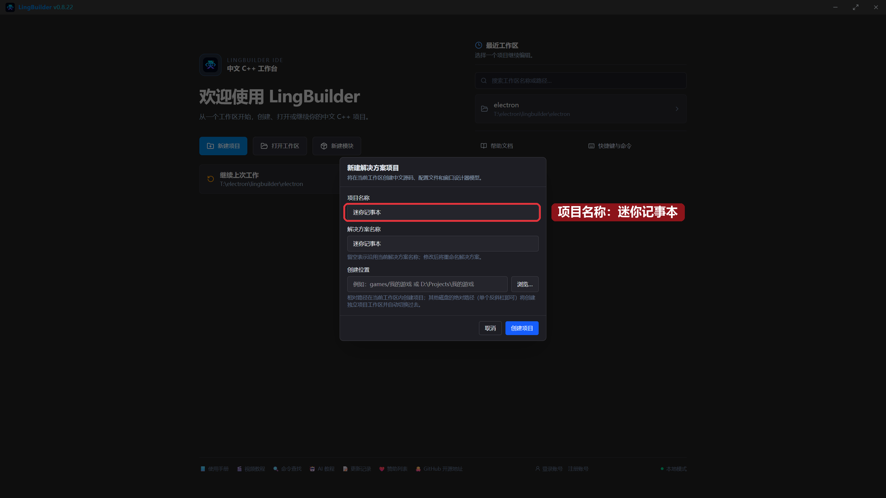
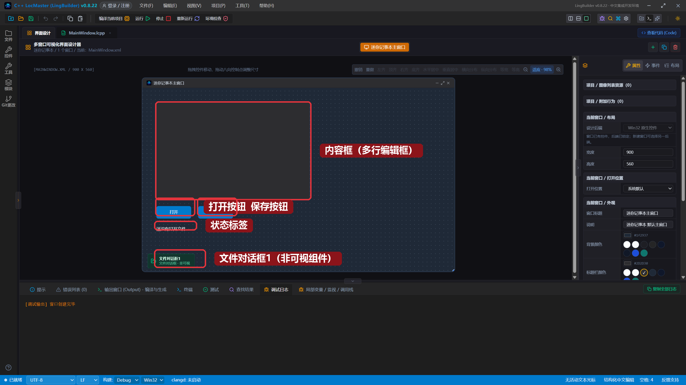
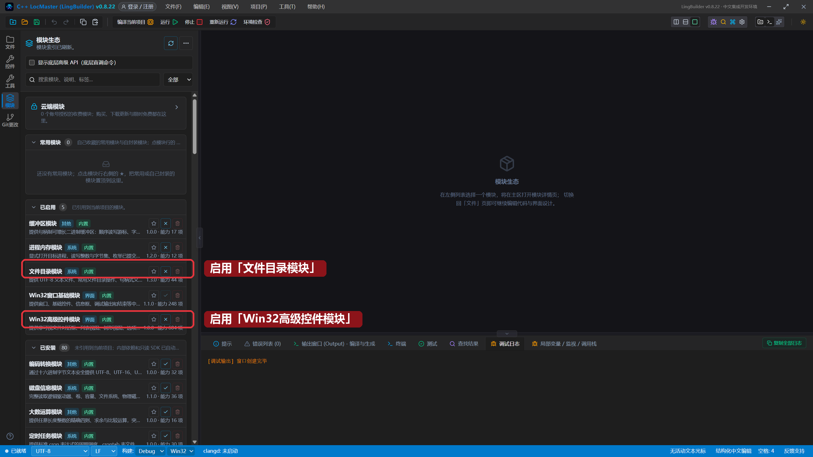
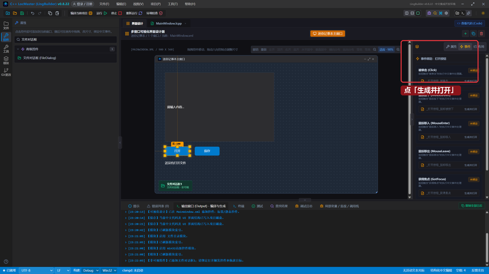
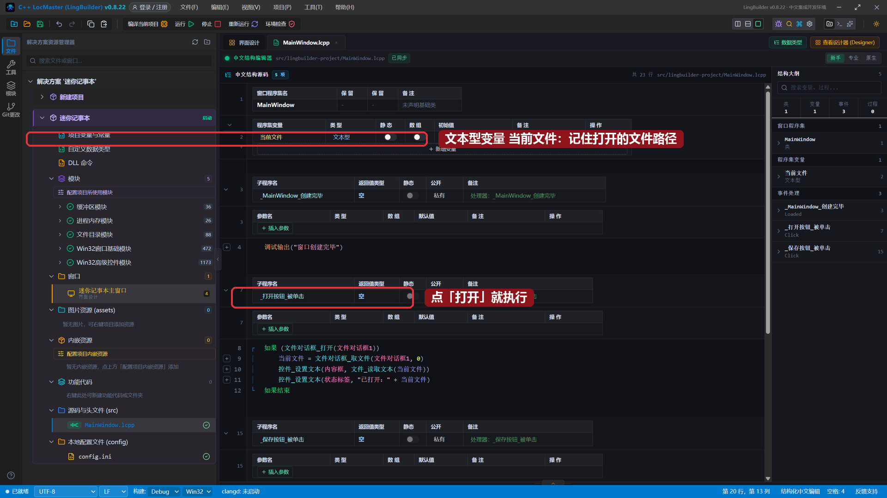
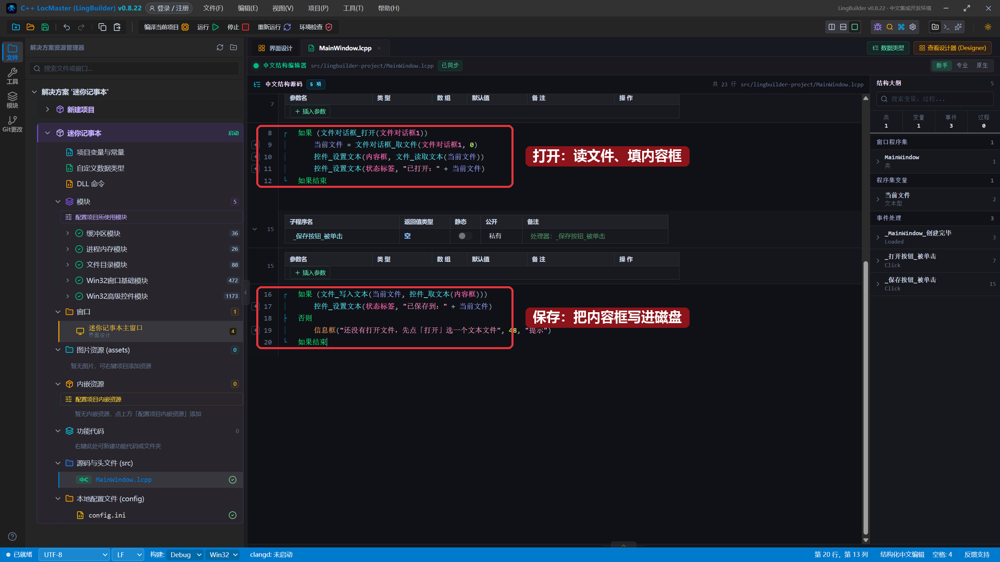
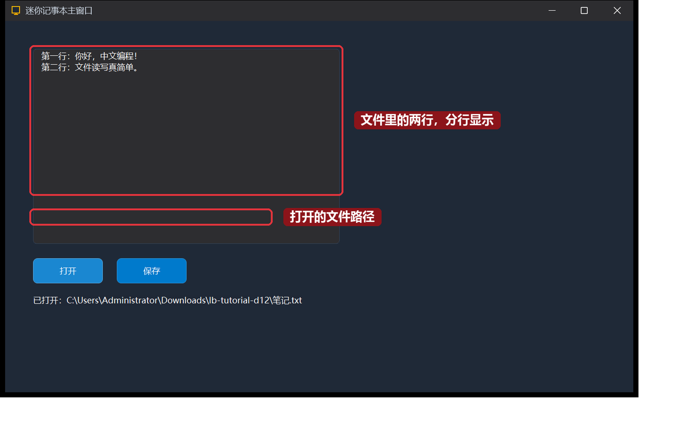
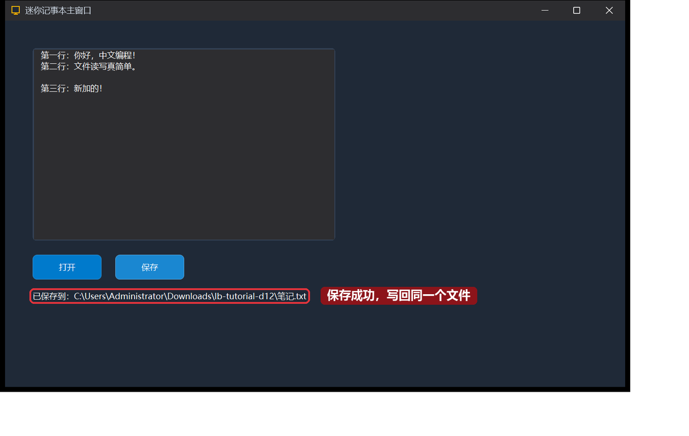

# 12 · 文件读写与文件对话框

> 《LingBuilder 零基础入门实战》第 12 集。程序一关，东西就没了？这一集学会把内容**存进文件**、再**读回来**——认识两个新朋友：文件对话框（非可视组件）和文件目录模块。做完就是一个能打开、能保存的迷你记事本，为后面的记事本实战打地基。全集目录见 [系列总览](/guide/tutorials/beginner)。
>
> 本集目标：启用文件相关模块 → 认识非可视组件「文件对话框」→ 学会 `文件_读取文本`、`文件_写入文本`。全程约 10 分钟。

## 1. 新建项目

欢迎页 →「**新建项目**」→「Windows 界面设计」→ 项目名称 **迷你记事本** →「创建项目」：



## 2. 搭界面：内容框 + 两个按钮 + 一个非可视组件

| 控件 | 中文名称 | 属性 | 左距 | 顶距 | 宽度 | 高度 |
| --- | --- | --- | --- | --- | --- | --- |
| 编辑框 | `内容框` | 勾选「**多行**」，占位提示 `写点什么…` | 40 | 40 | 440 | 280 |
| 按钮 | `打开按钮` | 显示内容 `打开` | 40 | 340 | 100 | 36 |
| 按钮 | `保存按钮` | 显示内容 `保存` | 160 | 340 | 100 | 36 |
| 标签/静态控件 | `状态标签` | 显示内容 `还没有打开文件` | 40 | 392 | 440 | 28 |

再到工具箱的「**高级控件**」组里找到「**文件对话框 (FileDialog)**」点一下——它是**非可视组件**，和第 8 集的时钟一样只占一个标记位：



> 小知识：文件对话框自带一个默认名称「文件对话框1」，代码里就按这个名字叫它。

## 3. 启用两个模块

这一集要用两组命令，老流程分别启用：

- **文件目录模块**：`文件_读取文本`、`文件_写入文本` 在这里；
- **Win32高级控件模块**：文件对话框非可视组件在这里。



## 4. 绑定「打开」按钮的单击事件

选中「打开」按钮 → 「事件」页 → 「被单击 (Click)」卡片 → 「生成并打开」：



## 5. 写打开和保存的代码

先在程序集变量表声明一个文本型变量 `当前文件`（不用勾数组），用来记住打开的文件路径。

`_打开按钮_被单击` 里写：

```lingbuilder
如果 (文件对话框_打开(文件对话框1))
    当前文件 = 文件对话框_取文件(文件对话框1, 0)
    控件_设置文本(内容框, 文件_读取文本(当前文件))
    控件_设置文本(状态标签, "已打开：" + 当前文件)
如果结束
```

- `文件对话框_打开(文件对话框1)`：弹出选择文件的对话框；用户选了文件返回真，取消了返回假。
- `文件对话框_取文件(文件对话框1, 0)`：拿用户选中的第 1 个文件的完整路径。
- `文件_读取文本(当前文件)`：把整个文本文件读成一串文字，填进内容框。

`_保存按钮_被单击` 里写：

```lingbuilder
如果 (文件_写入文本(当前文件, 控件_取文本(内容框)))
    控件_设置文本(状态标签, "已保存到：" + 当前文件)
否则
    信息框("还没有打开文件，先点「打开」选一个文本文件", 48, "提示")
如果结束
```

- `文件_写入文本(路径, 内容)`：把文字写进文件，成功返回真。
- 还没打开过文件时 `当前文件` 是空的，写入会失败——就走「否则」弹个提醒。

完整代码分上下两屏：





## 6. 运行！打开一个真正的文件

保存，点「运行」。先在电脑上准备一个文本文件（比如 `笔记.txt`，里面写两行字）。点「**打开**」——弹出选择文件对话框，选中 `笔记.txt`：

文件的两行内容立刻出现在内容框里，**分行显示**，底部状态标签显示了完整路径：



在内容框末尾补一行「第三行：新加的！」，点「**保存**」——用记事本打开 `笔记.txt` 看看，新的一行真的写进去了！



## 本集小结

- **文件对话框**是非可视组件：`文件对话框_打开` 弹窗选文件，`文件对话框_取文件` 拿路径。
- `文件_读取文本(路径)` 读整个文本文件；`文件_写入文本(路径, 内容)` 覆盖写入——都在文件目录模块里。
- 用程序集变量 `当前文件` 记住路径，打开一次、反复保存。
- 「多行」编辑框能分行显示文件里的每一行。

**下一集预告**：[13 · 图片框与动态图像](/guide/tutorials/beginner)——界面里显示图片：图片框控件、填充方式，做一个图片查看小窗。
