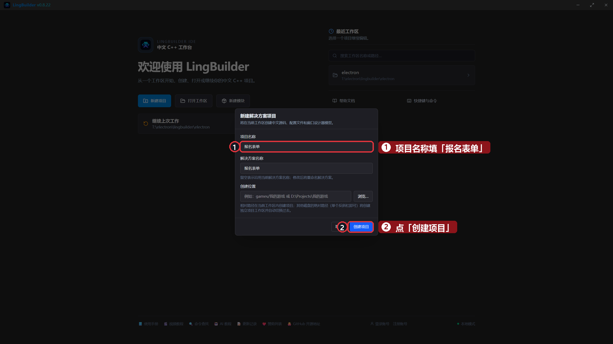
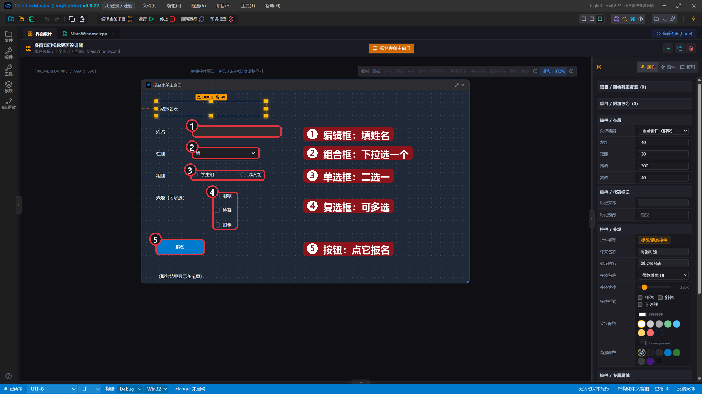
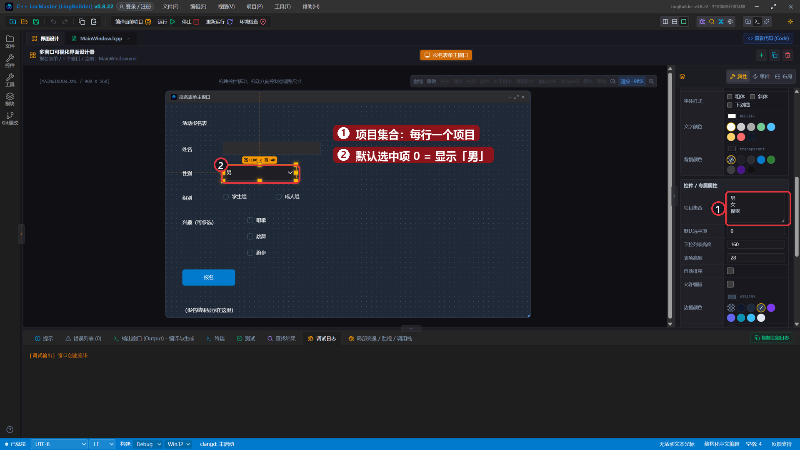
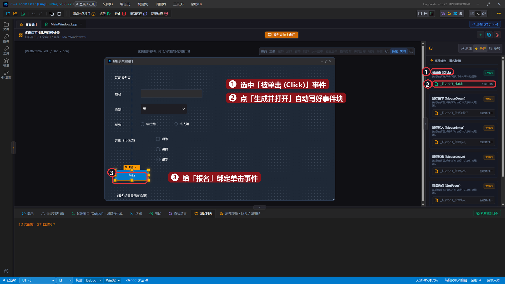
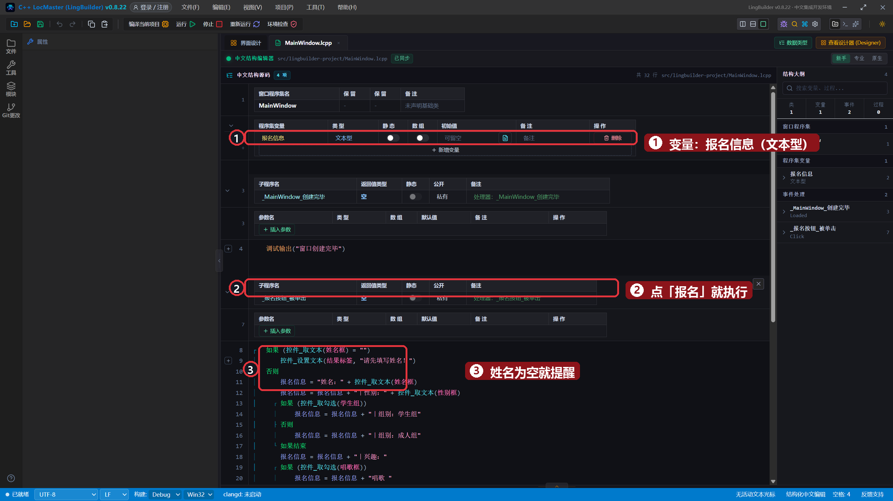
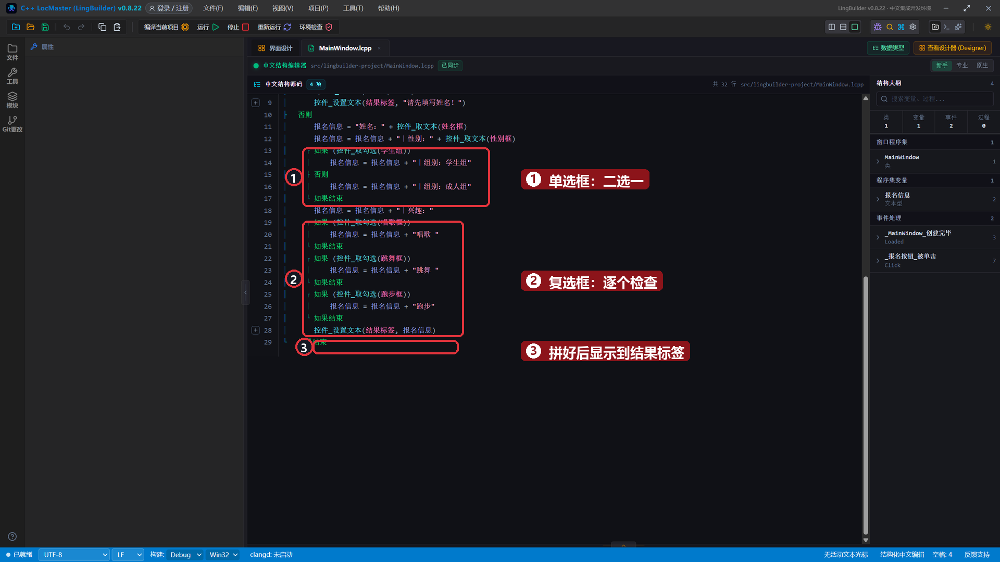
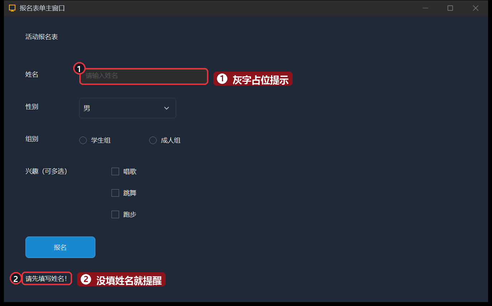
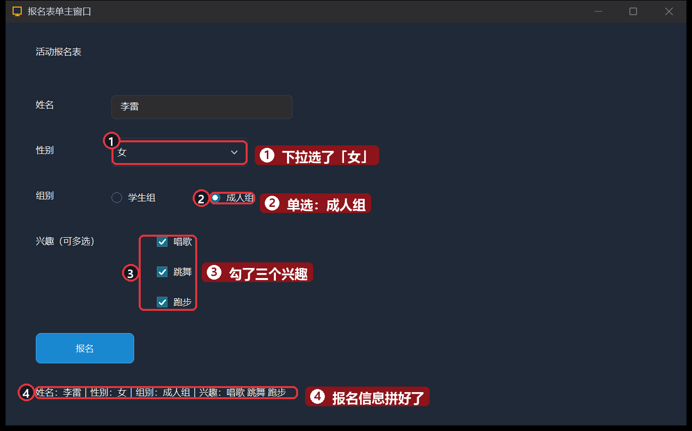

# 14 · 选择类控件：报名表单

> 《LingBuilder 零基础入门实战》第 14 集。前面学会了好用编辑框「填」内容，这一集学会让用户「选」内容：**组合框**（下拉选一个）、**单选框**（多个里选一个）、**复选框**（想选几个选几个）。做完是一张能用的活动报名表。全集目录见 [系列总览](/guide/tutorials/beginner)。
>
> 本集目标：认识三种选择类控件 → 学会 `控件_取勾选` 读取选中状态 → 用字符串拼接汇总报名信息。全程约 10 分钟。

## 1. 新建项目

欢迎页 →「**新建项目**」→ 项目名称 **报名表单** →「创建项目」：



## 2. 搭界面：一张报名表

控件都在基础控件组里。按下面的表摆（右键画布空白处也可以直接添加）：

| 控件 | 中文名称 | 显示内容 / 属性 | 左距 | 顶距 | 宽度 | 高度 |
| --- | --- | --- | --- | --- | --- | --- |
| 标签/静态控件 | `标题标签` | 活动报名表 | 40 | 30 | 300 | 40 |
| 标签/静态控件 | `姓名标签` | 姓名 | 40 | 100 | 80 | 28 |
| 编辑框 | `姓名框` | （显示内容留空） | 140 | 96 | 240 | 32 |
| 标签/静态控件 | `性别标签` | 性别 | 40 | 160 | 80 | 28 |
| 组合框 | `性别框` | 项目集合见下一节 | 140 | 152 | 180 | 40 |
| 标签/静态控件 | `组别标签` | 组别 | 40 | 220 | 80 | 28 |
| 单选框 | `学生组` | 学生组 | 140 | 218 | 110 | 26 |
| 单选框 | `成人组` | 成人组 | 270 | 218 | 110 | 26 |
| 标签/静态控件 | `兴趣标签` | 兴趣（可多选） | 40 | 280 | 150 | 28 |
| 复选框 | `唱歌框` | 唱歌 | 200 | 276 | 100 | 26 |
| 复选框 | `跳舞框` | 跳舞 | 200 | 316 | 100 | 26 |
| 复选框 | `跑步框` | 跑步 | 200 | 356 | 100 | 26 |
| 按钮 | `报名按钮` | 报名 | 40 | 410 | 130 | 40 |
| 标签/静态控件 | `结果标签` | （报名结果显示在这里） | 40 | 480 | 820 | 60 |

> 小知识：编辑框的「显示内容」要**留空**——它是用户要填的地方，占位提示（灰色提示字）在运行时会自动显示。



## 3. 给组合框喂选项

选中「性别框」，右侧属性找到「**项目集合**」，在文本框里**每行写一个选项**：`男`、`女`、`保密`。「默认选中项」填 `0` 表示默认显示第一项：



- **组合框**：点一下弹出下拉列表，用户只能从里面选一个，不用怕填错。
- **单选框**：同一个窗口里的单选框自动「互斥」——选了「学生组」，「成人组」就自动弹开，天生二选一。
- **复选框**：互相独立，勾哪个算哪个，适合「多选」场景。

## 4. 绑定「报名」按钮的单击事件

选中「报名」按钮 → 「事件」页 → 「被单击 (Click)」卡片 → 「生成并打开」：



## 5. 写代码：把选择拼成一句话

先在程序集变量表新增一个文本型变量 `报名信息`，用来累积拼接结果。

`_报名按钮_被单击` 里写：

```lingbuilder
如果 (控件_取文本(姓名框) = "")
    控件_设置文本(结果标签, "请先填写姓名！")
否则
    报名信息 = "姓名：" + 控件_取文本(姓名框)
    报名信息 = 报名信息 + "｜性别：" + 控件_取文本(性别框)
    如果 (控件_取勾选(学生组))
        报名信息 = 报名信息 + "｜组别：学生组"
    否则
        报名信息 = 报名信息 + "｜组别：成人组"
    如果结束
    报名信息 = 报名信息 + "｜兴趣："
    如果 (控件_取勾选(唱歌框))
        报名信息 = 报名信息 + "唱歌 "
    如果结束
    如果 (控件_取勾选(跳舞框))
        报名信息 = 报名信息 + "跳舞 "
    如果结束
    如果 (控件_取勾选(跑步框))
        报名信息 = 报名信息 + "跑步"
    如果结束
    控件_设置文本(结果标签, 报名信息)
如果结束
```

- `控件_取勾选(控件名)`：读取复选框/单选框**有没有被选中**，选中返回真。想知道用户选没选某一项，就用它。
- 组合框直接用第 5 集学过的 `控件_取文本` 就能拿到**当前选中的那一项**。
- 单选框二选一：问了「学生组」就不必再问「成人组」——不是它就是另一个，所以用 如果/否则。
- 复选框要**逐个问一遍**：每个兴趣一个如果，勾了就往 `报名信息` 后面拼一段。

完整代码分上下两屏：





## 6. 运行！什么都没填就点「报名」

保存，点「运行」。先什么都不填直接点「报名」——姓名框里只有灰色占位提示，程序正确判断出「是空的」，提醒先填姓名：



## 7. 填好再报一次

在姓名框输入「李雷」，性别下拉选「女」，组别点「成人组」，三个兴趣全勾上，再点「报名」——一句话报名信息拼好了：



## 本集小结

- **组合框**：「项目集合」每行一个选项，`控件_取文本` 拿选中的那项。
- **单选框**：同窗口自动互斥，适合二选一/多选一。
- **复选框**：各自独立，用 `控件_取勾选` 逐个判断。
- 拼长文本的套路：`变量 = 变量 + "新增的一段"`，一段一段往后接。

**下一集预告**：[15 · 延时与延迟调用](/guide/tutorials/beginner)——让程序「等一等」再干活：延时、延迟调用两兄弟，等待期间界面不卡死。
