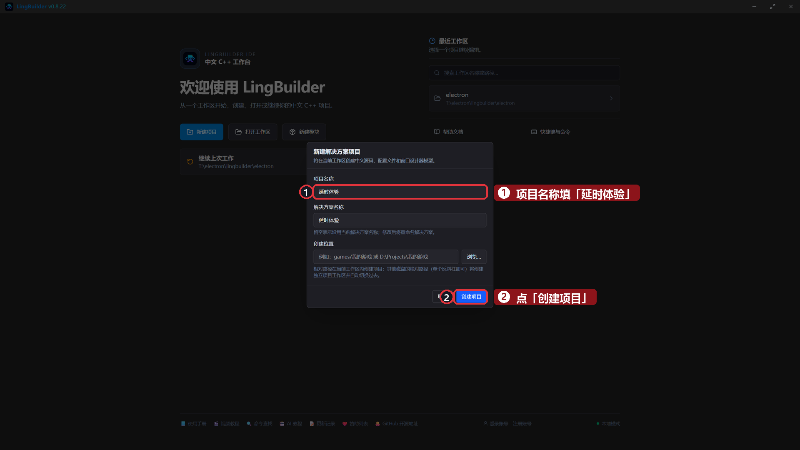
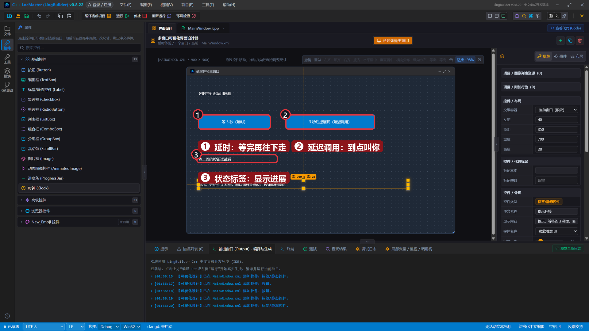
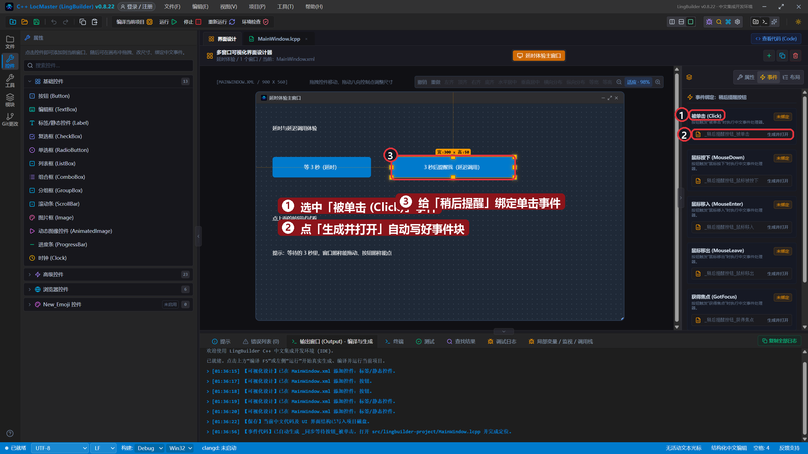
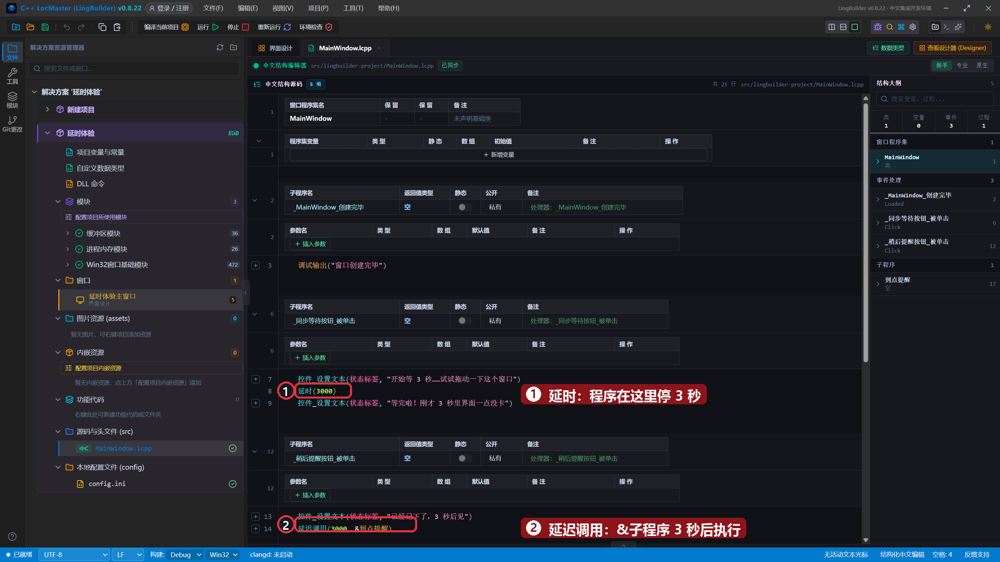
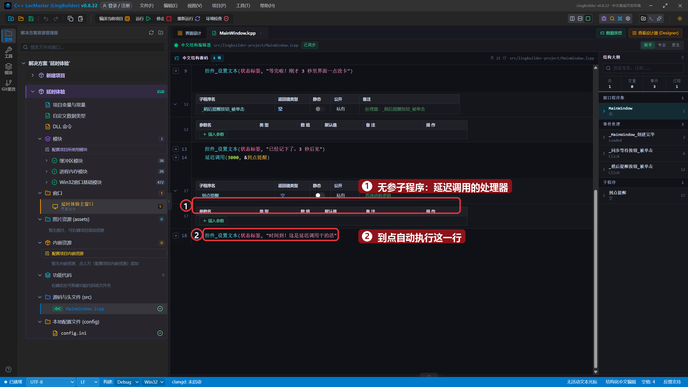
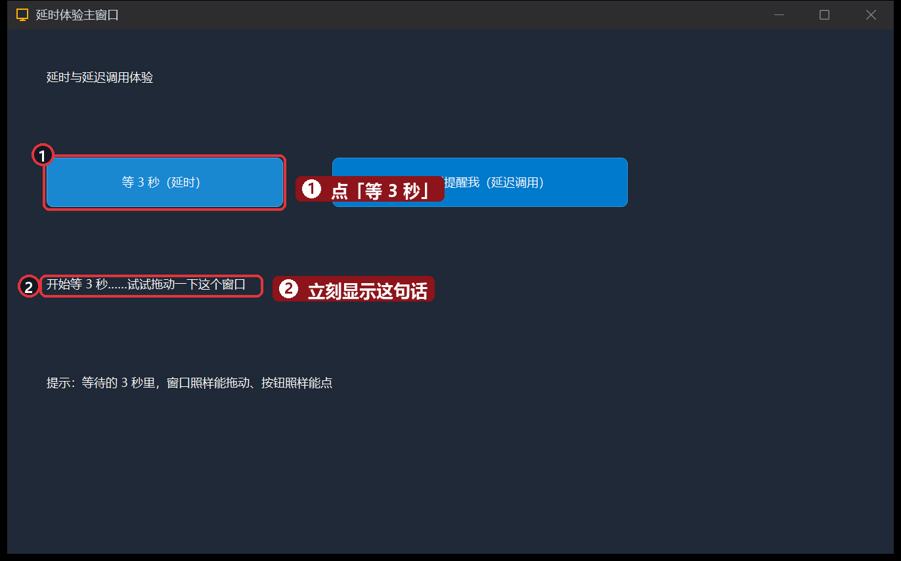
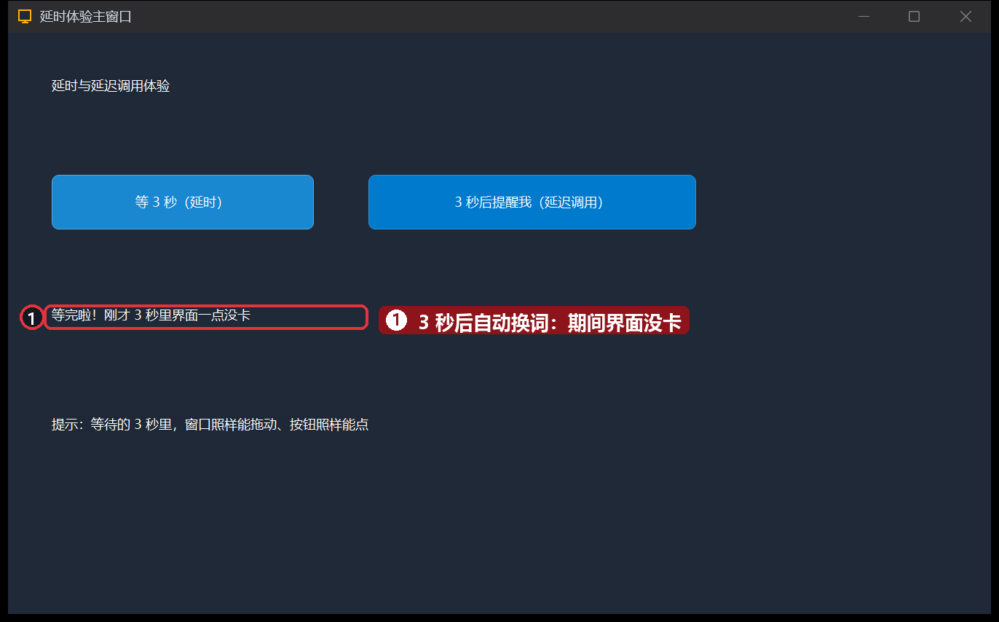
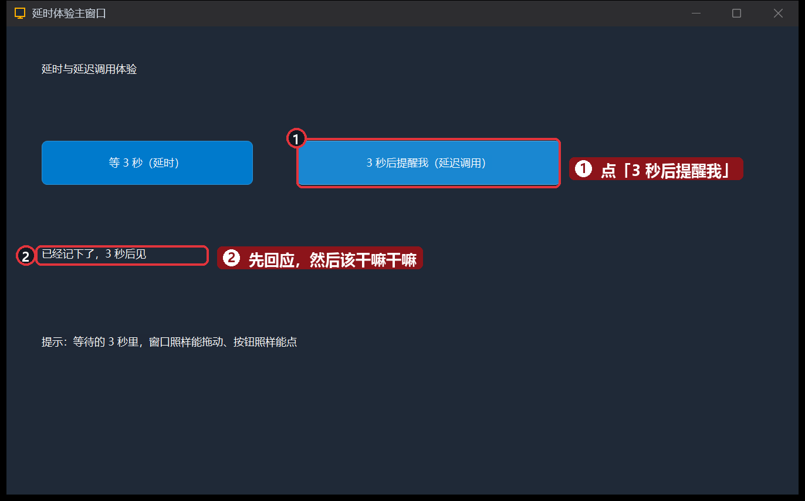
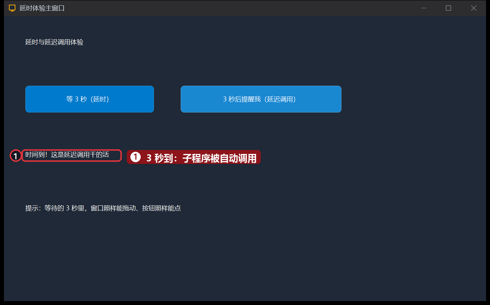

# 15 · 延时与延迟调用

> 《LingBuilder 零基础入门实战》第 15 集。程序怎么「等一会儿」？这一集认识两兄弟：**延时**（原地等够了再走）和**延迟调用**（先去干别的，到点再回来叫你）。最妙的是——等待期间界面**一点不卡**。全集目录见 [系列总览](/guide/tutorials/beginner)。
>
> 本集目标：学会 `延时(毫秒)` → 学会 `延迟调用(毫秒, &子程序)` → 学会自己写一个无参子程序。全程约 10 分钟。

## 1. 新建项目

欢迎页 →「**新建项目**」→ 项目名称 **延时体验** →「创建项目」：



## 2. 搭界面：两个按钮，一块屏幕

| 控件 | 中文名称 | 显示内容 | 左距 | 顶距 | 宽度 | 高度 |
| --- | --- | --- | --- | --- | --- | --- |
| 标签/静态控件 | `标题标签` | 延时与延迟调用体验 | 40 | 40 | 500 | 40 |
| 按钮 | `同步等待按钮` | 等 3 秒（延时） | 40 | 130 | 240 | 50 |
| 按钮 | `稍后提醒按钮` | 3 秒后提醒我（延迟调用） | 330 | 130 | 300 | 50 |
| 标签/静态控件 | `状态标签` | 点上面的按钮试试看 | 40 | 250 | 820 | 60 |
| 标签/静态控件 | `提示标签` | 提示：等待的 3 秒里，窗口照样能拖动、按钮照样能点 | 40 | 350 | 700 | 28 |



## 3. 绑定两个按钮的单击事件

老流程，分别给两个按钮绑定「被单击 (Click)」：



## 4. 写代码：三段

`_同步等待按钮_被单击` 里写（延时）：

```lingbuilder
控件_设置文本(状态标签, "开始等 3 秒……试试拖动一下这个窗口")
延时(3000)
控件_设置文本(状态标签, "等完啦！刚才 3 秒里界面一点没卡")
```

- `延时(毫秒)`：**在这行停一停**，够毫秒数再往下走。像「程序_延时」。
- 好消息：LingBuilder 的 `延时` 会一直帮窗口「传话」（泵消息），所以等待期间窗口**照样能拖动、按钮照样能点**——不像别的语言 `sleep` 一睡整个界面就假死。

`_稍后提醒按钮_被单击` 里写（延迟调用）：

```lingbuilder
控件_设置文本(状态标签, "已经记下了，3 秒后见")
延迟调用(3000, &到点提醒)
```

- `延迟调用(毫秒, &子程序)`：**不定死**，先把这行记在小本本上，继续干后面的活；毫秒数一到，它自动帮你调用 `&` 后面那个子程序。只触发一次。
- 注意 `&到点提醒`：**处理器必须写 `&名字`**，不要加引号。

然后在窗口类的最后，自己写一个**无参子程序**——它就是 3 秒后被调用的那个「处理器」：

```lingbuilder
空 到点提醒()
    控件_设置文本(状态标签, "时间到！这是延迟调用干的活")
结束
```

- 自己写子程序的格式：`返回值类型 名字()`，没有返回值就写 `空`，块里写要干的事，用 `结束` 收尾。
- `延迟调用` 的处理器规定是**无参子程序**，所以 `到点提醒()` 的括号里什么都不放。

完整代码分上下两屏：





## 5. 运行！先试「延时」

保存，点「运行」，点「**等 3 秒（延时）**」——状态标签立刻换上第一句话，程序开始等：



3 秒一到，第二句话自动出现：



> 试试在等的 3 秒里拖动窗口——拖得动！这就是「不冻结界面」的延时。

## 6. 再试「延迟调用」

点「**3 秒后提醒我（延迟调用）**」——标签先回应「已经记下了」，程序马上就闲下来了：



3 秒后，「时间到！」自己蹦出来——这是 `到点提醒` 子程序被自动调用，不是你点的：



## 本集小结

- `延时(毫秒)`：原地等，但界面不冻结。
- `延迟调用(毫秒, &子程序)`：预约一次「到点叫我」，处理器用 `&名字` 引用。
- 自己写子程序：`返回值类型 名字()` + `结束`，无返回值类型写 `空`。
- 两者选谁？「等完才能继续」用延时；「先去干别的，到点再说」用延迟调用。

**下一集预告**：[16 · 项目变量、常量与自定义数据类型](/guide/tutorials/beginner)——把数据放到「全项目都能用」的地方：项目变量、常量与自定义数据类型。
