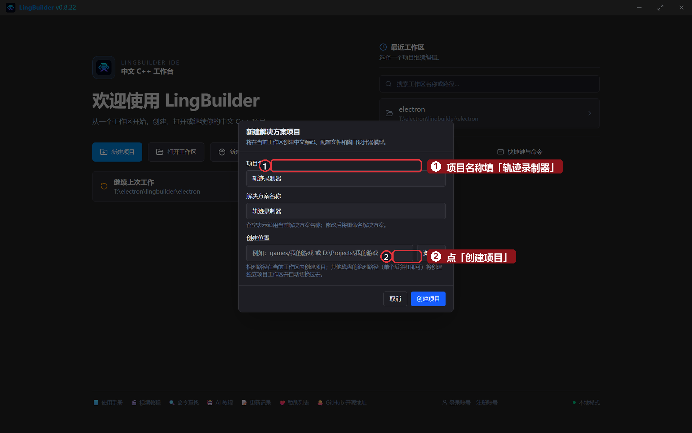
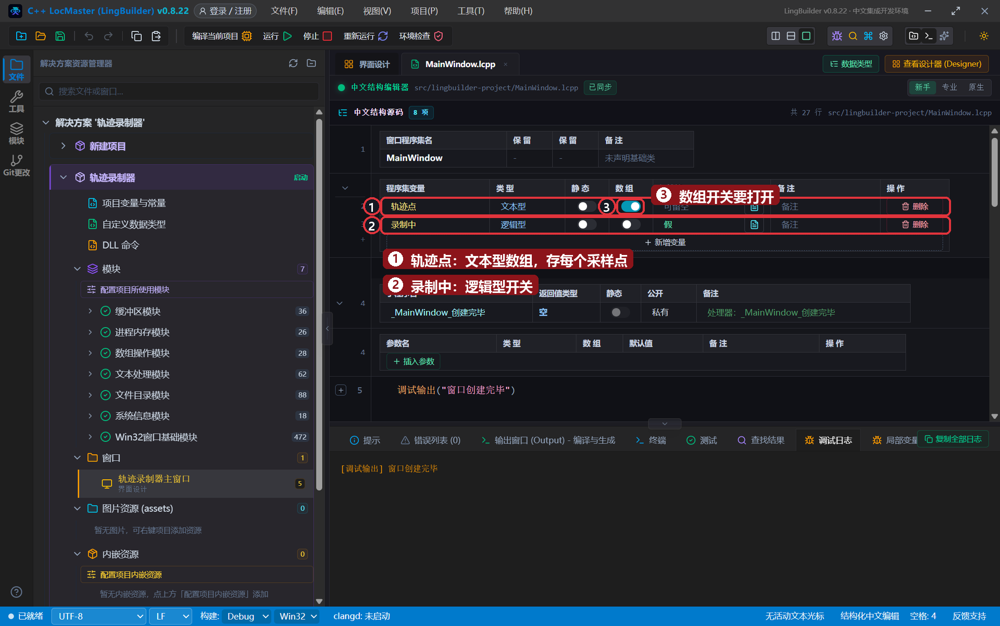
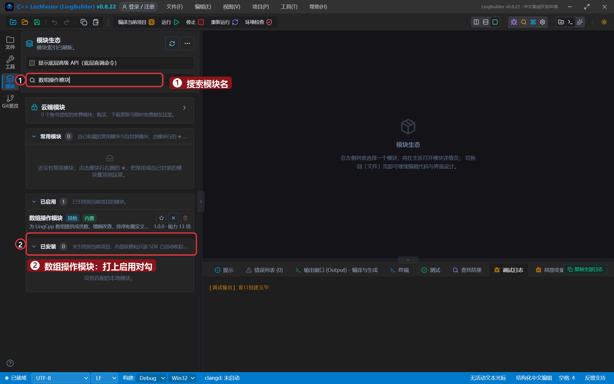
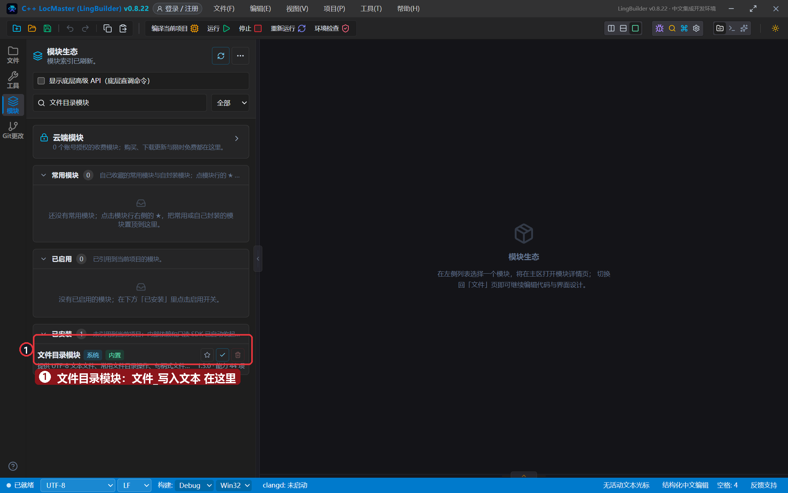
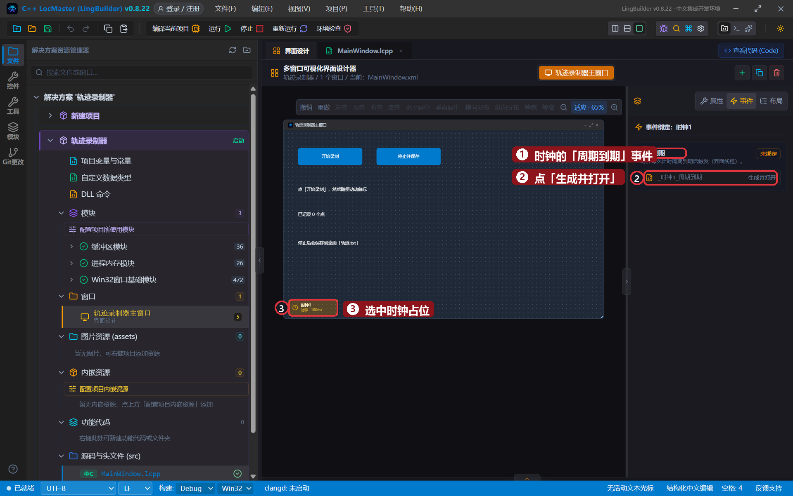
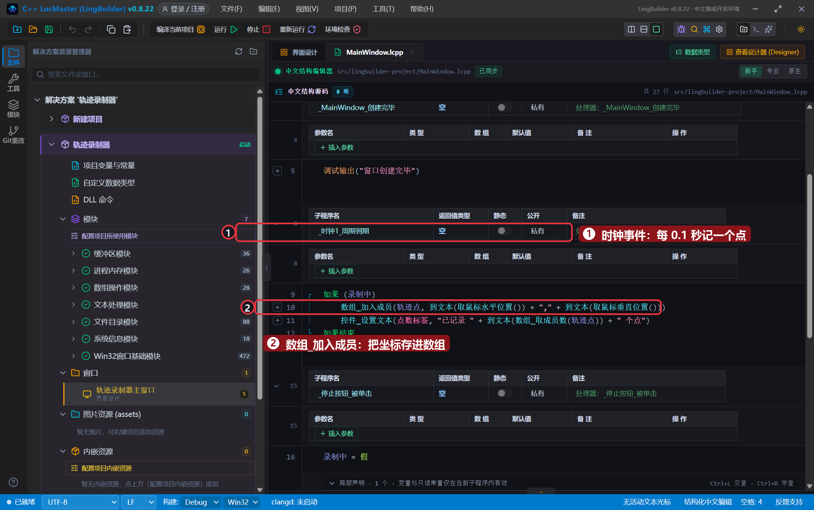
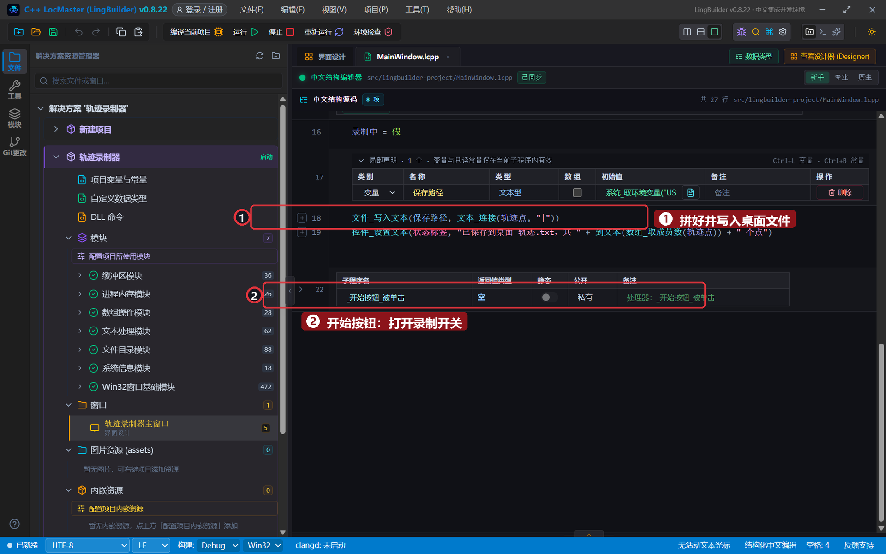
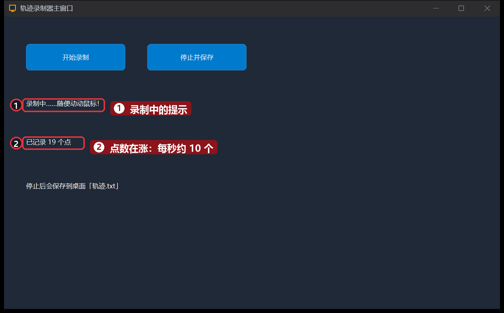
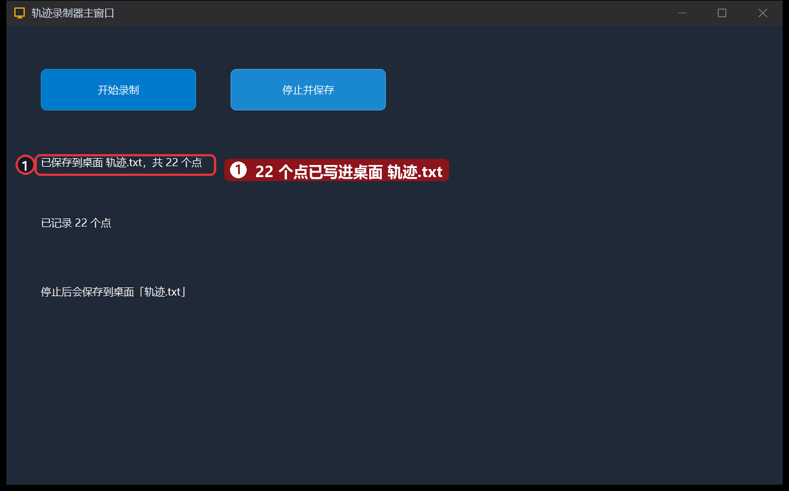

# 19 · 录制鼠标轨迹

> 《LingBuilder 零基础入门实战》第 19 集。上集学会了「看」鼠标，这集学会「记」鼠标：把鼠标的每一步坐标存进**数组**，停止时一次性写进桌面文件——这就是「宏录制」的雏形。全集目录见 [系列总览](/guide/tutorials/beginner)。
>
> 本集目标：启用两个模块 → 学会 `数组_加入成员` / `数组_取成员数` / `文本_连接` → 用逻辑变量当「录制开关」。全程约 12 分钟。

## 1. 新建项目

欢迎页 →「**新建项目**」→ 项目名称 **轨迹录制器** →「创建项目」：



## 2. 声明两个程序集变量

打开 `MainWindow.lcpp`，在程序集变量表里加两行：

- `轨迹点`：**文本型**，把「数组」开关打开（要存一串坐标）；
- `录制中`：**逻辑型**，初始值 `假`（当录制开关用）。



## 3. 启用两个模块

这集要用两组新命令，老流程在模块面板分别搜索并启用：

- **数组操作模块**：`数组_加入成员`、`数组_取成员数` 在这里；



- **文件目录模块**：`文件_写入文本` 在这里。



## 4. 搭界面 + 时钟

| 控件 | 中文名称 | 显示内容 | 左距 | 顶距 | 宽度 | 高度 |
| --- | --- | --- | --- | --- | --- | --- |
| 按钮 | `开始按钮` | 开始录制 | 40 | 50 | 180 | 48 |
| 按钮 | `停止按钮` | 停止并保存 | 260 | 50 | 180 | 48 |
| 标签/静态控件 | `状态标签` | 点「开始录制」，然后随便动动鼠标 | 40 | 150 | 820 | 32 |
| 标签/静态控件 | `点数标签` | 已记录 0 个点 | 40 | 220 | 500 | 32 |
| 标签/静态控件 | `提示标签` | 停止后会保存到桌面「轨迹.txt」 | 40 | 300 | 700 | 32 |
| 时钟（非可视） | `时钟1` | 周期毫秒 `100`，勾「创建后自动计时」 | - | - | - | - |

## 5. 绑定三个事件

选中时钟占位 →「周期到期」→「生成并打开」；再分别给两个按钮绑定「被单击」：



## 6. 写代码

`_时钟1_周期到期`（每 0.1 秒记一个点）：

```lingbuilder
如果 (录制中)
    数组_加入成员(轨迹点, 到文本(取鼠标水平位置()) + "," + 到文本(取鼠标垂直位置()))
    控件_设置文本(点数标签, "已记录 " + 到文本(数组_取成员数(轨迹点)) + " 个点")
如果结束
```

- `数组_加入成员(数组, 值)`：往数组末尾追加一个成员。坐标拼成 `"x,y"` 文本存进去。
- `数组_取成员数(数组)`：数组里现在有几个成员——点数标签就靠它实时报数。

`_开始按钮_被单击`（打开开关）：

```lingbuilder
录制中 = 真
控件_设置文本(状态标签, "录制中……随便动动鼠标！")
```

`_停止按钮_被单击`（写文件）：

```lingbuilder
录制中 = 假
局部 文本型 保存路径 = 系统_取环境变量("USERPROFILE") + "\Desktop\轨迹.txt"
文件_写入文本(保存路径, 文本_连接(轨迹点, "|"))
控件_设置文本(状态标签, "已保存到桌面 轨迹.txt，共 " + 到文本(数组_取成员数(轨迹点)) + " 个点")
```

- `系统_取环境变量("USERPROFILE")`：读到当前用户的主目录（例如 `C:\Users\某人`），拼上 `\Desktop\轨迹.txt` 就是桌面路径。
- `文本_连接(数组, 分隔符)`：把数组所有成员用分隔符连成**一段文本**——22 个点一口气变成一行，不用自己写循环拼接。

完整代码分上下两屏：





## 7. 运行！录一段真实的轨迹

保存，点「运行」。点「开始录制」，然后痛快地甩几下鼠标——点数蹭蹭上涨：



点「停止并保存」——状态显示「已保存到桌面 轨迹.txt，共 22 个点」：



去桌面打开 `轨迹.txt` 看看：一行 `x,y|x,y|x,y…`，鼠标走过的每一步都在。

## 本集小结

- **录制开关**套路：一个逻辑变量 + 如果判断，时钟只在「开」的时候干活。
- `数组_加入成员` 存、`数组_取成员数` 数、`文本_连接` 一次拼完——数组三件套。
- `文件_写入文本(路径, 内容)`：覆盖写整个文件；路径用环境变量拼，换电脑也能跑。

**下一集预告**：[20 · 回放鼠标轨迹](/guide/tutorials/beginner)——读回 `轨迹.txt`，让鼠标「自己动」：把录下的轨迹原样重放一遍。
