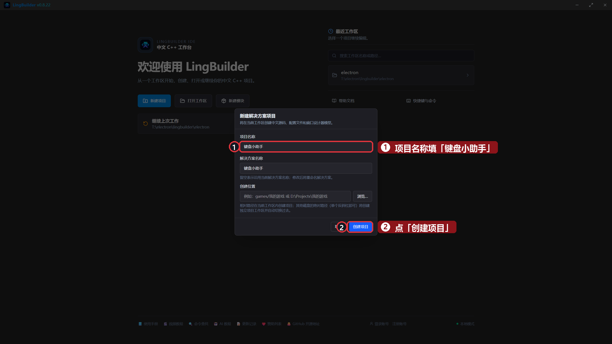
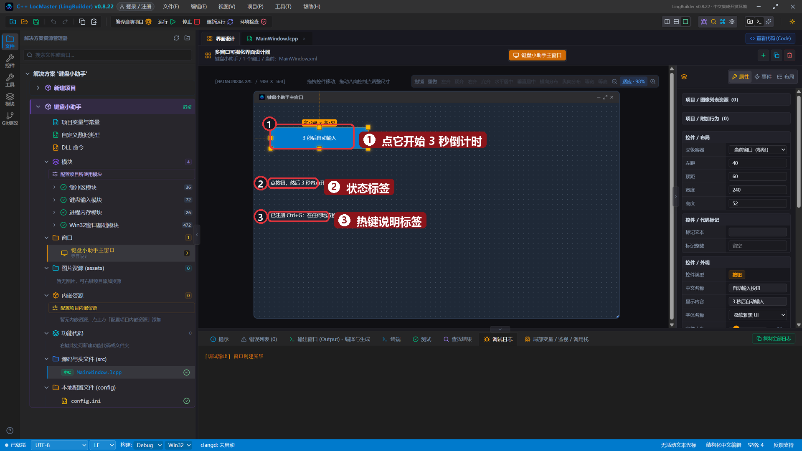
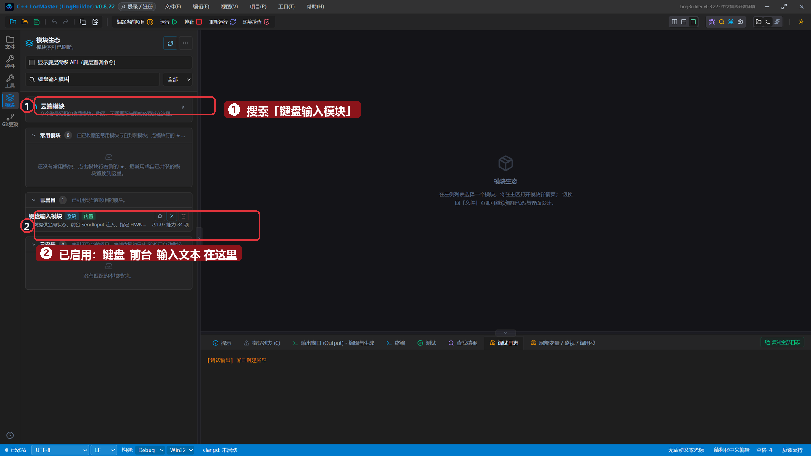
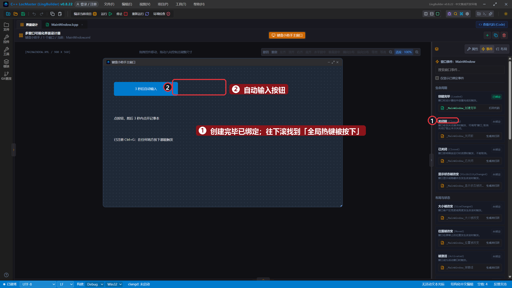
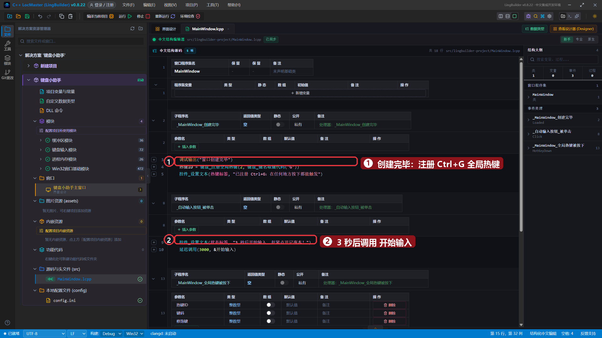
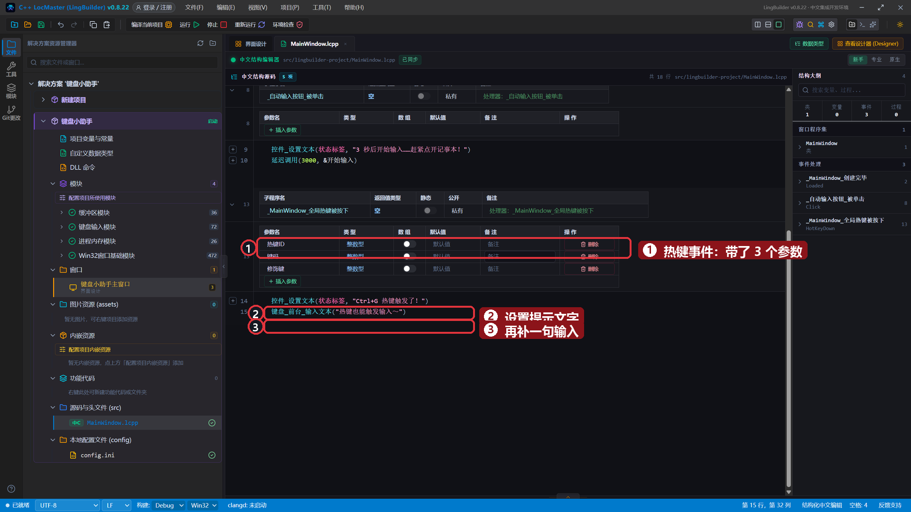
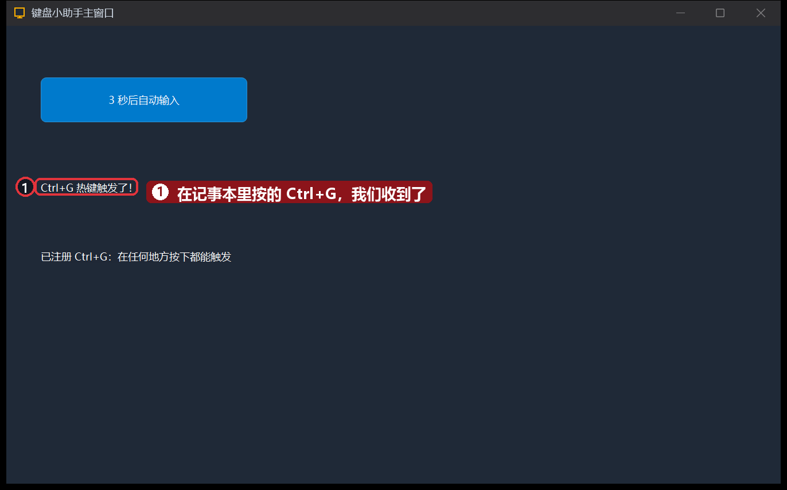
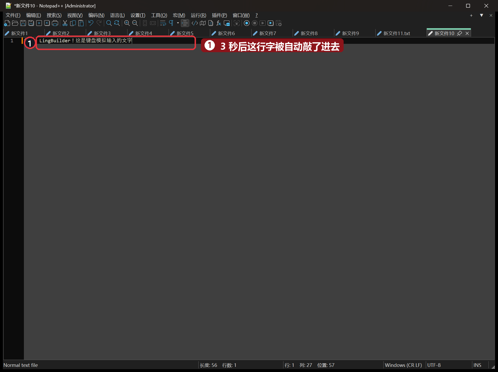

# 21 · 键盘模拟与热键

> 《LingBuilder 零基础入门实战》第 21 集。会搬鼠标还不够——这集让程序「敲键盘」：往任何软件里自动输入文字，再注册一个**全局热键**，程序藏在后台也能一按就响应。全集目录见 [系列总览](/guide/tutorials/beginner)。
>
> 本集目标：启用键盘输入模块 → 学会 `键盘_前台_输入文本` 自动打字 → 学会 `键盘_注册全局热键` + 窗口热键事件。全程约 12 分钟。

## 1. 新建项目

欢迎页 →「**新建项目**」→ 项目名称 **键盘小助手** →「创建项目」：



## 2. 搭界面

| 控件 | 中文名称 | 显示内容 | 左距 | 顶距 | 宽度 | 高度 |
| --- | --- | --- | --- | --- | --- | --- |
| 按钮 | `自动输入按钮` | 3 秒后自动输入 | 40 | 60 | 240 | 52 |
| 标签/静态控件 | `状态标签` | 点按钮，然后 3 秒内点开记事本 | 40 | 180 | 820 | 32 |
| 标签/静态控件 | `热键标签` | 已注册 Ctrl+G：在任何地方按下都能触发 | 40 | 260 | 700 | 32 |



## 3. 启用键盘输入模块

模块面板搜索「**键盘输入模块**」并启用——`键盘_前台_输入文本`、`键盘_注册全局热键` 都在这里：



## 4. 绑定两个事件

- 给「自动输入按钮」绑定「被单击 (Click)」；
- 窗口级的热键事件在**窗口事件**里：点画布空白处（不选中任何控件）→「事件」页就是**窗口事件**列表。本集先绑按钮，热键事件在代码保存后由「全局热键被按下」卡片生成。



## 5. 写代码

`_MainWindow_创建完毕`（窗口一打开就注册热键）：

```lingbuilder
调试输出("窗口创建完毕")
热键ID = 键盘_注册全局热键(2, 71)
控件_设置文本(热键标签, "已注册 Ctrl+G：在任何地方按下都能触发")
```

- `键盘_注册全局热键(修饰掩码, 虚拟键码)`：注册一个**全系统**热键。修饰掩码 `2` = Ctrl（1 Shift、4 Alt、8 Win，可相加），`71` 是字母 G 的虚拟键码。返回热键 ID，存进程序集变量 `热键ID`（整数型）。
- 注册成功后，哪怕窗口在后台，按下 Ctrl+G 它都能收到。

`_自动输入按钮_被单击`（延时输入）：

```lingbuilder
控件_设置文本(状态标签, "3 秒后开始输入……赶紧点开记事本！")
延迟调用(3000, &开始输入)
```

再补一个**无参子程序** `开始输入`（第 15 集学过）：

```lingbuilder
空 开始输入()
    键盘_前台_输入文本("你好，LingBuilder！这是键盘模拟输入的文字")
结束
```

- `键盘_前台_输入文本(文本)`：把文字「敲」进**当前焦点**所在的输入框——不管那个窗口是不是我们自己的程序。

`_MainWindow_全局热键被按下`（热键事件，带了 3 个整数型参数：热键ID、键码、修饰键）：

```lingbuilder
控件_设置文本(状态标签, "Ctrl+G 热键触发了！")
键盘_前台_输入文本("热键也能触发输入～")
```

完整代码分上下两屏：





## 6. 运行！先试热键

保存，点「运行」。把鼠标点到**记事本**的输入区里，按下 **Ctrl+G**——我们的程序立刻收到，状态变成「热键触发了！」，还顺手补了一句输入：



## 7. 再试自动输入

点「3 秒后自动输入」，赶紧切换到记事本——3 秒一到，那行问候语被自动「敲」了进去：



## 本集小结

- `键盘_前台_输入文本(文本)`：往当前焦点注入文字，别处程序也能「收货」。
- `键盘_注册全局热键(修饰掩码, 虚拟键码)`：注册系统级热键；触发时窗口收到「全局热键被按下」事件（带热键ID、键码、修饰键 3 个参数）。
- 修饰掩码：1 Shift、2 Ctrl、4 Alt、8 Win，可相加（如 Ctrl+Alt = 6）。
- 延迟调用 + 前台输入 = 「3 秒后自动打字」这类小自动化。

**下一集预告**：[22 · 实战整合：办公小助手](/guide/tutorials/beginner)——把前几集的登录、倒计时、记录、回放整合成一个完整的小软件。
