# 22 · 实战整合：办公小助手

> 《LingBuilder 零基础入门实战》第 22 集。前面 21 集的零件都攒齐了，这集把它们**拼成一个真正能用的软件**：「办公小助手」——能登录、能录制回放鼠标轨迹、能把便签自动敲进记事本，还带一个全局热键随叫随到。全集目录见 [系列总览](/guide/tutorials/beginner)。
>
> 本集目标：把第 6 集（登录）、第 8 集（时钟）、第 18~20 集（鼠标轨迹）、第 21 集（键盘+热键）整合进一个窗口。全程约 15 分钟。

## 1. 新建项目

欢迎页 →「**新建项目**」→ 项目名称 **办公小助手** →「创建项目」：

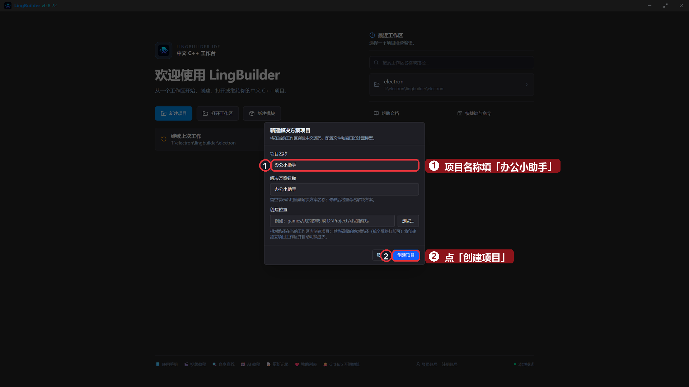

## 2. 搭界面：三块功能一层窗

窗口从上到下分三层：**登录区**、**轨迹区**、**便签区**。控件不少，照表慢慢摆（都从工具箱添加，选中后改坐标）：

| 控件 | 中文名称 | 显示内容 | 左距 | 顶距 | 宽度 | 高度 |
| --- | --- | --- | --- | --- | --- | --- |
| 标签/静态控件 | `标题标签` | 办公小助手 | 40 | 30 | 400 | 48 |
| 标签/静态控件 | `时钟标签` | 时钟未启动 | 480 | 42 | 380 | 32 |
| 编辑框 | `账号框` | （显示内容**留空**，占位提示：请输入账号） | 40 | 120 | 220 | 32 |
| 编辑框 | `密码框` | （显示内容**留空**，占位提示：请输入密码） | 300 | 120 | 220 | 32 |
| 按钮 | `登录按钮` | 登录 | 560 | 116 | 120 | 40 |
| 标签/静态控件 | `登录状态标签` | （未登录） | 40 | 180 | 500 | 32 |
| 按钮 | `开始记录按钮` | 开始记录鼠标轨迹 | 40 | 250 | 220 | 44 |
| 按钮 | `停止保存按钮` | 停止并保存到桌面 | 300 | 250 | 240 | 44 |
| 按钮 | `回放按钮` | 回放上一段轨迹 | 580 | 250 | 220 | 44 |
| 标签/静态控件 | `轨迹状态标签` | 轨迹工具未启动 | 40 | 330 | 700 | 32 |
| 按钮 | `便签按钮` | 把便签输入到记事本 | 40 | 400 | 240 | 44 |
| 编辑框 | `便签框` | （显示内容**留空**，占位提示：输入要自动敲进记事本的话） | 320 | 404 | 400 | 36 |

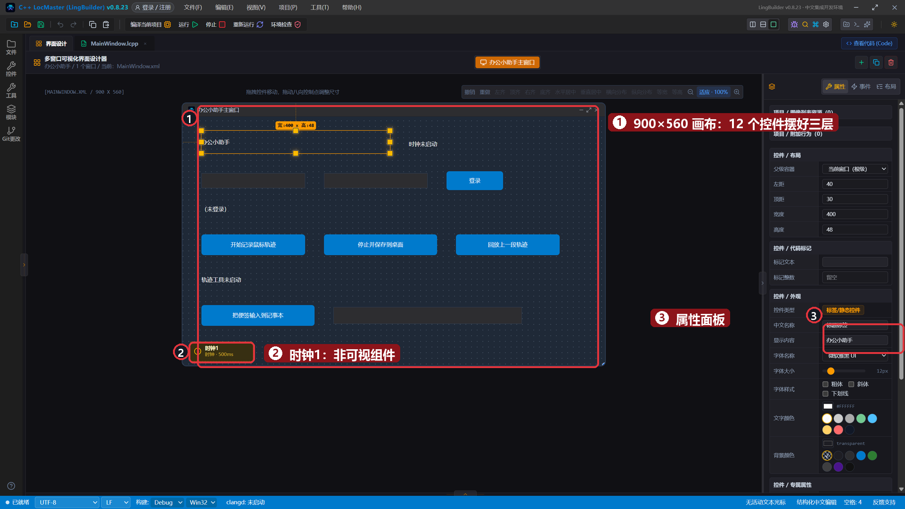

两个提醒：

- 三个编辑框的「显示内容」一定要**清空**——不填的话会带默认的「请输入内容...」，运行时它是真实文本，登录判断就全乱了（第 13 集的坑）。
- 再从工具箱加一个**时钟**，中文名称 `时钟1`，周期 `500`，勾选「创建后自动计时」——它是非可视组件，画布上只占一个小方块，不占运行界面。

## 3. 绑定事件

- 六个按钮各绑「被单击 (Click)」：选中按钮 → 右侧「事件」页 → 点「被单击」卡片里的「生成并打开」。下图是「登录按钮」的样子：
- 时钟的「周期到期」：点画布上的时钟小方块 →「事件」页 →「周期到期」；
- 窗口级热键事件：点画布**空白处** →「事件」页变成窗口事件列表 →「全局热键被按下」（第 21 集讲过）。

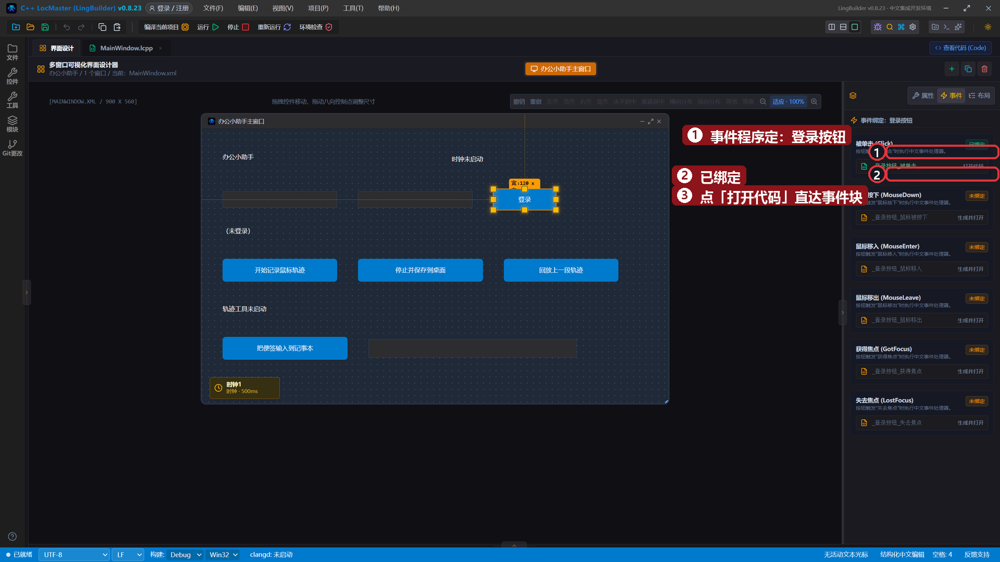

## 4. 程序集变量：小助手的「记忆」

打开 `MainWindow.lcpp`，先在**程序集变量**表里加 5 个变量（这些状态要跨事件共享，所以放程序集变量）：

| 名称 | 类型 | 初始值 | 用途 |
| --- | --- | --- | --- |
| `轨迹点` | 文本型 | 勾「数组」 | 存「x,y」坐标点 |
| `录制中` | 逻辑型 | 假 | 录制开关 |
| `已登录` | 逻辑型 | 假 | 登录状态 |
| `热键ID` | 整数型 | 0 | 注册热键的返回值 |
| `序号` | 整数型 | 0 | 回放循环计数 |

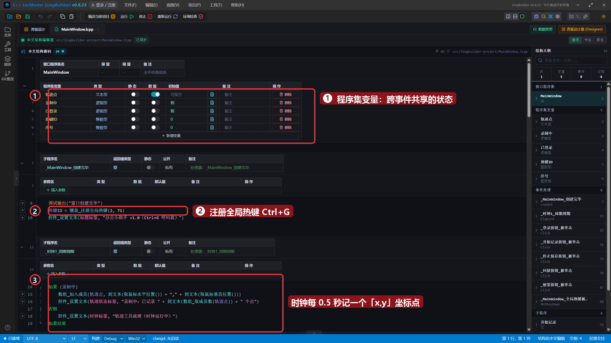

## 5. 写代码

模块面板确认「**键盘输入模块**」已启用（第 21 集的 `键盘_注册全局热键`、`键盘_前台_输入文本` 在这里）。

`_MainWindow_创建完毕`（窗口一打开就注册热键）：

```lingbuilder
调试输出("窗口创建完毕")
热键ID = 键盘_注册全局热键(2, 71)
控件_设置文本(标题标签, "办公小助手 v1.0（Ctrl+G 呼叫我）")
```

`_时钟1_周期到期`（每 0.5 秒滴答一次：录制中就采样一个点）：

```lingbuilder
如果 (录制中)
    数组_加入成员(轨迹点, 到文本(取鼠标水平位置()) + "," + 到文本(取鼠标垂直位置()))
    控件_设置文本(轨迹状态标签, "录制中：已记录 " + 到文本(数组_取成员数(轨迹点)) + " 个点")
否则
    控件_设置文本(时钟标签, "轨迹工具就绪（时钟运行中）")
如果结束
```

- `取鼠标水平位置()` / `取鼠标垂直位置()`：读当前鼠标坐标（第 18 集）。
- 没在录制时，时钟顺手把「时钟标签」改成「就绪」——正好当一行**心跳显示**，证明时钟真的在跑。

`_登录按钮_被单击`（第 6 集的登录，浓缩成一层如果）：

```lingbuilder
如果 (控件_取文本(账号框) = "admin" && 控件_取文本(密码框) = "123")
    已登录 = 真
    控件_设置文本(登录状态标签, "欢迎回来，admin！")
否则
    控件_设置文本(登录状态标签, "账号或密码不对（提示：admin / 123）")
如果结束
```

`_便签按钮_被单击`（延迟调用，给用户 3 秒去切窗口）：

```lingbuilder
延迟调用(3000, &自动输入)
控件_设置文本(轨迹状态标签, "3 秒后把便签敲进记事本……快切过去！")
```

`_MainWindow_全局热键被按下`（窗口级事件，自带 3 个整数型参数）：

```lingbuilder
控件_设置文本(轨迹状态标签, "Ctrl+G 呼叫成功！办公小助手回到前台")
```

四个**无参子程序**（按钮事件只负责「调用」，逻辑都放子程序里，这是第 17 集养成的习惯）：

```lingbuilder
空 开始记录()
    录制中 = 真
    控件_设置文本(轨迹状态标签, "录制中：随便动动鼠标，点「停止并保存」结束")
结束

空 停止保存()
    录制中 = 假
    局部 文本型 保存路径
    保存路径 = 系统_取环境变量("USERPROFILE") + "\Desktop\轨迹.txt"
    文件_写入文本(保存路径, 文本_连接(轨迹点, "|"))
    控件_设置文本(轨迹状态标签, "已保存 " + 到文本(数组_取成员数(轨迹点)) + " 个点到桌面轨迹.txt")
结束

空 回放()
    局部 文本型 轨迹文本
    局部 文本型 点列表[]
    局部 文本型 单个点
    局部 文本型 坐标[]
    轨迹文本 = 文件_读取文本(系统_取环境变量("USERPROFILE") + "\Desktop\轨迹.txt")
    文本_分割(轨迹文本, "|", 点列表, 真)
    控件_设置文本(轨迹状态标签, "回放中：共 " + 到文本(数组_取成员数(点列表)) + " 个点")
    计次循环首 (数组_取成员数(点列表), 序号)
        单个点 = 数组_取成员(点列表, 序号 - 1)
        文本_分割(单个点, ",", 坐标, 真)
        设置鼠标位置(到整数(数组_取成员(坐标, 0)), 到整数(数组_取成员(坐标, 1)))
        延时(60)
    计次循环尾 ()
    控件_设置文本(轨迹状态标签, "回放完毕！")
结束

空 自动输入()
    键盘_前台_输入文本("【便签】" + 控件_取文本(便签框))
结束
```

- `文本_连接(轨迹点, "|")`：把所有点用竖线串成一行文本，一次写入桌面 `轨迹.txt`（`系统_取环境变量("USERPROFILE")` = 当前用户主目录）。
- 回放时 `文本_分割` 两层拆：先按 `|` 拆点，再按 `,` 拆 x/y（第 20 集同款）。

完整代码分四屏：

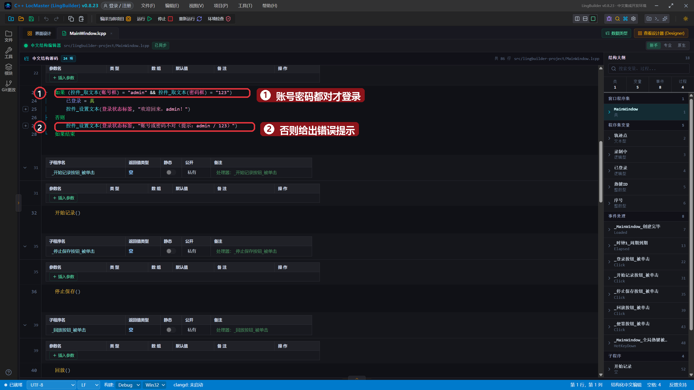

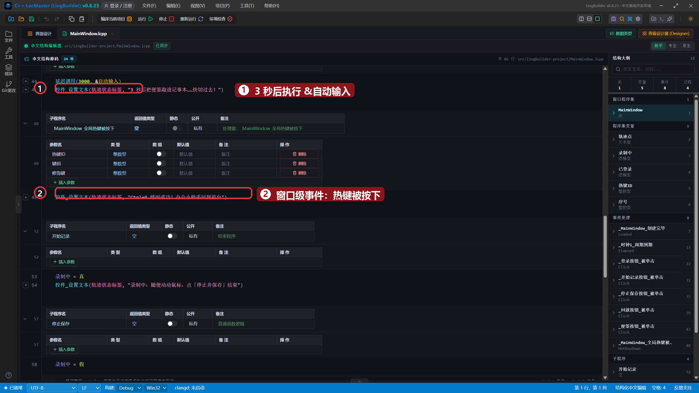

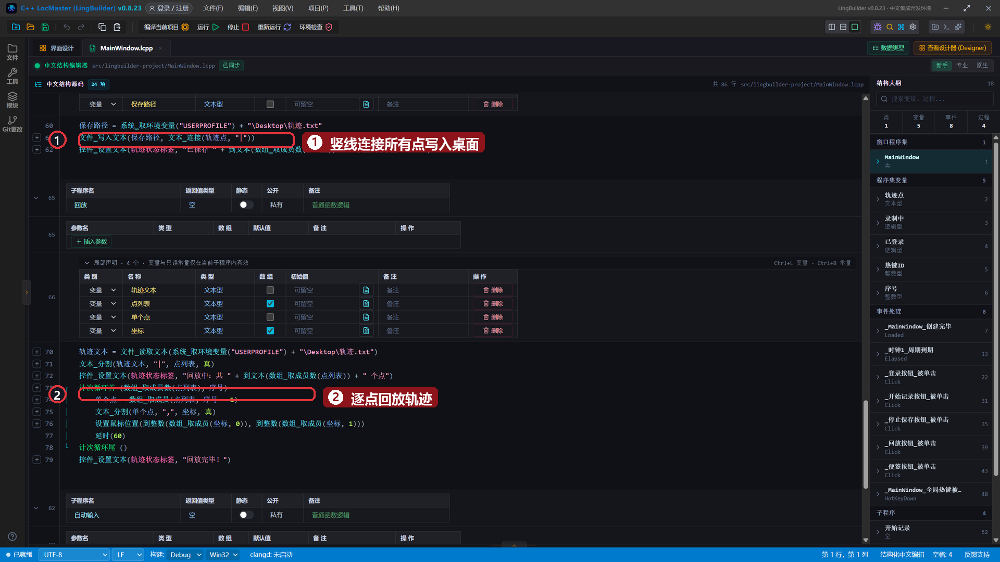

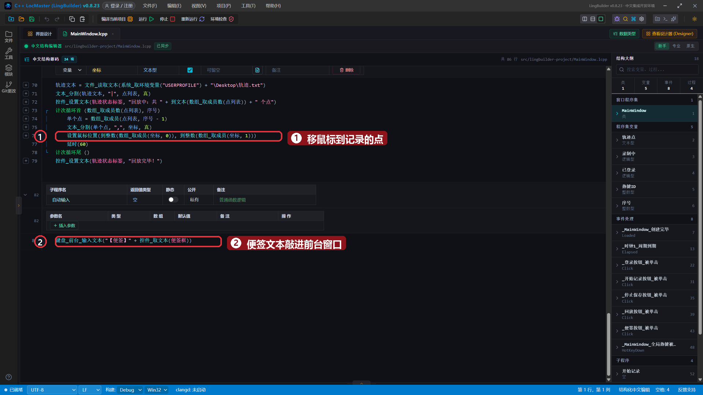

## 6. 运行！

保存，点「运行」。窗口打开后时钟就开始跳动——「轨迹工具就绪（时钟运行中）」这行字每 0.5 秒被周期事件刷新一次：

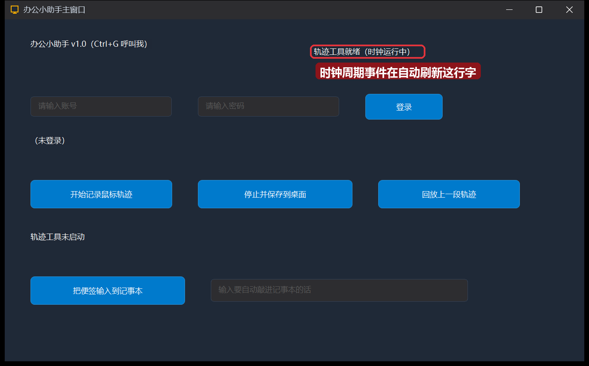

输入 `admin` / `123`，点「登录」——状态变成「欢迎回来，admin！」：

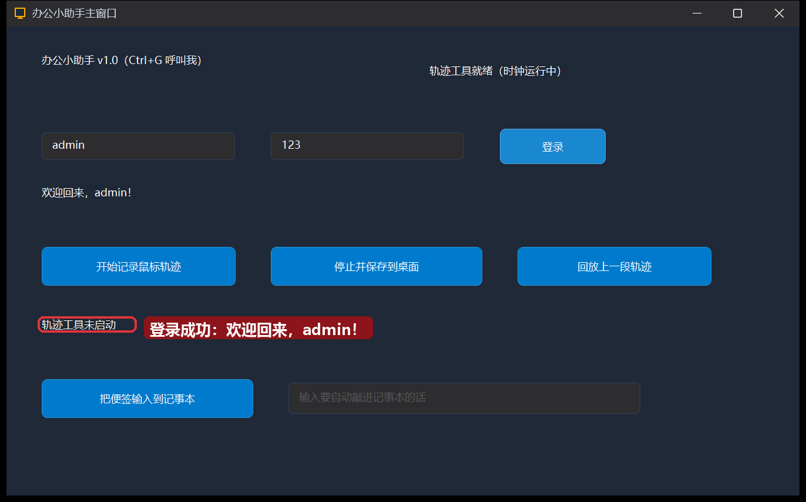

点「开始记录鼠标轨迹」，随便画几个圈——时钟每 0.5 秒记一个点，计数实时上涨：

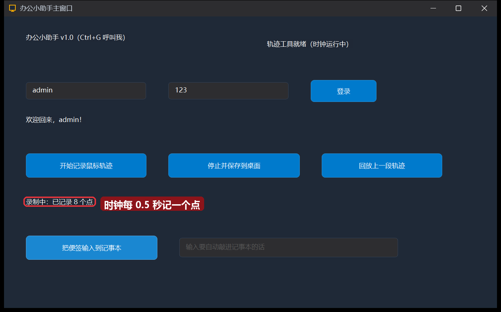

点「停止并保存到桌面」，9 个点写进桌面 `轨迹.txt`：

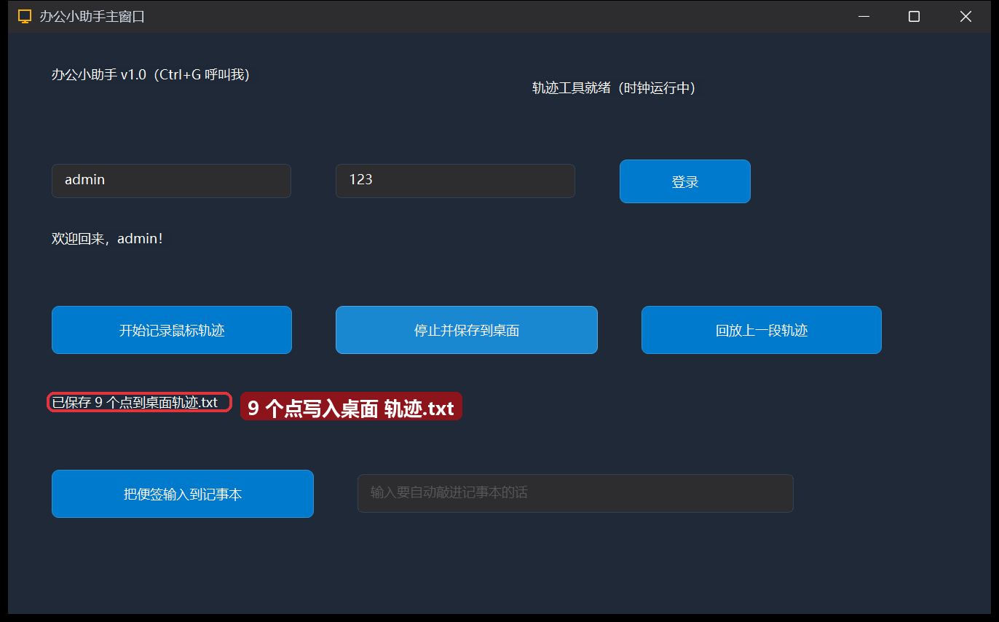

按 **Ctrl+G**——哪怕窗口在后台，全局热键也能把它「叫回来」：

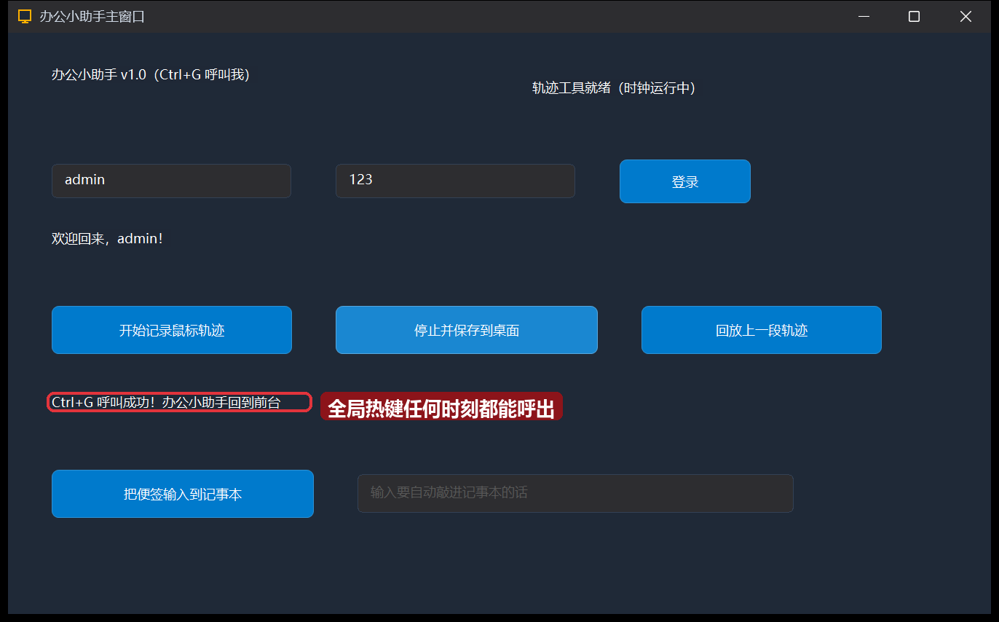

还剩最后一个彩蛋给你自己试：在便签框里写句话 → 点「把便签输入到记事本」→ 3 秒内点开记事本的输入区——你的话会被自动敲进去（记得先启用键盘输入模块）。

## 本集小结

- **整合不等于堆代码**：按钮事件只写一行「调用子程序」，真正的逻辑放子程序里，8 个事件 5 个子程序，条理清清楚楚。
- 程序集变量是跨事件的「共享记忆」：录制开关、登录状态、热键 ID 都放这里。
- 时钟的两用：录制时是**采样器**（周期到期 → 记点），空闲时是**心跳显示**（证明程序活着）。
- 文本就是万能容器：一串「x,y」用 `|` 连接、逗号分隔，存文件、读回来、拆开就能回放——第 19/20 集的组合拳。

**下一集预告**：[23 · 界面布局进阶](/guide/tutorials/beginner)——控件多了怎么摆？分组框、选项卡来救场。
