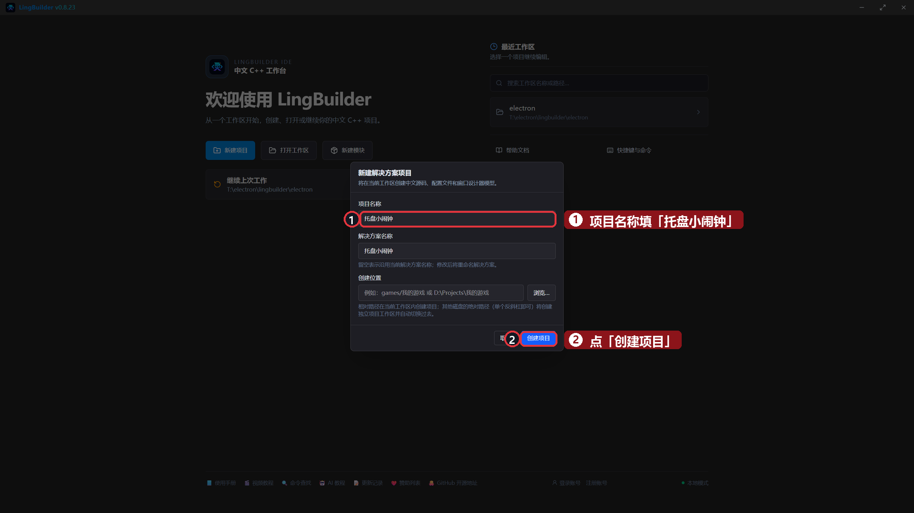
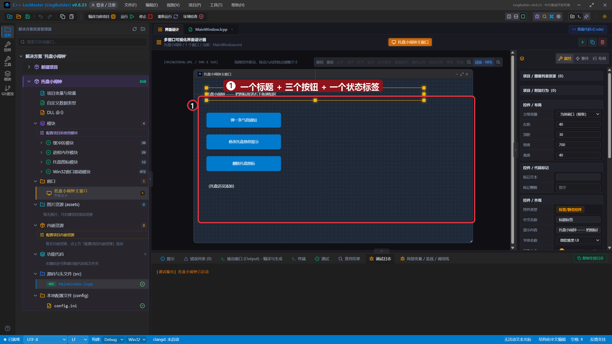
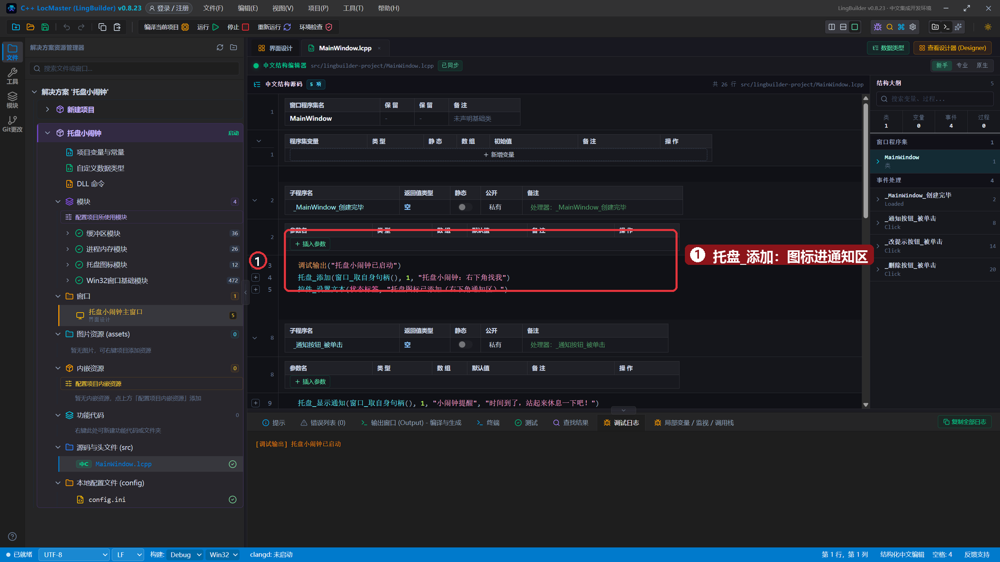
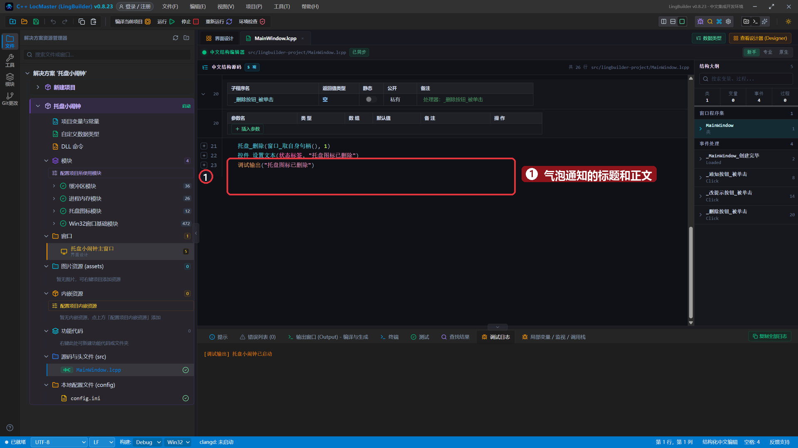
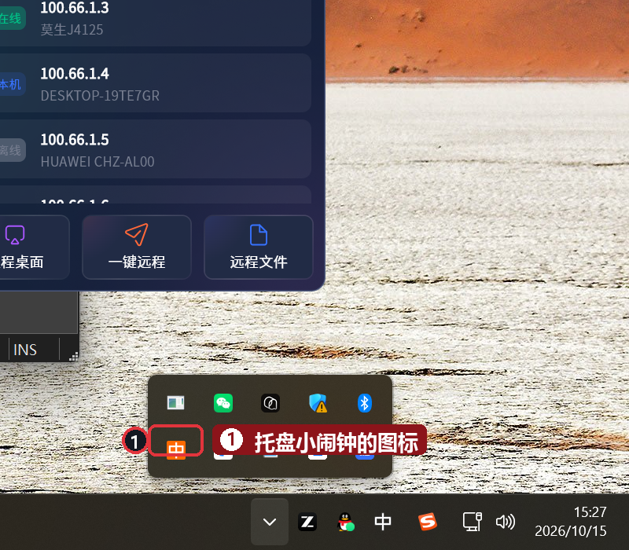
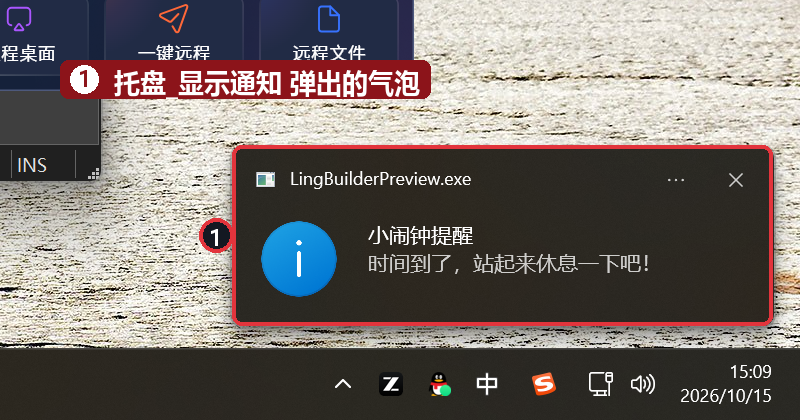
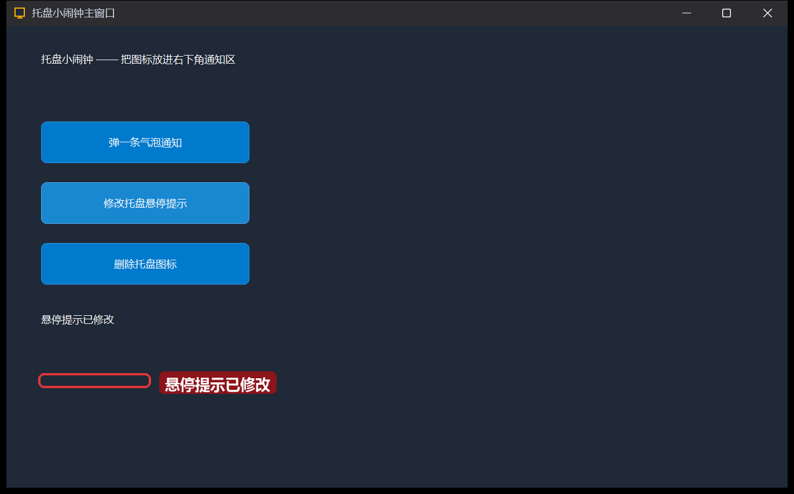
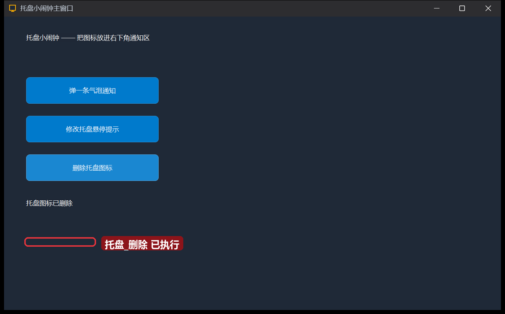

# 25 · 托盘图标与通知

> 《LingBuilder 零基础入门实战》第 25 集。很多软件「关了窗口还在」——它们藏在屏幕右下角的**通知区**（托盘）。这集写一个「托盘小闹钟」：加图标、弹系统气泡通知、改悬停提示、随手删除。全集目录见 [系列总览](/guide/tutorials/beginner)。
>
> 本集目标：托盘图标模块四条命令 + `窗口_取自身句柄()`。全程约 10 分钟。

## 1. 新建项目

欢迎页 →「**新建项目**」→ 项目名称 **托盘小闹钟** →「创建项目」：



## 2. 启用模块

模块面板启用「**托盘图标模块**」（托盘_添加 / 托盘_显示通知 等四条命令都在这里）。

## 3. 搭界面

| 控件 | 中文名称 | 显示内容 | 位置 (左,顶,宽,高) |
| --- | --- | --- | --- |
| 标签 | `标题标签` | 托盘小闹钟 —— 把图标放进右下角通知区 | 40, 30, 700, 40 |
| 按钮 | `通知按钮` | 弹一条气泡通知 | 40, 110, 240, 48 |
| 按钮 | `改提示按钮` | 修改托盘悬停提示 | 40, 180, 240, 48 |
| 按钮 | `删除按钮` | 删除托盘图标 | 40, 250, 240, 48 |
| 标签 | `状态标签` | （托盘还没添加） | 40, 330, 820, 32 |



三个按钮各绑「被单击 (Click)」。

## 4. 写代码

窗口一打开就添加托盘图标——`窗口_取自身句柄()` 是第 22 集学过的免句柄命令：

```lingbuilder
事件 _MainWindow_创建完毕()
    调试输出("托盘小闹钟已启动")
    托盘_添加(窗口_取自身句柄(), 1, "托盘小闹钟：右下角找我")
    控件_设置文本(状态标签, "托盘图标已添加（右下角通知区）")
结束
```

三个按钮各调一条托盘命令：

```lingbuilder
事件 _通知按钮_被单击()
    托盘_显示通知(窗口_取自身句柄(), 1, "小闹钟提醒", "时间到了，站起来休息一下吧！")
    控件_设置文本(状态标签, "气泡通知已发出（看右下角）")
    调试输出("气泡通知已发出")
结束

事件 _改提示按钮_被单击()
    托盘_修改提示(窗口_取自身句柄(), 1, "鼠标停在我身上能看到这句话")
    控件_设置文本(状态标签, "悬停提示已修改")
    调试输出("悬停提示已修改")
结束

事件 _删除按钮_被单击()
    托盘_删除(窗口_取自身句柄(), 1)
    控件_设置文本(状态标签, "托盘图标已删除")
    调试输出("托盘图标已删除")
结束
```

- 四条命令的**编号**参数都是 `1`——同一个编号对应同一个托盘图标，先添加才能改/删/通知。
- `托盘_显示通知(句柄, 编号, 标题, 内容)`：弹出的是**系统级**气泡通知（Windows 通知中心也能看到）。

完整代码分两屏：





## 5. 运行！

保存，点「运行」。点开任务栏右下角的「^」折叠区——托盘小闹钟的图标已经在里面了：



点「弹一条气泡通知」——右下角弹出系统气泡：



点「修改托盘悬停提示」——再把鼠标停在托盘图标上，提示文字换成了新的：



点「删除托盘图标」——折叠区里的图标消失：



## 本集小结

- **托盘四件套**：`托盘_添加`（编号 + 提示文本）→ `托盘_显示通知`（气泡）→ `托盘_修改提示` → `托盘_删除`，全部用 `窗口_取自身句柄()` + 同一个编号寻址。
- 气泡通知是系统通知，程序在后台也能提醒用户——配合第 15 集的 `延时` 和第 21 集的热键，就能做「定时提醒器」。
- 图标用的是应用默认图标；程序退出时托盘图标会自动消失。

**下一集预告**：[26 · 简易计算器](/guide/tutorials/beginner)——把四则运算装进一个窗口。
