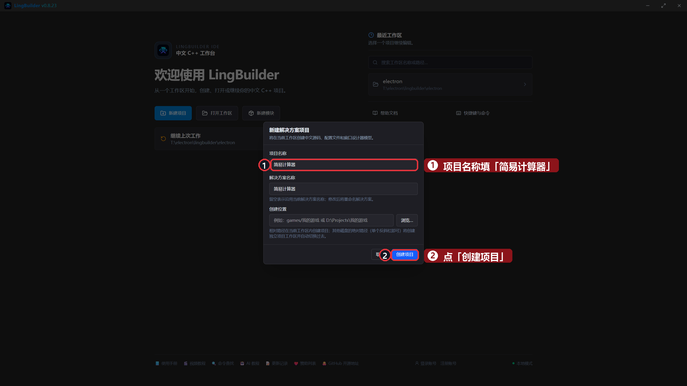
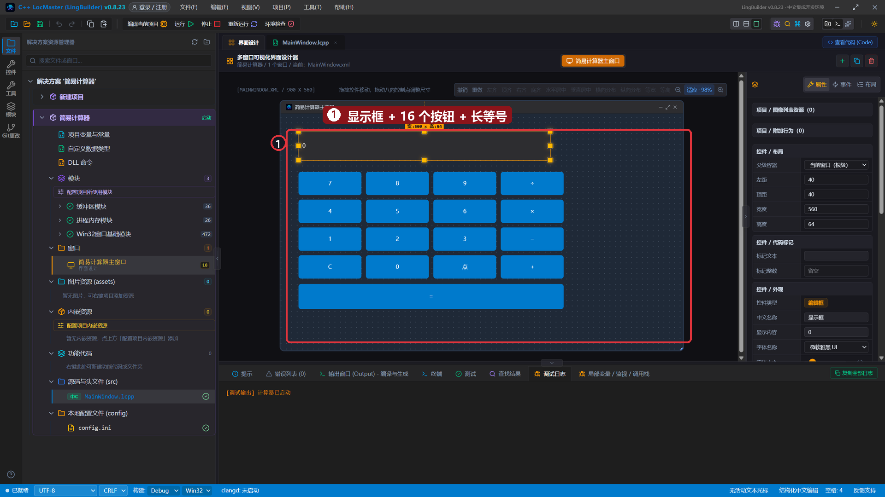
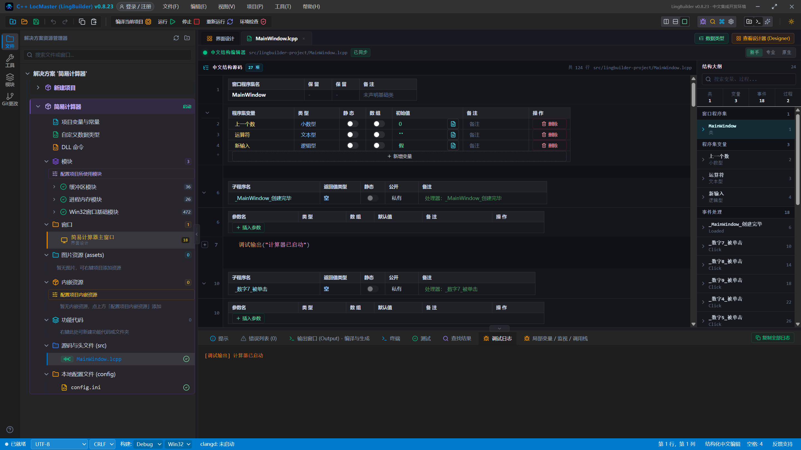
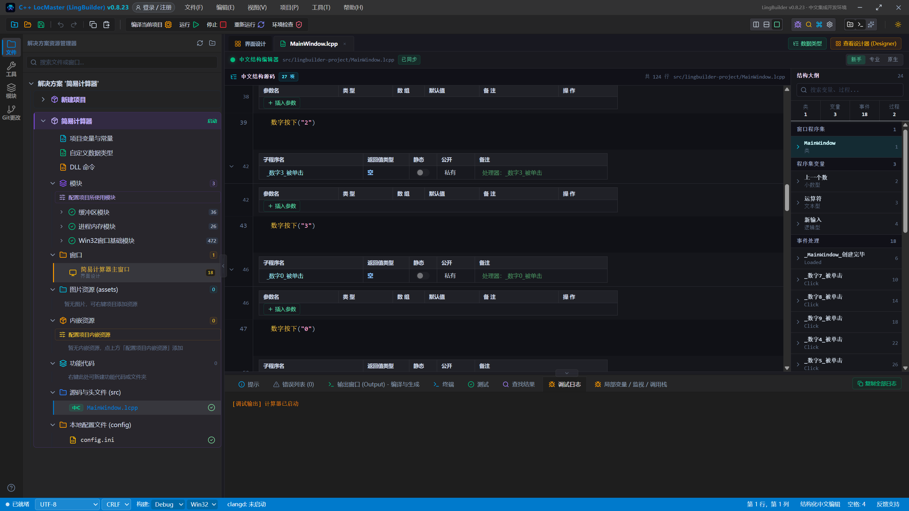
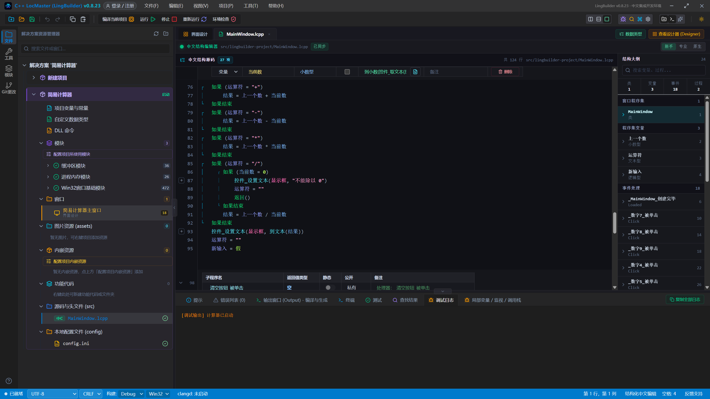
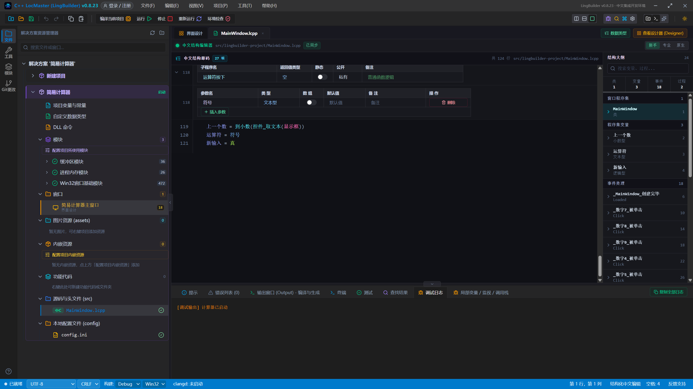
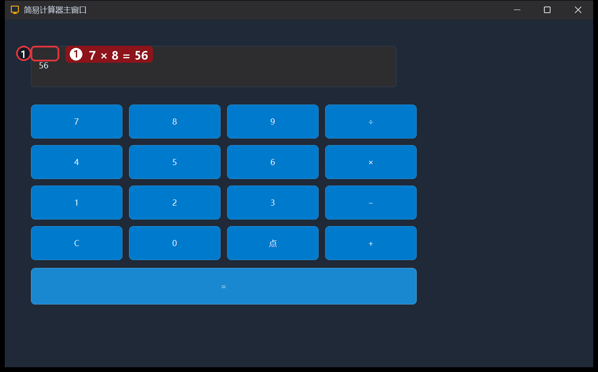
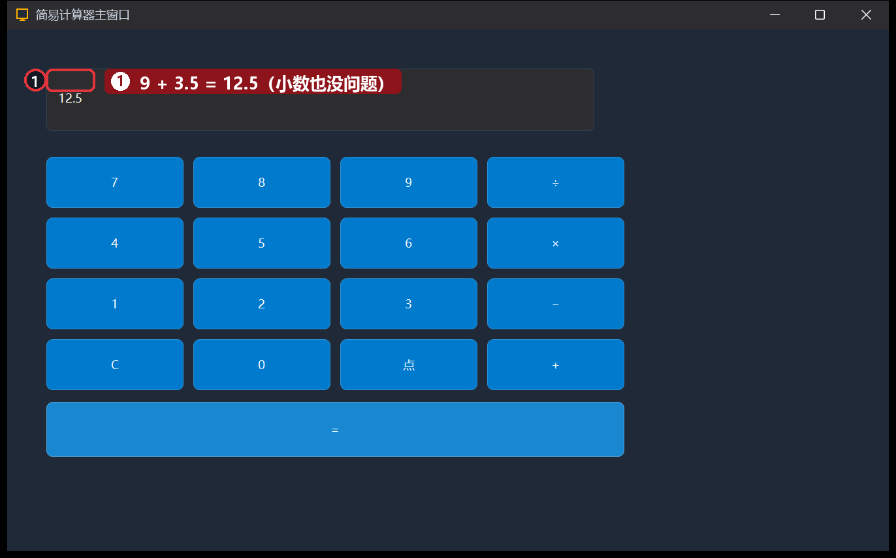
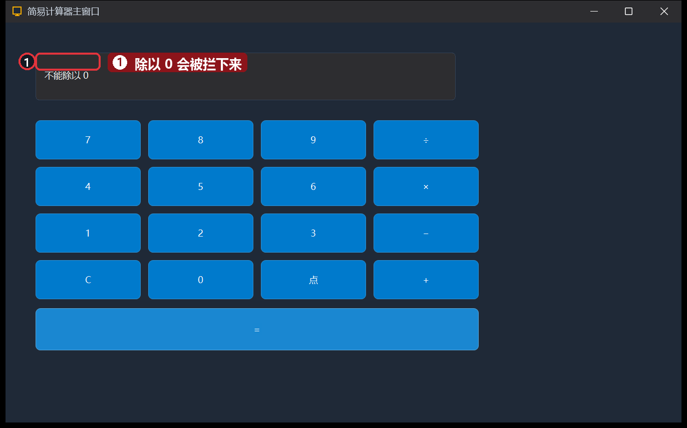

# 26 · 简易计算器

> 《LingBuilder 零基础入门实战》第 26 集。这集把四则运算装进一个窗口：数字键盘、加减乘除、小数、连「不能除以 0」都帮你拦住。学完你就掌握了「一堆按钮 + 一个状态机」的经典界面套路。全集目录见 [系列总览](/guide/tutorials/beginner)。
>
> 本集目标：16 个按钮的批量布局 → 程序集变量当「计算器记忆」→ 到小数/到文本 转换。全程约 18 分钟。

## 1. 新建项目

欢迎页 →「**新建项目**」→ 项目名称 **简易计算器** →「创建项目」：



## 2. 搭界面：显示框 + 按钮矩阵

| 控件 | 中文名称 | 显示内容 | 位置 (左,顶,宽,高) |
| --- | --- | --- | --- |
| 编辑框 | `显示框` | 0 | 40, 40, 560, 64（勾选「只读」） |
| 按钮 ×4 | `数字7` `数字8` `数字9` `除号按钮` | 7 8 9 ÷ | 40/190/340/490, 130, 140, 52 |
| 按钮 ×4 | `数字4` `数字5` `数字6` `乘号按钮` | 4 5 6 × | 同上, 192, 140, 52 |
| 按钮 ×4 | `数字1` `数字2` `数字3` `减号按钮` | 1 2 3 − | 同上, 254, 140, 52 |
| 按钮 ×4 | `清空按钮` `数字0` `小数点按钮` `加号按钮` | C 0 . + | 同上, 316, 140, 52 |
| 按钮 | `等号按钮` | ＝ | 40, 380, 590, 56 |



每个按钮都绑「被单击 (Click)」——处理器名就是 `_<控件名>_被单击`（如 `_数字7_被单击`、`_等号按钮_被单击`）。

## 3. 程序集变量：计算器的「记忆」

在程序集变量表加三个变量（类型很重要）：

| 名称 | 类型 | 初始值 | 用途 |
| --- | --- | --- | --- |
| `上一个数` | 小数型 | 0 | 按运算符时存下的左操作数 |
| `运算符` | 文本型 | （空） | 当前待执行的运算 |
| `新输入` | 逻辑型 | 假 | 按过运算符后，下一个数字要「另起一行」 |

## 4. 写代码

数字按钮全走同一个子程序（以 7 为例，其余 0~9 和小数点只换参数）：

```lingbuilder
事件 _数字7_被单击()
    数字按下("7")
结束
```

两个核心子程序：

```lingbuilder
空 数字按下(文本型 数字)
    如果 (新输入)
        控件_设置文本(显示框, "")
        新输入 = 假
    结束
    局部 文本型 当前
    当前 = 控件_取文本(显示框)
    如果 (当前 = "0")
        当前 = ""
    结束
    控件_设置文本(显示框, 当前 + 数字)
结束

空 运算符按下(文本型 符号)
    上一个数 = 到小数(控件_取文本(显示框))
    运算符 = 符号
    新输入 = 真
结束
```

- `到小数(文本)`：文本转小数；`到文本(数)` 反过来。两个转换命令在第 11 集的数值运算里见过整数版。

等号按钮做真正的计算——四个如果各管一种运算：

```lingbuilder
事件 _等号按钮_被单击()
    如果 (运算符 = "")
        返回()
    结束
    小数型 结果 = 0
    小数型 当前数 = 到小数(控件_取文本(显示框))
    如果 (运算符 = "+")
        结果 = 上一个数 + 当前数
    结束
    如果 (运算符 = "-")
        结果 = 上一个数 - 当前数
    结束
    如果 (运算符 = "*")
        结果 = 上一个数 * 当前数
    结束
    如果 (运算符 = "/")
        如果 (当前数 = 0)
            控件_设置文本(显示框, "不能除以 0")
            运算符 = ""
            返回()
        结束
        结果 = 上一个数 / 当前数
    结束
    控件_设置文本(显示框, 到文本(结果))
    运算符 = ""
    新输入 = 假
结束
```

- **除零保护**：除之前先看除数是不是 0，是就显示提示并 `返回()` 提前结束。
- 计算完把 `运算符` 清空——再按等号就不会重复计算了。

C 键一键归零：

```lingbuilder
事件 _清空按钮_被单击()
    控件_设置文本(显示框, "0")
    上一个数 = 0
    运算符 = ""
    新输入 = 假
结束
```

完整代码分四屏：









## 5. 运行！

保存，点「运行」。按 **7 × 8 ＝**——显示框亮出 56：



按 **C 9 + 3 . 5 ＝**——小数加法也没问题：



再来个坏习惯：**8 ÷ 0 ＝**——程序稳稳拦住：



## 本集小结

- **一堆按钮一个套路**：数字按钮全部转发给 `数字按下(参数)`，新增按键只需要一行转发。
- **程序集变量 = 状态机**：`上一个数 + 运算符 + 新输入` 三个变量撑起了「输入 → 运算 → 等号」的完整流程。
- `到小数` / `到文本` 是界面和计算之间的翻译官。
- 永远不要相信输入：除零先判断，`返回()` 提前离场。

**下一集预告**：[27 · 实战 TXT 记事本①](/guide/tutorials/beginner-27-notepad-1)——从零做一个能打开、能保存的真记事本。
