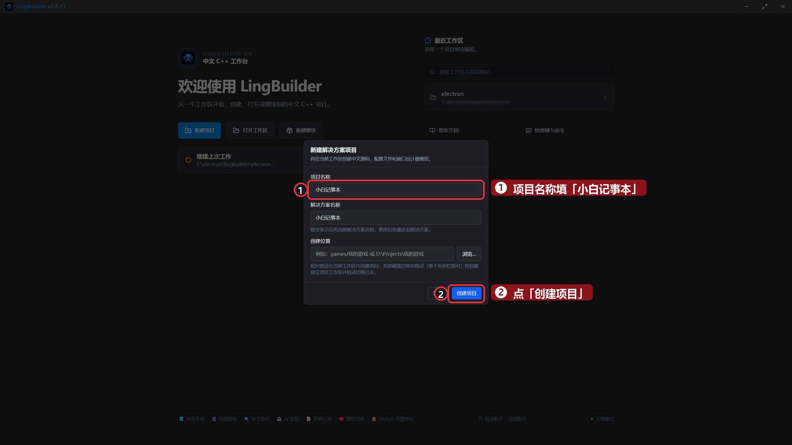
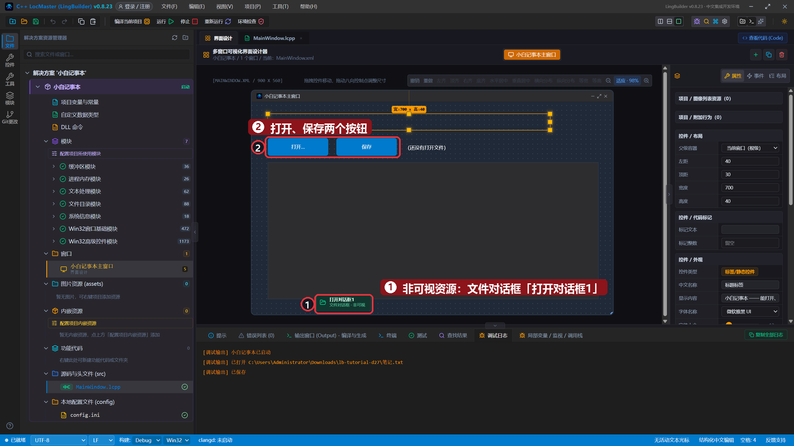
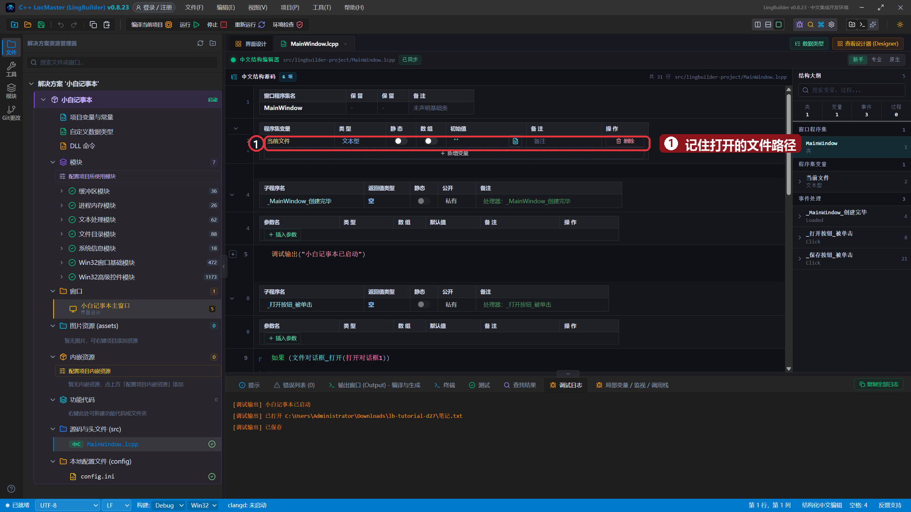
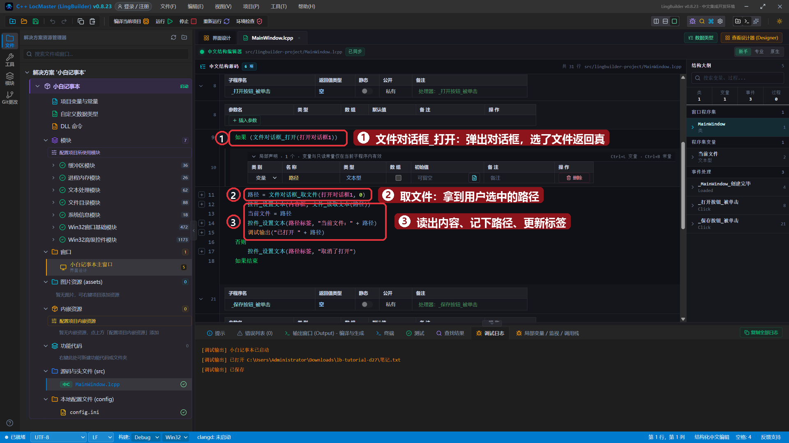
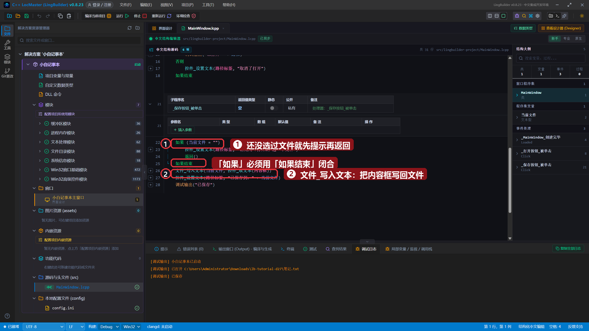
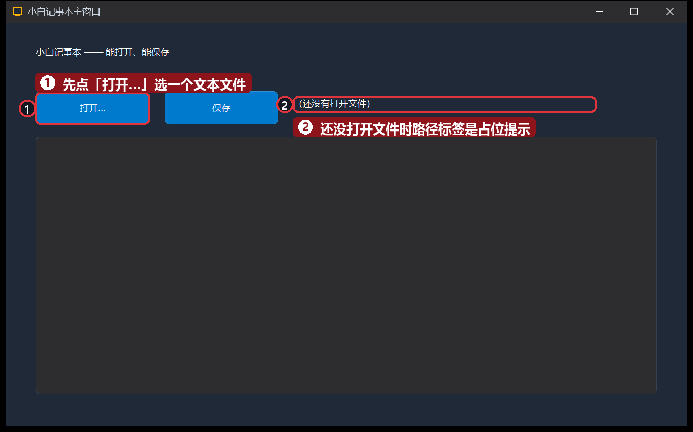
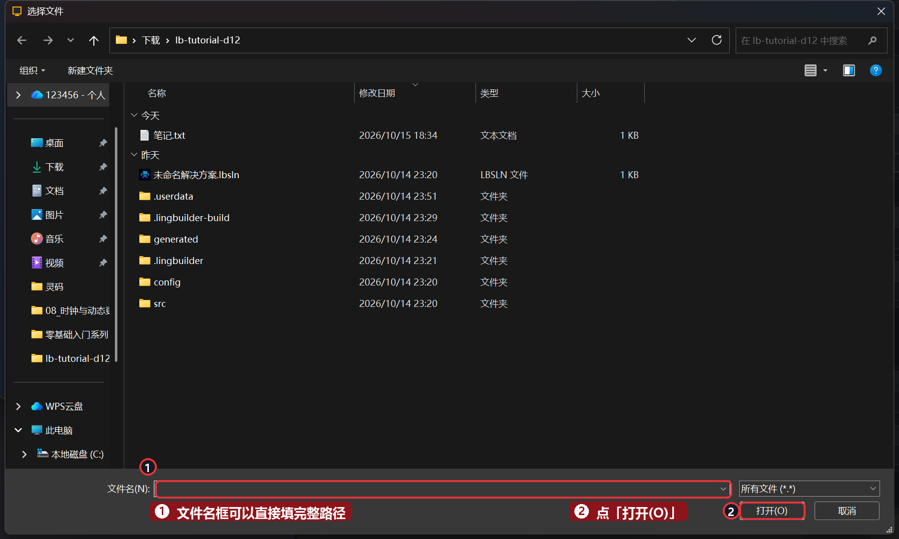
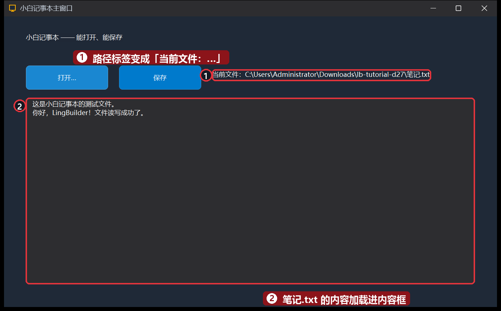
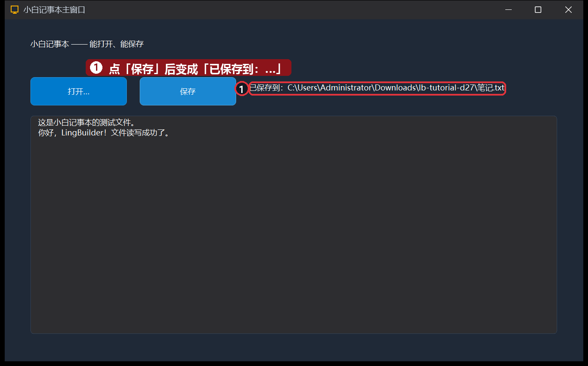

# 27 · 实战 TXT 记事本①：打开与保存

> 《LingBuilder 零基础入门实战》第 27 集。从这集开始，连做三集把「记事本」从玩具做成成品：本集先让它**能打开、能保存**——点「打开…」弹出文件对话框选一个 txt，内容读进窗口；改完点「保存」写回磁盘。学完你就把第 12 集的文件读写正式用进了一个真软件。全集目录见 [系列总览](/guide/tutorials/beginner)。
>
> 本集目标：搭记事本界面 → 非可视资源「文件对话框」→ 程序集变量记住当前文件 → 打开/保存两个事件。全程约 15 分钟。

## 1. 新建项目

欢迎页 →「**新建项目**」→ 项目名称 **小白记事本** →「创建项目」：



## 2. 搭界面：两个按钮 + 一个大内容框

| 控件 | 中文名称 | 显示内容 | 位置 (左, 顶, 宽, 高) |
| --- | --- | --- | --- |
| 标签 | `标题标签` | 小白记事本 —— 能打开、能保存 | 40, 30, 700, 40 |
| 按钮 | `打开按钮` | 打开… | 40, 90, 150, 44 |
| 按钮 | `保存按钮` | 保存 | 210, 90, 150, 44 |
| 标签 | `路径标签` | （还没有打开文件） | 380, 98, 480, 32 |
| 编辑框 | `内容框` | （空） | 40, 150, 820, 340（勾选「多行」） |

窗口标题改成 **小白记事本主窗口**，尺寸 900 × 560。

每个按钮都绑「被单击 (Click)」——处理器名就是 `_<控件名>_被单击`（`_打开按钮_被单击`、`_保存按钮_被单击`）。

## 3. 拖一个「文件对话框」非可视资源

到工具箱的「**高级控件**」组里点「**文件对话框 (FileDialog)**」——它是**非可视资源**，和第 8 集的时钟一样不占窗口地方，只在设计器画布下方留一个小卡片：**打开对话框1**。



> 小知识：文件对话框属性里有个「打开控件」可以挂一个按钮，挂上后点那个按钮会**只弹对话框、不执行你的代码**。本教程全程用第 12 集的「代码驱动」写法（自己调 `文件对话框_打开` 弹窗），所以这个属性保持留空——两个都配会出现「按钮没反应」的怪事。

## 4. 写代码

### 程序集变量：记住当前文件

加一个程序集变量 `当前文件`（文本型），打开文件后把路径存进去，保存时按它找到要写的文件：



### 打开按钮：弹窗 → 读取 → 显示

```lingbuilder
事件 _打开按钮_被单击()
    如果 (文件对话框_打开(打开对话框1))
        局部 文本型 路径
        路径 = 文件对话框_取文件(打开对话框1, 0)
        控件_设置文本(内容框, 文件_读取文本(路径))
        当前文件 = 路径
        控件_设置文本(路径标签, "当前文件：" + 路径)
        调试输出("已打开 " + 路径)
    否则
        控件_设置文本(路径标签, "取消了打开")
    如果结束
结束
```



- `文件对话框_打开(打开对话框1)`：弹出选择文件对话框，**选了文件返回真、点了取消返回假**——所以正好套在「如果」里。
- `文件对话框_取文件(打开对话框1, 0)`：拿用户选中的第 1 个文件的完整路径。
- `文件_读取文本(路径)`：整个文件读成一个文本，塞进内容框。

### 保存按钮：写回磁盘

```lingbuilder
事件 _保存按钮_被单击()
    如果 (当前文件 = "")
        控件_设置文本(路径标签, "请先用「打开…」选一个文件")
        返回()
    如果结束
    文件_写入文本(当前文件, 控件_取文本(内容框))
    控件_设置文本(路径标签, "已保存到：" + 当前文件)
    调试输出("已保存")
结束
```



- **还没选过文件就先拦住**：`当前文件` 是空说明从没打开过，提示一句就 `返回()` 提前结束。
- 「如果」必须用「如果结束」闭合——新手编辑器写「如果」会自动补上，但手改代码时最容易把「如果结束」误删成「结束」，那样保存时就会报「如果 结构缺少结束语句」。写完先看一眼底部**错误列表**，有错先修错再运行。

## 5. 运行！

保存，点「运行」。窗口出来，路径标签还是占位提示：



点「**打开…**」——弹出选择文件对话框（它还记得你上一次选文件的目录），选中准备好的 `笔记.txt`（里面先随便写两行字）：



打开成功——内容读进窗口，路径标签变成「当前文件：…」：



点「**保存**」——路径标签变成「已保存到：…」，内容已经写回磁盘。可以关掉程序用记事本打开 `笔记.txt` 验证，改过的字真的存进去了：



## 本集小结

- **非可视资源 = 看不见的工具**：文件对话框不占界面，`文件对话框_打开` 弹窗、`文件对话框_取文件` 拿路径，返回真假正好配「如果」。
- **程序集变量当「书签」**：`当前文件` 记住打开的路径，保存时才知道往哪写；为空就先拦住。
- 「打开 → 改 → 保存」的闭环和记事本软件一模一样，你已经在写「真软件」了。
- 「如果」配「如果结束」，运行前先看错误列表。

**下一集预告**：[28 · 实战 TXT 记事本②](/guide/tutorials/beginner-28-notepad-2)——给记事本加上查找和替换。
