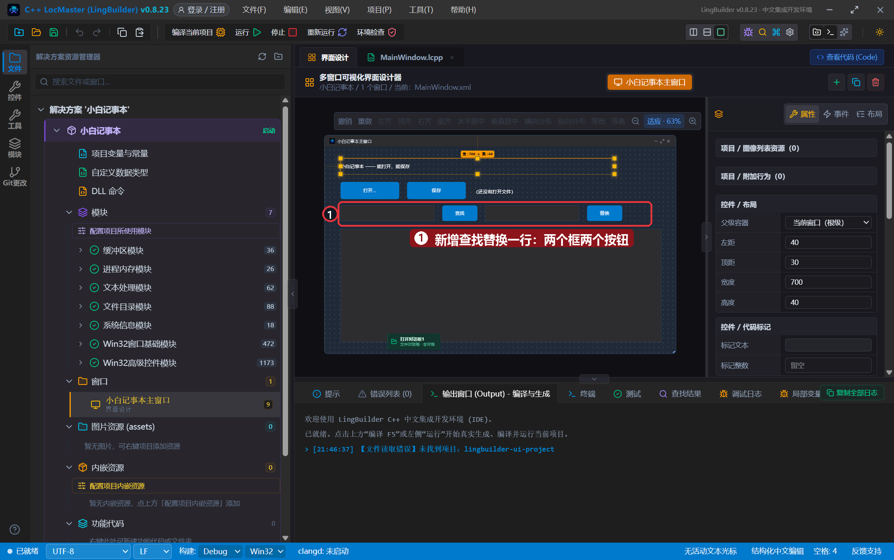
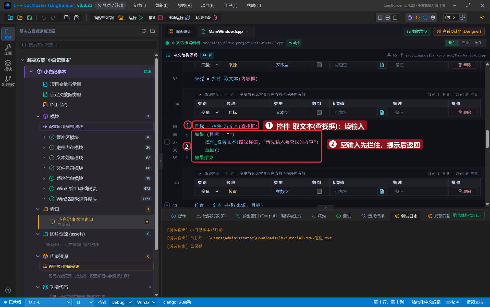
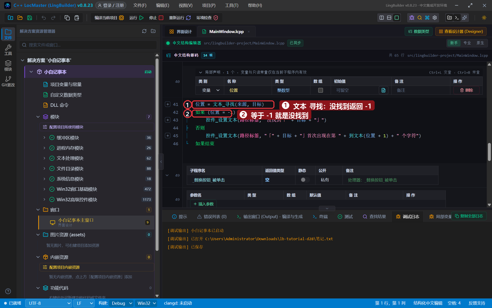
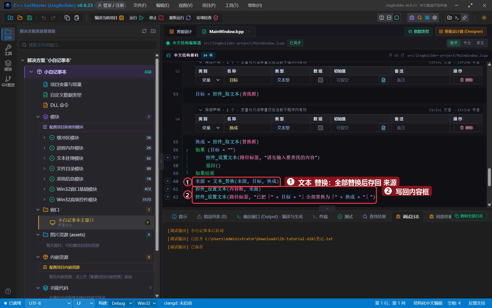
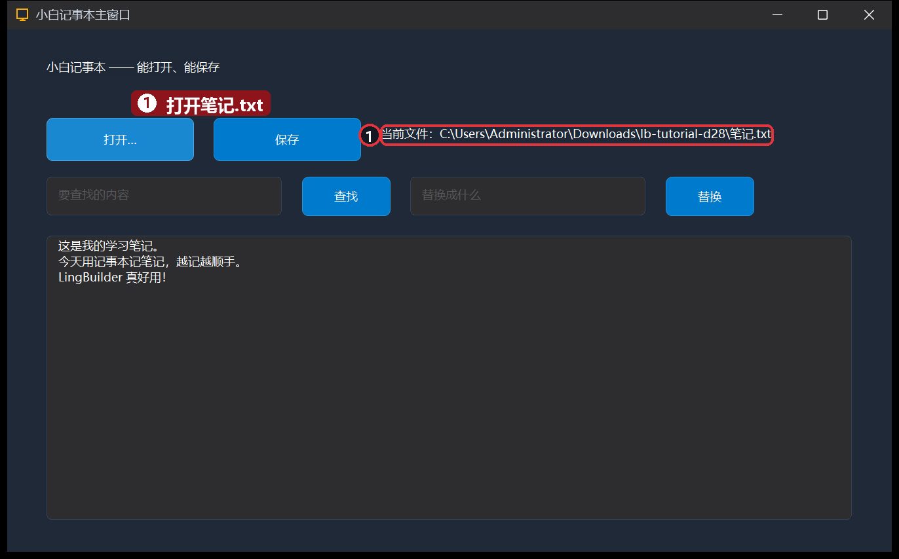
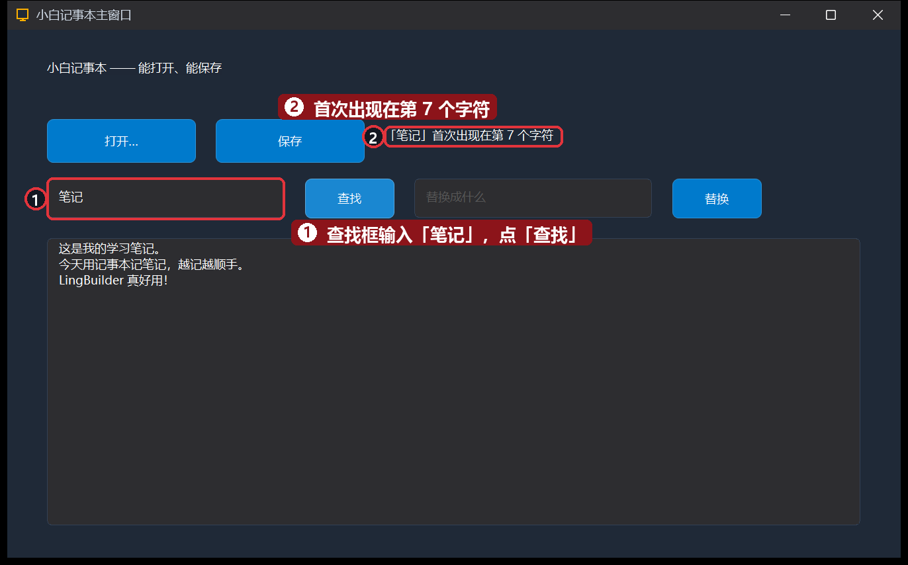
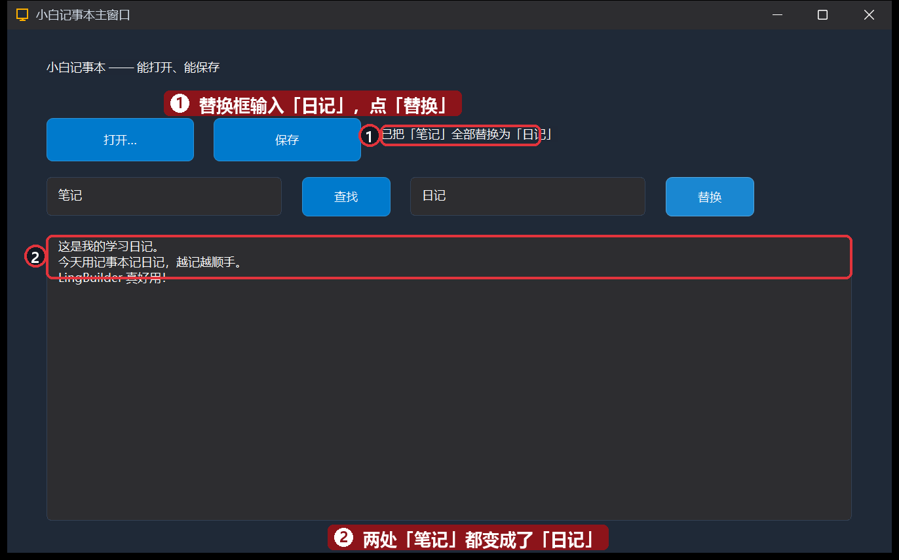

# 28 · 实战 TXT 记事本②：查找替换

> 《LingBuilder 零基础入门实战》第 28 集。给 27 集的记事本装上「查找」和「替换」：输入关键词一点就报告它藏在第几个字符，再输入替换词一键把文章里的「笔记」全改成「日记」。学完你就掌握了 `文本_寻找` / `文本_替换` 这对文本处理主力。全集目录见 [系列总览](/guide/tutorials/beginner)。
>
> 本集目标：再加一行控件 → 读输入框做参数 → `文本_寻找` 报位置 → `文本_替换` 一键全换。全程约 12 分钟。

## 1. 在 27 集项目上加一行控件

打开上一集的「小白记事本」项目（或照着 27 集重新搭一个），在按钮行下面加一行四个控件，内容框往下挪一挪（改成 40, 210, 820, 290）：

| 控件 | 中文名称 | 显示内容 | 位置 (左, 顶, 宽, 高) |
| --- | --- | --- | --- |
| 编辑框 | `查找框` | （空，占位提示「要查找的内容」） | 40, 150, 240, 40 |
| 按钮 | `查找按钮` | 查找 | 300, 150, 90, 40 |
| 编辑框 | `替换框` | （空，占位提示「替换成什么」） | 410, 150, 240, 40 |
| 按钮 | `替换按钮` | 替换 | 670, 150, 90, 40 |

两个按钮照旧绑「被单击 (Click)」：`_查找按钮_被单击`、`_替换按钮_被单击`。



## 2. 查找按钮：报告关键词的位置

`文本_寻找(文本, 目标)` 返回目标**第一次出现的位置**（从 0 起数），找不到返回 **-1**：

```lingbuilder
事件 _查找按钮_被单击()
    局部 文本型 来源
    来源 = 控件_取文本(内容框)
    局部 文本型 目标
    目标 = 控件_取文本(查找框)
    如果 (目标 = "")
        控件_设置文本(路径标签, "请先输入要查找的内容")
        返回()
    如果结束
    局部 整数型 位置
    位置 = 文本_寻找(来源, 目标)
    如果 (位置 = -1)
        控件_设置文本(路径标签, "没找到「" + 目标 + "」")
    否则
        控件_设置文本(路径标签, "「" + 目标 + "」首次出现在第 " + 到文本(位置 + 1) + " 个字符")
    如果结束
结束
```



- 先把「查找框是空的」拦住——`文本_寻找` 遇到空目标会直接返回 0，不拦会误报「在第 1 个字符找到」。
- `位置 + 1`：程序员从 0 起数数，普通人从 1 起。报给用户看之前 +1 更自然。



## 3. 替换按钮：一键全换

`文本_替换(文本, 查找内容, 替换内容)` 把**所有**匹配一次性换掉，返回换好的新文本：

```lingbuilder
事件 _替换按钮_被单击()
    局部 文本型 来源
    来源 = 控件_取文本(内容框)
    局部 文本型 目标
    目标 = 控件_取文本(查找框)
    局部 文本型 换成
    换成 = 控件_取文本(替换框)
    如果 (目标 = "")
        控件_设置文本(路径标签, "请先输入要查找的内容")
        返回()
    如果结束
    来源 = 文本_替换(来源, 目标, 换成)
    控件_设置文本(内容框, 来源)
    控件_设置文本(路径标签, "已把「" + 目标 + "」全部替换为「" + 换成 + "」")
结束
```



- 三个局部变量各管一件事：`来源` 是原文、`目标` 是查什么、`换成` 是换成什么。
- `文本_替换` 不会改动原文本，它**返回新文本**——所以要接回 `来源` 再写回内容框。

## 4. 运行！

保存，点「运行」。还是先「打开…」选中 `笔记.txt`：



查找框输入「**笔记**」，点「**查找**」——路径标签报告「首次出现在第 7 个字符」：



替换框输入「**日记**」，点「**替换**」——两处「笔记」全部变成「日记」：



再点一下「保存」，替换结果就写回磁盘了。用记事本打开 `笔记.txt` 验证，改动真的存进去了。

## 本集小结

- `文本_寻找(文本, 目标)`：返回 0 起位置，**-1 = 没找到**；空目标要先拦。
- `文本_替换(文本, 查找内容, 替换内容)`：全部替换，**返回新文本**，记得接回来。
- 输入框 + 命令 + 标签反馈，就是「表单 → 处理 → 结果」的通用套路。
- 报告位置时 `位置 + 1`，照顾从 1 起数数的用户习惯。

**下一集预告**：[29 · 实战 TXT 记事本③](/guide/tutorials/beginner-29-notepad-3)——状态栏实时统计字数，退出前还能拦截确认。
