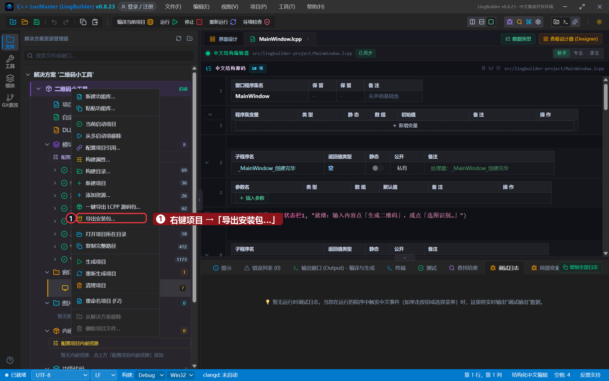
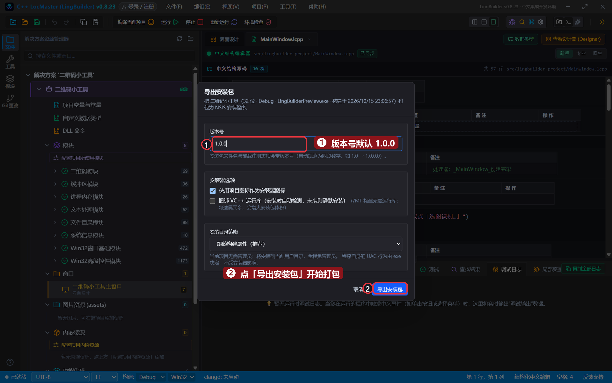
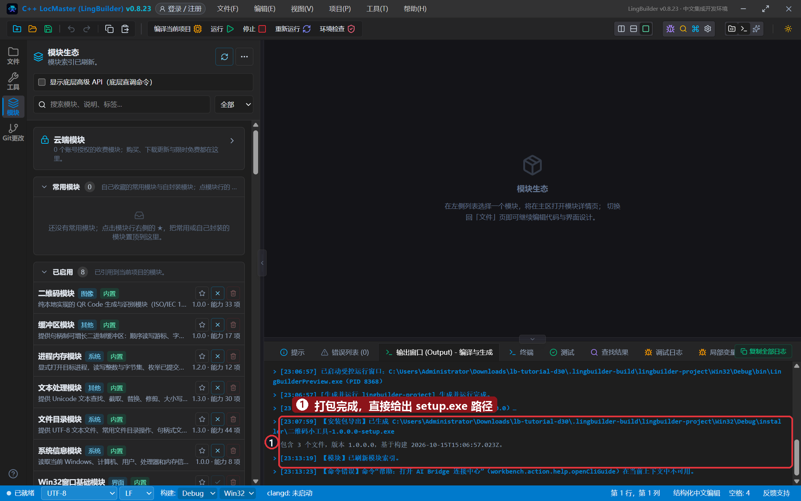
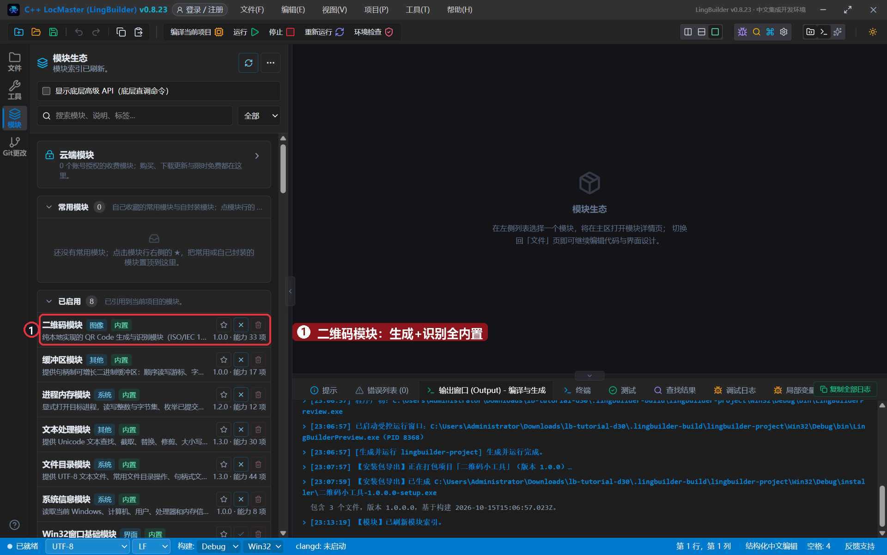
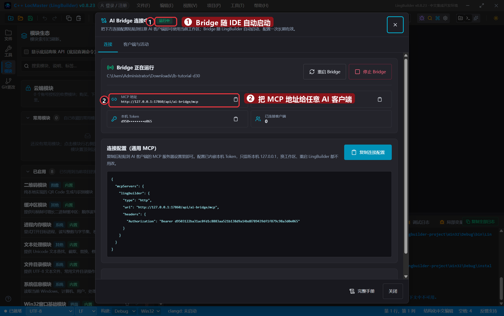
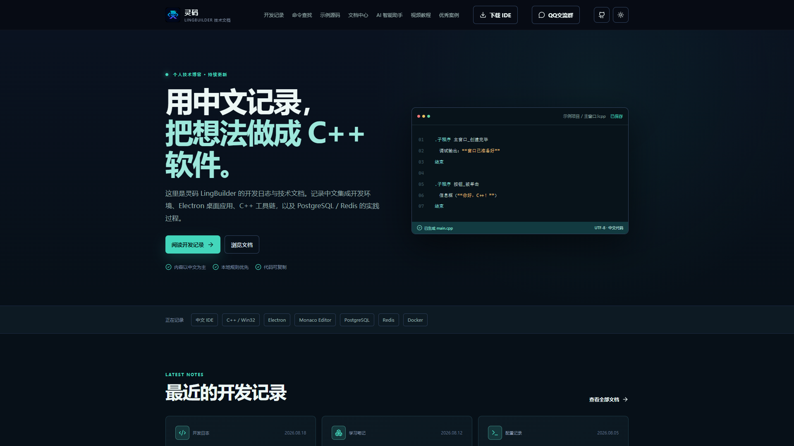
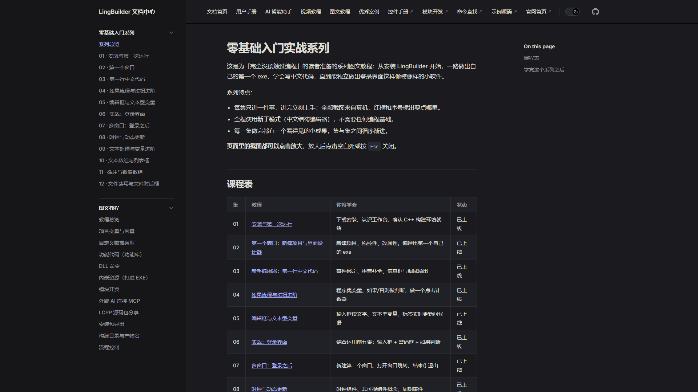
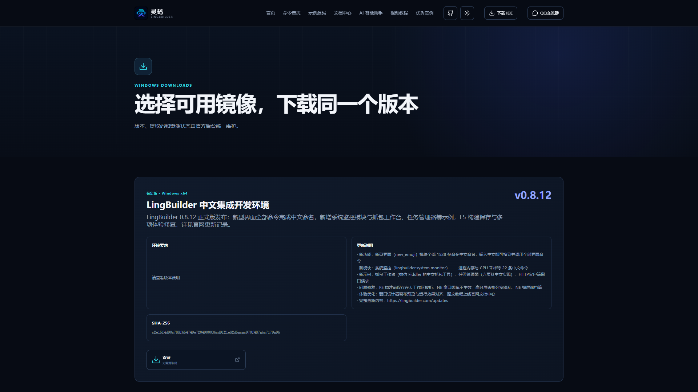

# 31 · 发布与下一步

> 《LingBuilder 零基础入门实战》第 31 集（收官）。软件做完了，这集讲三件「之后」的事：**把软件打包成安装包发给朋友**、**用模块生态给软件加能力**、**让 AI 帮你写下一款软件**——最后给你几张「去哪继续学」的地图。全程以导览为主，不需要写新代码。全集目录见 [系列总览](/guide/tutorials/beginner)。
>
> 本集目标：导出安装包 → 认识模块生态 → 连接 AI Bridge → 官网与社区导航。全程约 10 分钟。

## 1. 把软件打包成安装包

还记第 30 集的二维码小工具吗？在解决方案资源管理器里**右键项目** →「**导出安装包…**」：

弹出导出对话框：版本号默认 1.0.0（安装包文件名和卸载注册表项都会带上它），可以勾选「使用项目图标」「捆绑 VC++ 运行库」，选择安装目录策略——点「**导出安装包**」：

稍等片刻，输出窗口直接给出成品路径——一个 `二维码小工具-1.0.0.0-setup.exe`：

把这个 setup.exe 发给朋友，双击安装、开始菜单启动、控制面板卸载，和市面上的软件一个体验。你的中文程序，就这样成了「正经软件」。

## 2. 模块生态：给软件加能力

左侧「**模块**」页是 LingBuilder 的能力仓库：云端模块在线安装、内置模块即点即用（本系列用过的文本处理、文件目录、二维码模块都在这），还支持安装自己或别人封装的 `.lbmod` 模块包——右上「**…**」菜单里有模块打包与安装入口：

## 3. 让 AI 帮你写下一款软件

工具栏的星形图标打开「**AI Bridge 连接中心**」：Bridge 随 IDE 自动启动，把「复制连接配置」得到的 MCP 配置粘进任意支持 MCP 的 AI 客户端（Codex、Claude Code、Gemini CLI 等），AI 就能直接读写你的工作区、新建项目、编译运行——本系列 31 集的截图，很多就是 AI 自动化拍的：

## 4. 官网与社区

- 官网首页：[lingbuilder.com](https://lingbuilder.com/)——新闻、下载、案例：

- **教程中心**：本系列全部集数都在 [lingbuilder.com/docs/guide/tutorials/beginner](https://lingbuilder.com/docs/guide/tutorials/beginner)，旁边还有流程控制、LingCpp 快速上手等进阶图文：

- **下载页**：[lingbuilder.com/downloads](https://lingbuilder.com/downloads)——随时拿到最新版 IDE：

## 本集小结

- **导出安装包**：右键项目 → 导出安装包 → setup.exe，三步把程序变成「正经软件」。
- **模块生态**：内置模块即点即用，`.lbmod` 让能力可以随身携带、互相分享。
- **AI Bridge**：MCP 配置一处粘贴，外部 AI 变成你的中文编程搭档。
- 31 集走完，你已经从「没写过代码」到「能独立做出、打包、发布的中文软件」——下一步做什么，由你说了算。

**系列完**。回[系列总览](/guide/tutorials/beginner)复习任意一集，或去[教程中心](https://lingbuilder.com/docs/)继续进阶。
