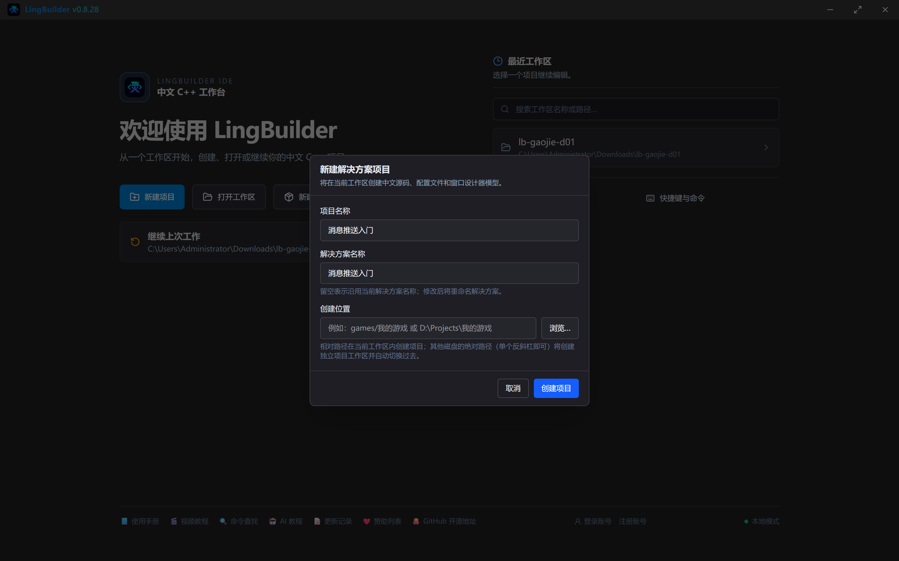
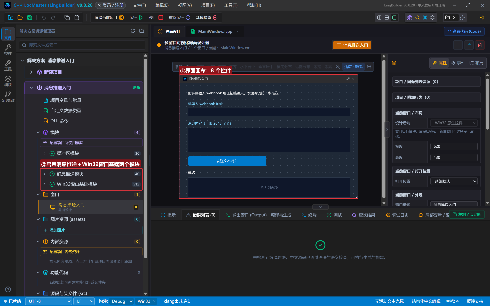
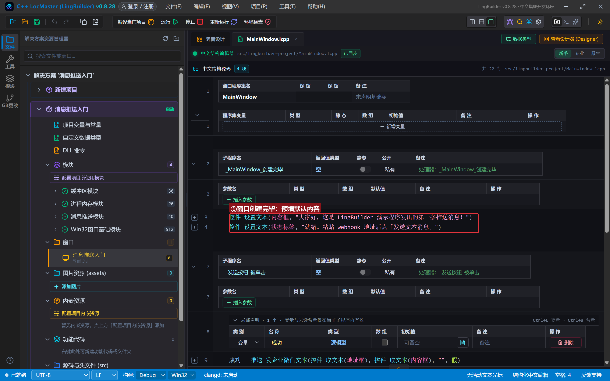
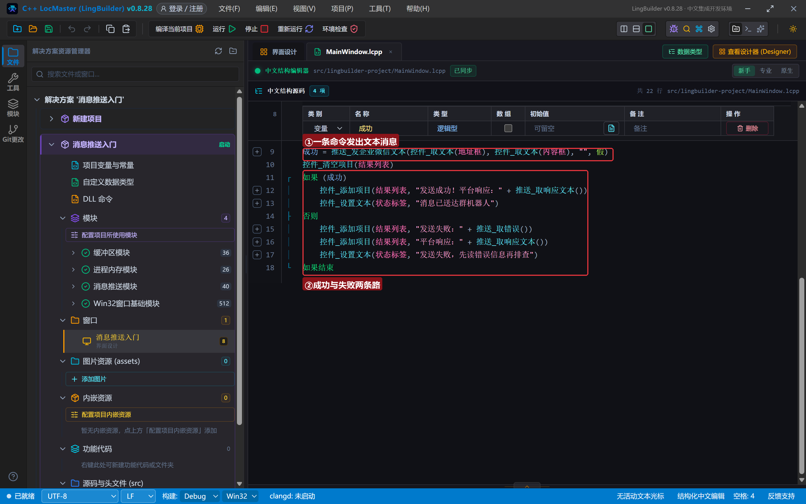
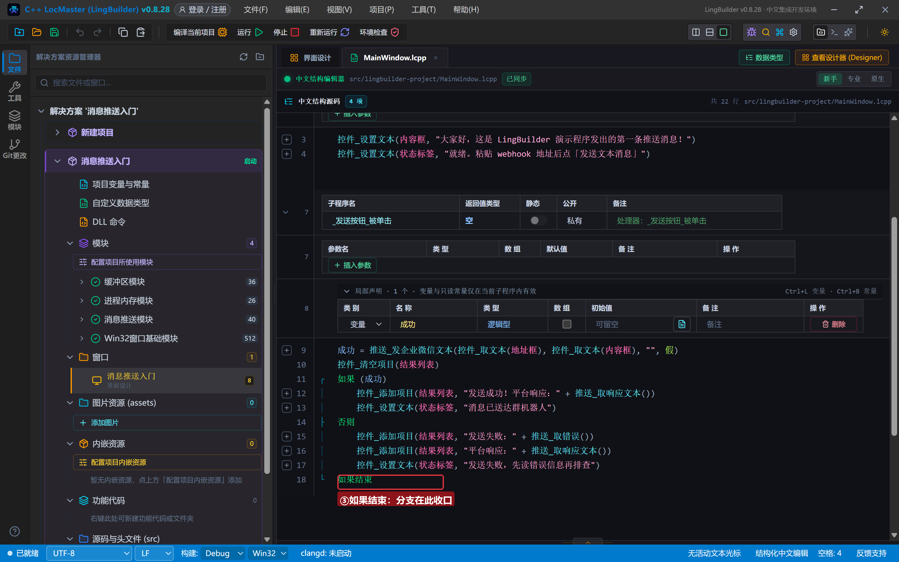
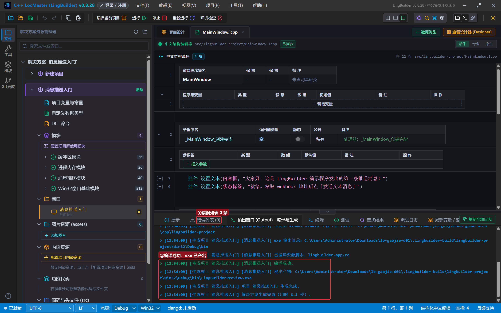
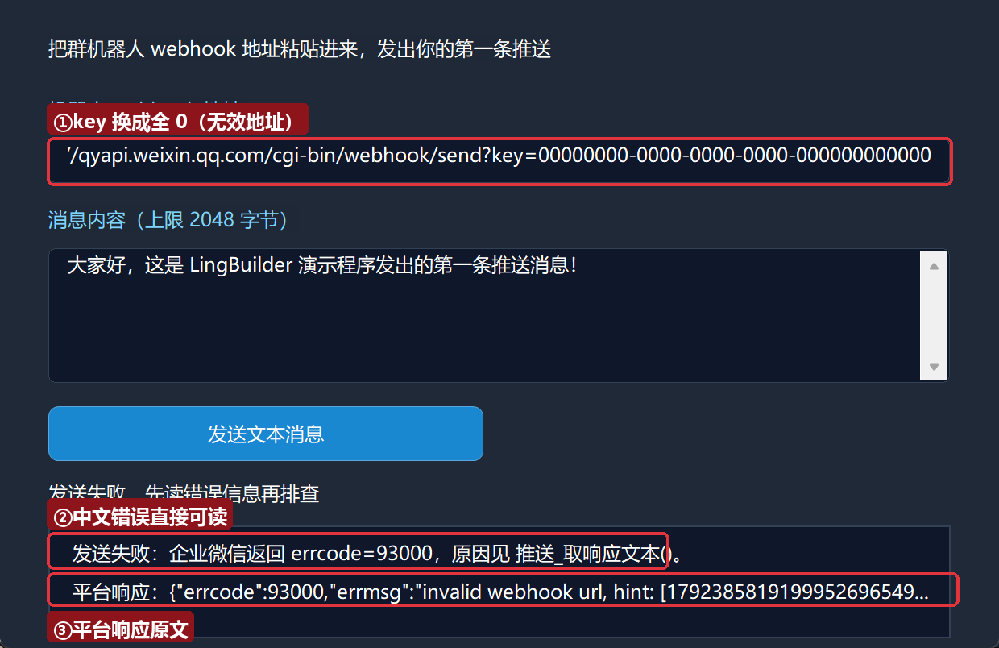
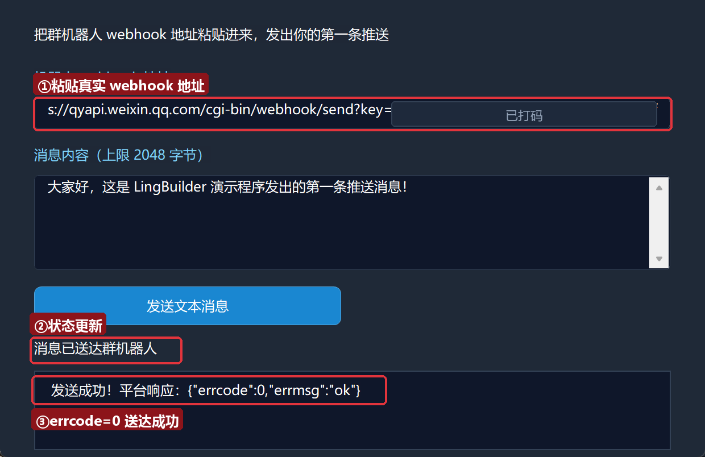
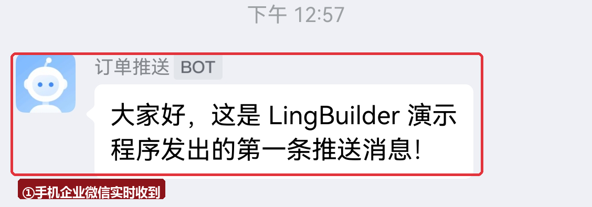

# 高阶实战 01 · 消息推送入门：发出你的第一条企微推送

> 《LingBuilder 高阶实战系列》第 1 集，**消息推送专题·企业微信篇**开篇。程序跑完一批任务、服务器半夜出了状况——「往群里发条消息告诉我」是当下最通用的通知方式。本集用**消息推送模块（lingbuilder.notify）**把一条文本消息发进你的企业微信群：从申请群机器人、新建项目，到真实发送、读懂平台响应，再到「故意失败一次」学会排障。全程约 30 分钟。
>
> 前置要求：学完[零基础入门系列](/guide/tutorials/beginner)即可，本集不需要任何网络编程基础。本集源码包见文末。

## 这一集你将学会

- 什么是**群机器人 webhook**，去哪里申请
- `推送_发企业微信文本(地址, 内容, 手机号列表, 是否所有人)`：4 个参数发出一条文本消息
- `推送_取错误()` / `推送_取响应文本()`：失败排障的两件套
- 红线：webhook 地址里的 `key` 就是发信权限，不能写进代码、不能发给别人

## 1. 三十秒理解：程序怎么把消息发进群

企业微信群可以添加一种叫**群机器人**的东西。添加后它会给你一个很长网址，长这样：

```text
https://qyapi.weixin.qq.com/cgi-bin/webhook/send?key=xxxxxxxx-xxxx-xxxx-xxxx-xxxxxxxxxxxx
```

这个网址就是机器人的「收件入口」：程序往它 POST 一段 JSON（`{"msgtype":"text","text":{"content":"你好"}}`），机器人就把消息发进群。网址里 `key=` 后面那串就是这台机器人的**发信钥匙**——谁拿到 key，谁就能往你的群里发消息，所以要保管好。

这些组 JSON、转义引号、拼接地址的活儿，LingBuilder 的**消息推送模块**全部代劳，你只需要一条命令：

```lcpp
推送_发企业微信文本(地址, "构建完成", "", 假)
```

返回逻辑型：真 = 平台确认送达，假 = 中途被拒（用 `推送_取错误()` 看中文原因）。

## 2. 申请一个群机器人 webhook（3 分钟）

1. 电脑或手机上打开你的企业微信群（没有合适的话，新建一个只有自己的群也完全可以）；
2. 点群右上角「**群设置**」→ 找到「**群机器人**」→ 点「**添加机器人**」；
3. 给机器人起个名字（比如「构建通知」），创建成功后会显示 **Webhook 地址**；
4. 点「复制地址」，先粘贴到记事本里备用。它长什么样参见第 1 节。

> 安全提醒：这个地址不要发到公开的群、帖子或代码仓库里。本教程的所有截图都已把 key 打码，你也应该这样做。

## 3. 新建项目与启用模块

新建窗口项目：名称 **消息推送入门**，模板「Windows 界面设计」，创建位置留空：



在解决方案树的「模块」区确认两个模块已启用：**消息推送模块**（40 条命令，本集主角）和 **Win32窗口基础模块**（界面控件的 `控件_设置文本` 等命令来自它，新建窗口项目默认已启用）：



## 4. 设计界面

界面很简单：一个地址框、一个内容框、一个发送按钮，加一条状态栏和一块结果列表。

| 控件 | 名称 | 显示内容 | 左距 | 顶距 | 宽度 | 高度 |
| --- | --- | --- | --- | --- | --- | --- |
| 标签 | 说明标签 | 把群机器人 webhook 地址粘贴进来，发出你的第一条推送 | 30 | 22 | 560 | 24 |
| 标签 | 地址标签 | 机器人 webhook 地址 | 30 | 60 | 220 | 22 |
| 编辑框 | 地址框 | （空） | 30 | 86 | 560 | 28 |
| 标签 | 内容标签 | 消息内容（上限 2048 字节） | 30 | 128 | 220 | 22 |
| 编辑框 | 内容框 | （空，勾选**多行**） | 30 | 154 | 560 | 84 |
| 按钮 | 发送按钮 | 发送文本消息 | 30 | 252 | 270 | 34 |
| 标签 | 状态标签 | 就绪 | 30 | 298 | 560 | 22 |
| 列表框 | 结果列表 | — | 30 | 326 | 560 | 70 |

窗口宽 620、高 430。绑 1 个按钮事件（发送按钮 → 被单击）+ 窗口「创建完毕」。

## 5. 写代码

创建完毕事件预填默认内容；发送按钮事件一条命令完成投递，成功失败各走一条路：

```lcpp
事件 _MainWindow_创建完毕()
    控件_设置文本(内容框, "大家好，这是 LingBuilder 演示程序发出的第一条推送消息！")
    控件_设置文本(状态标签, "就绪。粘贴 webhook 地址后点「发送文本消息」")
结束
```



```lcpp
事件 _发送按钮_被单击()
    局部 逻辑型 成功
    成功 = 推送_发企业微信文本(控件_取文本(地址框), 控件_取文本(内容框), "", 假)
    控件_清空项目(结果列表)
    如果 (成功)
        控件_添加项目(结果列表, "发送成功！平台响应：" + 推送_取响应文本())
        控件_设置文本(状态标签, "消息已送达群机器人")
    否则
        控件_添加项目(结果列表, "发送失败：" + 推送_取错误())
        控件_添加项目(结果列表, "平台响应：" + 推送_取响应文本())
        控件_设置文本(状态标签, "发送失败，先读错误信息再排查")
    如果结束
结束
```



拆解：

- **4 个参数**依次是：机器人地址、消息正文、要 @ 的手机号列表（本集先传空文本 `""` 不 @ 人，第 2 集细讲）、是否 @ 所有人（传逻辑型 `假`）。
- **正文给原文就行**：内容里的引号、换行由运行时自动转义成 JSON 安全格式，你不需要自己拼。
- 返回值是逻辑型，必须「先声明、再赋值」（`局部 逻辑型 成功`），这是老规矩了。
- **失败不抛异常**：命令返回假，中文原因固定到 `推送_取错误()` 里读；平台的原始 JSON 应答固定到 `推送_取响应文本()` 里读。这两件套是整个专题的排障基石，第 14 集还会系统展开。



## 6. 编译与运行

点「编译当前项目」。错误列表 (0)、输出窗口「编译成功」、exe 已产出：



> 习惯动作：每次运行/编译前先瞄一眼底部**错误列表**，有红的先修红的，再往下走。

### 6.1 先来一次真实失败：把 key 换成全 0

排障能力是推送系统的基本功，我们先故意失败一次。把地址框里 `key=` 后面那串改成全 0，点「发送文本消息」：



结果列表出现两行：

- `发送失败：企业微信返回 errcode=93000，原因见 推送_取响应文本()。`——`推送_取错误()` 给出的**中文结论**；
- `平台响应：{"errcode":93000,"errmsg":"invalid webhook url, hint:..."}`——`推送_取响应文本()` 给出的**平台原话**。

`errcode` 是企业微信的**错误编号**：0 才是成功，非 0 就是失败。93000 = webhook 地址无效（key 不存在）。以后遇到任何推送失败，先看中文结论，再拿 errcode 去官方文档一查便知。

### 6.2 换回真实地址：第一条消息送达

把真实 webhook 地址粘回地址框（`https://` 开头完整粘贴），再点「发送文本消息」：



结果列表显示 `发送成功！平台响应：{"errcode":0,"errmsg":"ok"}`，状态栏变成「消息已送达群机器人」。打开手机上的企业微信——消息已经在群里了：



`errcode:0` + `errmsg:ok` 就是企业微信的「签收单」。恭喜，你的程序从此有了主动说话的能力——后面 14 集全部建立在这一条链路上。

## 7. 红线与提示

- **key 就是权限**：webhook 地址不要硬编码进源码、不要提交到代码仓库、不要发给别人。本集源码包里的地址框是空的，运行时自己粘贴。真实项目从配置文件或环境变量里读。
- **@ 人先放一放**：`推送_发企业微信文本` 的后两个参数（手机号列表、是否所有人）本集传了 `""` 和 `假`，第 2 集专门讲。
- **限流**：每个机器人约 20 条/分钟，循环推送要控制节奏，收到频率类 errcode 先等待再重试。
- **失败要可见**：永远把 `推送_取错误()` 的结果回显给用户（像本集那样写进结果列表），静默吞掉失败是通知系统的大忌。

## 8. 常见问题急救表

| 症状 | 原因 | 解法 |
| --- | --- | --- |
| `errcode=93000 invalid webhook url` | key 错误/机器人被删/地址不完整 | 重新复制 webhook 地址；确认机器人还在群设置里 |
| 「地址解析失败：必须是完整的 http:// 或 https:// webhook 地址。」 | 地址粘贴断了行、少了前缀 | 重新完整复制粘贴，`https://` 开头 |
| 发送成功但群里没消息 | 看的是别的群/别的机器人 | 确认 webhook 地址属于目标群的机器人 |
| `内容超出 2048 字节（UTF-8），当前 N 字节。` | 正文超长 | 精简正文或分段发送（第 2 集细讲上限） |
| 卡住几秒后报网络错误 | 断网/防火墙拦截 | 检查网络；企业服务器确认放行 `qyapi.weixin.qq.com` |

## 本集小结

- 群机器人 webhook ＝ 群的「收件入口」，`key` 是发信钥匙，必须保密。
- 一条命令发文本：`推送_发企业微信文本(地址, 内容, 手机号列表, 是否所有人)`。
- 排障两件套：`推送_取错误()` 给中文结论，`推送_取响应文本()` 给平台原话；`errcode=0` 才是成功。
- 红线：key 不进代码、不进仓库；失败必须回显。

**下一集预告**：《文本与 Markdown 排版》——加粗、引用、代码块把通知排版成「人话」，还要学会 @ 指定手机号，以及 2048/4096 字节上限到底怎么算。

## 本集源码包

- 下载：[消息推送入门.lcpppkg](./消息推送入门.lcpppkg)（官网「示例源码」区同步提供，编号 01）
- 导入：LingBuilder 欢迎页 →「打开工作区」旁的「**导入源码包**」，选中 `.lcpppkg` 文件即可一键还原整个项目（含界面设计与源码）。
- 导入后需自备自己的机器人 webhook 地址（第 2 节），地址框运行时粘贴即可，源码包内不含任何密钥。

[回系列总览](/guide/tutorials/gaojie)
