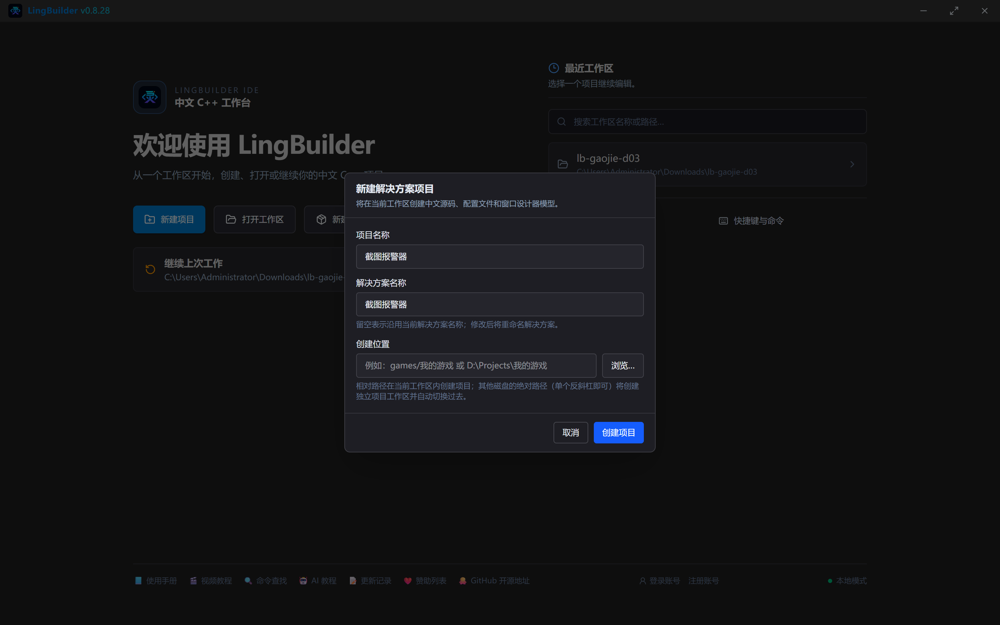
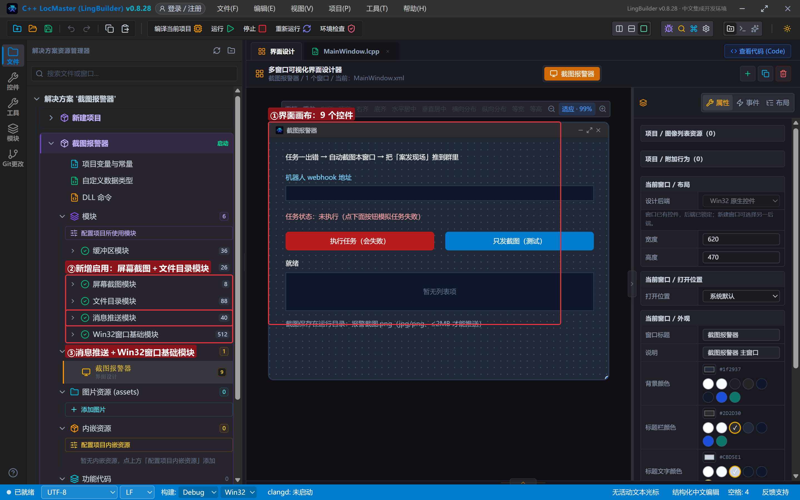
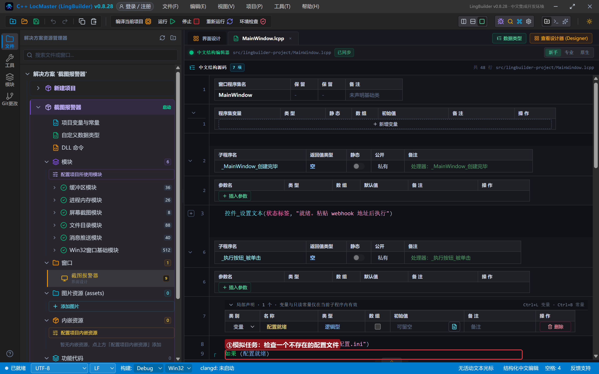
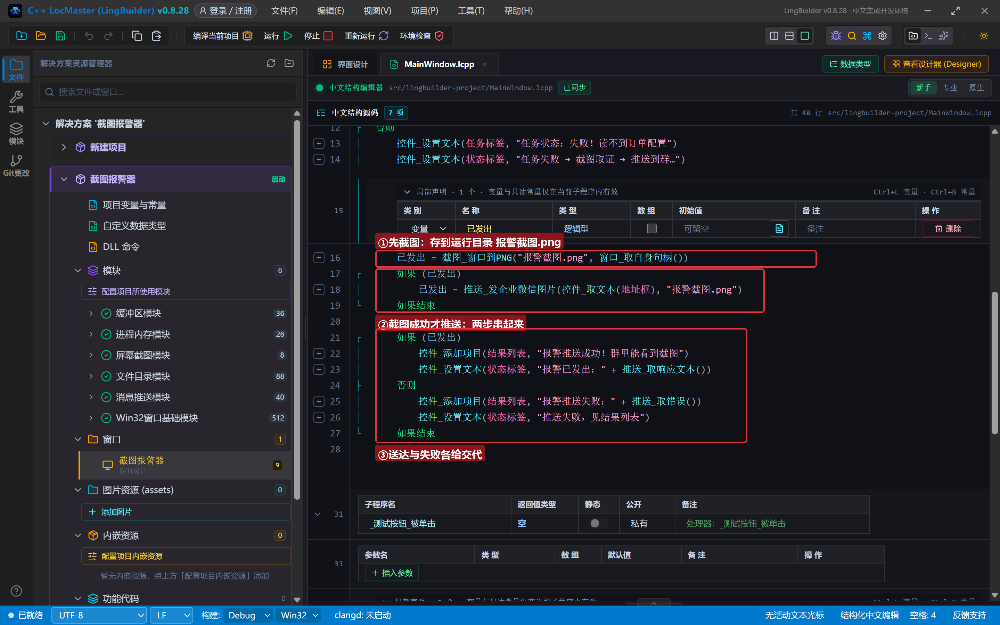
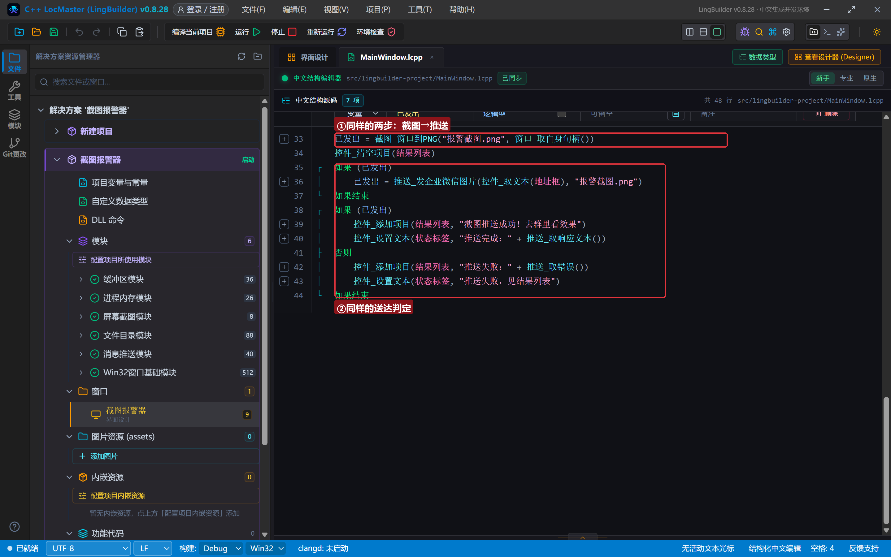
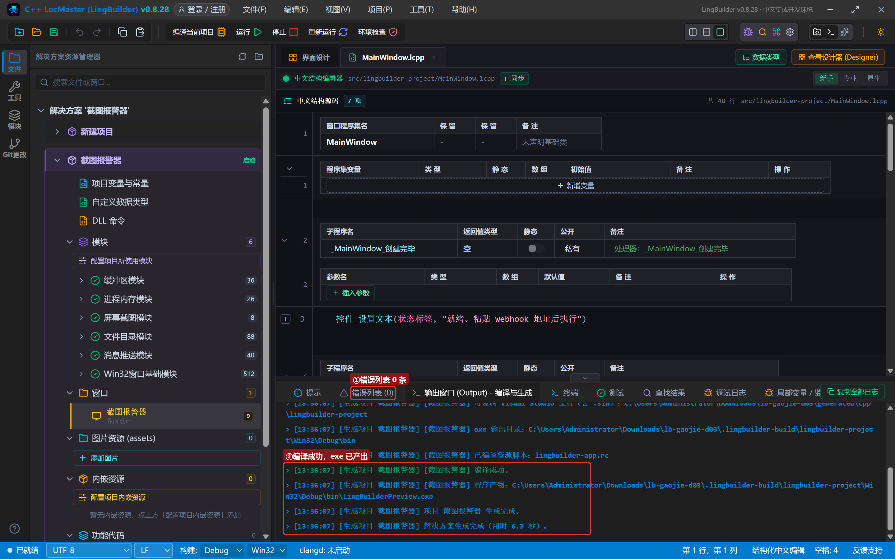
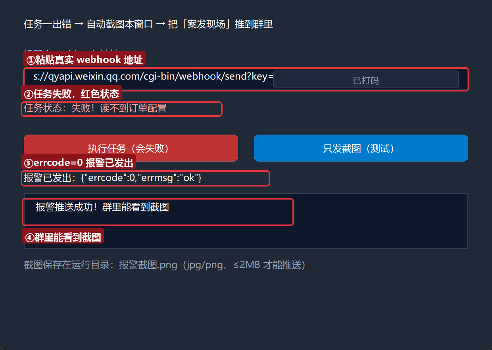
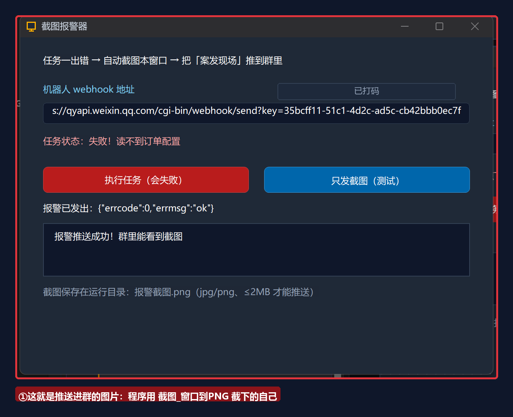
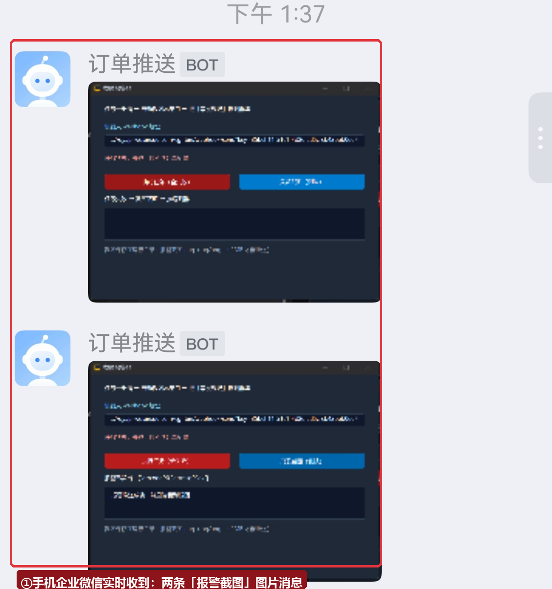
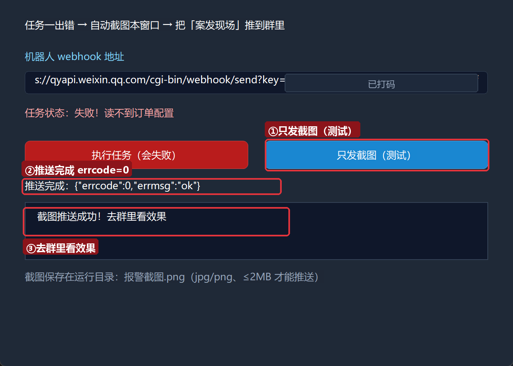

# 高阶实战 03 · 图片推送：做出错自动截图报警器

> 《LingBuilder 高阶实战系列》第 3 集，**消息推送专题·企业微信篇**。文字通知看得多了容易麻——「案发现场」的截图才是最直观的报警。本集把**屏幕截图模块**和**消息推送模块**接在一起，做一个**出错自动截图报警器**：任务一出错，程序把自己窗口的当前状态截成 PNG，直接推进群里，谁看到都知道哪里炸了。全程约 35 分钟。
>
> 前置要求：学完[第 01 集](/guide/tutorials/gaojie-01)（会申请 webhook、会发文本）。本集源码包见文末。

## 这一集你将学会

- `截图_窗口到PNG(目标路径, 窗口句柄)`：把指定窗口截成 PNG 文件
- `窗口_取自身句柄()`：拿到自己窗口的句柄（Win32窗口基础模块）
- `推送_发企业微信图片(地址, 图片路径)`：只给路径，Base64 与 MD5 运行时自动算
- 组合套路：**先截图、成功才推送、结果给交代**的三段式
- 红线：图片仅 jpg/png、≤2MB；路径可以是相对路径（exe 运行目录）

## 1. 三十秒理解：一张图怎么进群

企业微信的图片消息不接受「发文件」——它要求 JSON 里带**图片的 Base64 编码**和一个 **MD5 校验值**。手工做这三步（读文件 → Base64 → 算 MD5 → 组 JSON）又长又容易错；`推送_发企业微信图片` 把它们全部折叠成一条命令：

```lcpp
推送_发企业微信图片(地址, "报警截图.png")
```

你只给**本地路径**（相对路径按 exe 运行目录解析），运行时自动读文件、编码、组包、发送。格式（jpg/png）和大小（≤2MB）在本地预检，不合格直接给中文错误。

配合 `截图_窗口到PNG`（截窗口到文件）和 `窗口_取自身句柄`（自己截自己），报警链路就三行：

```lcpp
已发出 = 截图_窗口到PNG("报警截图.png", 窗口_取自身句柄())
如果 (已发出)
    已发出 = 推送_发企业微信图片(控件_取文本(地址框), "报警截图.png")
如果结束
```

## 2. 新建项目与启用模块

新建窗口项目：名称 **截图报警器**，模板「Windows 界面设计」，创建位置留空：



本集在消息推送、Win32窗口基础之外，**新启用两个模块**：**屏幕截图模块**（8 条命令，截图三兄弟在这里）和**文件目录模块**（88 条命令，用它的 `文件_是否存在` 模拟任务失败）：



## 3. 设计界面

| 控件 | 名称 | 显示内容 | 左距 | 顶距 | 宽度 | 高度 |
| --- | --- | --- | --- | --- | --- | --- |
| 标签 | 说明标签 | 任务一出错 → 自动截图本窗口 → 把「案发现场」推到群里 | 30 | 22 | 560 | 24 |
| 标签 | 地址标签 | 机器人 webhook 地址 | 30 | 60 | 220 | 22 |
| 编辑框 | 地址框 | （空） | 30 | 86 | 560 | 28 |
| 标签 | 任务标签 | 任务状态：未执行（点下面按钮模拟任务失败） | 30 | 128 | 560 | 28 |
| 按钮 | 执行按钮 | 执行任务（会失败） | 30 | 170 | 270 | 34 |
| 按钮 | 测试按钮 | 只发截图（测试） | 320 | 170 | 270 | 34 |
| 标签 | 状态标签 | 就绪 | 30 | 216 | 560 | 22 |
| 列表框 | 结果列表 | — | 30 | 244 | 560 | 70 |
| 标签 | 路径标签 | 截图保存在运行目录：报警截图.png（jpg/png、≤2MB 才能推送） | 30 | 326 | 560 | 22 |

窗口宽 620、高 470。绑 2 个按钮事件 + 窗口「创建完毕」。把**任务标签**的前景色设为红色（#FCA5A5），失败时更醒目——它也是截图里的「报警灯」。

## 4. 写代码

### 4.1 模拟一个会失败的任务

真实项目里任务失败各有原因；教学里我们用一句确定性判断制造失败——检查一个**不存在的配置文件**：

```lcpp
事件 _执行按钮_被单击()
    局部 逻辑型 配置就绪
    配置就绪 = 文件_是否存在("C:\演示\订单配置.ini")
    如果 (配置就绪)
        控件_设置文本(任务标签, "任务状态：执行成功")
        控件_设置文本(状态标签, "任务正常，无需报警")
    否则
        控件_设置文本(任务标签, "任务状态：失败！读不到订单配置")
        控件_设置文本(状态标签, "任务失败 → 截图取证 → 推送到群…")
```



`文件_是否存在` 返回逻辑型：只有普通文件返回真。这个路径你机器上大概率没有——所以「执行任务」按钮**每次都会走进报警分支**，演示效果稳定。

### 4.2 报警三段式：截图 → 推送 → 交代

失败分支的后半段是本集的主菜：

```lcpp
        局部 逻辑型 已发出
        已发出 = 截图_窗口到PNG("报警截图.png", 窗口_取自身句柄())
        如果 (已发出)
            已发出 = 推送_发企业微信图片(控件_取文本(地址框), "报警截图.png")
        如果结束
        控件_清空项目(结果列表)
        如果 (已发出)
            控件_添加项目(结果列表, "报警推送成功！群里能看到截图")
            控件_设置文本(状态标签, "报警已发出：" + 推送_取响应文本())
        否则
            控件_添加项目(结果列表, "报警推送失败：" + 推送_取错误())
            控件_设置文本(状态标签, "推送失败，见结果列表")
        如果结束
    如果结束
结束
```



拆解：

- **`窗口_取自身句柄()`** 返回本窗口的句柄，喂给 `截图_窗口到PNG` 就是「自己截自己」。截图时机在**红色失败状态写完之后**，所以推出去的图自带「失败」字样，看图即知出事。
- **截图成功才推送**：两层 `如果 (已发出)` 串起来——截图都失败了（路径没权限、磁盘满），推送更无从谈起。复用同一个 `已发出` 变量，最后统一判定。
- **`"报警截图.png"` 是相对路径**，落在 exe 的运行目录（bin）里，路径标签写明了位置。想截成 jpg？改扩展名即可，运行时按扩展名和文件魔数双重校验。
- 失败原因两件套照旧：`推送_取错误()` 中文结论 + `推送_取响应文本()` 平台原话。

### 4.3 只发截图（测试按钮）

调试报警器不必每次真把任务跑挂——「只发截图」按钮走同一条链路但不判断任务状态：

```lcpp
事件 _测试按钮_被单击()
    局部 逻辑型 已发出
    已发出 = 截图_窗口到PNG("报警截图.png", 窗口_取自身句柄())
    控件_清空项目(结果列表)
    如果 (已发出)
        已发出 = 推送_发企业微信图片(控件_取文本(地址框), "报警截图.png")
    如果结束
    如果 (已发出)
        控件_添加项目(结果列表, "截图推送成功！去群里看效果")
        控件_设置文本(状态标签, "推送完成：" + 推送_取响应文本())
    否则
        控件_添加项目(结果列表, "推送失败：" + 推送_取错误())
        控件_设置文本(状态标签, "推送失败，见结果列表")
    如果结束
结束
```



## 5. 编译与运行

点「编译当前项目」，错误列表 (0)、输出窗口「编译成功」：



### 5.1 执行任务：失败 → 截图 → 推送

粘入真实 webhook 地址，点「执行任务（会失败）」：



红色「任务状态：失败！」亮起，紧接着「报警已发出：{"errcode":0,"errmsg":"ok"}」。推出去的图长这样——就是程序自己截的自己：



### 5.2 手机上收到的图片消息

打开手机企业微信，两条「报警截图」图片消息已经躺在群里（一条来自执行任务、一条来自测试按钮）：



### 5.3 只发截图（测试）

点「只发截图（测试）」再推一张：



## 6. 红线与提示

- **图片仅 jpg/png、≤2MB**：别的扩展名或超大图片会在本地预检被拒（中文错误写明原因）。截图类报警一般远小于 2MB。
- **截图时机**：先把失败状态画到窗口上，再截图。顺序反了，推出去的图看不出哪里出错。
- **截图会被遮挡**：`截图_窗口到PNG` 截的是窗口边界区域的**实时画面**，窗口被别的窗口盖住，图里就是盖住它的东西。报警器通常挂在无人值守的机器上，无人遮挡；桌面演示时把窗口置前再触发。
- **别把报警器写成轰炸机**：失败循环重试时记得限流（每机器人约 20 条/分钟），同一故障推送一条 + 状态标记足够，第 14 集排障方法论会展开。
- **webhook 地址不进代码**：和前两集一样，源码包地址框留空，运行时粘贴。

## 7. 常见问题急救表

| 症状 | 原因 | 解法 |
| --- | --- | --- |
| 「企业微信机器人图片仅支持 jpg/png 格式，当前扩展名：…」 | 扩展名不对 | 改成 .png 或 .jpg |
| 「图片超过 2MB 上限，当前 N 字节。」 | 图片太大 | 压缩或缩小截图区域（`截图_区域到PNG` 只截关键区） |
| 「文件内容不是 jpg/png 图片（魔数校验失败）。」 | 改了扩展名但内容不是图片 | 用截图命令产出真 PNG，别手工改名 |
| 推送成功但图里是别的窗口 | 截图时窗口被遮挡/失焦 | 触发前把窗口置前；无人值守场景无此问题 |
| 句柄传 0 报错 | `窗口_取自身句柄()` 忘了调 | 句柄参数传 `窗口_取自身句柄()` 的返回值 |

## 本集小结

- 三行报警链：`截图_窗口到PNG(路径, 窗口_取自身句柄())` → `推送_发企业微信图片(地址, 路径)` → `推送_取错误/取响应文本` 交代结果。
- 图片命令只收路径：Base64、MD5、组包全由运行时代劳；jpg/png、≤2MB 本地预检。
- 先画失败状态、再截图、再推送——图要能「 self-explain 」。
- 相对路径落在 exe 运行目录，教学与部署都省心。

**下一集预告**：《图文推送》——news 卡片：一条消息带标题、描述、跳转链接和配图，`标题|描述|跳转链接|图片URL` 行格式一次推 1~8 条，还要见识「url 必填」（errcode 40039）的正确踩法。

## 本集源码包

- 下载：[截图报警器.lcpppkg](./截图报警器.lcpppkg)（官网「示例源码」区同步提供，编号 03）
- 导入：欢迎页 →「导入源码包」一键还原；运行时粘贴自己的 webhook 地址（源码包不含任何密钥）。报警画面里的 key 已打码，你自己的截图请同样保管好地址。

[回系列总览](/guide/tutorials/gaojie)
