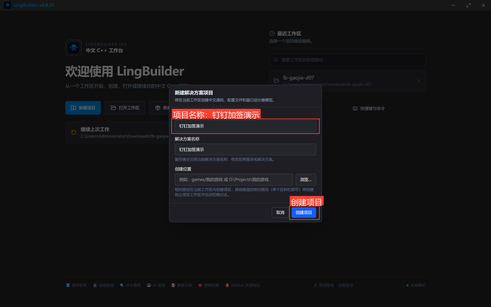
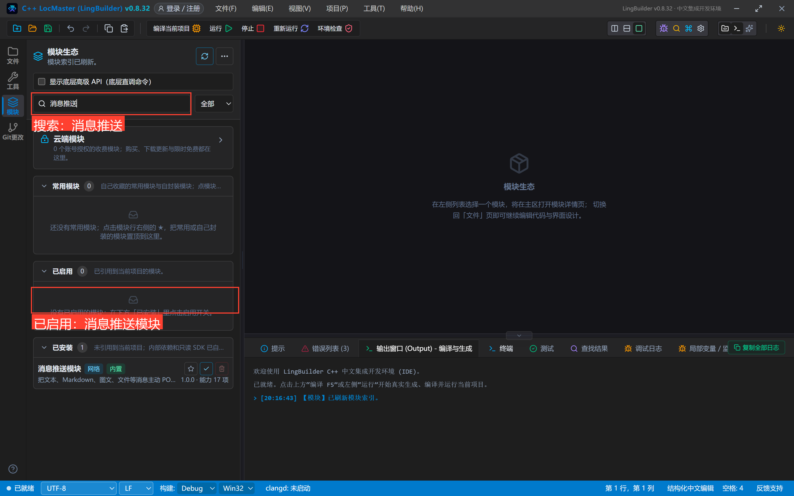
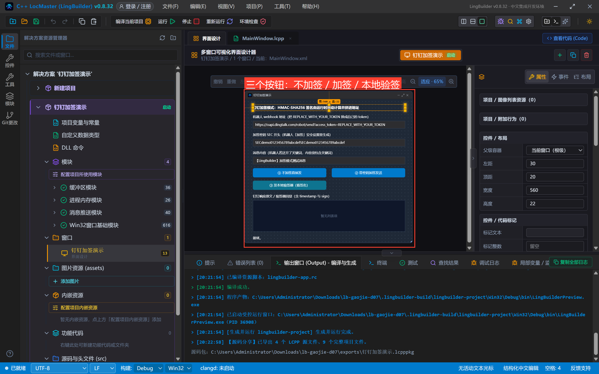
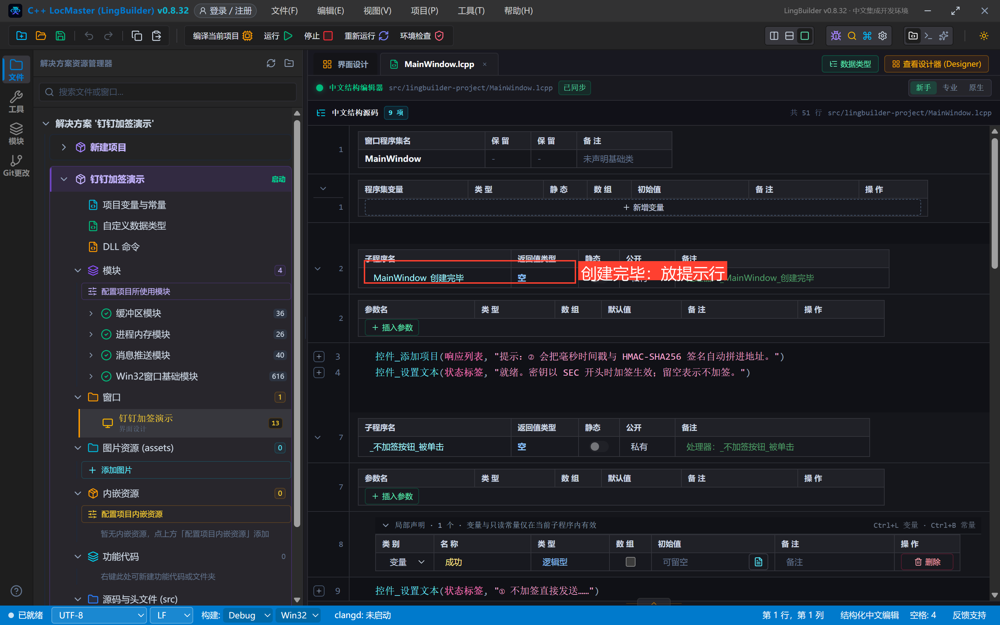
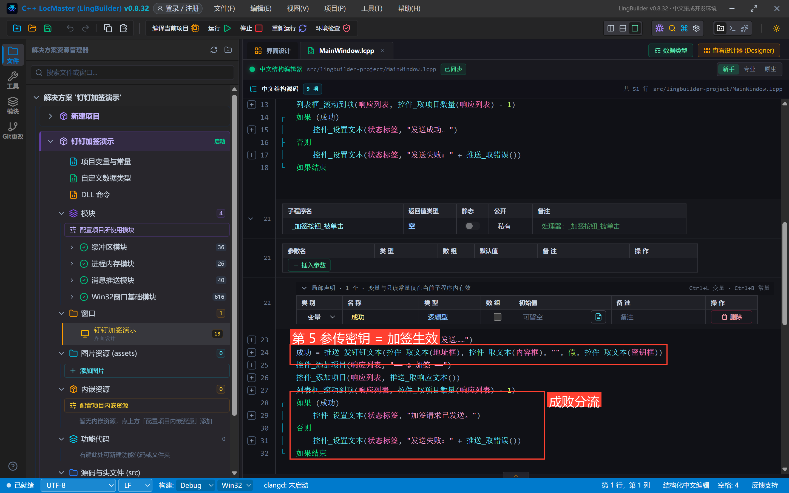
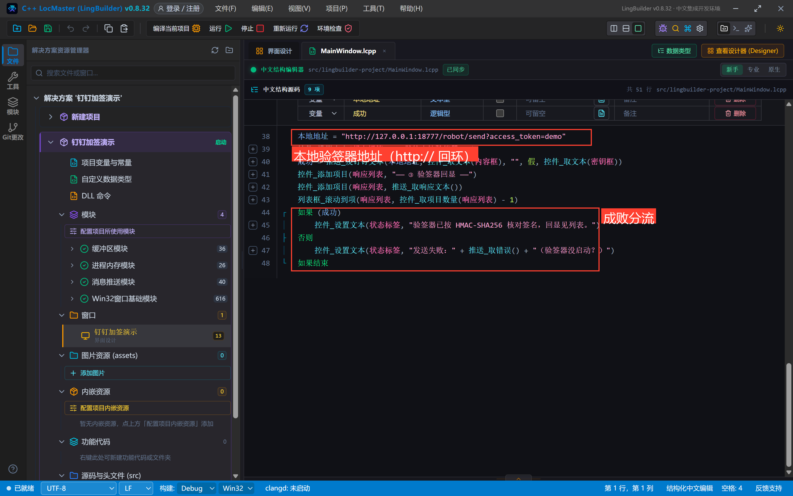
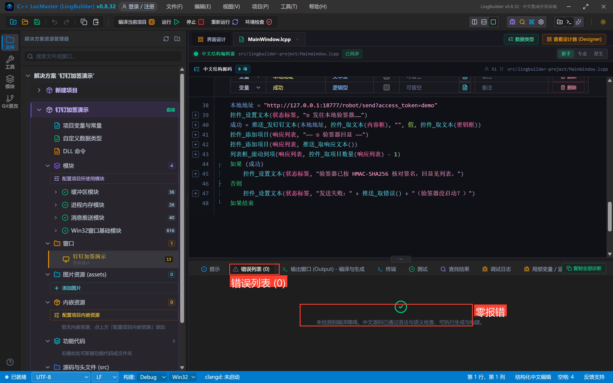
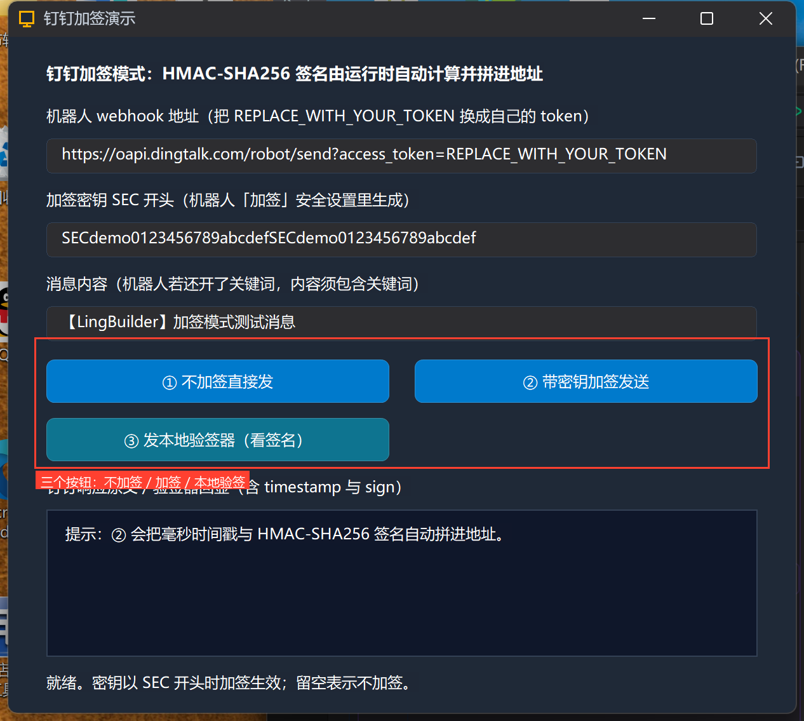
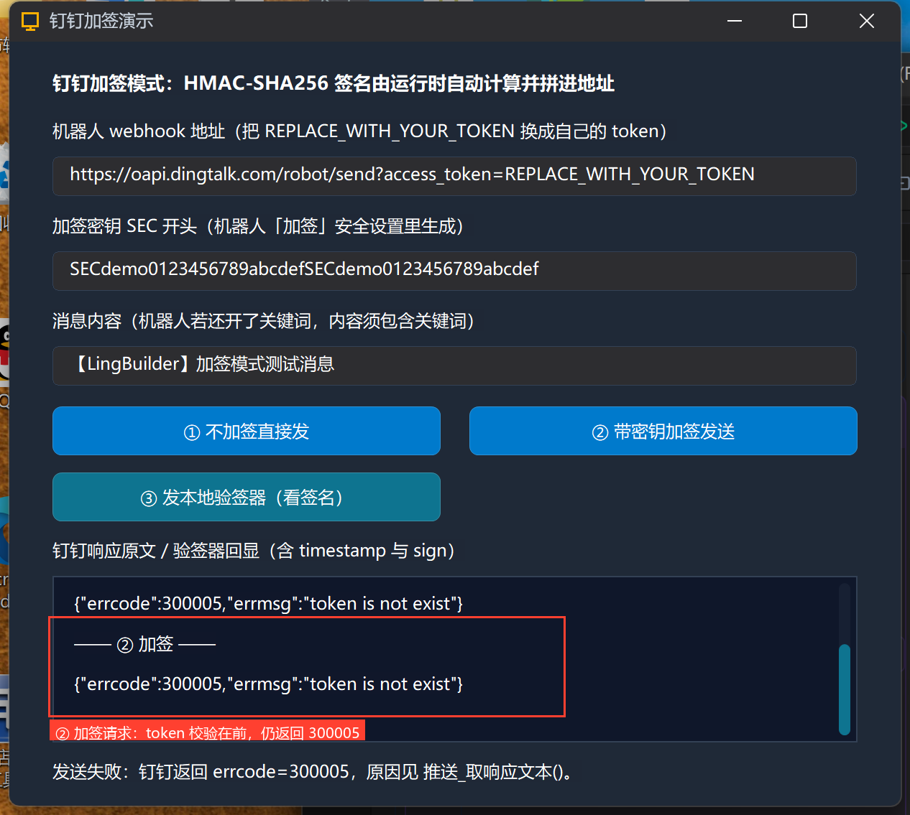
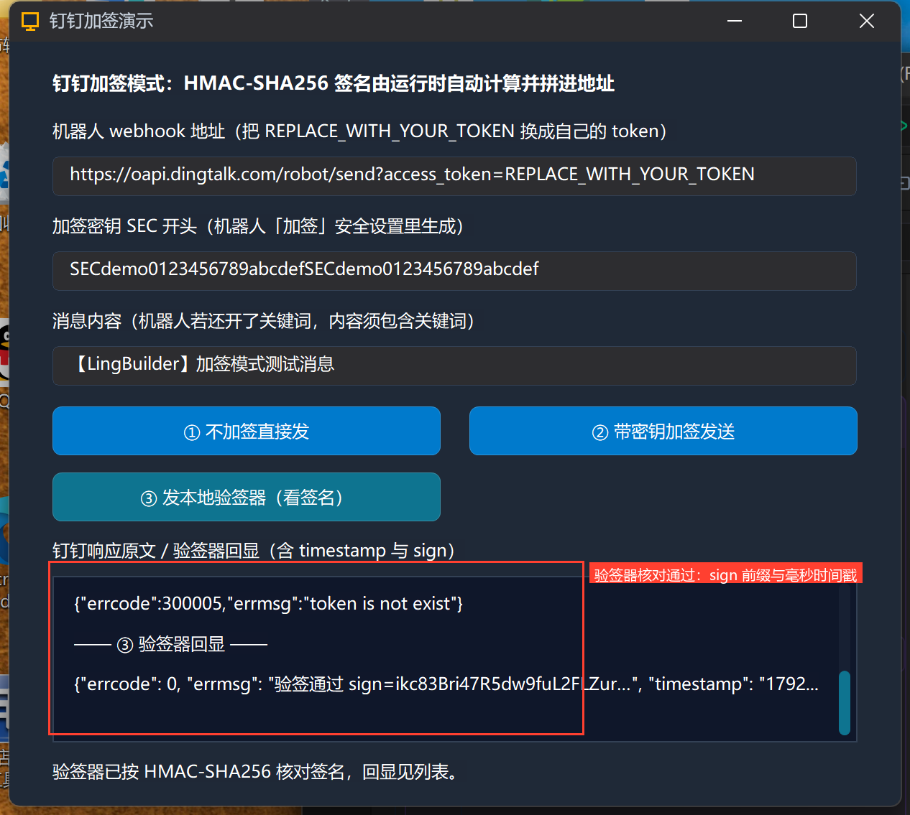

# 高阶实战 07 · 钉钉加签安全模式：HMAC-SHA256 签名算法原理与命令实操

> 《LingBuilder 高阶实战系列》第 7 集，**消息推送专题·钉钉篇**。上一集的关键词模式管的是「内容里得有什么」，这一集的**加签模式**管的是「请求得是谁发的」：机器人给你一个 `SEC` 开头的密钥，每次请求都要带一个按 **HMAC-SHA256** 算出来的签名——不知道密钥的人，即使拿到 webhook 地址也发不进你的群。本集把这个算法拆开讲透，再用真机**亲眼看到运行时算出来的签名**，并由一个本地验签器独立核对通过。全程约 35 分钟。
>
> 前置要求：学过[第 06 集](/guide/tutorials/gaojie-06)（钉钉文本/Markdown 与真实响应排障）。本集源码包见文末；真实机器人请把占位 token 与演示密钥换成你自己的。

## 这一集你将学会

- `推送_发钉钉文本` / `推送_发钉钉Markdown` 的**第 5 个参数**：加签密钥（传 `SEC...` = 加签生效，传空 = 不加签）
- 加签算法四步：**毫秒时间戳 → `时间戳+"\n"+密钥` → HMAC-SHA256（密钥当 key）→ Base64 再 URL 编码，拼到地址上**
- 消息推送模块的签名由运行时**全自动计算**，你只需要把密钥传对
- 本地验签器思路：自己搭一个回环 HTTP 服务核对签名（顺便预习第 13 集的「自建接口」）

## 1. 三十秒理解：加签到底在防谁

webhook 地址一旦泄露，任何人都能往你群里发消息。钉钉的对策：添加机器人时选「**加签**」，它会给你一个密钥：

```text
SECxxxxxxxxxxxxxxxxxxxxxxxxxxxxxxxx
```

之后每次发消息，都必须在地址上多拼两个参数：

```text
&timestamp=1792844423471&sign=h1jVodzL8sAI41K1%2FzwMv9Qy8Z4Jf3kBhXuP7hI1%2FAQ%3D
```

- `timestamp`：**毫秒**级时间戳（钉钉要求请求时间与服务器时间相差不超过 1 小时）；
- `sign`：把「`时间戳 + "\n" + 密钥`」用 **HMAC-SHA256**（密钥当 key）算出摘要，再 Base64、再 URL 编码。

签名只与「时间戳 + 密钥」有关、与消息内容无关；钉钉服务器用同样的密钥重算一遍，对不上就拒绝（`errcode 310000, sign not match`）。**没有密钥的人就算抓到一条旧请求，一小时内也许能重放，但拿不到密钥就永远算不出下一个合法签名。**

这些计算在 LingBuilder 里**一行都不用写**：把密钥传给发送命令的第 5 个参数即可。

## 2. 新建项目与启用模块

新建窗口项目，类型「Windows 界面设计」，名称 **钉钉加签演示**，创建位置留空：



启用 **消息推送模块**（活动栏「模块」→ 搜索「消息推送」→ 确认出现在「已启用」）：



## 3. 设计界面

| 控件 | 名称 | 显示内容 | 左距 | 顶距 | 宽度 | 高度 |
| --- | --- | --- | --- | --- | --- | --- |
| 标签 | 说明标签 | 钉钉加签模式：HMAC-SHA256 签名由运行时自动计算并拼进地址 | 30 | 20 | 560 | 22 |
| 标签 | 地址标签 | 机器人 webhook 地址（把 REPLACE_WITH_YOUR_TOKEN 换成自己的 token） | 30 | 54 | 560 | 22 |
| 编辑框 | 地址框 | https://oapi.dingtalk.com/robot/send?access_token=REPLACE_WITH_YOUR_TOKEN | 30 | 80 | 560 | 28 |
| 标签 | 密钥标签 | 加签密钥 SEC 开头（机器人「加签」安全设置里生成） | 30 | 120 | 560 | 22 |
| 编辑框 | 密钥框 | SECdemo0123456789abcdefSECdemo0123456789abcdef | 30 | 146 | 560 | 28 |
| 标签 | 内容标签 | 消息内容（机器人若还开了关键词，内容须包含关键词） | 30 | 186 | 560 | 22 |
| 编辑框 | 内容框 | 【LingBuilder】加签模式测试消息 | 30 | 212 | 560 | 28 |
| 按钮 | 不加签按钮 | ① 不加签直接发 | 30 | 254 | 270 | 34 |
| 按钮 | 加签按钮 | ② 带密钥加签发送 | 320 | 254 | 270 | 34 |
| 按钮 | 验签按钮 | ③ 发本地验签器（看签名） | 30 | 300 | 270 | 34 |
| 标签 | 响应标签 | 钉钉响应原文 / 验签器回显（含 timestamp 与 sign） | 30 | 346 | 560 | 22 |
| 列表框 | 响应列表 | — | 30 | 372 | 560 | 116 |
| 标签 | 状态标签 | 就绪。 | 30 | 500 | 560 | 22 |

窗口宽 620、高 560；三个按钮绑「被单击」，窗口绑「创建完毕」。



## 4. 写代码

### 4.1 创建完毕：放提示行



```lcpp
事件 _MainWindow_创建完毕()
    控件_添加项目(响应列表, "提示：② 会把毫秒时间戳与 HMAC-SHA256 签名自动拼进地址。")
    控件_设置文本(状态标签, "就绪。密钥以 SEC 开头时加签生效；留空表示不加签。")
结束
```

### 4.2 ①② 对照：同一命令，第 5 参数定乾坤



```lcpp
事件 _不加签按钮_被单击()
    局部 逻辑型 成功
    控件_设置文本(状态标签, "① 不加签直接发送……")
    成功 = 推送_发钉钉文本(控件_取文本(地址框), 控件_取文本(内容框), "", 假, "")
    控件_添加项目(响应列表, "—— ① 不加签 ——")
    控件_添加项目(响应列表, 推送_取响应文本())
    列表框_滚动到项(响应列表, 控件_取项目数量(响应列表) - 1)
    如果 (成功)
        控件_设置文本(状态标签, "发送成功。")
    否则
        控件_设置文本(状态标签, "发送失败：" + 推送_取错误())
    如果结束
结束
```

```lcpp
事件 _加签按钮_被单击()
    局部 逻辑型 成功
    控件_设置文本(状态标签, "② 带密钥加签发送……")
    成功 = 推送_发钉钉文本(控件_取文本(地址框), 控件_取文本(内容框), "", 假, 控件_取文本(密钥框))
    控件_添加项目(响应列表, "—— ② 加签 ——")
    控件_添加项目(响应列表, 推送_取响应文本())
    列表框_滚动到项(响应列表, 控件_取项目数量(响应列表) - 1)
    如果 (成功)
        控件_设置文本(状态标签, "加签请求已发送。")
    否则
        控件_设置文本(状态标签, "发送失败：" + 推送_取错误())
    如果结束
结束
```

两条命令只差一个参数：① 的密钥是**空文本**（不加签），② 传**密钥框内容**（加签生效）。`列表框_滚动到项` + `控件_取项目数量` 让列表每次自动滚到最新一行，响应再长也不会「发出去就看不见」。

### 4.3 ③ 本地验签器：亲眼看见签名



```lcpp
事件 _验签按钮_被单击()
    局部 文本型 本地地址
    局部 逻辑型 成功
    本地地址 = "http://127.0.0.1:18777/robot/send?access_token=demo"
    控件_设置文本(状态标签, "③ 发往本地验签器……")
    成功 = 推送_发钉钉文本(本地地址, 控件_取文本(内容框), "", 假, 控件_取文本(密钥框))
    控件_添加项目(响应列表, "—— ③ 验签器回显 ——")
    控件_添加项目(响应列表, 推送_取响应文本())
    列表框_滚动到项(响应列表, 控件_取项目数量(响应列表) - 1)
    如果 (成功)
        控件_设置文本(状态标签, "验签器已按 HMAC-SHA256 核对签名，回显见列表。")
    否则
        控件_设置文本(状态标签, "发送失败：" + 推送_取错误() + "（验签器没启动？）")
    如果结束
结束
```

地址换成回环 `http://127.0.0.1:18777`——请求不出本机，发到我们自己的「验签器」。密钥照传，运行时照样会算签名拼地址，验签器把收到的地址原样回显，签名就现形了。

## 5. 编译与运行

点「编译当前项目」，**先看错误列表**——零报错再运行：



点「运行」：



## 6. 真机观察：三个按钮各说明什么

**①② 对比**：两按钮打的都是占位 token 的钉钉地址，钉钉都返回 `errcode 300005`（token 不存在）。注意一个细节——**token 校验排在签名校验之前**，所以占位 token 阶段两个请求的响应一模一样；换成你自己的 token 后：机器人若开了加签，① 会返回 `310000 sign not match`，② 则直接送达成功：



**③ 验签器**：本地验签器用 Python 标准库独立重算了一遍签名，结论「验签通过」直接回显——这就是运行时签名正确性的真机证据：

```json
{"errcode": 0, "errmsg": "验签通过 sign=ikc83Bri47R5dw9fuL2FLZur...", "timestamp": "1792844423XXX"}
```



验签器的完整实现只有 30 行（随源码包附在本集工程同级 `dingtalk_echo_server.py`，也可从下面的原理小节自己手写）：收 POST → 从地址取 `timestamp`/`sign` → 按 `HMAC-SHA256(key=SEC, msg=timestamp+"\n"+SEC)` 重算 → 对比。

## 7. 加签红线速查

- 密钥**必须 `SEC` 开头**原样粘贴（含 `SEC` 前缀），漏了前缀签名必错；
- 时间戳是**毫秒**（13 位数字）——钉钉与飞书在这里相反，飞书用**秒**并写进请求体（第 12 集对照）；
- 签名参与运算的是「`时间戳 + "\n" + 密钥`」，**不含消息内容**；换内容不用重算——运行时本来就每次自动算；
- **关键词 + 加签可叠加**：机器人同时开两个，请求既要带合法签名、内容又要含关键词；
- 地址一旦泄露，加了签就安全得多；但仍要避免把带真实密钥的代码截图外发——本集密钥是演示用的假密钥；
- 本地验签器演示用 `http://127.0.0.1` 回环没有安全问题；真实钉钉地址必须是 `https://`。

## 小结与源码包

这一集把钉钉最硬的安全机制讲透了：算法四步 + 真机签名 + 独立验签。你写的代码始终只有一行命令调用。下一集解决另一个高频问题：**@ 指定人与 @ 所有人**的正确姿势。

- 本集源码包：[钉钉加签.lcpppkg](钉钉加签.lcpppkg)
- 官方示例源码区同款：`07-钉钉加签.lcpppkg`
