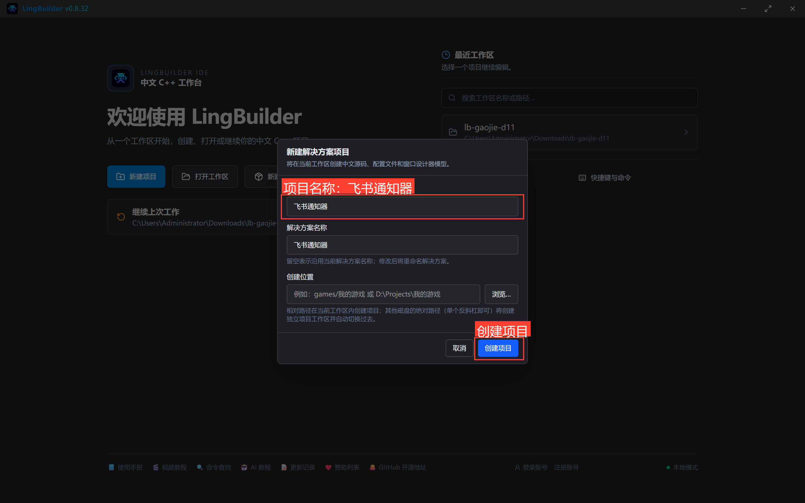
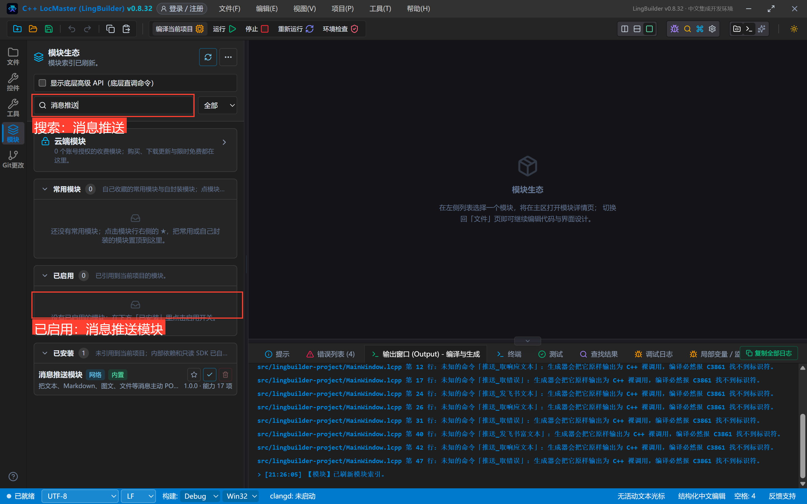
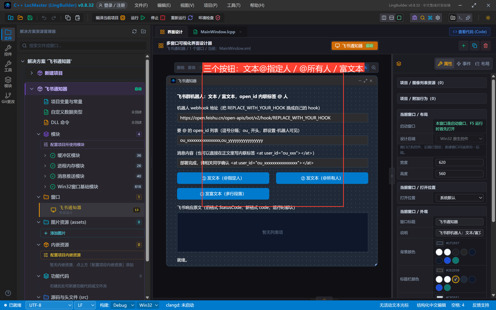
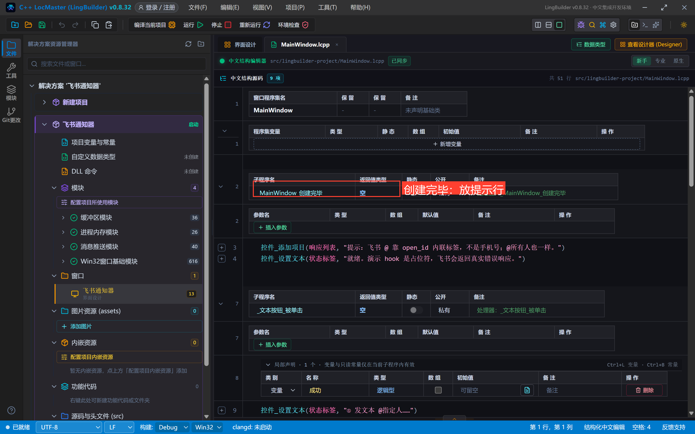
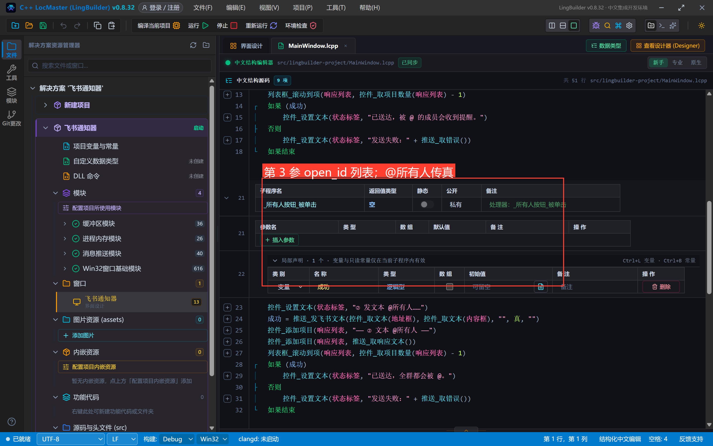
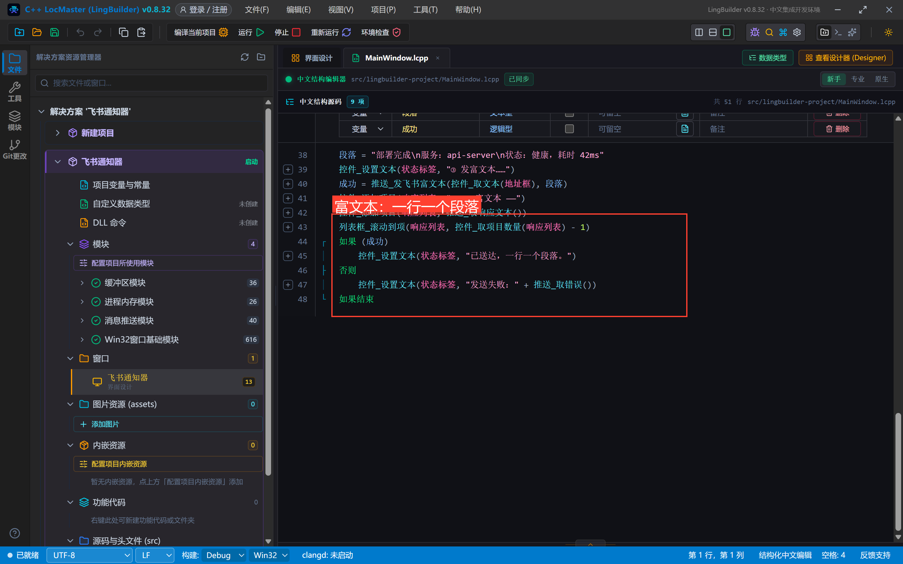
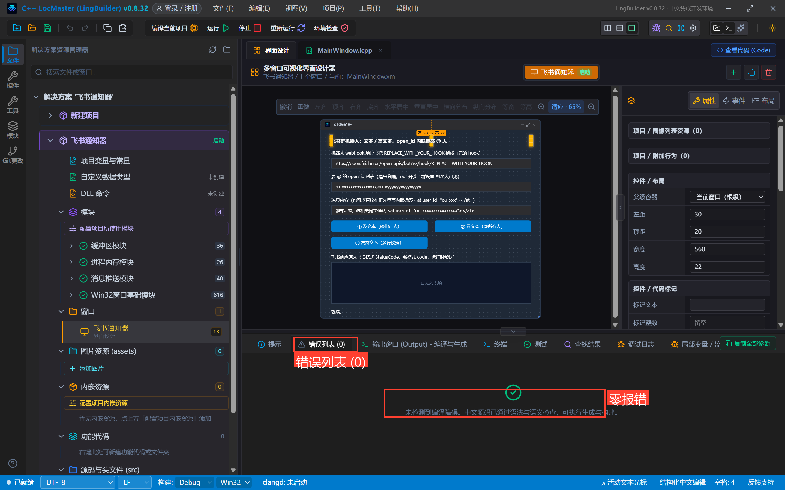
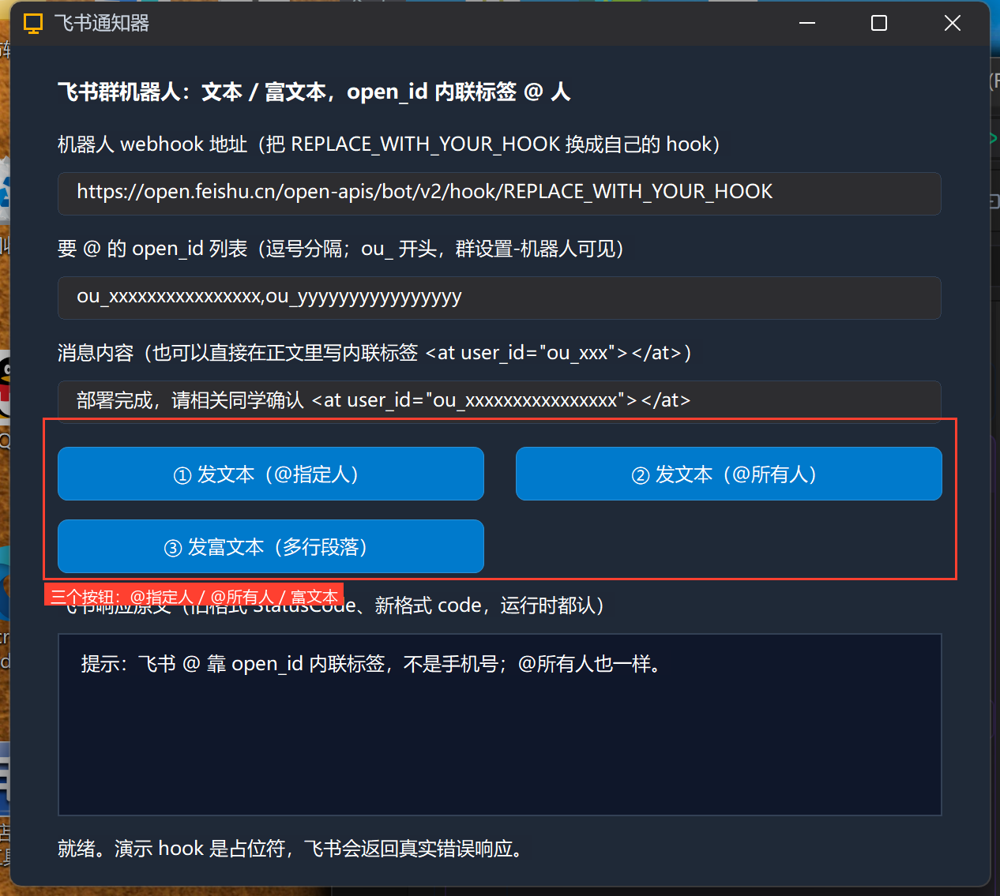
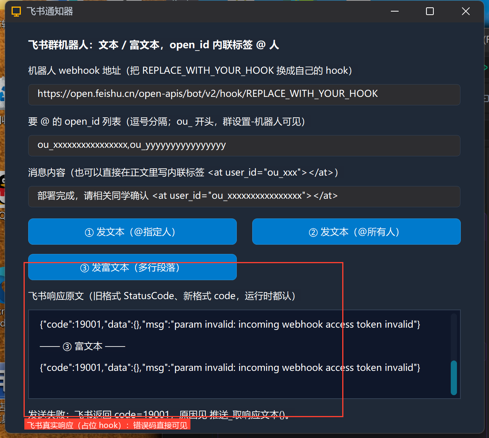

# 高阶实战 11 · 飞书文本与富文本：open_id 内联标签 @ 人

> 《LingBuilder 高阶实战系列》第 11 集，**消息推送专题·飞书篇**。飞书自定义机器人的消息形态比钉钉更简洁——官方只给**文本**和**富文本（post）**两种，但 @ 人的机制是三家里最特别的：**不认手机号，认 open_id 内联标签** `<at user_id="..."></at>`。本集把两种消息都发出去，亲眼看看飞书的真实响应格式（它跟钉钉的 `errcode` 不是一套字段），再搞懂 open_id 从哪来、内联标签怎么写。全程约 30 分钟。
>
> 前置要求：学过[第 06 集](/guide/tutorials/gaojie-06)。真实机器人请把占位 hook 换成自己的；飞书响应格式与另两家不同，正好练「读响应排障」。

## 这一集你将学会

- `推送_发飞书文本(地址, 内容, 用户ID列表, 是否所有人, 加签密钥)`：五参与钉钉文本一致，但第 3 参是 **open_id 列表**（不是手机号）
- `推送_发飞书富文本(地址, 多行文本, 加签密钥)`：一行一个段落；第 3 参加签密钥（未开启传空或省略）
- **open_id 内联标签**：`<at user_id="ou_xxxx"></at>` 直接写进正文；运行时也会把 ID 列表自动包装成标签追加
- **飞书响应格式**：新格式 `{"code":0,...}`、旧格式 `{"StatusCode":0,...}`——运行时三键兜底判定（errcode/StatusCode/code）

## 1. 三十秒理解：飞书 @ 与另两家的差别

| | 企微 | 钉钉 | 飞书 |
| --- | --- | --- | --- |
| @ 凭据 | 手机号（仅企业成员） | 手机号（群成员） | **open_id**（ou_ 开头） |
| 写法 | 文本命令的 @ 列表 | at 字段 + 正文 @手机号 文本 | **正文内联标签** `<at user_id="...">` |
| @ 所有人 | —（文本命令 atAll） | isAtAll | `<at user_id="all">` 标签 |

open_id 在飞书群「设置 → 群机器人」与成员管理接口里能查到（`ou_` 开头一长串）。LingBuilder 的做法：把 open_id 列表传给第 3 参，运行时自动包成 `<at>` 标签追加到正文末尾；要控制 @ 出现的位置，就直接在正文里写内联标签（两种可以混用）。

## 2. 新建项目与启用模块

新建窗口项目「**飞书通知器**」（Windows 界面设计、创建位置留空），启用 **消息推送模块**：





## 3. 设计界面

| 控件 | 名称 | 显示内容 | 左距 | 顶距 | 宽度 | 高度 |
| --- | --- | --- | --- | --- | --- | --- |
| 标签 | 说明标签 | 飞书群机器人：文本 / 富文本，open_id 内联标签 @ 人 | 30 | 20 | 560 | 22 |
| 标签 | 地址标签 | 机器人 webhook 地址（把 REPLACE_WITH_YOUR_HOOK 换成自己的 hook） | 30 | 54 | 560 | 22 |
| 编辑框 | 地址框 | https://open.feishu.cn/open-apis/bot/v2/hook/REPLACE_WITH_YOUR_HOOK | 30 | 80 | 560 | 28 |
| 标签 | ID列表标签 | 要 @ 的 open_id 列表（逗号分隔；ou_ 开头，群设置-机器人可见） | 30 | 120 | 560 | 22 |
| 编辑框 | ID列表框 | ou_xxxxxxxxxxxxxxxx,ou_yyyyyyyyyyyyyyyy | 30 | 146 | 560 | 28 |
| 标签 | 内容标签 | 消息内容（也可以直接在正文里写内联标签） | 30 | 186 | 560 | 22 |
| 编辑框 | 内容框 | 部署完成，请相关同学确认 \<at user_id="ou_xxxxxxxxxxxxxxxx"\>\</at\> | 30 | 212 | 560 | 28 |
| 按钮 | 文本按钮 | ① 发文本（@指定人） | 30 | 254 | 270 | 34 |
| 按钮 | 所有人按钮 | ② 发文本（@所有人） | 320 | 254 | 270 | 34 |
| 按钮 | 富文本按钮 | ③ 发富文本（多行段落） | 30 | 300 | 270 | 34 |
| 标签 | 响应标签 | 飞书响应原文（旧格式 StatusCode、新格式 code，运行时都认） | 30 | 346 | 560 | 22 |
| 列表框 | 响应列表 | — | 30 | 372 | 560 | 116 |
| 标签 | 状态标签 | 就绪。 | 30 | 500 | 560 | 22 |

窗口宽 620、高 560；三个按钮绑「被单击」，窗口绑「创建完毕」。



## 4. 写代码

### 4.1 创建完毕



```lcpp
事件 _MainWindow_创建完毕()
    控件_添加项目(响应列表, "提示：飞书 @ 靠 open_id 内联标签，不是手机号；@所有人也一样。")
    控件_设置文本(状态标签, "就绪。演示 hook 是占位符，飞书会返回真实错误响应。")
结束
```

### 4.2 ①②：文本消息的两种 @



```lcpp
事件 _文本按钮_被单击()
    局部 逻辑型 成功
    控件_设置文本(状态标签, "① 发文本 @指定人……")
    成功 = 推送_发飞书文本(控件_取文本(地址框), 控件_取文本(内容框), 控件_取文本(ID列表框), 假, "")
    控件_添加项目(响应列表, "—— ① 文本 @指定人 ——")
    控件_添加项目(响应列表, 推送_取响应文本())
    列表框_滚动到项(响应列表, 控件_取项目数量(响应列表) - 1)
    如果 (成功)
        控件_设置文本(状态标签, "已送达，被 @ 的成员会收到提醒。")
    否则
        控件_设置文本(状态标签, "发送失败：" + 推送_取错误())
    如果结束
结束
```

② 把第 3 参换成空文本、第 4 参（是否所有人）换成「真」——运行时追加 `<at user_id="all">所有人</at>`，全群被 @。

### 4.3 ③ 富文本：一行一个段落



```lcpp
事件 _富文本按钮_被单击()
    局部 文本型 段落
    局部 逻辑型 成功
    段落 = "部署完成\n服务：api-server\n状态：健康，耗时 42ms"
    控件_设置文本(状态标签, "③ 发富文本……")
    成功 = 推送_发飞书富文本(控件_取文本(地址框), 段落)
    控件_添加项目(响应列表, "—— ③ 富文本 ——")
    控件_添加项目(响应列表, 推送_取响应文本())
    列表框_滚动到项(响应列表, 控件_取项目数量(响应列表) - 1)
    如果 (成功)
        控件_设置文本(状态标签, "已送达，一行一个段落。")
    否则
        控件_设置文本(状态标签, "发送失败：" + 推送_取错误())
    如果结束
结束
```

富文本命令把多行文本拆成 post 结构的多个 text 元素，转义全部由运行时完成。机器人若开了「签名校验」，第 3 参传密钥（下一集专讲）；未开启传空或直接省略。

## 5. 编译与运行

编译后先看错误列表（零报错再继续），点运行：





## 6. 真机观察：飞书的真实响应

占位 hook 下点按钮，飞书服务器返回了**真实响应**：

```json
{"code":19001,"data":[],"msg":"param invalid: incoming webhook access token invalid"}
```

注意两个教学点：

1. 飞书的成功/失败字段是 **`code`**（新格式）或 **`StatusCode`**（旧格式），不是钉钉的 `errcode`——状态行显示「飞书返回 code=19001」，说明运行时的**三键兜底判定**已经替你兼容了两代格式；
2. 换成你自己的 hook 后，同样的代码直接送达；`code=19001` 这类错误码排障思路与钉钉一致。



## 7. 飞书红线速查

- **@ 靠 open_id 内联标签**，不是手机号；open_id 以 `ou_` 开头，在群设置/管理后台查；
- 内联标签格式固定：`<at user_id="ou_xxx"></at>`；@ 所有人是 `<at user_id="all">`（第 4 参传真的等价）；
- ID 列表传了但 open_id 不在群里：不报错、也没人被 @（与钉钉手机号同类行为）；
- 响应判定认 **errcode/StatusCode/code 三键**——自己写调用时别只判其中一键（用返回值 + `推送_取错误()` 即可）；
- 富文本的复杂元素（超链接/图片/@混排）走 `推送_发JSON` 直发 post 结构（第 13 集）；
- 加签与钉钉完全不同：飞书把**秒级时间戳和 sign 写进请求体**，不是拼地址——第 12 集对照实操。

## 小结与源码包

这一集打通飞书的最小闭环并认识了它独特的 @ 机制。下一集补齐飞书的安全模式：**签名校验**，并把三家的签名差异做成一张对照表。

- 本集源码包：[飞书通知.lcpppkg](飞书通知.lcpppkg)
- 官方示例源码区同款：`11-飞书通知.lcpppkg`
