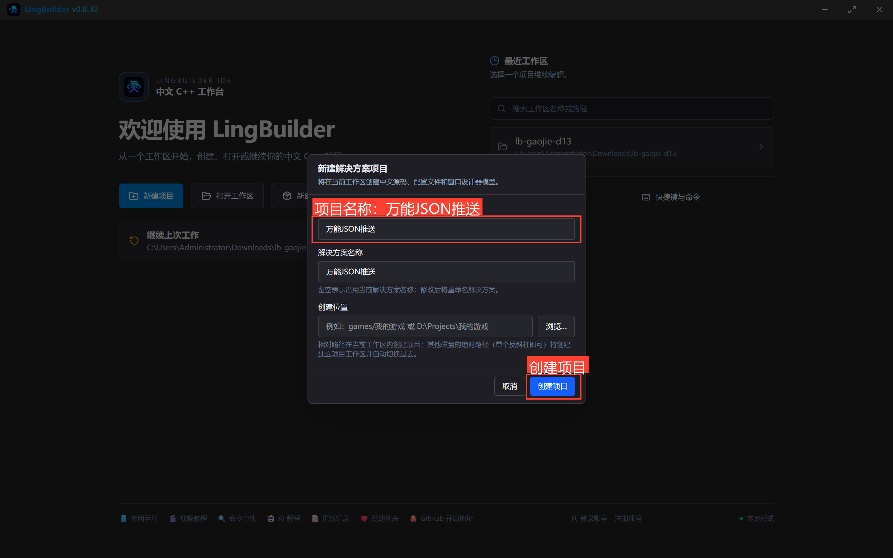
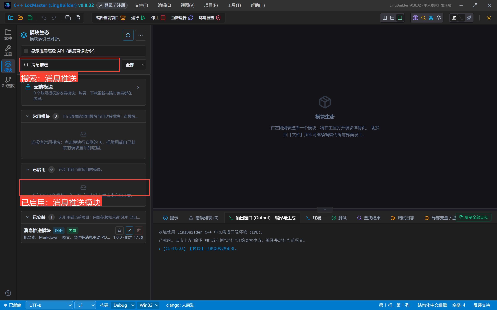
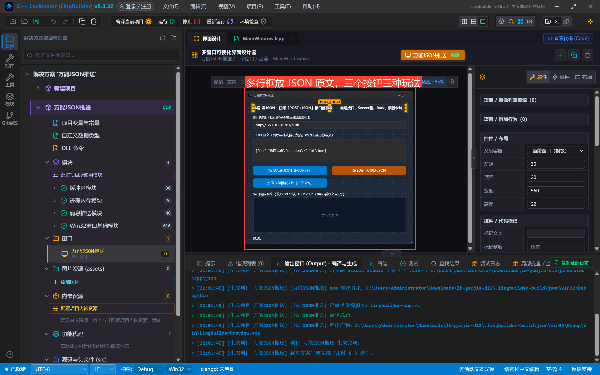
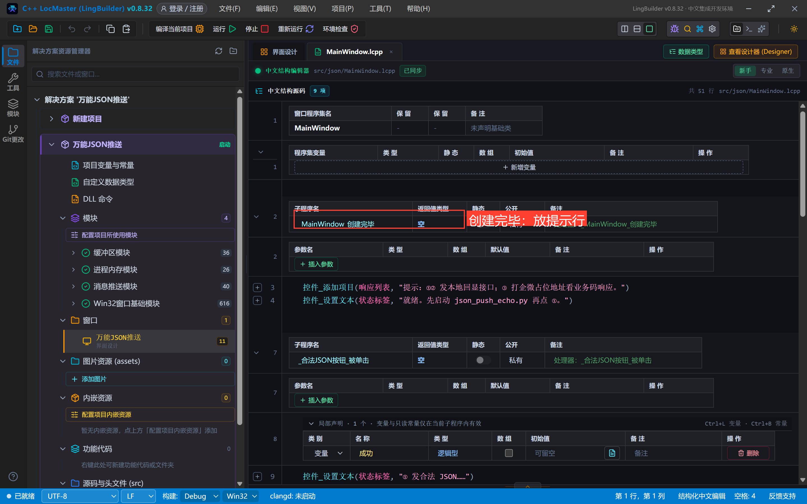
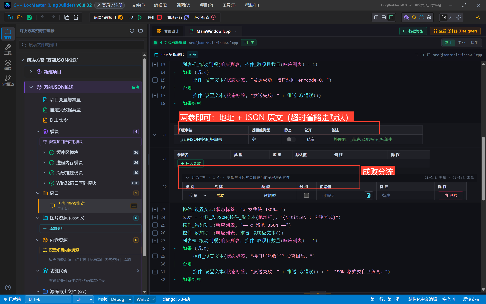
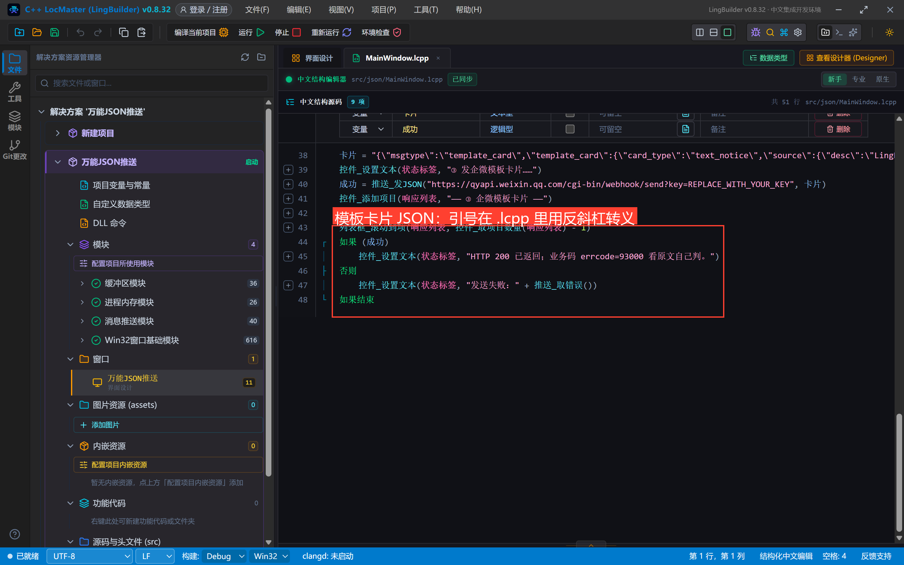
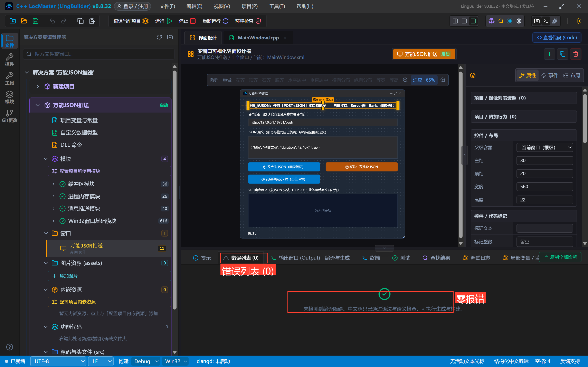
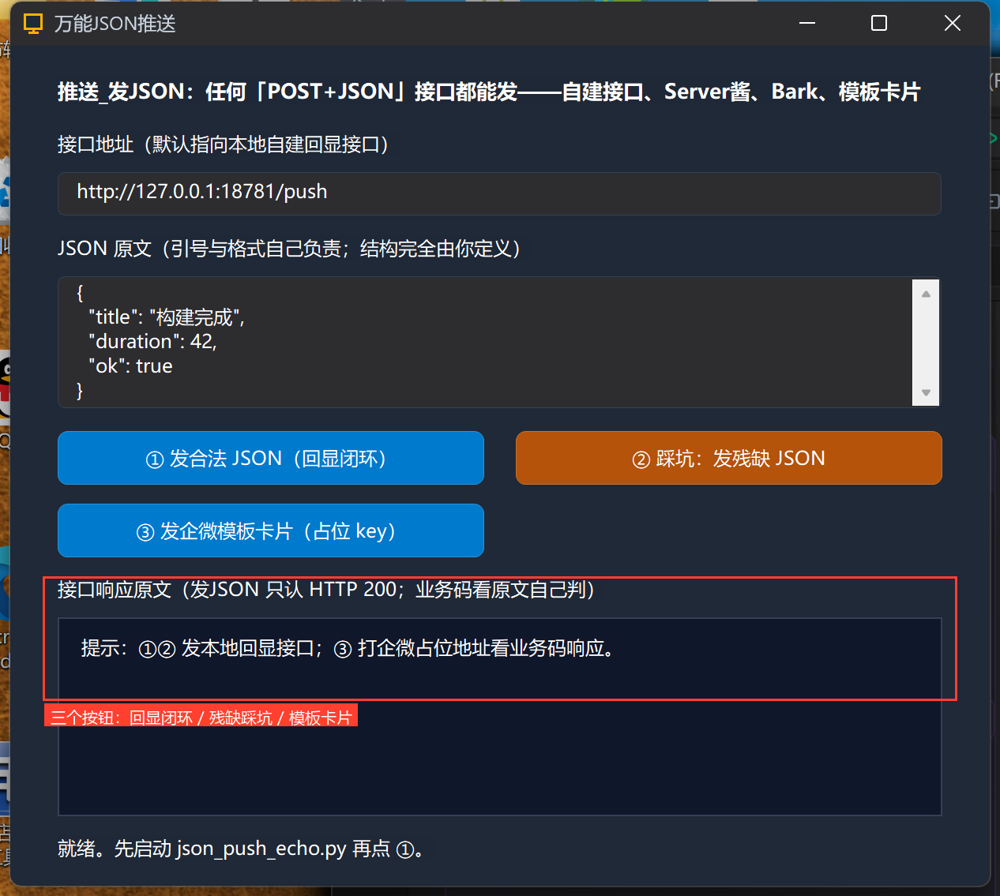
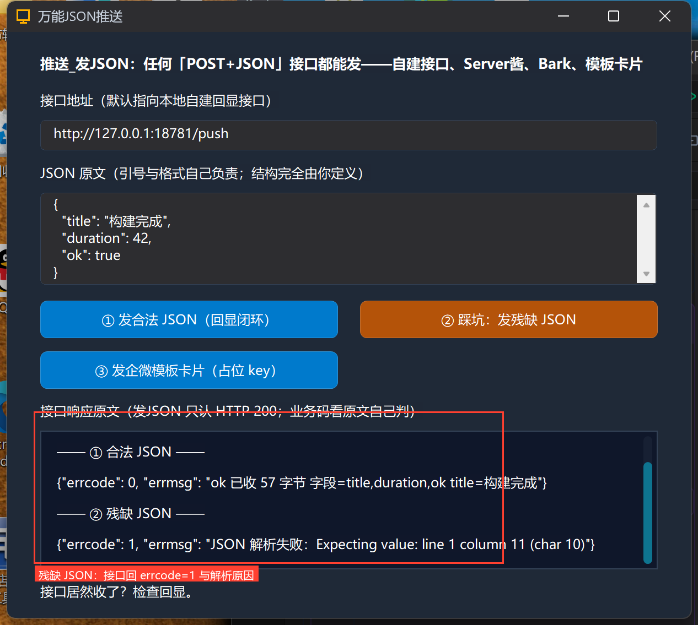
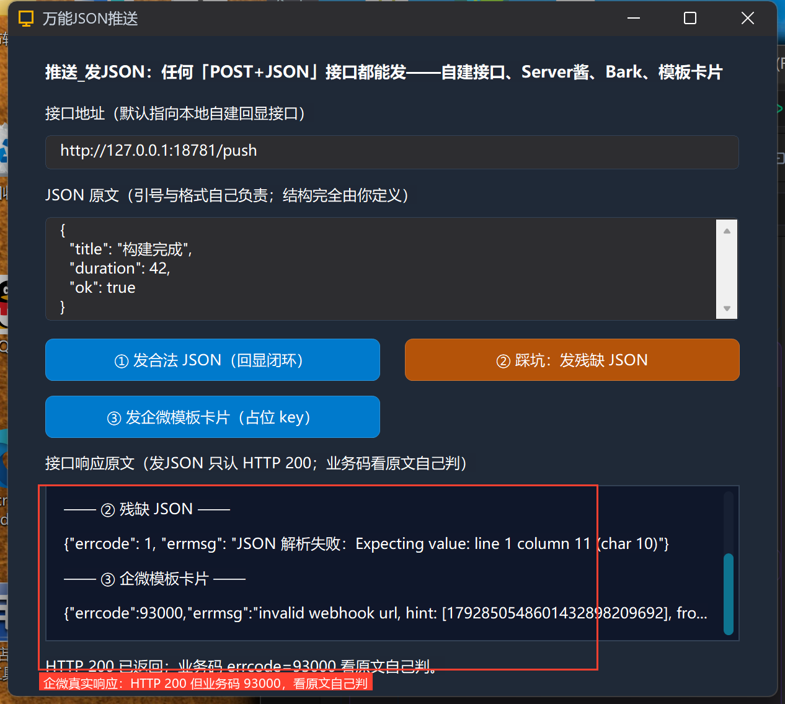

# 高阶实战 13 · 万能兜底 `推送_发JSON`：自建接口、Server酱、Bark、模板卡片

> 《LingBuilder 高阶实战系列》第 13 集，**消息推送专题·通用篇**。结构化命令（`推送_发钉钉文本` 等十几条）覆盖了三家机器人的常用形态，但总有命令面之外的接口：企微的**模板卡片**、手机推送服务 **Server酱 / Bark**、公司内部**自建 webhook**……它们的共同点是「POST + JSON」。`推送_发JSON` 就是为此准备的万能兜底：**地址和 JSON 原文都由你给，运行时只负责把请求发出去**。本集用本地自建接口做一次真机闭环，再踩一次「残缺 JSON」的坑，最后直发一次企微模板卡片。全程约 35 分钟。
>
> 前置要求：学过[第 06 集](/guide/tutorials/gaojie-06)。本集回显器 `json_push_echo.py` 随源码包附带，`python json_push_echo.py` 启动后即可复现全部真机效果。

## 这一集你将学会

- `推送_发JSON(地址, JSON文本)`（超时毫秒可省略，默认 `#推送_默认超时毫秒` = 10 秒）
- **判定口径**：`推送_发JSON` 只认 **HTTP 200**——业务码（errcode/code）要看 `推送_取响应文本()` 自己判，这正是「万能」的自由与代价
- 自建接口闭环：本地回显器收 JSON → 回 `{"errcode":0}` → 程序显示发送成功
- 企微模板卡片 JSON 的 .lcpp 转义写法（内嵌引号用 `\"`）

## 1. 三十秒理解：万能兜底的位置

```text
结构化命令（推荐优先用）
  推送_发企业微信文本 / 发钉钉Markdown / 发飞书文本 …
        │  覆盖不到的接口
        ▼
推送_发JSON(地址, JSON原文)      ← 任何「POST + application/json」都能发
```

三种典型用途：

1. **自建接口**：公司内部告警网关、HomeAssistant、n8n 等自定义 webhook；
2. **手机推送服务**：Server酱（`https://sctapi.ftqq.com/你的SendKey.send`，表单字段 `title`/`desp`）、Bark（`https://api.day.app/你的Key/标题/内容`——Bark 也支持 JSON POST，字段 `title`/`body`）；把地址和 JSON 换成对应格式即可，密钥去各自官网免费申请；
3. **平台高级消息**：企微 `template_card` 模板卡片等结构化命令未封装的形态。

注意一条铁律：**JSON 的引号、逗号、格式全部自己负责**——运行时只透传，不做校验、不代转义。

## 2. 新建项目与启用模块

新建窗口项目「**万能JSON推送**」（Windows 界面设计、创建位置留空），启用 **消息推送模块**：





## 3. 设计界面

| 控件 | 名称 | 显示内容 | 左距 | 顶距 | 宽度 | 高度 |
| --- | --- | --- | --- | --- | --- | --- |
| 标签 | 说明标签 | 推送_发JSON：任何「POST+JSON」接口都能发——自建接口、Server酱、Bark、模板卡片 | 30 | 20 | 560 | 22 |
| 标签 | 地址标签 | 接口地址（默认指向本地自建回显接口） | 30 | 54 | 560 | 22 |
| 编辑框 | 地址框 | http://127.0.0.1:18781/push | 30 | 80 | 560 | 28 |
| 标签 | JSON标签 | JSON 原文（引号与格式自己负责；结构完全由你定义） | 30 | 120 | 560 | 22 |
| 编辑框 | JSON框 | 多行 JSON 示例（见下） | 30 | 146 | 560 | 84 |
| 按钮 | 合法JSON按钮 | ① 发合法 JSON（回显闭环） | 30 | 244 | 270 | 34 |
| 按钮 | 非法JSON按钮 | ② 踩坑：发残缺 JSON | 320 | 244 | 270 | 34 |
| 按钮 | 模板卡片按钮 | ③ 发企微模板卡片（占位 key） | 30 | 290 | 270 | 34 |
| 标签 | 响应标签 | 接口响应原文（发JSON 只认 HTTP 200；业务码看原文自己判） | 30 | 336 | 560 | 22 |
| 列表框 | 响应列表 | — | 30 | 362 | 560 | 126 |
| 标签 | 状态标签 | 就绪。 | 30 | 500 | 560 | 22 |

窗口宽 620、高 560；三个按钮绑「被单击」，窗口绑「创建完毕」。JSON框勾「多行」+ 垂直滚动条，默认内容：

```json
{
  "title": "构建完成",
  "duration": 42,
  "ok": true
}
```



## 4. 写代码

### 4.1 创建完毕



```lcpp
事件 _MainWindow_创建完毕()
    控件_添加项目(响应列表, "提示：①② 发本地回显接口；③ 打企微占位地址看业务码响应。")
    控件_设置文本(状态标签, "就绪。先启动 json_push_echo.py 再点 ①。")
结束
```

### 4.2 ①②：两参发JSON 与 残缺 JSON 踩坑



```lcpp
事件 _合法JSON按钮_被单击()
    局部 逻辑型 成功
    控件_设置文本(状态标签, "① 发合法 JSON……")
    成功 = 推送_发JSON(控件_取文本(地址框), 控件_取文本(JSON框))
    控件_添加项目(响应列表, "—— ① 合法 JSON ——")
    控件_添加项目(响应列表, 推送_取响应文本())
    列表框_滚动到项(响应列表, 控件_取项目数量(响应列表) - 1)
    如果 (成功)
        控件_设置文本(状态标签, "发送成功：接口返回 errcode=0。")
    否则
        控件_设置文本(状态标签, "发送失败：" + 推送_取错误())
    如果结束
结束
```

两个参数就够：地址 + JSON 原文（超时省略走默认）。② 故意发一份残缺 JSON（`"title": 构建完成` 值没加引号）：

```lcpp
成功 = 推送_发JSON(控件_取文本(地址框), "{\"title\": 构建完成}")
```

### 4.3 ③ 企微模板卡片：内嵌引号的转义



```lcpp
事件 _模板卡片按钮_被单击()
    局部 文本型 卡片
    局部 逻辑型 成功
    卡片 = "{\"msgtype\":\"template_card\",\"template_card\":{\"card_type\":\"text_notice\",\"source\":{\"desc\":\"LingBuilder\"},\"main_title\":{\"title\":\"构建完成\"},\"emphasis_content\":{\"title\":\"成功\",\"desc\":\"构建结果\"}}}"
    控件_设置文本(状态标签, "③ 发企微模板卡片……")
    成功 = 推送_发JSON("https://qyapi.weixin.qq.com/cgi-bin/webhook/send?key=REPLACE_WITH_YOUR_KEY", 卡片)
    控件_添加项目(响应列表, "—— ③ 企微模板卡片 ——")
    控件_添加项目(响应列表, 推送_取响应文本())
    列表框_滚动到项(响应列表, 控件_取项目数量(响应列表) - 1)
    如果 (成功)
        控件_设置文本(状态标签, "HTTP 200 已返回；业务码 errcode=93000 看原文自己判。")
    否则
        控件_设置文本(状态标签, "发送失败：" + 推送_取错误())
    如果结束
结束
```

`.lcpp` 字符串里的双引号用 `\"` 转义——和 C/Java 一个习惯。模板卡片的字段结构见企微官方文档（`template_card`），这里只示范最短的 text_notice。

## 5. 编译与运行

编译后先看错误列表（零报错再继续），点运行（回显器记得先启动）：





## 6. 真机观察三种结果

**① 合法 JSON → 闭环成功**：回显器收到 57 字节、解析出 `title/duration/ok` 三个字段，回 `{"errcode": 0, "errmsg": "ok 已收 57 字节 …"}`——程序状态行显示「发送成功：接口返回 errcode=0」。这是本系列第一个完整走通的「自建接口」闭环。

**② 残缺 JSON → 接口拒收**：回显器解析失败，回 `{"errcode": 1, "errmsg": "JSON 解析失败： Expecting value: line 1 column 11 (char 10)"}`——发送失败 + 原因一目了然：



**③ 企微模板卡片 → 业务码自查**：企微对占位 key 返回 HTTP 200 + `{"errcode":93000,"errmsg":"invalid webhook url, ...}"`。注意状态行的措辞——`推送_发JSON` 返回「真」只代表 **HTTP 200**，业务码 93000 要看响应原文自己判。换成你的真实 key，这张模板卡片就会真正出现在企微群里：



## 7. 发JSON 红线速查

- **只判 HTTP 200**：业务码（errcode/code/StatusCode）必须自己读 `推送_取响应文本()` 判断——别把「返回真」当成「业务成功」；
- JSON 引号/格式/转义**全部自己负责**，发残缺 JSON 接口会拒收（服务端解析错误信息会经响应原文带回来）；
- 超时默认 10 秒（`#推送_默认超时毫秒`），慢接口用第 3 参传更大的值；
- Server酱/Bark 的地址不是 JSON 接口的（Server酱默认表单、Bark 是 URL 路径式）——Bark 用 `{"title":"..","body":".."}` POST 即可；Server酱加 `&charset=utf-8` 之类参数见其文档，发送方式同样是本命令；
- 自建接口建议像本集回显器一样**返回带 errcode/code 的 JSON**，程序里统一判成功/失败；
- 企微模板卡片等高级消息的字段拼错不会报 HTTP 错——企微只回业务码，务必看响应原文。

## 小结与源码包

到这里，消息推送专题的「命令面」全部讲完：三家机器人 + 万能兜底。下一集把散落各集的排障手段串成方法论：**取错误、取响应文本、三家响应格式对照与限流**。

- 本集源码包：[万能JSON推送.lcpppkg](万能JSON推送.lcpppkg)（回显器 `json_push_echo.py` 同目录附带）
- 官方示例源码区同款：`13-万能JSON推送.lcpppkg`
