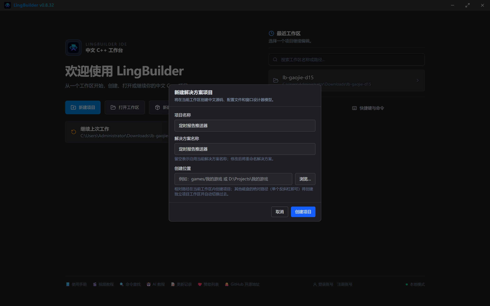
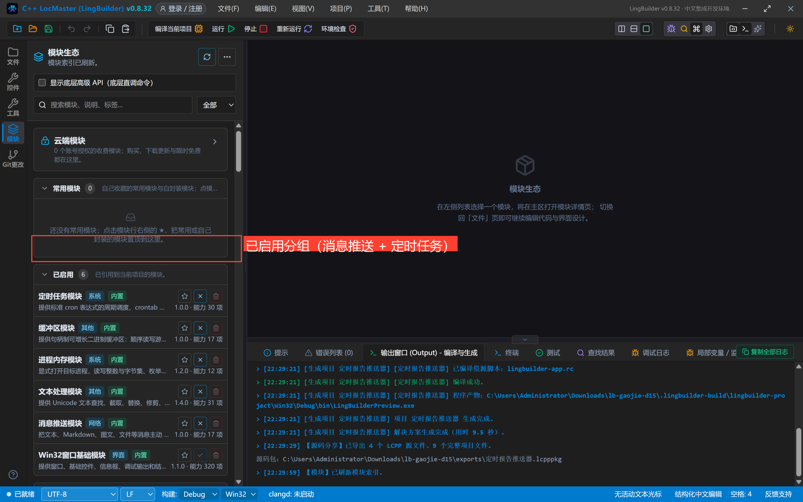
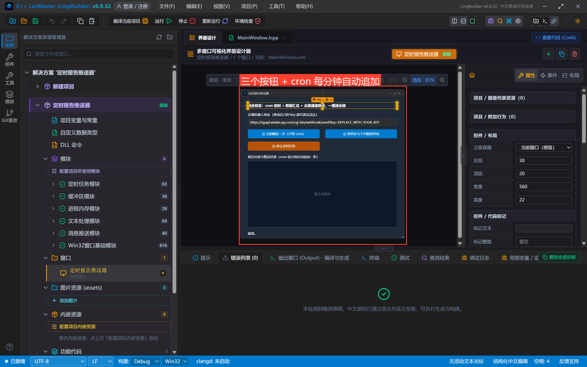
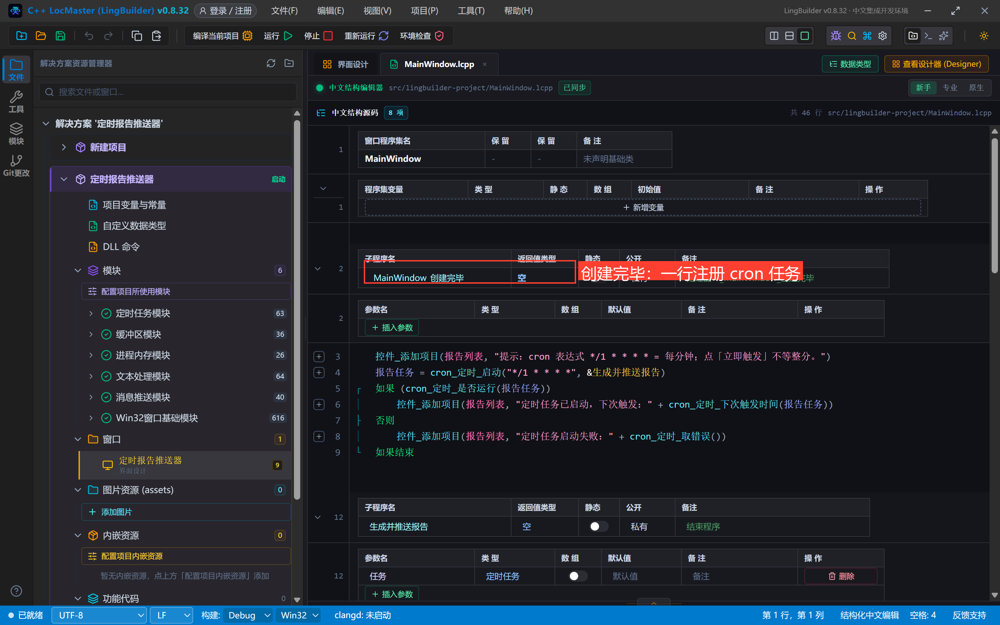
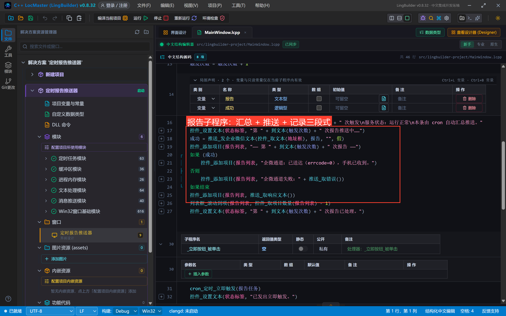
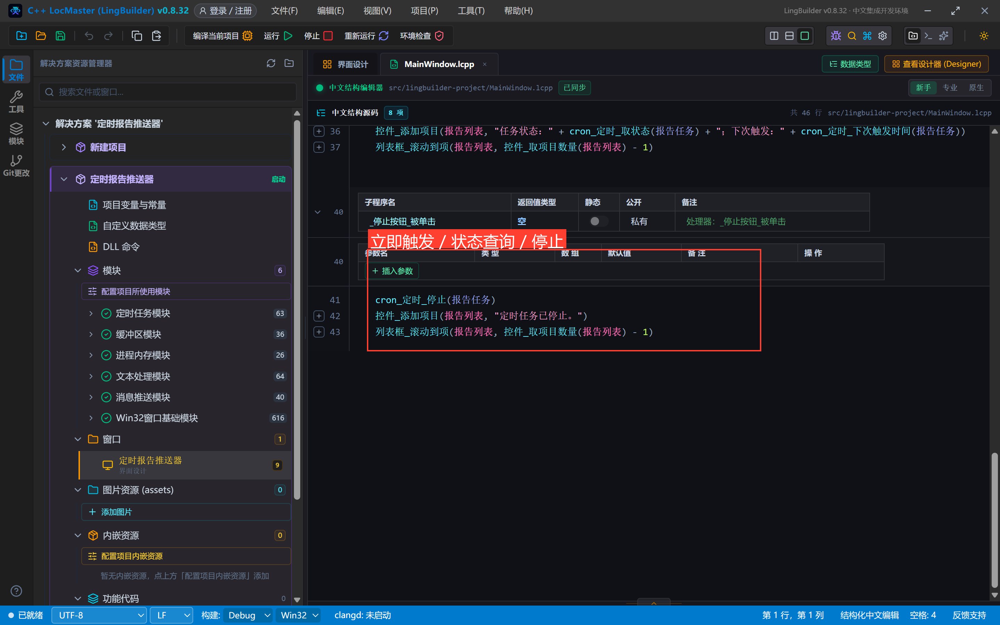
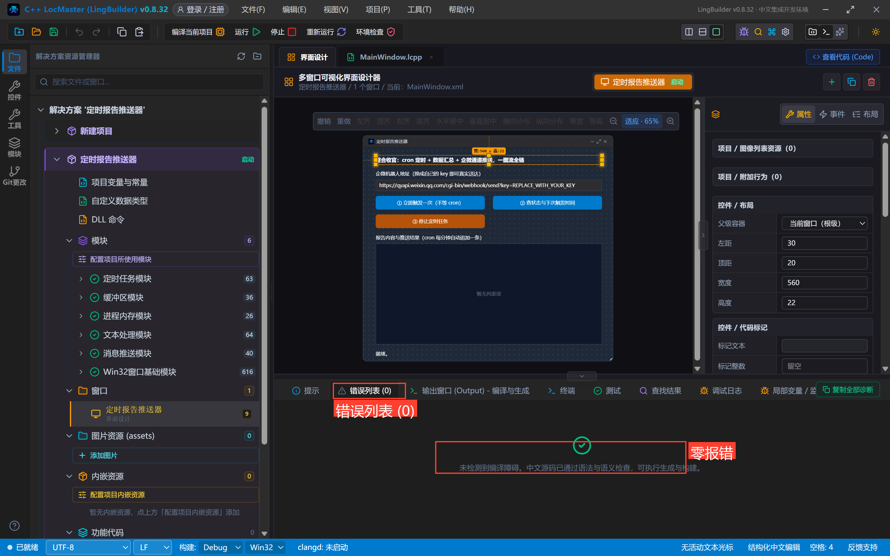
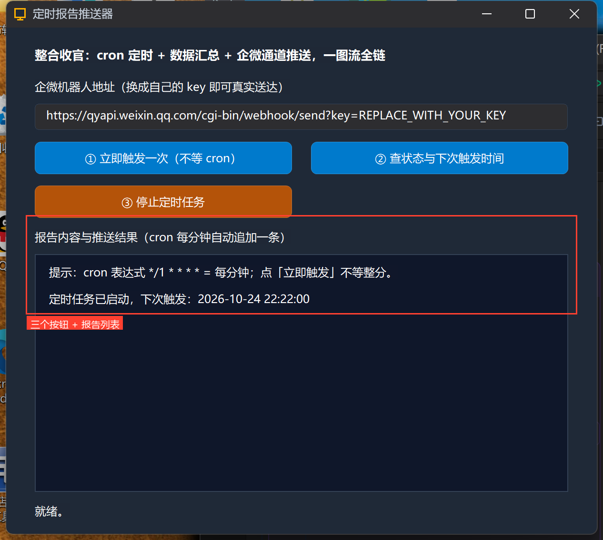
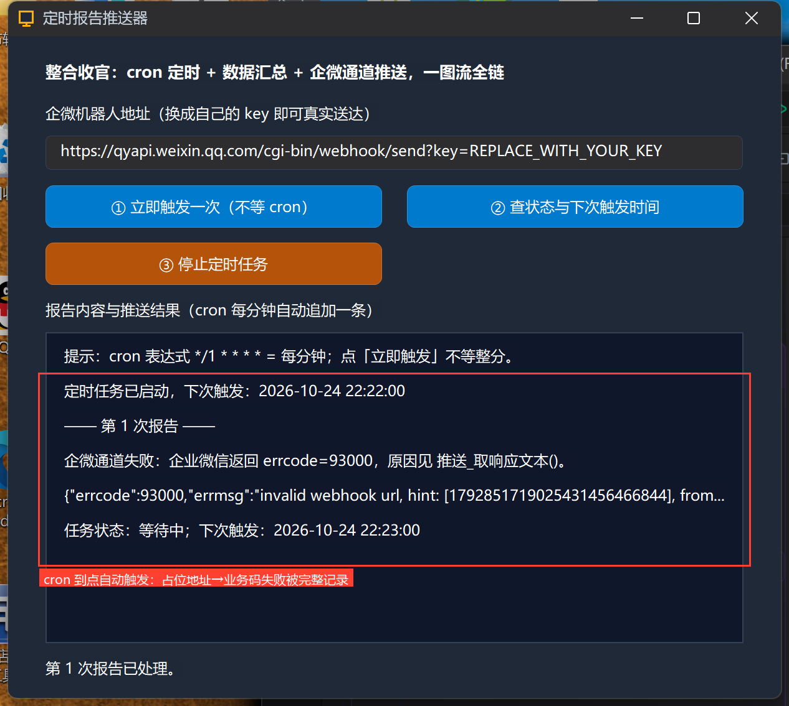
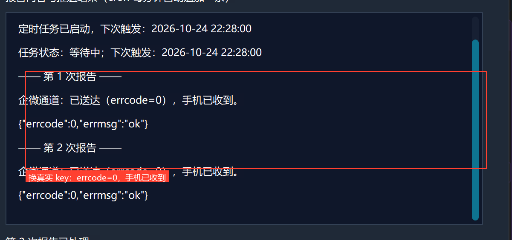

# 高阶实战 15 · 定时报告推送器：cron 定时 + 数据汇总 + 多通道推送（整合收官）

> 《LingBuilder 高阶实战系列》第 15 集，**消息推送专题收官**。前 14 集的零件——三家机器人命令、万能 JSON、排障方法论——这一集组装成一台真正有用的机器：**定时报告推送器**。cron 表达式一行注册「每分钟自动汇总一次」，报告内容动态生成，推送到企业微信通道；到点自动跑、可立即触发、可查状态、可停止。文末附**三平台 @ 与签名差异总表**，一表收走整个专题。全程约 40 分钟。
>
> 前置要求：学过[第 07 集](/guide/tutorials/gaojie-07)（cron 定时提醒器的定时用法）与第 14 集（排障方法论）。本集演示里企微地址用占位 key，换成你自己的即可真实送达。

## 这一集你将学会

- `cron_定时_启动("*/1 * * * *", &生成并推送报告)`：一行注册周期任务，到点自动执行
- **cron 处理器契约**：`空 处理器名(定时任务 任务)`——带一个 `定时任务` 参数（签名不对会编译期阻断）
- `cron_定时_立即触发 / 取状态 / 下次触发时间 / 停止`：不用等整分、随时掌控
- 数字拼接文本用 `到文本(触发次数)`（文本处理模块）
- 报告子程序三段式：**汇总数据 → 通道推送 → 结果记录**

## 1. 三十秒理解：这台机器怎么转

```text
cron_定时_启动("*/1 * * * *", &生成并推送报告)
        │ 每分钟到点（也可「立即触发」手动加开一轮）
        ▼
生成并推送报告(任务)
  ① 汇总：触发次数 +1，拼出报告文本
  ② 推送：推送_发企业微信文本(地址框, 报告)
  ③ 记录：报告列表追加「第 N 次 + 通道结果 + 响应原文」
```

cron 表达式 `*/1 * * * *` 就是「每分钟」（五段=分 时 日 月 周）。创建窗口时注册一次，窗口关闭任务自动停止——不留后台进程。

## 2. 新建项目与启用模块

新建窗口项目「**定时报告推送器**」（Windows 界面设计、创建位置留空）。本集启用**两个**模块：**消息推送模块** + **定时任务模块**：



在模块页确认「已启用」分组里两个模块都在：



## 3. 项目全局变量：给任务与计数器安家

解决方案树「项目变量与常量」（项目全局变量.lcpp）加两行：

```lcpp
全局 定时任务 报告任务
全局 整数型 触发次数 = 0
```

`定时任务` 类型**纯声明、不赋初值**（写 `= 0` 会被编译期拦下——句柄类类型的老规矩）；`触发次数` 就是本集的「数据汇总」。

## 4. 设计界面

| 控件 | 名称 | 显示内容 | 左距 | 顶距 | 宽度 | 高度 |
| --- | --- | --- | --- | --- | --- | --- |
| 标签 | 说明标签 | 整合收官：cron 定时 + 数据汇总 + 企微通道推送，一图流全链 | 30 | 20 | 560 | 22 |
| 标签 | 地址标签 | 企微机器人地址（换成自己的 key 即可真实送达） | 30 | 54 | 560 | 22 |
| 编辑框 | 地址框 | https://qyapi.weixin.qq.com/cgi-bin/webhook/send?key=REPLACE_WITH_YOUR_KEY | 30 | 80 | 560 | 28 |
| 按钮 | 立即按钮 | ① 立即触发一次（不等 cron） | 30 | 120 | 270 | 34 |
| 按钮 | 状态按钮 | ② 查状态与下次触发时间 | 320 | 120 | 270 | 34 |
| 按钮 | 停止按钮 | ③ 停止定时任务 | 30 | 166 | 270 | 34 |
| 标签 | 报告标签 | 报告内容与推送结果（cron 每分钟自动追加一条） | 30 | 212 | 560 | 22 |
| 列表框 | 报告列表 | — | 30 | 238 | 560 | 250 |
| 标签 | 状态标签 | 就绪。 | 30 | 500 | 560 | 22 |

窗口宽 620、高 560；三个按钮绑「被单击」，窗口绑「创建完毕」。



## 5. 写代码

### 5.1 创建完毕：一行注册定时任务



```lcpp
事件 _MainWindow_创建完毕()
    控件_添加项目(报告列表, "提示：cron 表达式 */1 * * * * = 每分钟；点「立即触发」不等整分。")
    报告任务 = cron_定时_启动("*/1 * * * *", &生成并推送报告)
    如果 (cron_定时_是否运行(报告任务))
        控件_添加项目(报告列表, "定时任务已启动，下次触发：" + cron_定时_下次触发时间(报告任务))
    否则
        控件_添加项目(报告列表, "定时任务启动失败：" + cron_定时_取错误())
    如果结束
结束
```

`cron_定时_启动` 返回 `定时任务` 句柄；启动成功立刻能用 `cron_定时_下次触发时间` 精确到秒地报出下次运行时刻。

### 5.2 报告子程序：汇总 + 推送 + 记录三段式



```lcpp
空 生成并推送报告(定时任务 任务)
    触发次数 = 触发次数 + 1
    局部 文本型 报告
    局部 逻辑型 成功
    报告 = "【LingBuilder 定时报告】第 " + 到文本(触发次数) + " 次触发\n服务状态：运行正常\n本条由 cron 自动汇总推送。"
    控件_设置文本(状态标签, "第 " + 到文本(触发次数) + " 次报告推送中……")
    成功 = 推送_发企业微信文本(控件_取文本(地址框), 报告, "", 假)
    控件_添加项目(报告列表, "—— 第 " + 到文本(触发次数) + " 次报告 ——")
    如果 (成功)
        控件_添加项目(报告列表, "企微通道：已送达（errcode=0），手机已收到。")
    否则
        控件_添加项目(报告列表, "企微通道失败：" + 推送_取错误())
    如果结束
    控件_添加项目(报告列表, 推送_取响应文本())
    列表框_滚动到项(报告列表, 控件_取项目数量(报告列表) - 1)
    控件_设置文本(状态标签, "第 " + 到文本(触发次数) + " 次报告已处理。")
结束
```

三个要点：

1. **处理器签名是 `空 名(定时任务 任务)`**——cron 到点会把任务句柄传进来；签名不匹配会在编译前被中文诊断拦下（不用到 MSVC 才发现）；
2. 数字拼进文本用 `到文本(触发次数)`（文本处理模块），不要直接 `+ 整数变量`；
3. 无论成败都记录「通道结论 + 响应原文」——第 14 集排障方法论在真实定时任务里的直接应用。

### 5.3 三个按钮：立即触发 / 状态 / 停止



```lcpp
事件 _立即按钮_被单击()
    cron_定时_立即触发(报告任务)
    控件_设置文本(状态标签, "已发出立即触发。")
结束

事件 _状态按钮_被单击()
    控件_添加项目(报告列表, "任务状态：" + cron_定时_取状态(报告任务) + "；下次触发：" + cron_定时_下次触发时间(报告任务))
    列表框_滚动到项(报告列表, 控件_取项目数量(报告列表) - 1)
结束

事件 _停止按钮_被单击()
    cron_定时_停止(报告任务)
    控件_添加项目(报告列表, "定时任务已停止。")
    列表框_滚动到项(报告列表, 控件_取项目数量(报告列表) - 1)
结束
```

`cron_定时_立即触发` 立刻按注册方式跑一轮、不影响原有周期——演示和调试时不用干等整分。

## 6. 编译与运行

编译后先看错误列表（零报错再继续），点运行：





## 7. 真机观察：自动、失败、成功，三段全录

**cron 到点自动触发**：启动后不用管，到 22:22:00 自动跑出「第 1 次报告」。占位 key 阶段企微回 `errcode=93000`——注意列表把「失败原因 + 响应原文」都记下了，排障方法论自动生效：



**换成真实 key**：把地址框里的 key 换成你自己机器人的，下一轮（或点「立即触发」）：



```text
—— 第 1 次报告 ——
企微通道：已送达（errcode=0），手机已收到。
{"errcode":0,"errmsg":"ok"}
```

`errcode=0` —— 消息真正进了你的企微群。这台机器现在每分钟自动汇报一次；把表达式改成 `0 9 * * *`（每天 09:00）、报告文本换成你真实业务的统计值，就是一个可交付的日报机器人。

## 8. 三平台差异总表（专题收官收藏版）

| | 企微 | 钉钉 | 飞书 |
| --- | --- | --- | --- |
| @ 凭据 | 手机号（企业成员） | 手机号 + 正文同现 | open_id 内联标签 |
| @ 所有人 | 文本命令开关 | isAtAll | `<at user_id="all">` |
| Markdown @ | 不支持 | 支持（自动补 @ 文本） | 富文本标签 |
| 签名时间戳 | —（IP 白名单） | **毫秒**，拼 URL | **秒**，写 body |
| 签名算法 | — | HMAC(密钥=key, msg=ts\n密钥) | HMAC(key=ts\n密钥, msg=空) |
| 响应字段 | `errcode` | `errcode` | `code`（旧 `StatusCode`） |
| 直接发图 | 可以（base64 ≤2MB） | 不行（用 FeedCard 图文 URL） | 富文本图片元素 |
| 限流 | 约 20 条/分钟 | 约 20 条/分钟 | 约 20 条/分钟 |
| 万能兜底 | `推送_发JSON`（只判 HTTP 200） | 同左 | 同左 |

## 小结与源码包

消息推送专题（01~15）正式收官：从第一条文本消息，到签名、@、卡片、排障，再到这台 cron 驱动的定时报告器。下一个专题是 **DLL**：调用系统 DLL、封装自己的 DLL、零落盘内存加载——中文代码通往 Win32 生态的深水区。

- 本集源码包：[定时报告推送器.lcpppkg](定时报告推送器.lcpppkg)
- 官方示例源码区同款：`15-定时报告推送器.lcpppkg`
