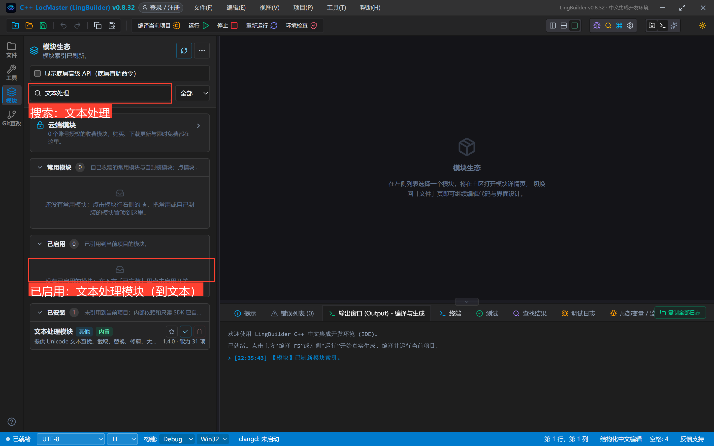
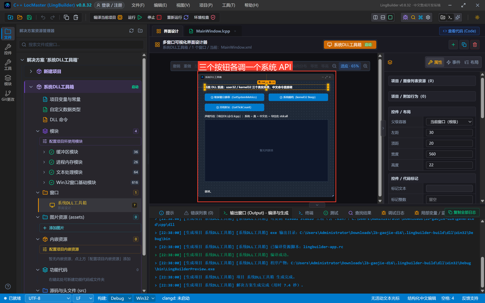
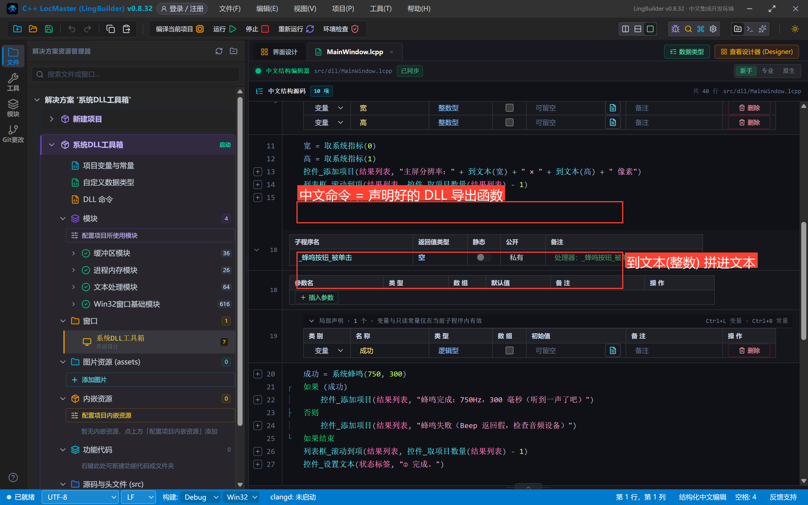
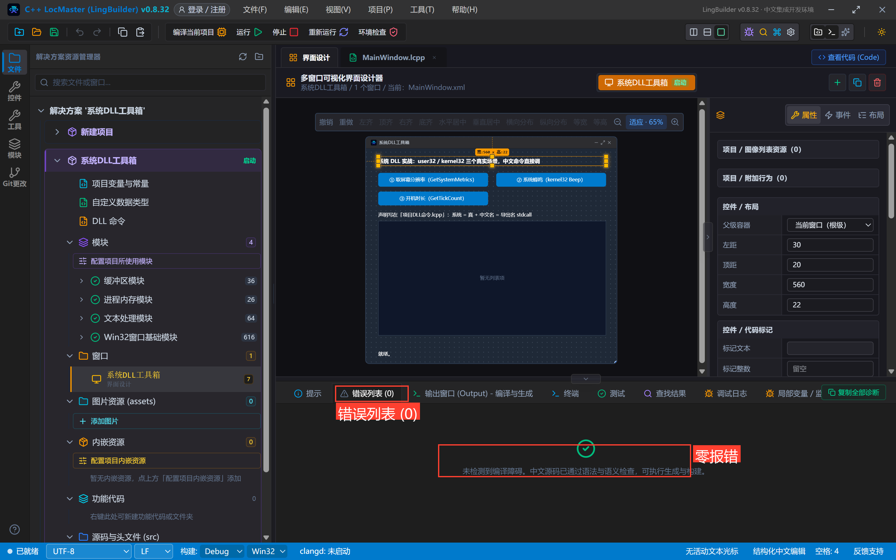
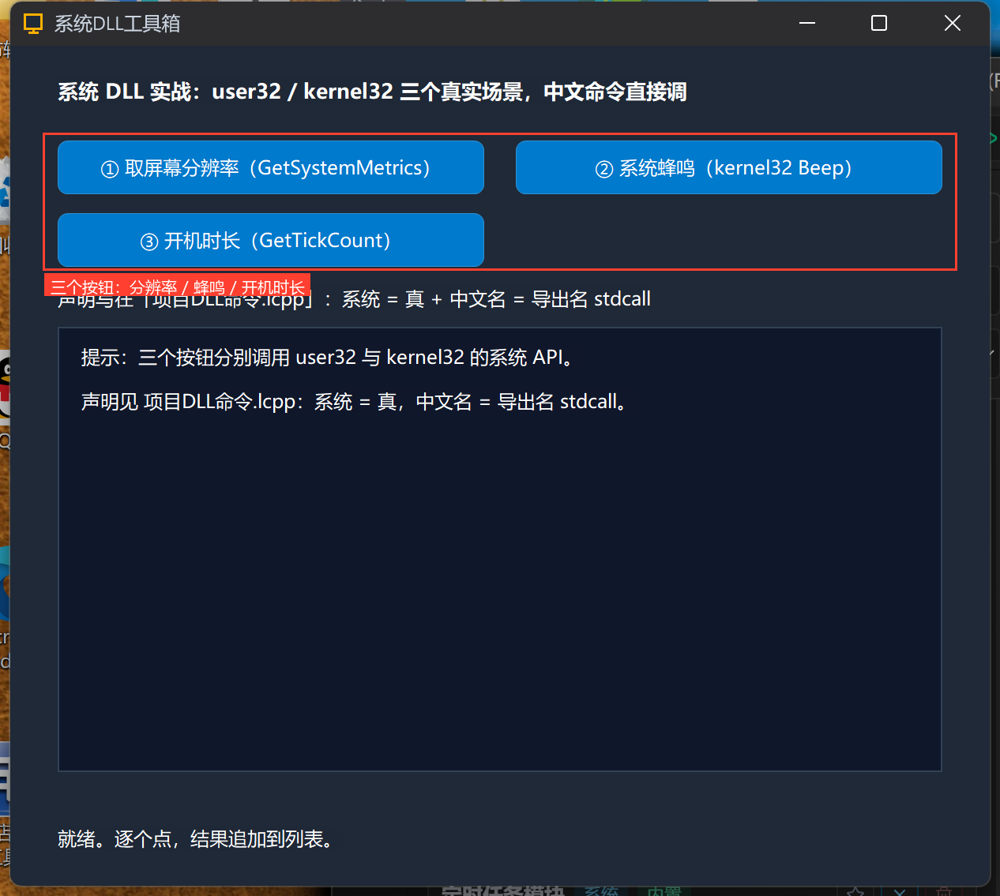
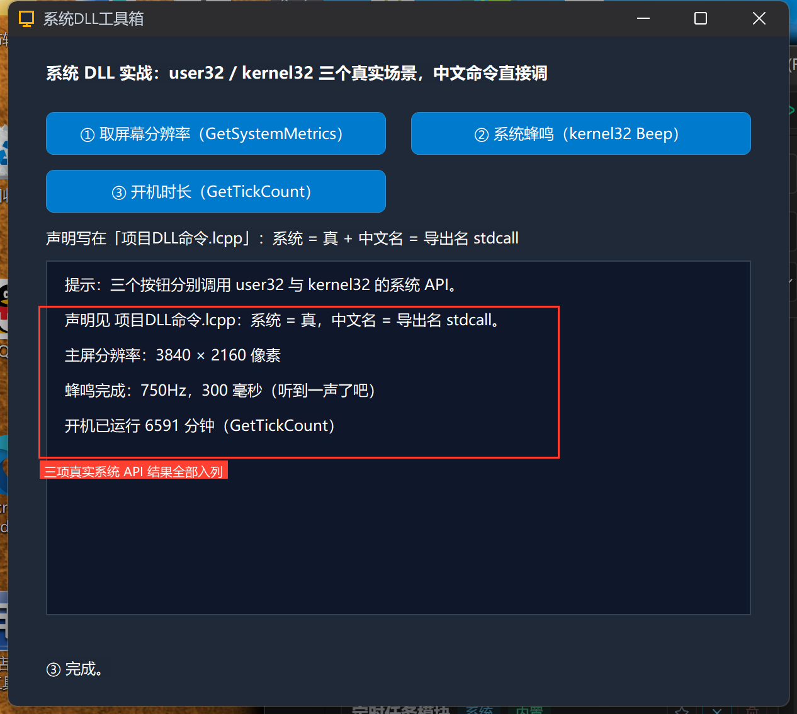

# 高阶实战 16 · 调用系统 DLL 实战：user32 / kernel32 常用 API 中文直调

> 《LingBuilder 高阶实战系列》第 16 集，**DLL 专题**开篇。Windows 系统本身就是一组 DLL——user32.dll、kernel32.dll 里躺着几千个系统能力：取屏幕分辨率、蜂鸣、计时……LingBuilder 用一段「**DLL 命令声明**」把这些 API 变成中文命令，之后调用它们与调用内置模块毫无区别。本集声明三个最常用 API 并真机调用验证。全程约 30 分钟。
>
> 本集与已上线的《DLL命令图文教程》互为补充：那篇讲声明编辑器的操作细节，本篇讲真实场景的组合运用。

## 这一集你将学会

- 「项目DLL命令.lcpp」声明：`DLL命令库 user32` + `系统 = 真` + `整数型 中文名(参数) = 导出名 stdcall`
- **「系统 = 真」**：从系统目录加载（user32/kernel32 是 Windows 自带，不随 exe 分发）
- **中文名 = 导出名**：中文命令映射真实 API；**stdcall** 是系统 API 在 x86 的调用约定
- 三个真实场景：`GetSystemMetrics`（分辨率）、`Beep`（蜂鸣）、`GetTickCount`（开机时长）

## 1. 三十秒理解：声明 DLL 命令

```lcpp
DLL命令库 user32
  系统 = 真
  整数型 取系统指标(整数型 索引) = GetSystemMetrics stdcall
结束DLL命令库
```

四段结构：库名（自定义）→ `系统 = 真`（系统 DLL 标记）→ **中文命令声明行**（返回值类型 中文名(参数) `=` 真实导出名 + 调用约定）→ `结束DLL命令库`。声明只写在 **项目DLL命令.lcpp** 里（解决方案树「DLL 命令」节点，双击进入），不要写进窗口主源码。

「系统 = 真」的库**中文名必须补英文/拼音别名**（`= GetSystemMetrics` 就是别名），否则构建会被阻断——导出表校验要求系统 API 按真实导出名匹配。

## 2. 新建项目与启用模块

新建窗口项目「**系统DLL工具箱**」（Windows 界面设计、创建位置留空）。本集额外启用 **文本处理模块**（`到文本` 把数字拼进文本）：



## 3. 声明三个系统 API

「项目DLL命令.lcpp」完整内容：

```lcpp
包 项目DLL命令

DLL命令库 user32
  系统 = 真
  整数型 取系统指标(整数型 索引) = GetSystemMetrics stdcall
结束DLL命令库

DLL命令库 kernel32
  系统 = 真
  逻辑型 系统蜂鸣(整数型 频率, 整数型 毫秒) = Beep stdcall
  整数型 系统启动毫秒() = GetTickCount stdcall
结束DLL命令库
```

三个 API 的签名（MSDN）：`GetSystemMetrics(int index)` 返回 int；`Beep(DWORD freq, DWORD dur)` 返回 BOOL；`GetTickCount()` 返回开机毫秒数。类型对齐规则：int↔整数型、DWORD↔整数型、BOOL↔逻辑型、指针↔后续集（本集用不到）。

## 4. 设计界面与调用代码

| 控件 | 名称 | 显示内容 | 左距 | 顶距 | 宽度 | 高度 |
| --- | --- | --- | --- | --- | --- | --- |
| 标签 | 说明标签 | 系统 DLL 实战：user32 / kernel32 三个真实场景，中文命令直接调 | 30 | 20 | 560 | 22 |
| 按钮 | 屏幕按钮 | ① 取屏幕分辨率（GetSystemMetrics） | 30 | 60 | 270 | 34 |
| 按钮 | 蜂鸣按钮 | ② 系统蜂鸣（kernel32 Beep） | 320 | 60 | 270 | 34 |
| 按钮 | 时长按钮 | ③ 开机时长（GetTickCount） | 30 | 106 | 270 | 34 |
| 标签 | 声明标签 | 声明写在「项目DLL命令.lcpp」… | 30 | 152 | 560 | 22 |
| 列表框 | 结果列表 | — | 30 | 178 | 560 | 282 |
| 标签 | 状态标签 | 就绪。 | 30 | 494 | 560 | 22 |

窗口宽 620、高 560；三个按钮绑「被单击」，窗口绑「创建完毕」。



调用代码（三个事件同构，以 ① 为例）：



```lcpp
事件 _屏幕按钮_被单击()
    局部 整数型 宽
    局部 整数型 高
    宽 = 取系统指标(0)
    高 = 取系统指标(1)
    控件_添加项目(结果列表, "主屏分辨率：" + 到文本(宽) + " × " + 到文本(高) + " 像素")
    列表框_滚动到项(结果列表, 控件_取项目数量(结果列表) - 1)
    控件_设置文本(状态标签, "① 完成。")
结束
```

`GetSystemMetrics` 的参数 0/1 分别是 SM_CXSCREEN/SM_CYSCREEN（主屏宽/高）。③ 里把毫秒换算成分钟：`毫秒 / 1000 / 60`（整数除法自动取整）。

## 5. 编译与运行

编译后先看错误列表（零报错），点运行，依次点三个按钮：





## 6. 真机结果



```text
主屏分辨率：3840 × 2160 像素        ← GetSystemMetrics(0)/(1)
蜂鸣完成：750Hz，300 毫秒            ← Beep(750, 300)，真的响了
开机已运行 6591 分钟（GetTickCount） ← 换算约 4.6 天
```

三个系统 API 全部真机生效——声明一次，中文命令随时可调。

## 7. 系统 DLL 红线速查

- 「系统 = 真」的库**必须补英文/拼音别名**（`= 真实导出名`），构建期导出表校验会按名匹配；
- 系统 API 在 x86 是 **stdcall**——声明行尾必须写 `stdcall`，漏写会导致栈不平衡崩溃；x64 只有一种约定，写不写都一样（建议统一写）；
- 类型必须按 Win32 语义对齐：DWORD/int → 整数型、BOOL → 逻辑型、句柄 → 整数型（32 位句柄）；带指针/结构体参数的 API（如 GetCursorPos）超出本集范围，见第 17 集；
- 声明只写 `项目DLL命令.lcpp`；复制进窗口主源码会把整个窗口类当声明文件处理（能编译、事件全空壳）；
- 「系统 = 真」不复制文件；第三方 DLL（`Win32 = "dll/..."`）构建时才复制到 exe 旁——见第 17 集。

## 小结与源码包

本集打通了「声明 → 中文命令 → 真机调用」的最小闭环。下一集进阶：**第三方 DLL 的结构体传参、pack 对齐与字节集缓冲区**。

- 本集源码包：[系统DLL工具箱.lcpppkg](系统DLL工具箱.lcpppkg)
- 官方示例源码区同款：`16-系统DLL工具箱.lcpppkg`
