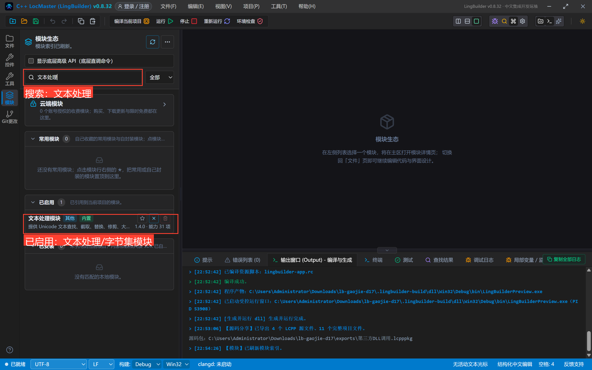
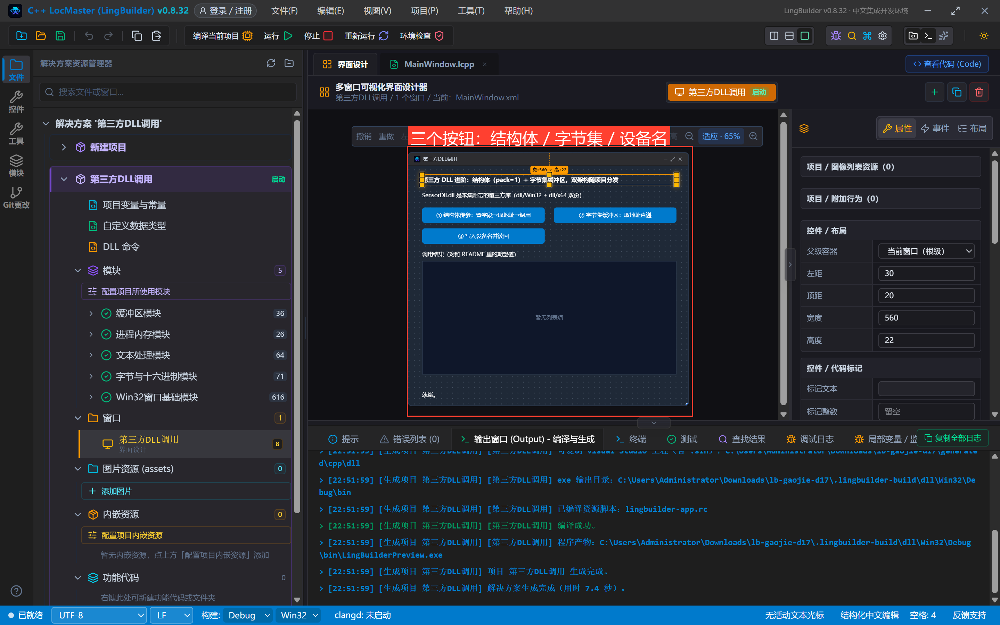
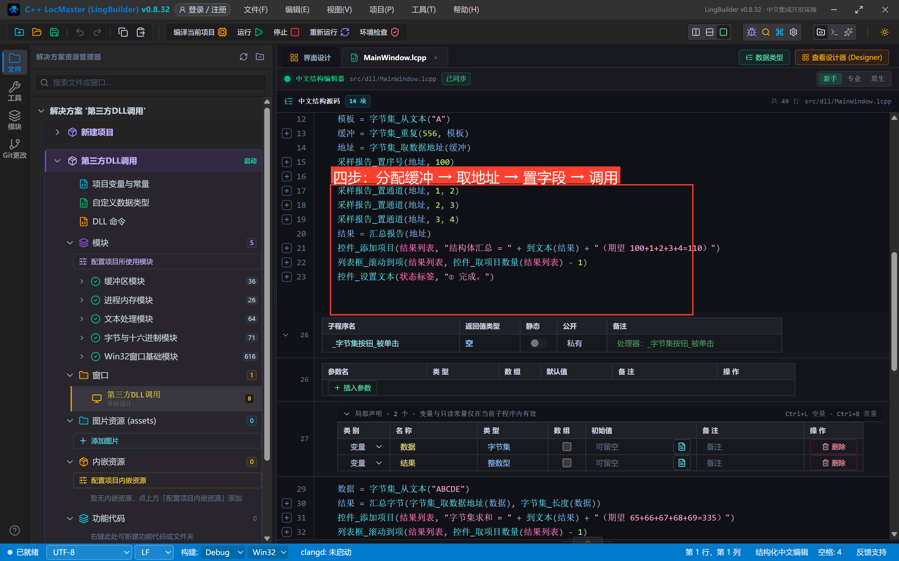
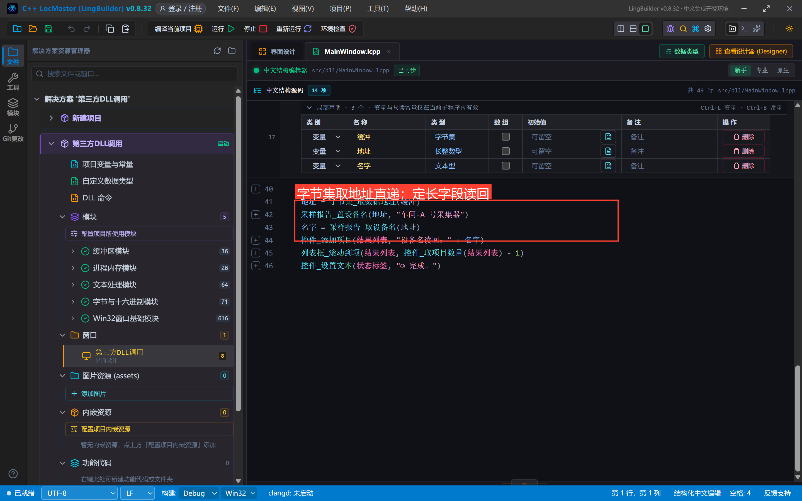
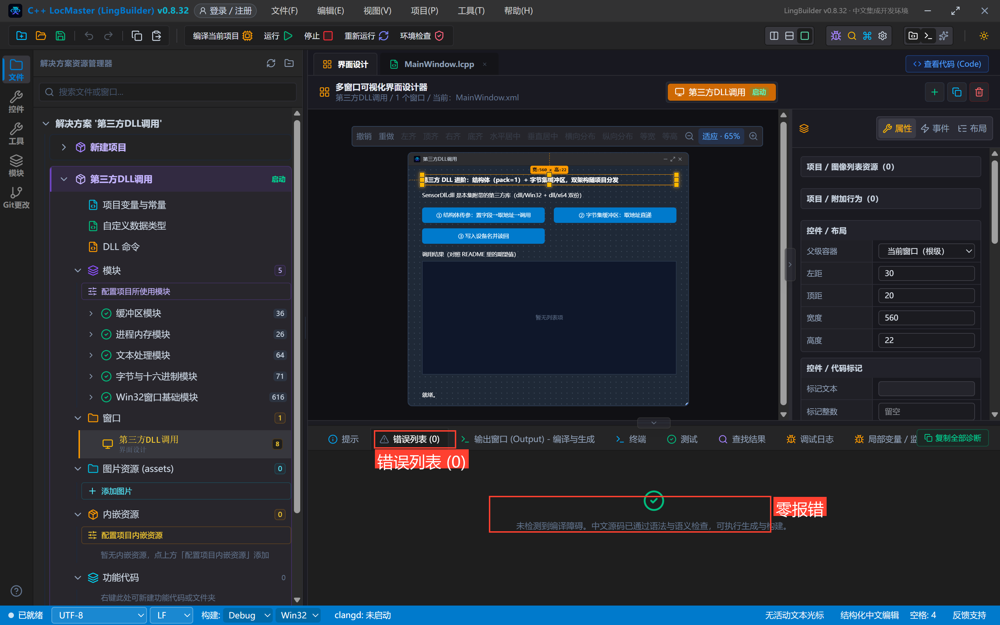
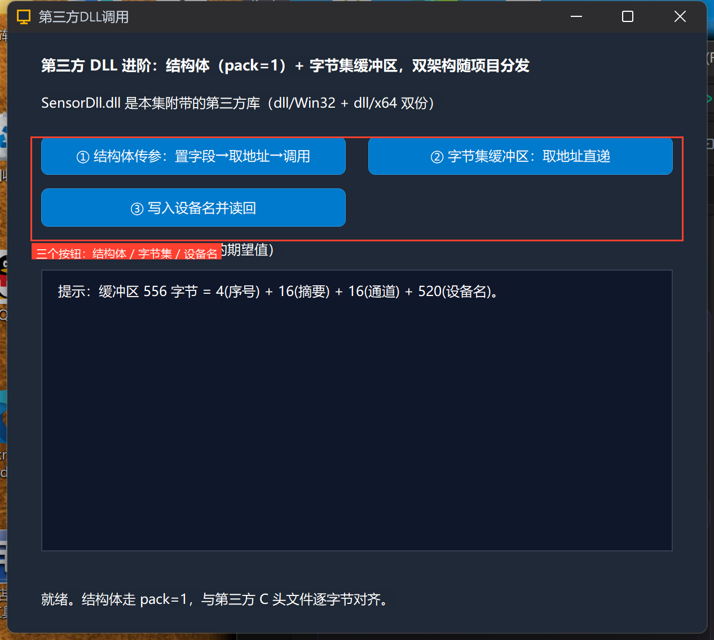
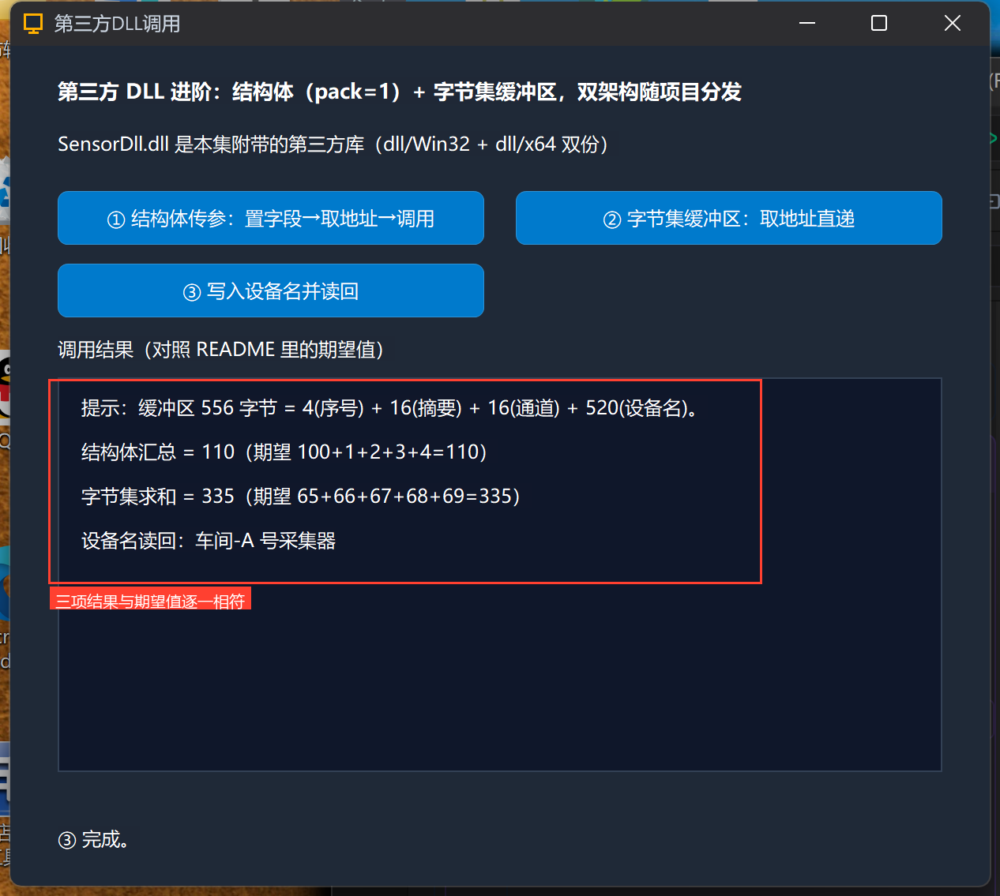

# 高阶实战 17 · 调用第三方 DLL 进阶：结构体、定长数组、pack 对齐与字节集缓冲区

> 《LingBuilder 高阶实战系列》第 17 集，**DLL 专题**第二集。上一集的系统 API 都是「整数进、整数出」；真实世界的第三方 DLL 可没这么客气——SDK 函数要传**结构体**，而且结构体经常是 `#pragma pack(1)` 打包的。本集自己做一回「接 SDK 的人」：随集附带的第三方库 **SensorDll.dll**（x86+x64 双份）带一个 pack=1 的采集结构体，我们用中文代码给它**逐字节**喂数据、取结果，再用 `字节集_取数据地址` 把字节集缓冲区直接递进 DLL。全程约 40 分钟。
>
> 前置要求：学过[第 16 集](/guide/tutorials/gaojie-16)（DLL 命令声明的位置与语法）。本集素材：`SensorDll/`（含 `SensorDll.c` 源码与双架构 DLL，随源码包同目录）。

## 这一集你将学会

- 库内**结构体声明**：`结构体 采样报告` + `对齐 = 1` + 定长数组字段（`字节型 摘要[16]`、`整数型 通道[4]`、`文本型 设备名[260]`）
- **结构体参数的调用范式**：分配字节集 → `字节集_取数据地址` 拿地址 → `采样报告_置序号/置通道` 置字段 → 把地址递给 DLL 命令
- 生成器自动派生的**字段取/置命令**（`采样报告_取序号(地址)`、`采样报告_置通道(地址, 下标, 值)`）
- `字节集_取数据地址` 直递指针整数形参；**x86/x64 双架构红线**

## 1. 认识第三方的约定（C 头文件长这样）

```c
#pragma pack(push, 1)          // 1 字节打包
typedef struct SampleReport {
    int serial;                // 序号
    unsigned char digest[16];  // 摘要
    int channels[4];           // 通道
    wchar_t name[260];         // 设备名
} SampleReport;
#pragma pack(pop)

int SumReport(const SampleReport* r);              // 序号+四个通道 求和
int SumBytes(const unsigned char* data, int len);  // 字节求和
```

`对齐 = 1` 时结构体大小 = 4 + 16 + 16 + 520 = **556 字节**，没有 padding——中文声明必须用 `对齐 = 1` 复刻出逐字节一致的布局，否则 DLL 读到的就是错位数据（pack 错位是**静默数据损坏**，编译器不会报错）。

## 2. 新建项目与启用模块

新建窗口项目「**第三方DLL调用**」（Windows 界面设计、创建位置留空）。启用 **文本处理模块**（`到文本`）与 **字节集模块**（`字节集_从文本/重复/取数据地址/长度`）：



## 3. 放入第三方 DLL 并声明

把 SensorDll 的两份 DLL 放进项目：解决方案树项目节点下建 `dll/Win32/` 与 `dll/x64/`，分别放入对应架构的 `SensorDll.dll`（构建时按当前架构自动复制到 exe 旁，位数永远不会装错）。

打开「项目DLL命令.lcpp」，声明库、结构体与两个命令：

```lcpp
DLL命令库 SensorDll
  Win32 = "dll/Win32/SensorDll.dll"
  x64 = "dll/x64/SensorDll.dll"
  结构体 采样报告
    对齐 = 1
    整数型 序号
    字节型 摘要[16]
    整数型 通道[4]
    文本型 设备名[260]
  结束结构体
  整数型 汇总报告(采样报告 报告) = SumReport
  整数型 汇总字节(指针整数 数据, 整数型 长度) = SumBytes
结束DLL命令库
```

三个关键点：

1. **`对齐 = 1`** 生成 `#pragma pack(1)`，与第三方 C 头文件逐字节一致（支持 1/2/4/8/16）；
2. **定长数组字段**用 `类型 名[N]` 写法（N 最多 1048576），生成器派生 `采样报告_取摘要(地址, 下标)` / `采样报告_置摘要(地址, 下标, 值)` 这类带下标的取/置命令；
3. **字节指针形参**声明为 `指针整数`——调用侧用 `字节集_取数据地址()` 拿地址递进去。

## 4. 设计界面与代码

界面三按钮 + 结果列表（窗口 620×560）：



### 4.1 ① 结构体传参：四步范式



```lcpp
事件 _结构体按钮_被单击()
    局部 字节集 模板
    局部 字节集 缓冲
    局部 长整数型 地址
    局部 整数型 结果
    模板 = 字节集_从文本("A")
    缓冲 = 字节集_重复(556, 模板)
    地址 = 字节集_取数据地址(缓冲)
    采样报告_置序号(地址, 100)
    采样报告_置通道(地址, 0, 1)
    采样报告_置通道(地址, 1, 2)
    采样报告_置通道(地址, 2, 3)
    采样报告_置通道(地址, 3, 4)
    结果 = 汇总报告(地址)
    控件_添加项目(结果列表, "结构体汇总 = " + 到文本(结果) + "（期望 100+1+2+3+4=110）")
    列表框_滚动到项(结果列表, 控件_取项目数量(结果列表) - 1)
结束
```

四步范式背下来：**分配缓冲 → 取数据地址 → 置字段 → 调用**。`采样报告_置通道` 第二参是数组下标（从 0 起）；`汇总报告(地址)` 把结构体指针递给 DLL——地址类型是长整数型。

### 4.2 ② 字节集缓冲区直递



```lcpp
数据 = 字节集_从文本("ABCDE")
结果 = 汇总字节(字节集_取数据地址(数据), 字节集_长度(数据))
' 结果 = 65+66+67+68+69 = 335
```

`字节集_取数据地址` 按引用转发、不拷贝——⚠️ **地址随字节集生灭**：字节集被重新赋值、清空或变量销毁，旧地址立即失效，绝对不要存起来晚点用。

### 4.3 ③ 定长文本字段读写

```lcpp
采样报告_置设备名(地址, "车间-A 号采集器")
名字 = 采样报告_取设备名(地址)
```

定长文本字段（`wchar_t[260]`）的取/置走同样的地址+字段名命令。

## 5. 编译与运行

编译后先看错误列表（零报错再继续），点运行：





## 6. 真机观察：三项全部对上期望值



```text
结构体汇总 = 110 （期望 100+1+2+3+4=110）
字节集求和 = 335 （期望 65+66+67+68+69=335）
设备名读回：车间-A 号采集器
```

三项逐一相符——pack=1 的布局、地址传参、定长字段读写，全链真机验证。

## 7. 第三方 DLL 红线速查

- **pack 必须和第三方一致**：C 头文件有 `#pragma pack(1)` 就声明 `对齐 = 1`；错位=静默数据损坏；
- **位数红线**：Win32 项目只能加载 dll/Win32 的 32 位 DLL，x64 只能加载 64 位——双份都放进项目目录，构建自动选；
- **调用约定**：声明默认 cdecl；明确 stdcall 的库（多数系统 API 风格）在声明行尾写 `stdcall`——x86 下两者栈清理方式不同，写错会栈损坏；
- 字节集地址**随生灭**，取地址后立即用完；要长期持有先把数据复制进独立变量；
- 结构体字段访问一律走生成的取/置命令，**不要自己算偏移**（pack 换了字节数，偏移全变）。

## 小结与源码包

第三方 DLL 的两大硬骨头——结构体布局与缓冲区传递——都拆完了。下一集换到供给侧：**用 windows-dll 模板封装自己的 DLL**，再回头调用它，形成完整闭环。

- 本集源码包：[第三方DLL调用.lcpppkg](第三方DLL调用.lcpppkg)（`SensorDll/` 含 C 源码与双架构 DLL）
- 官方示例源码区同款：`17-第三方DLL调用.lcpppkg`
