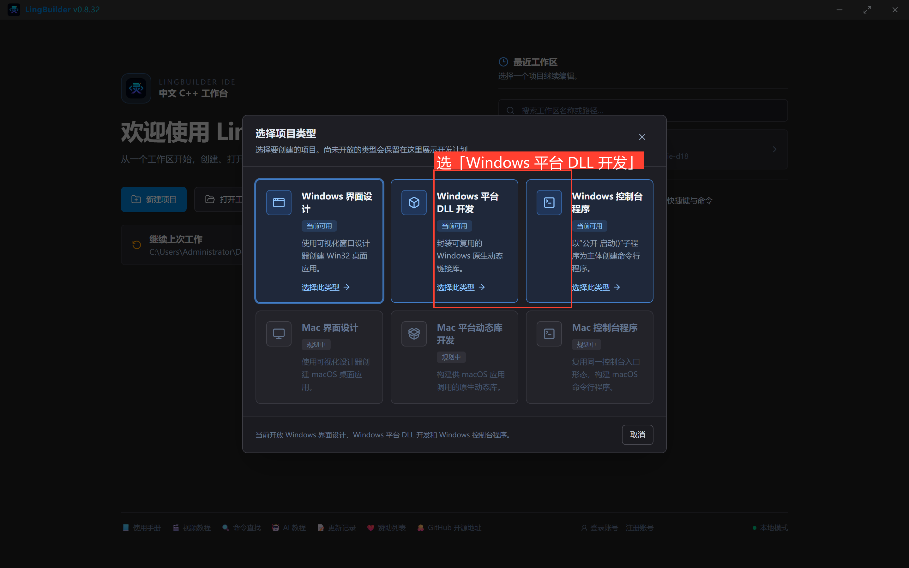
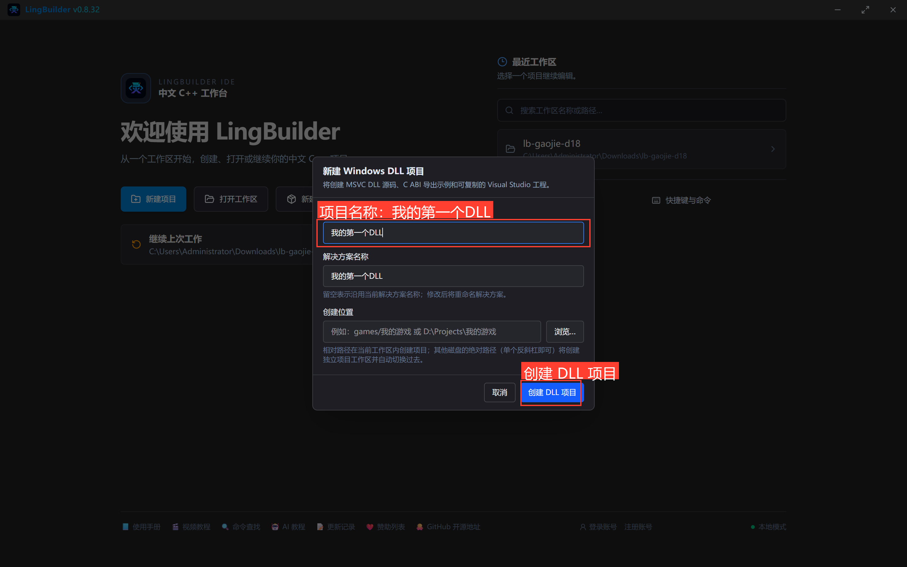
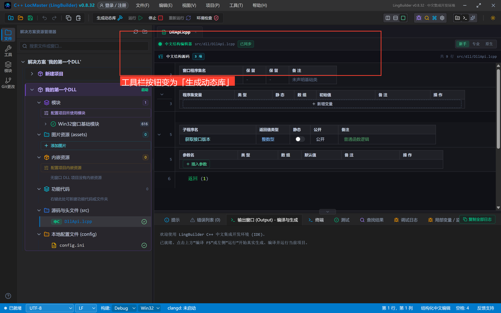
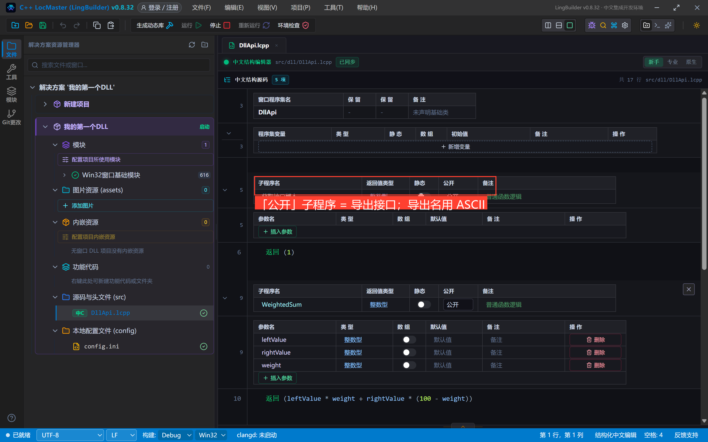
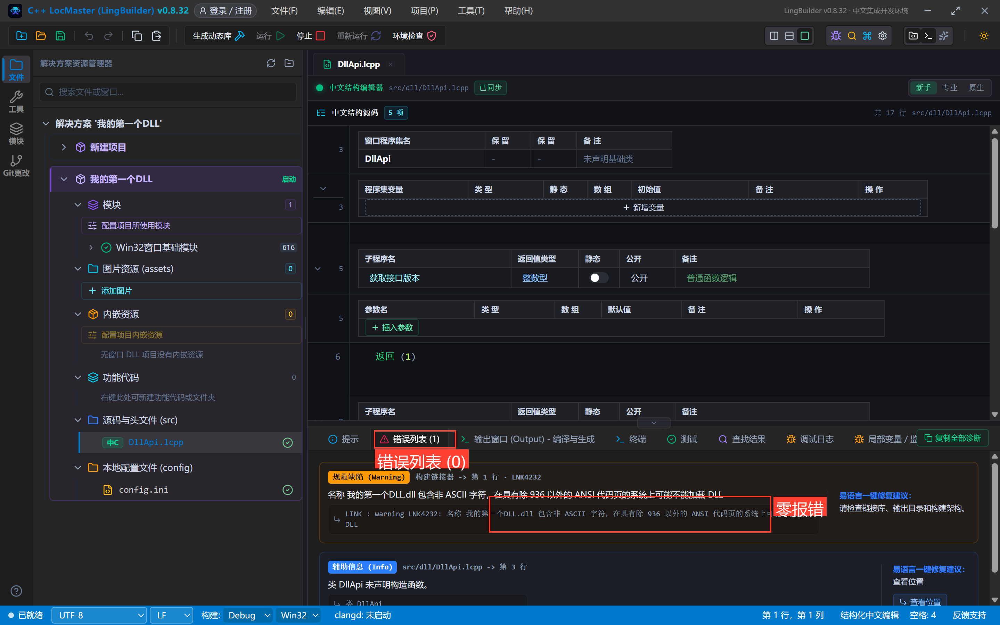
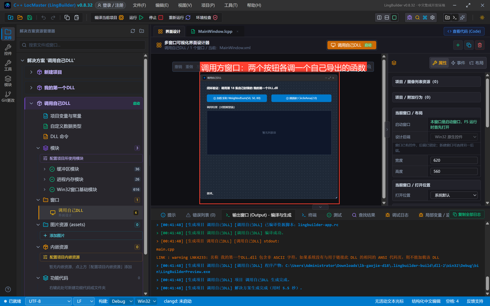
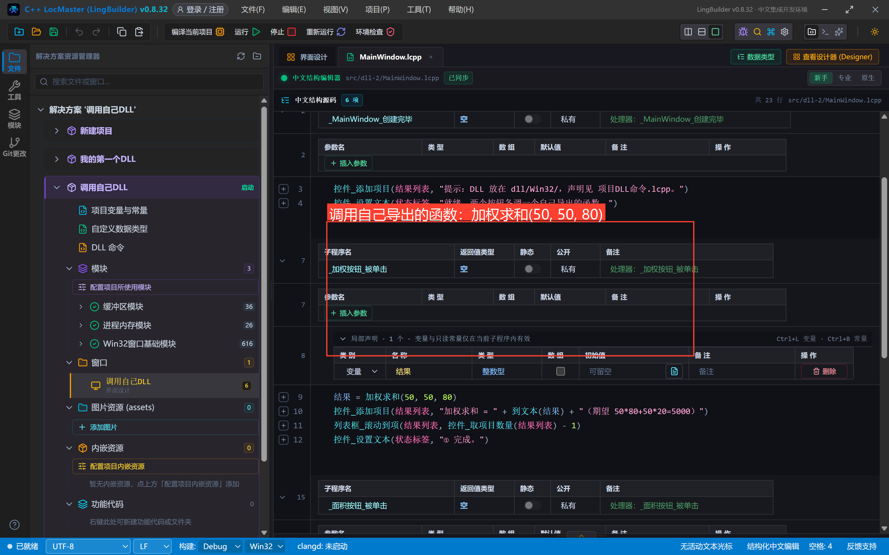
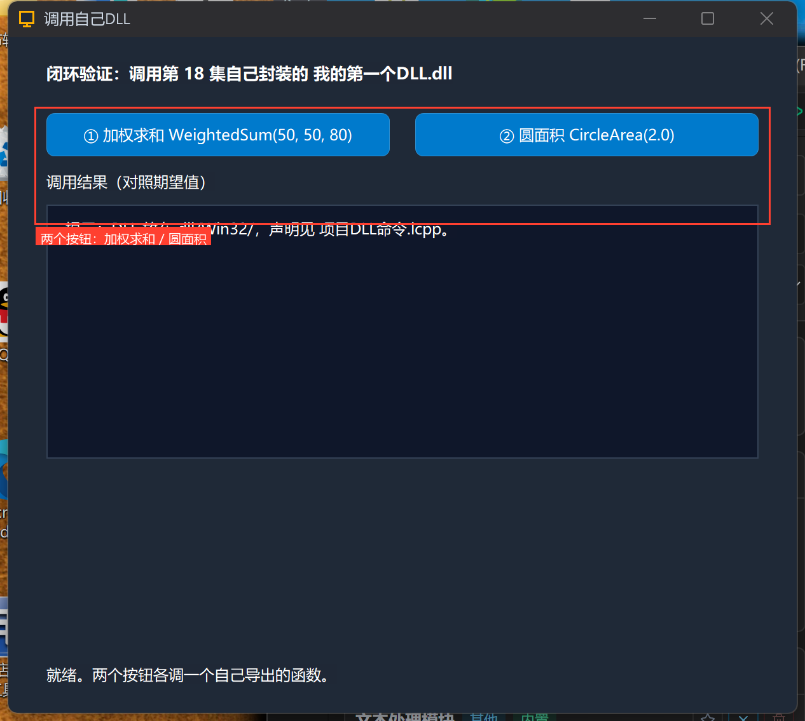
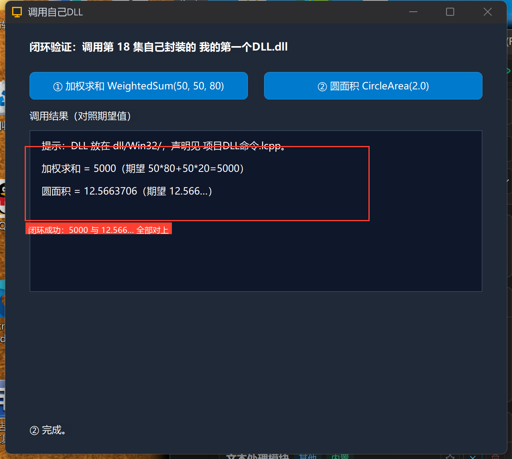

# 高阶实战 18 · 封装自己的 DLL：windows-dll 模板与调用闭环

> 《LingBuilder 高阶实战系列》第 18 集，**DLL 专题**第三集。前两集都在「调用别人的 DLL」；这一集换到供给侧——用 **windows-dll 项目模板**封装一个自己的 `我的第一个DLL.dll`，再用**另一个项目**声明调用它，跑通「封装 → 导出 → 调用」全闭环。顺带实修一个 IDE 缺陷：DLL 项目的「生成动态库」此前漏把 `exports.def` 传给链接器，`公开` 子程序的导出会静默消失（详见第 6 节）。全程约 45 分钟。
>
> 前置要求：学过[第 16 集](/guide/tutorials/gaojie-16)（DLL 命令声明位置与语法）。

## 这一集你将学会

- 欢迎页「**Windows 平台 DLL 开发**」模板：创建即得 `DllApi.lcpp` + `exports.def` + DllMain 源码
- **`公开` 子程序 = 导出接口**；导出名用 **ASCII**（英文/拼音），工具栏按钮变为「**生成动态库**」
- 另一个项目里用 `DLL命令库` 声明调用：`整数型 加权求和(...) = WeightedSum`（默认 cdecl）
- 本集实修的 x86 导出约定：包装函数 `__cdecl` + def 裸名 + 调用方 dllimport `__cdecl`，三层全无装饰才能加载期对齐

## 1. 三十秒理解：封装 DLL 的三层

```text
① DLL 项目（供给侧）        ② exports.def           ③ 调用方项目（消费侧）
类 DllApi                  LIBRARY "dll"           DLL命令库 我的第一个DLL
公开                         EXPORTS                   整数型 加权求和(...) = WeightedSum
  整数型 WeightedSum(...)      WeightedSum             小数型 圆面积(...) = CircleArea
  小数型 CircleArea(...)       CircleArea            结束DLL命令库
```

- **`公开` 子程序就是导出接口**：生成器为每个 `公开` 子程序生成一个 C 包装（extern "C"），名字进 `exports.def`；
- **导出名用 ASCII**（英文/拼音）：中文子程序名在 x86 只能以装饰名（`_名@N`）导出，易语言等宿主无法按名声明；
- **调用约定全链 cdecl**：生成器包装、def 导出名、调用方 dllimport 声明三层全部无装饰，x86 加载期才能对齐（本集实修的缺陷正是这里曾有 __stdcall 残留）。

## 2. 新建 DLL 项目

欢迎页点「**新建项目**」，在类型选择里选「**Windows 平台 DLL 开发**」（与界面设计并列的卡片）：



项目名称填 **我的第一个DLL**，点「**创建 DLL 项目**」：



DLL 项目的工作台与窗口项目不同：**没有设计器**，工具栏按钮是「**生成动态库**」（编译产出 .dll + 导入库 .lib，不运行）：



## 3. 写导出接口：`公开` 子程序

打开 `DllApi.lcpp`，在模板的 `获取接口版本` 下面加两个 `公开` 子程序（**导出名用 ASCII**）：



```lcpp
包 MyMath

类 DllApi
公开
  整数型 获取接口版本()
    返回 (1)
  结束

  整数型 WeightedSum(整数型 leftValue, 整数型 rightValue, 整数型 weight)
    返回 (leftValue * weight + rightValue * (100 - weight))
  结束

  小数型 CircleArea(小数型 radius)
    返回 (3.14159265 * radius * radius)
  结束
结束类
```

`WeightedSum(50, 50, 80)` = 50×80 + 50×20 = **5000**（加权 80% 压给左值）；`CircleArea(2.0)` = **12.566…**。

## 4. 生成动态库

点工具栏「**生成动态库**」，先看错误列表（零报错）：



构建产出在 `.lingbuilder-build/dll/Win32/Debug/bin/`：`我的第一个DLL.dll` + 导入库 `.lib`。导出表可以用 VS 的 dumpbin 验证：`WeightedSum`、`CircleArea` 两个干净名都在（模板自带的 `获取接口版本` 也在）。

## 5. 调用方项目：声明并调用

同一个工作区再建一个普通窗口项目「**调用自己DLL**」（Windows 界面设计），把上一步的 `我的第一个DLL.dll` 复制到它的 `dll/Win32/` 目录，然后在「项目DLL命令.lcpp」声明：



```lcpp
DLL命令库 我的第一个DLL
  Win32 = "dll/Win32/我的第一个DLL.dll"
  整数型 加权求和(整数型 左值, 整数型 右值, 整数型 权重) = WeightedSum
  小数型 圆面积(小数型 半径) = CircleArea
结束DLL命令库
```

注意**没有写 stdcall 后缀**——自己封装的 DLL 是 cdecl 约定（generator 包装、def、调用方三层一致），与第 16 集系统 API 的 stdcall 不同。

调用代码：



```lcpp
事件 _加权按钮_被单击()
    局部 整数型 结果
    结果 = 加权求和(50, 50, 80)
    控件_添加项目(结果列表, "加权求和 = " + 到文本(结果) + "（期望 50*80+50*20=5000）")
    列表框_滚动到项(结果列表, 控件_取项目数量(结果列表) - 1)
    控件_设置文本(状态标签, "① 完成。")
结束

事件 _面积按钮_被单击()
    局部 小数型 结果
    结果 = 圆面积(2.0)
    控件_添加项目(结果列表, "圆面积 = " + 到文本(结果) + "（期望 12.566…）")
    列表框_滚动到项(结果列表, 控件_取项目数量(结果列表) - 1)
    控件_设置文本(状态标签, "② 完成。")
结束
```

## 6. 编译、运行与真机闭环

编译调用方（零报错），点运行，依次点两个按钮：





```text
加权求和 = 5000 （期望 50*80+50*20=5000）
圆面积 = 12.5663706 （期望 12.566…）
```

**闭环成功**：调用方 exe 加载了自己封装的 DLL，两个导出函数的结果全部与期望一致。

> 🛠 **本集实修的 IDE 缺陷（已修复）**：「生成动态库」此前有两处漏接——① 生成的 vcxproj 把 `exports.def` 只登记为普通文件、没传 `ModuleDefinitionFile` 给链接器；② 直连 cl 链接命令漏掉 `/DEF` 参数。后果是 `公开` 子程序（ASCII 名）的导出**静默消失**，调用方 LNK2019。另将 x86 导出包装从 `__stdcall` 统一为 `__cdecl`：与 def 裸名、调用方 dllimport `__cdecl` 三层对齐（`__stdcall` 会让导入符号带 `@N` 装饰，与无装饰导出名在加载期对不上）。旧版本遇到「自己封装的 DLL 调不到」，升级 IDE 即可。

## 7. 封装 DLL 红线速查

- **`公开` 子程序 = 导出接口**；不想导出的子程序不要点「公开」；
- 导出名（子程序名）**用英文或拼音**：中文名在 x86 只有装饰名导出，易语言等宿主无法按名声明；
- def 与调用方全链 **cdecl**（LingBuilder 生成器已保证）；若第三方宿主要为 stdcall，请在封装时另出一份 stdcall 壳或直接说明按名 GetProcAddress；
- DLL 项目**不能运行**（没有入口），工具栏用「生成动态库」；报错先看错误列表；
- 调用方声明默认 **cdecl**（与第 16 集「系统 API 要写 stdcall」相反——系统 API 是 Windows 自己的 stdcall 约定，自己的 DLL 按 LingBuilder 约定是 cdecl）；
- 位数匹配红线同第 17 集：调用方 Win32 就放 `dll/Win32/` 的 32 位 DLL。

## 小结与源码包

「封装 → 导出 → 调用」全闭环打通。下一集是 DLL 专题最后一集：**内存加载 DLL**——把 DLL 内嵌进 EXE 资源，运行时手工映射，exe 旁边一个 DLL 文件都没有。

- 本集源码包：[调用自己DLL.lcpppkg](调用自己DLL.lcpppkg)（调用方完整工程；`我的第一个DLL源码/` 附 DllApi.lcpp 与 exports.def）
- 官方示例源码区同款：`18-封装DLL-调用方.lcpppkg`
