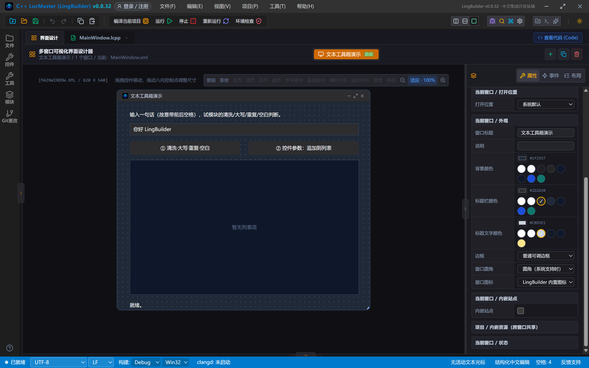
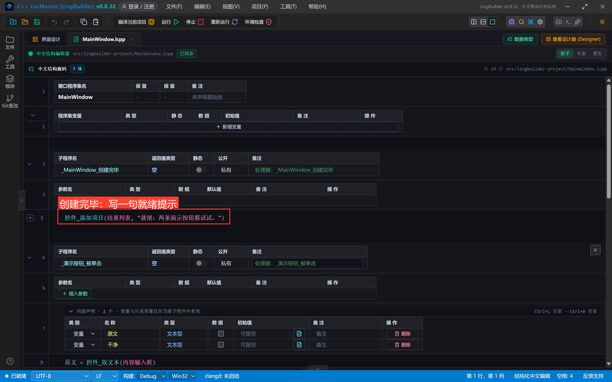
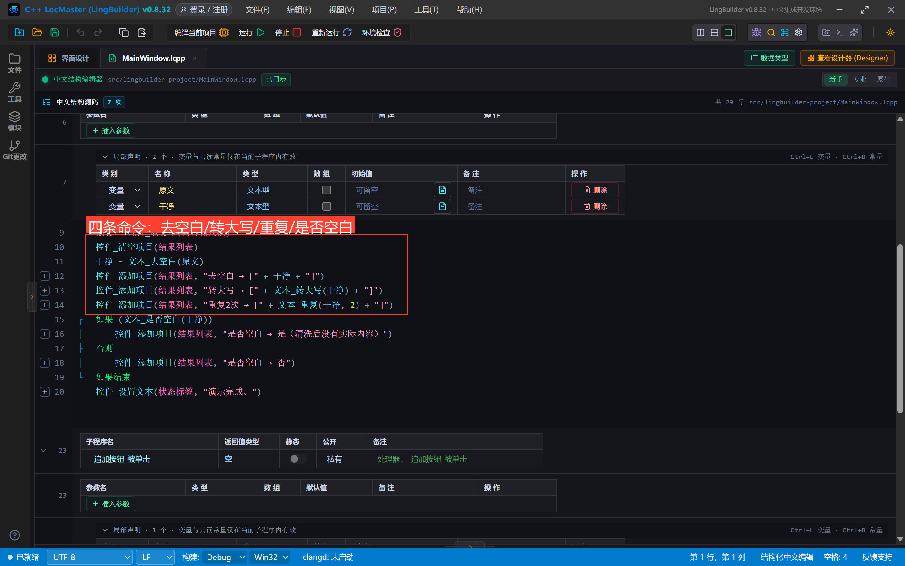
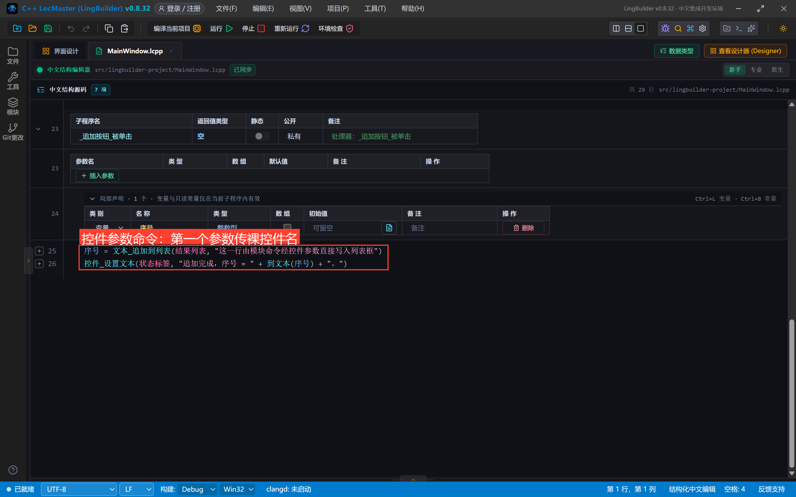
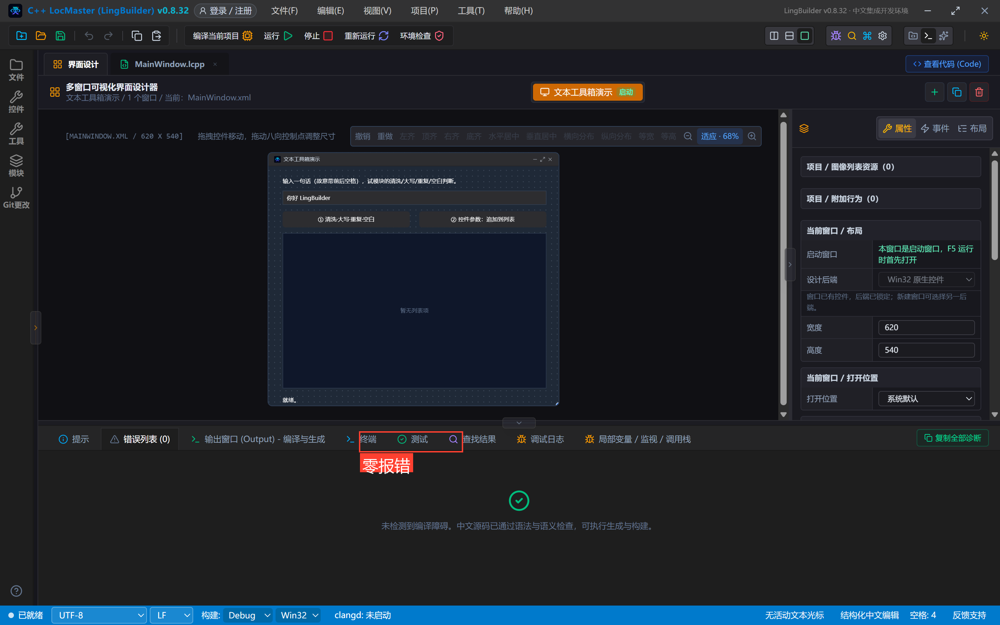
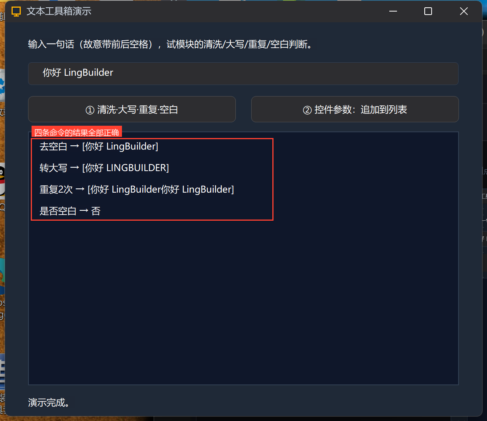
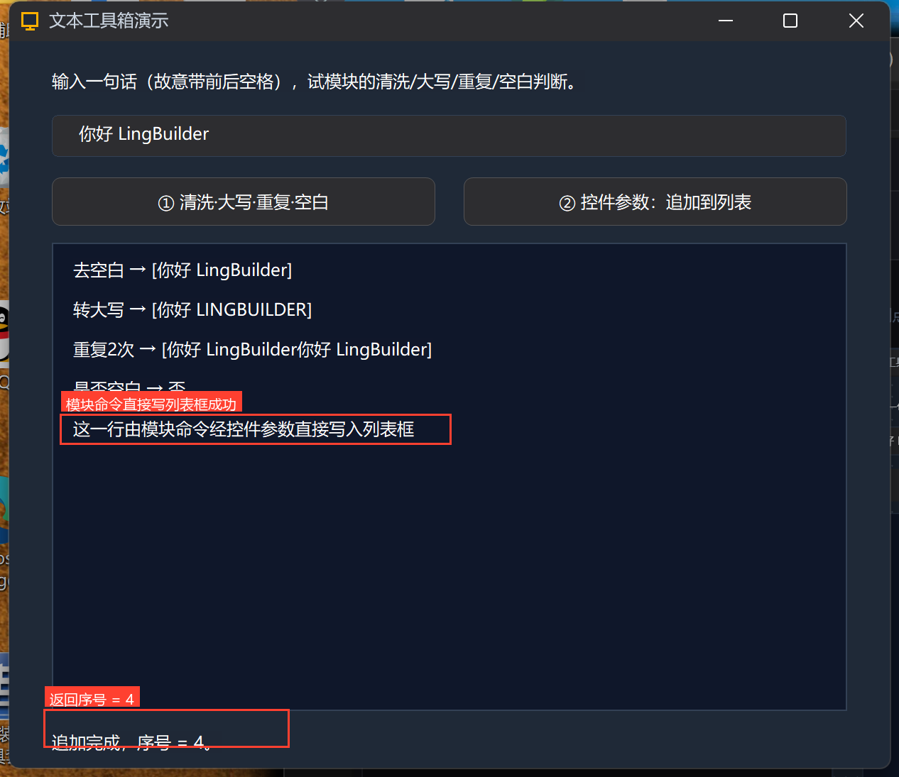

# 高阶实战 21 · 命令面进阶：多参数、控件参数、常量、片段与别名

> 《LingBuilder 高阶实战系列》第 21 集，**模块封装专题**第二集。[上一集](/guide/tutorials/gaojie-20)我们跑通了「新建模块 → 改命令 → 启用 → 打包」的全流程；这一集把**命令面**写法全部展开：多参数命令、逻辑型返回值、**控件参数 controlRef**（让模块命令直接操作窗口上的控件！）、常量 `#`、代码片段 snippets、中文别名 aliases。全程约 35 分钟。
>
> 前置要求：学过[第 20 集](/guide/tutorials/gaojie-20)。

## 这一集你将学会

- 带多个参数的命令怎么声明（`文本_重复(内容, 次数)`）
- 逻辑型/整数型返回值在 `如果` 里怎么用
- **控件参数（controlRef）**：binding 里声明 `controlRef` + `nativeHandle`，用户传**裸控件名**，生成器自动翻译成真实 HWND——模块 C++ 用 `SendMessage` 直接写列表框
- 常量 `#常量名` 在源码中直接引用
- 代码片段 snippets：把常用骨架放进编辑器补全
- 中文别名 aliases：每条命令带一个英文别名

## 1. 本集模块：文本工具箱

新建模块 `lingbuilder.demo.textkit`（名称「文本工具箱」，分类「系统」），命令面一共 **5 条命令 + 1 个常量 + 1 个片段**：

| 命令 | 签名 | 返回 | 看点 |
| --- | --- | --- | --- |
| `文本_去空白` | (内容) | 文本型 | 去首尾空白 |
| `文本_转大写` | (内容) | 文本型 | 英文字母大写 |
| `文本_重复` | (内容, 次数) | 文本型 | **多参数** |
| `文本_是否空白` | (内容) | 逻辑型 | **逻辑返回**，输入校验 |
| `文本_追加到列表` | (目标列表, 内容) | 整数型 | **控件参数**：直接写列表框 |

新建与启用的完整过程和第 20 集一模一样（欢迎页「新建模块」→ 填 ID/名称/说明 → 创建；模块页搜索「文本工具」→ 开发源卡片 → 详情 → 启用），这里不再重复截图。

## 2. 命令面怎么写：contributes 与 bindings

清单里每条命令写两处（第 20 集讲过：`contributes` 给人看、`bindings` 给编译器看）。本集新增的写法有四处：

**① 多参数**：`parameters` 数组按顺序列出每个参数——

```json
{ "command": "文本_重复", "runtimeName": "TextKit_Repeat",
  "parameters": [
    { "name": "内容", "type": "wideString", "description": "原始文本。" },
    { "name": "次数", "type": "int", "description": "重复次数（1~100）。" }
  ],
  "returnType": "wideString" }
```

**② 逻辑型返回**：binding `returnType` 写 `bool`，contributes 写 `逻辑型`。源码里可以直接放进 `如果`：

```lcpp
如果 (文本_是否空白(干净))
    控件_添加项目(结果列表, "是否空白 → 是")
否则
    控件_添加项目(结果列表, "是否空白 → 否")
如果结束
```

**③ 控件参数（本集主角）**：`文本_追加到列表` 的第一个参数引用窗口上的列表框控件。binding 里必须声明 `type: "controlRef"`，并写全三要素（允许的控件类型 / 对象种类 / 解析作用域）和运行时表示：

```json
{ "command": "文本_追加到列表", "runtimeName": "TextKit_ListPush",
  "parameters": [
    { "name": "目标列表", "type": "controlRef",
      "controlTypes": ["ListBox"], "controlKinds": ["visual"],
      "scope": "currentWindow", "runtimeRepresentation": "nativeHandle",
      "description": "要追加项目的列表框控件（裸控件名）。" },
    { "name": "内容", "type": "wideString", "description": "要追加的一行文本。" }
  ],
  "returnType": "int" }
```

- `runtimeRepresentation: "nativeHandle"`：生成器把裸控件名翻译成**真实 HWND** 传给模块函数；
- 源码里调用时第一个参数**直接写控件名，不带引号**（带了引号反而过不了控件引用门禁）；
- 编辑器会在这个参数位提供当前窗口兼容控件的补全，C++ 生成、语言服务、设计器定位消费同一份声明。

**④ 中文别名**：contributes 命令条目加 `aliases` 数组，英文主名与中文主名落到同一个 binding：

```json
{ "name": "文本_去空白", "aliases": ["TextKit_Trim"], "...": "..." }
```

## 3. C++ 实现：控件参数收到的是 HWND

`include/module_bridge.h` 与 `src/module_bridge.cpp`（完整源码见源码包），核心是控件参数命令——**第一个参数就是列表框的真实窗口句柄**，直接用 Win32 API 写：

```cpp
#include "module_bridge.h"
#include <windows.h>

// 控件参数命令：nativeHandle 传入列表框真实 HWND，直接 Win32 追加一行。
int TextKit_ListPush(HWND list, const std::wstring& text) {
    if (list == nullptr) return -1;
    int index = (int)SendMessageW(list, LB_ADDSTRING, 0, (LPARAM)text.c_str());
    if (index >= 0) SendMessageW(list, LB_SETTOPINDEX, (WPARAM)index, 0);
    return index;
}
```

其余四条是纯文本处理（`iswspace`/`towupper`/循环拼接），返回 `std::wstring` 或 `bool`，与 binding 的 `wideString`/`bool` 一一对应。

## 4. 调用方项目：把命令面全用一遍

建窗口项目「文本工具箱演示」，启用文本工具箱模块，画 6 个控件：说明标签、输入框（默认内容**故意带前后空格** `␣␣你好 LingBuilder␣␣`）、两个按钮、结果列表、状态标签：



调用代码（29 行，三个事件块）：



```lcpp
类 MainWindow
    事件 _MainWindow_创建完毕()
        控件_添加项目(结果列表, "就绪：两条演示按钮都试试。")
    结束
```

「① 清洗·大写·重复·空白」按钮——**四条文本命令各用一次**：



```lcpp
    事件 _演示按钮_被单击()
        局部 文本型 原文
        局部 文本型 干净
        原文 = 控件_取文本(内容输入框)
        控件_清空项目(结果列表)
        干净 = 文本_去空白(原文)
        控件_添加项目(结果列表, "去空白 → [" + 干净 + "]")
        控件_添加项目(结果列表, "转大写 → [" + 文本_转大写(干净) + "]")
        控件_添加项目(结果列表, "重复2次 → [" + 文本_重复(干净, 2) + "]")
        如果 (文本_是否空白(干净))
            控件_添加项目(结果列表, "是否空白 → 是（清洗后没有实际内容）")
        否则
            控件_添加项目(结果列表, "是否空白 → 否")
        如果结束
        控件_设置文本(状态标签, "演示完成。")
    结束
```

「② 控件参数：追加到列表」按钮——**第一个参数传裸控件名 `结果列表`**：



```lcpp
    事件 _追加按钮_被单击()
        局部 整数型 序号
        序号 = 文本_追加到列表(结果列表, "这一行由模块命令经控件参数直接写入列表框")
        控件_设置文本(状态标签, "追加完成，序号 = " + 到文本(序号) + "。")
    结束
结束类
```

常量也在本集源码里出现：`调试输出(#文本工具箱版本)` 直接输出 200（可在源码包的最小示例里看到）。

## 5. 编译运行：真机结果

编译后错误列表零报错：



点「①」：输入框原文 `␣␣你好 LingBuilder␣␣`——去空白后**方括号紧贴文本**（前后空格被去掉）、转大写 `LINGBUILDER`、重复 2 次、是否空白「否」，四条命令全部正确：



点「②」：新的一行出现在列表框里，状态栏显示**「追加完成，序号 = 4。」**——返回值是 0 起序号（前面已有 4 行）：



这一行不是调用方代码写的，是**模块 C++ 通过控件参数拿到的 HWND 用 `SendMessage` 写进去的**——这就是 controlRef 的威力：模块作者可以做出直接操作界面控件的命令，而用户只需写一个控件名。

## 6. 代码片段：把骨架放进补全

清单里注册 snippets 后，编辑器补全里能直接搜到「文本工具箱·清洗并追加」三行骨架：

```json
"snippets": [ {
  "label": "文本工具箱·清洗并追加",
  "description": "去空白、转大写后把结果追加到列表框的三行骨架。",
  "insertText": "局部 文本型 干净文本 = 文本_去空白($1)\n干净文本 = 文本_转大写(干净文本)\n文本_追加到列表(结果列表, 干净文本)"
} ]
```

`$1` 是占位符：插入后光标落在第一个参数位置，直接输入要处理的文本即可。

## 常见坑

- **控件参数传了带引号的字符串**：门禁直接阻断。控件参数请写裸控件名（`结果列表`），只有真正的文本参数才加引号。
- **controlRef 三要素没写全**：`controlTypes` / `controlKinds` / `scope`（+ `runtimeRepresentation`）必须显式声明，模块校验会给出中文诊断。
- **别名冲突**：`aliases` 里不要用其他模块已占用的命令名，校验器会提示重名。

## 下一集预告

22 集讲**功能库与代码组织**：`功能/` 目录一文件一库、`库名.功能()` 限定调用、分类子目录归拢。

## 源码包

本集完整项目（模块源码 + 调用方源码）已打包：[文本工具箱演示.lcpppkg](文本工具箱演示.lcpppkg)——在 LingBuilder 里「文件 → 打开 LCPP 源码包」一键导入运行。
