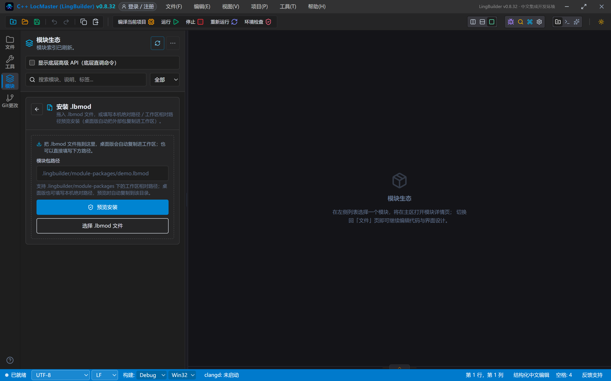
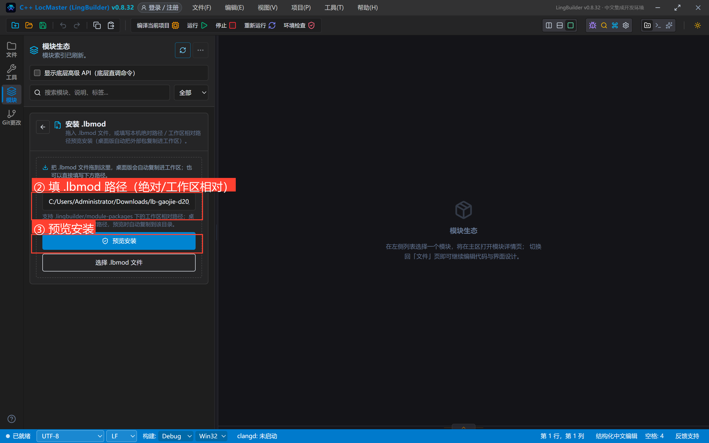
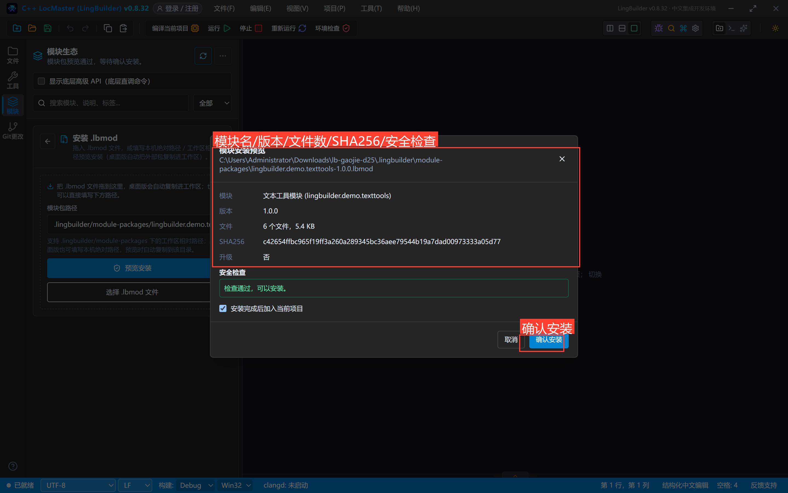
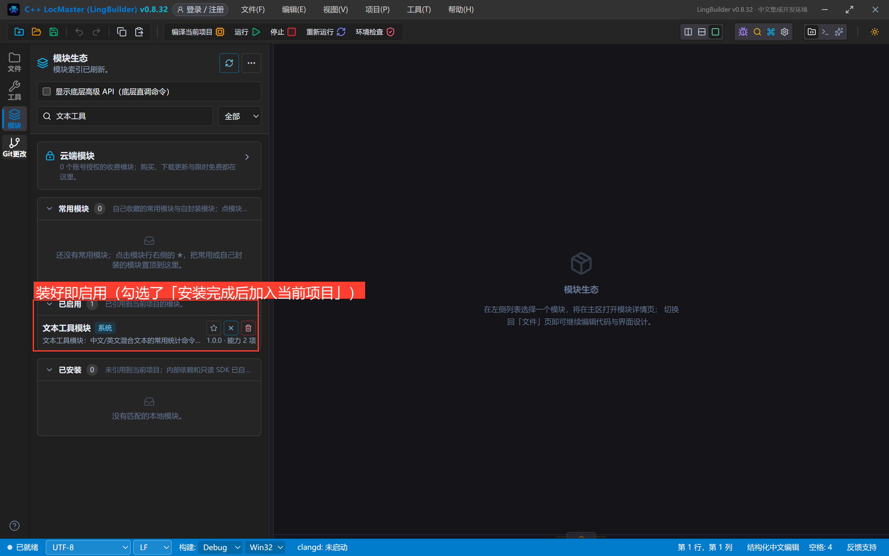
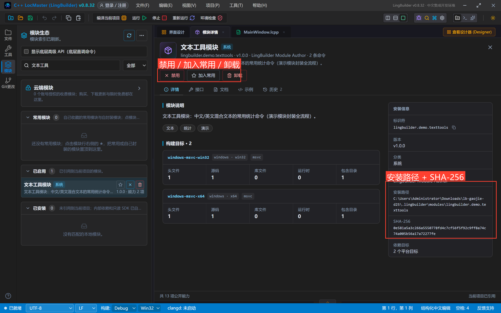
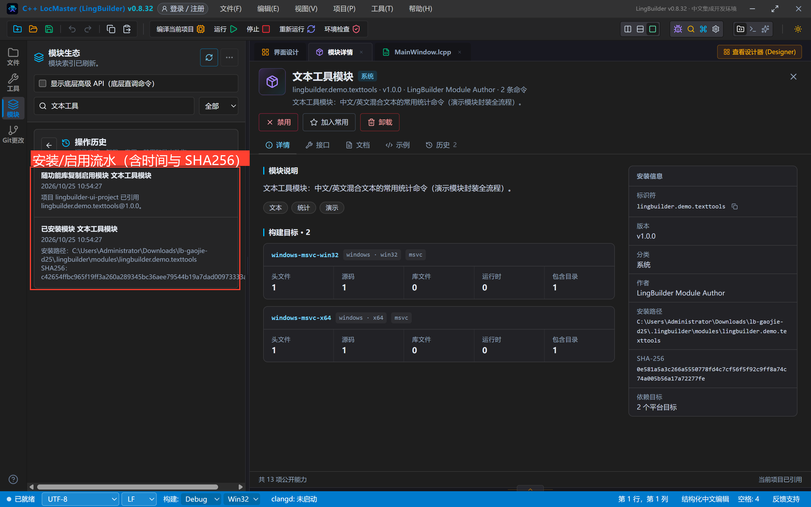
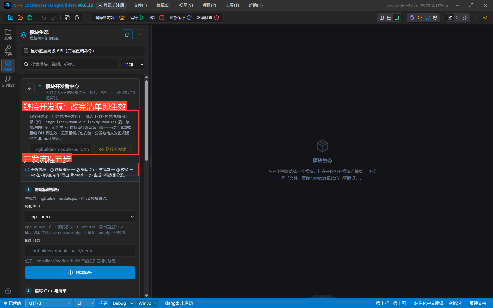
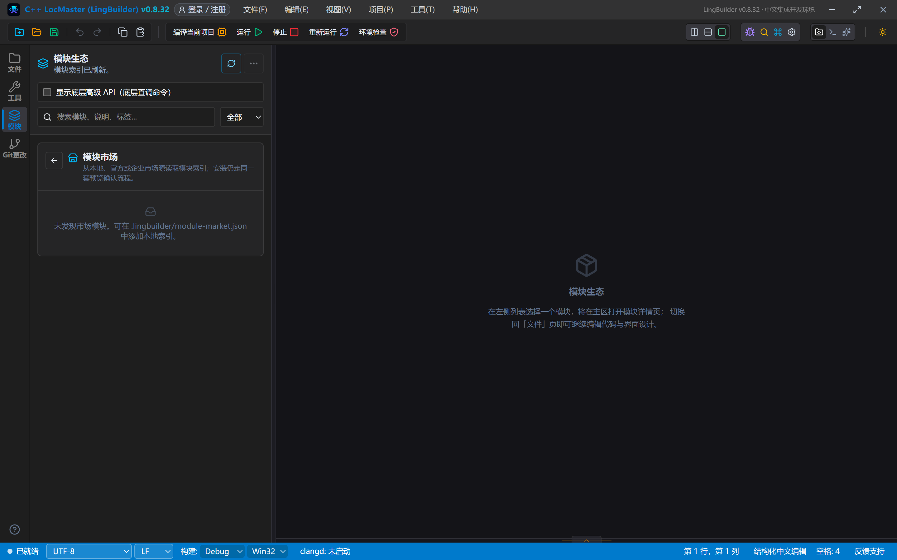
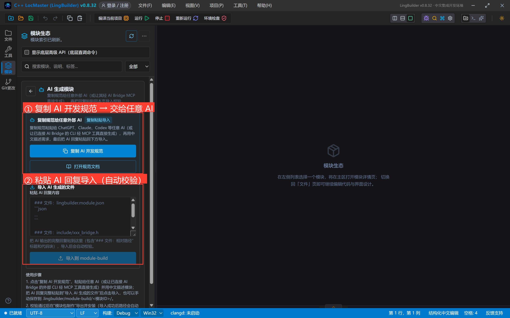
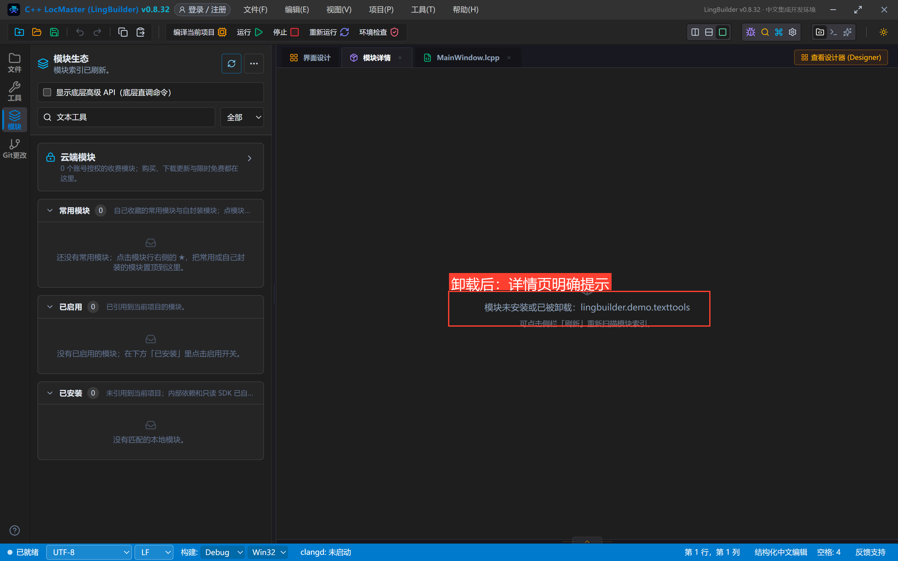

# 高阶实战 25 · 模块生态与分发：安装、卸载、历史与 AI 生成

> 《LingBuilder 高阶实战系列》第 25 集，**模块封装专题**收官。前面五集讲「做模块」，这一集讲「模块的下半生」：别人发来的 `.lbmod` 怎么装、装完怎么管（启用/停用/卸载）、出问题去哪查（操作历史带 SHA-256 审计）、模块作者的工作台（开发者中心）、以及**让 AI 替你写模块**的两条路。全程约 30 分钟。
>
> 前置要求：学过[第 20 集](/guide/tutorials/gaojie-20)（知道 .lbmod 是什么）。本集用的示例包就是第 20 集打包的 `lingbuilder.demo.texttools-1.0.0.lbmod`。

## 这一集你将学会

- 模块页「…」菜单的六大工具：AI 生成模块 / 安装 .lbmod / 模块包制作 / 模块开发者中心 / 模块市场 / 操作历史
- **两段式安全安装**：预览（模块名/版本/文件数/SHA-256/安全检查）→ 确认
- 安装位与开发源的区别：`.lingbuilder/modules/`（安装副本）vs `.lingbuilder/module-build/`（开发源）
- 卸载与快照、操作历史审计
- AI 生成模块：复制规范给任意外部 AI → 粘贴回复导入（自动校验）；以及外部 AI 经 AI Bridge MCP 的六步链

## 1. 拿到 .lbmod：两段式安装

点活动栏「模块」打开模块生态，右上**「…」→「安装 .lbmod」**。面板支持两种给包方式：把文件**拖进来**（桌面版自动复制进工作区），或在「模块包路径」里填**本机绝对路径 / `.lingbuilder/module-packages/` 工作区相对路径**：

填入第 20 集打包的 `lingbuilder.demo.texttools-1.0.0.lbmod` 路径，点**「预览安装」**：

预览弹窗把包里里外外查一遍：模块名/标识符、版本、6 个文件 5.4 KB、**SHA-256**、是否为升级，以及安全检查结论「检查通过，可以安装。」。勾选「**安装完成后加入当前项目**」再点「确认安装」：

装完回到列表搜索「文本工具」——模块出现在**「已启用」**分组（勾选了加入当前项目就自动启用），1.0.0 · 能力 2 项：

> **安装位 vs 开发源**：这样装出来的模块落在工作区 `.lingbuilder/modules/<模块ID>`，是**安装副本**——改它的源码不会生效，想改要么卸载重装新包，要么用开发源（第 20 集的新建模块流程）。两者的模块详情一眼可辨：开发源有金色「开发源」徽标和「取消链接」按钮；安装副本显示**安装路径与 SHA-256**。

## 2. 模块详情：安装副本的操作按钮

点开安装副本的详情，按钮组变成 **「禁用 / 加入常用 / 卸载」**（对比开发源的「启用/取消链接」）：

- **禁用/启用**：按项目生效——停用只影响当前项目引用，别的项目不受影响；
- **加入常用**：收藏到侧栏「常用模块」分组，跨工作区生效；
- **卸载**：卸载前自动留**快照**（误删可找回），同时清理所有项目的引用。

## 3. 操作历史：每一次变动都有审计

「…」→「操作历史」：安装、启用、停用、卸载的每一步都记了**时间戳、安装路径与 SHA-256**——「这个模块是谁在什么时候装的、包对不对」一查便知：

## 4. 模块开发者中心：作者的工作台

「…」→「模块开发者中心」：面向会 C++ 的模块作者，提供**链接开发源**（填 `.lingbuilder/module-build/<模块ID>`，改完清单或重编 DLL 即生效、无需重打包）、**开发流程五步**（① 创建模块模板 → ② 编写 C++ 与清单 → ③ 校验 → ④ 在「模块包制作」导出 .lbmod → ⑤ 生成市场索引分发）和一键创建模板（cpp-source / ui-control / dll-lib / command-only / empty 五种模板类型）：

## 5. 模块市场

「…」→「模块市场」：登录 LingBuilder 账号后，这里按索引列出可购买的收费模块与免费更新。开发期看到的是空索引提示——分发链路是「.lbmod → 市场索引」，作者侧的第 ⑤ 步就在开发者中心：

## 6. AI 生成模块：复制规范 → 粘贴导入

「…」→「AI 生成模块」——没有内置 AI 引擎，而是把 LingBuilder 的模块开发规范交给**你自己选的 AI**：

两条路：

1. **复制粘贴流**（上图）：点「复制 AI 开发规范」→ 粘贴给 ChatGPT / Claude / Codex 等任意 AI，用中文描述你要的模块 → 把 AI 回复的完整回答（含 `### 文件：相对路径` 标题和代码块）粘回「导入 AI 生成的文件」框 → 点「导入到 module-build」——**导入时自动校验**清单与 binding，有错会给出中文诊断，通过后模块直接登记为开发源；
2. **MCP 直连流**：外部 AI 客户端经 AI Bridge 连接 IDE 后，直接按六步链工作：`module.scaffold`（建骨架）→ `module.writeFiles`（写文件）→ `module.validate`（校验）→ `module.pack`（打包 .lbmod）→ `module.installPreview`（预览）→ `module.install`（安装）。每一步都有权限门禁与审计日志，与本集的 UI 操作一一对应。

## 7. 卸载

模块详情点「卸载」——模块立即从工作区移除（卸载前留快照），所有项目引用一并清理；再点开它的详情会明确提示「模块未安装或已被卸载」，侧栏「已启用/已安装」分组同时归零：

> **升级自愈**：把同 ID 更高版本的 .lbmod 再走一遍「预览安装」，预览弹窗的「升级」行会标出「是」，确认后覆盖安装——升级失败的残留目录（`.lingbuilder.xxx.next-*` 等暂存目录）会在下次扫描时按清单 ID 去重自愈，不需要手工清理。

## 合集小结（20~25）

- 20 集：新建模块 → 改命令 → 打包 .lbmod 的最小闭环；
- 21 集：命令面进阶（多参数/逻辑返回/**控件参数**/常量/片段/别名）；
- 22 集：项目内代码组织——功能库与 `库名.功能()`；
- 23 集：C++ 运行时——pragma 链接、runtimeFiles 随包、双架构红线；
- 24 集：随包文档与例程，让模块自带说明书；
- 25 集（本集）：安装、审计、开发者中心、市场与 AI 生成。

至此模块封装专题全部完成。

## 下一集预告

26 集开启**文档处理与识别专题**：用 Word 文档模块做一个合同/报告生成器（无需安装 Microsoft Word）。
