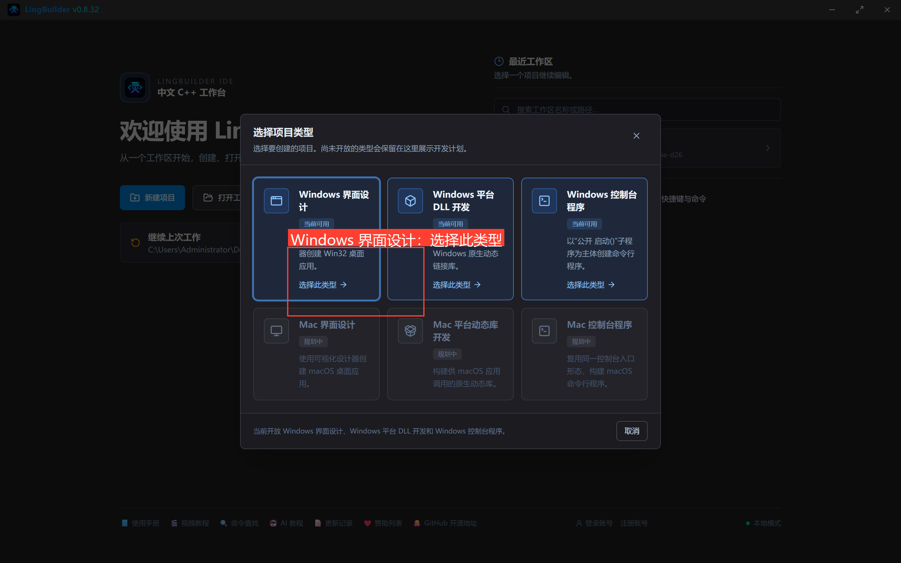
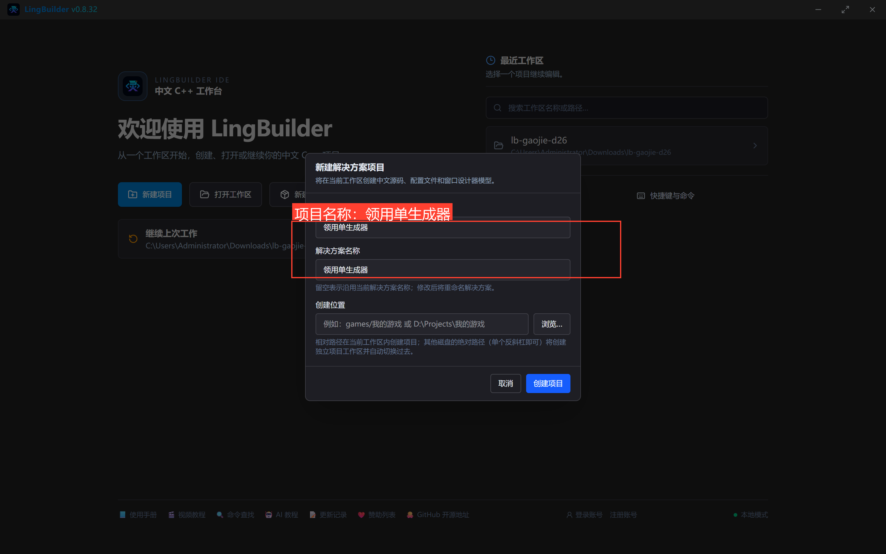
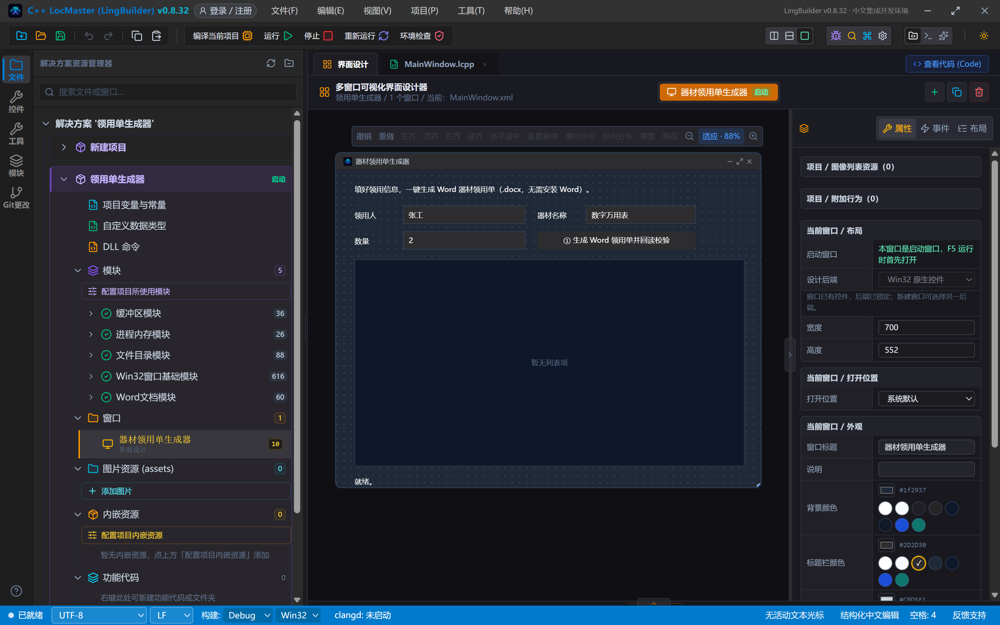
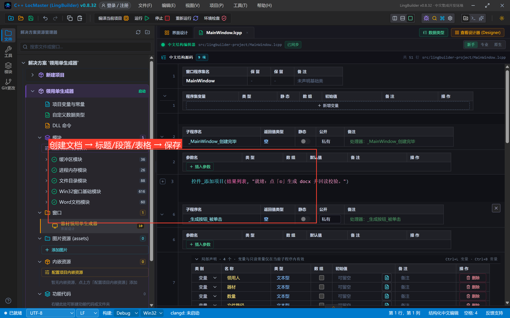
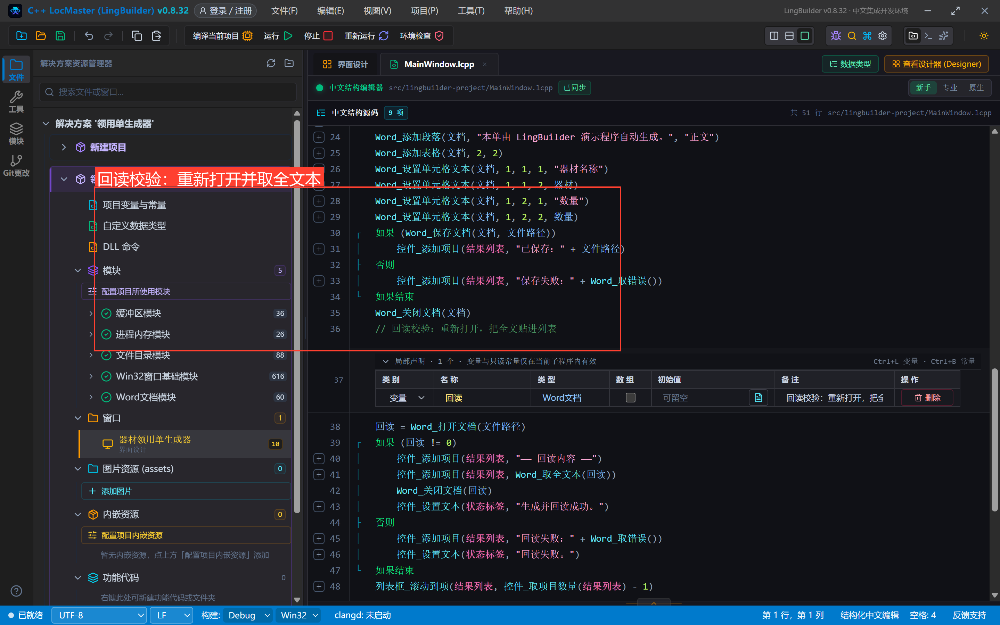
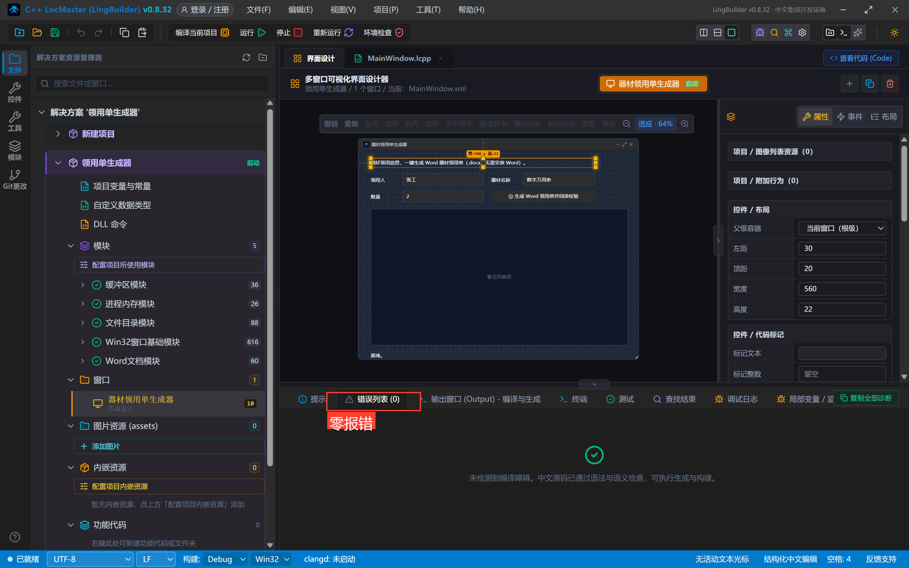
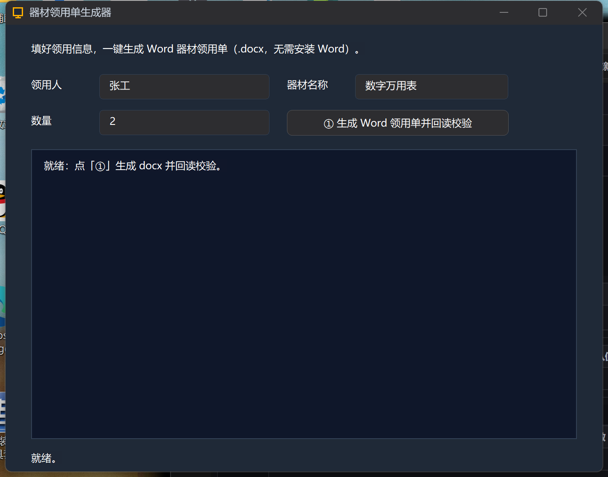
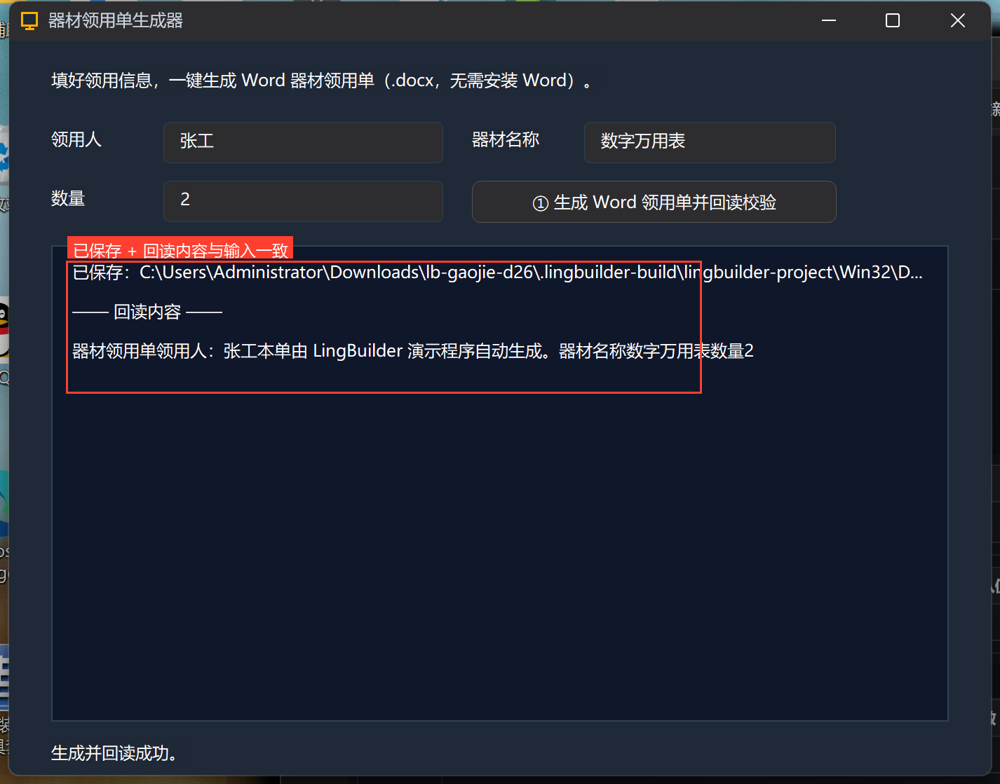

# 高阶实战 26 · Word 文档生成入门：程序自己写 .docx

> 《LingBuilder 高阶实战系列》第 26 集，**文档处理与识别专题**开篇。从这一集起连续六集玩「让程序处理文档」：本集用 **Word 文档模块**（`lingbuilder.data.word`）做一个「器材领用单生成器」——填三个框，程序自己创建 .docx（标题 + 段落 + 表格）、保存、再**重新打开回读全文**证明内容真实写进去了。**全程不需要安装 Microsoft Word**。约 35 分钟。
>
> 前置要求：零基础系列水平即可。

## 这一集你将学会

- 启用 Word 文档模块，拿到受管句柄 `Word文档`
- 五步生成：`Word_创建文档` → `Word_添加标题/段落` → `Word_添加表格` + `Word_设置单元格文本` → `Word_保存文档` → `Word_关闭文档`
- 用 **`Word_打开文档` + `Word_取全文本`** 回读校验，程序自己检查自己
- 两个实战坑：**目录必须已存在**、句柄局部变量的「先声明后赋值」写法

## 1. 启用模块，认识句柄

建窗口项目「领用单生成器」（Windows 界面设计）：





到模块页启用「**Word文档模块**」。它用一个受管句柄类型 `Word文档`（整数，0 = 无效）代表一篇文档：`Word_创建文档()` 在内存里新建，`Word_保存文档(文档, 路径)` 才写出到文件。所有命令失败都返回 0/假，并可用 `Word_取错误()` 读中文原因。

## 2. 画界面

9 个控件：说明标签、领用人/器材名称/数量 三组标签+输入框（默认 `张工` / `数字万用表` / `2`）、生成按钮、结果列表、状态标签：



## 3. 生成五步 + 回读校验

双击 `MainWindow.lcpp`，写生成按钮的事件（完整源码见源码包）：



```lcpp
    事件 _生成按钮_被单击()
        局部 文本型 领用人
        局部 文本型 器材
        局部 文本型 数量
        局部 文本型 文件路径
        文件路径 = 系统_取运行目录() + "/器材领用单.docx"
        领用人 = 控件_取文本(领用人输入框)
        器材 = 控件_取文本(器材输入框)
        数量 = 控件_取文本(数量输入框)
        控件_清空项目(结果列表)
        局部 Word文档 文档
        文档 = Word_创建文档()
        如果 (文档 = 0)
            控件_添加项目(结果列表, "创建失败：" + Word_取错误())
            返回
        如果结束
        Word_添加标题(文档, "器材领用单", 1)
        Word_添加段落(文档, "领用人：" + 领用人, "正文")
        Word_添加段落(文档, "本单由 LingBuilder 演示程序自动生成。", "正文")
        Word_添加表格(文档, 2, 2)
        Word_设置单元格文本(文档, 1, 1, 1, "器材名称")
        Word_设置单元格文本(文档, 1, 1, 2, 器材)
        Word_设置单元格文本(文档, 1, 2, 1, "数量")
        Word_设置单元格文本(文档, 1, 2, 2, 数量)
        如果 (Word_保存文档(文档, 文件路径))
            控件_添加项目(结果列表, "已保存：" + 文件路径)
        否则
            控件_添加项目(结果列表, "保存失败：" + Word_取错误())
        如果结束
        Word_关闭文档(文档)
```

接着**回读校验**——重新打开刚保存的文件，把全文贴进列表，让程序自己证明「内容真的写进去了」：



```lcpp
        局部 Word文档 回读
        回读 = Word_打开文档(文件路径)
        如果 (回读 != 0)
            控件_添加项目(结果列表, "—— 回读内容 ——")
            控件_添加项目(结果列表, Word_取全文本(回读))
            Word_关闭文档(回读)
            控件_设置文本(状态标签, "生成并回读成功。")
        否则
            控件_添加项目(结果列表, "回读失败：" + Word_取错误())
            控件_设置文本(状态标签, "回读失败。")
        如果结束
        列表框_滚动到项(结果列表, 控件_取项目数量(结果列表) - 1)
    结束
```

## 4. 编译运行：真机闭环

编译后先看错误列表（零报错）：



运行，点「① 生成 Word 领用单并回读校验」——列表里出现保存路径和回读全文：





```text
已保存：C:\...\bin\器材领用单.docx
—— 回读内容 ——
器材领用单领用人：张工本单由 LingBuilder 演示程序自动生成。器材名称数字万用表数量2
```

回读全文包含标题、两段正文和表格四个单元格的全部文字——**生成→保存→重开→读取**闭环成立。生成的 .docx 就在 exe 同目录，可以直接用 Word/WPS 打开看排版。

## 5. 三个实战坑（本集真机踩过）

1. **保存目录必须已存在**：`Word_保存文档` 不负责建目录，`输出/xxx.docx` 里 `输出/` 不存在会得到「无法写出文件」。要么先 `文件_创建目录`，要么像本集一样直接存到运行目录；
2. **相对路径口径**：回读时相对路径可能解析到别处，**用 `系统_取运行目录()` 拼绝对路径**最稳（系统外壳模块的命令，记得启用）；
3. **句柄局部变量先声明后赋值**：`局部 Word文档 回读 = Word_打开文档(...)` 这种「声明即调用」的写法会被生成器提升到函数开头、在依赖变量赋值**之前**执行，拿到空路径。拆成两行——先 `局部 Word文档 回读`，再 `回读 = Word_打开文档(...)`——才是稳的写法。

## 下一集预告

27 集讲 **Word 批量与导出**：`{{占位符}}` 模板批量填充（批量通知单）＋ 一行命令导出 PDF。

## 源码包

本集完整项目已打包：[领用单生成器.lcpppkg](领用单生成器.lcpppkg)——「文件 → 打开 LCPP 源码包」一键导入。
