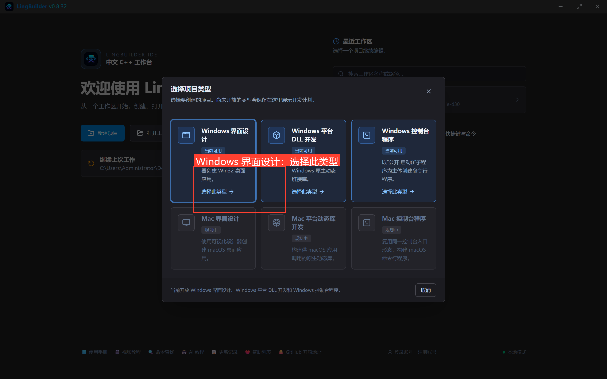
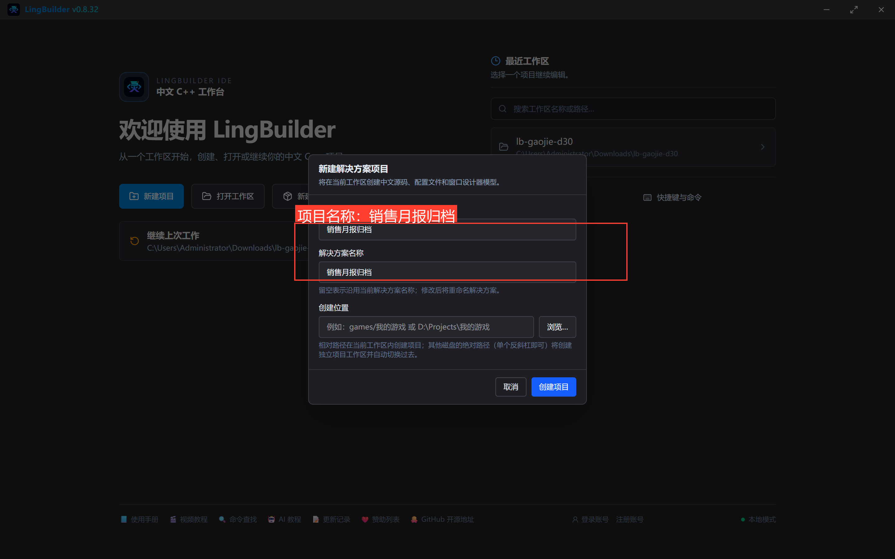
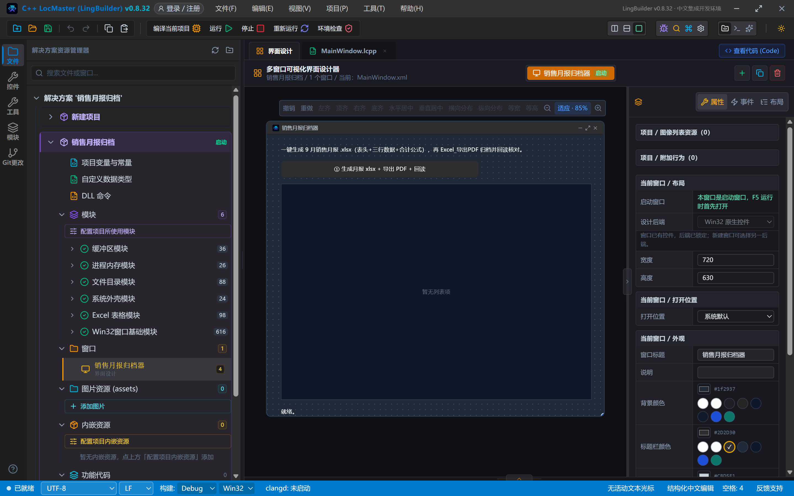
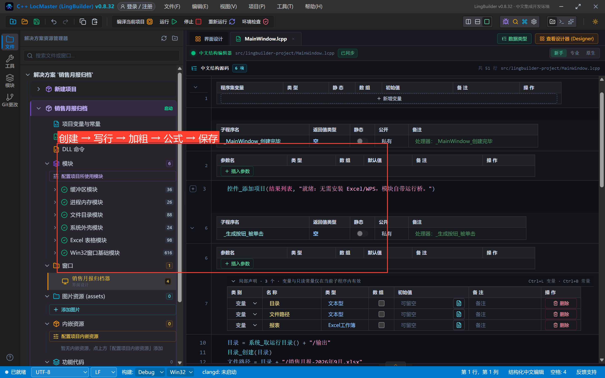
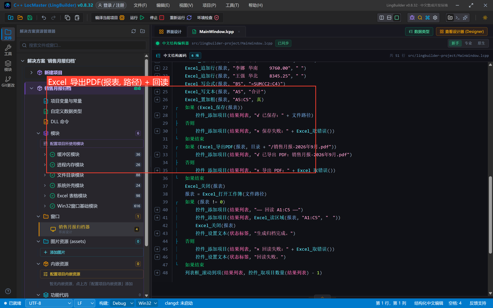
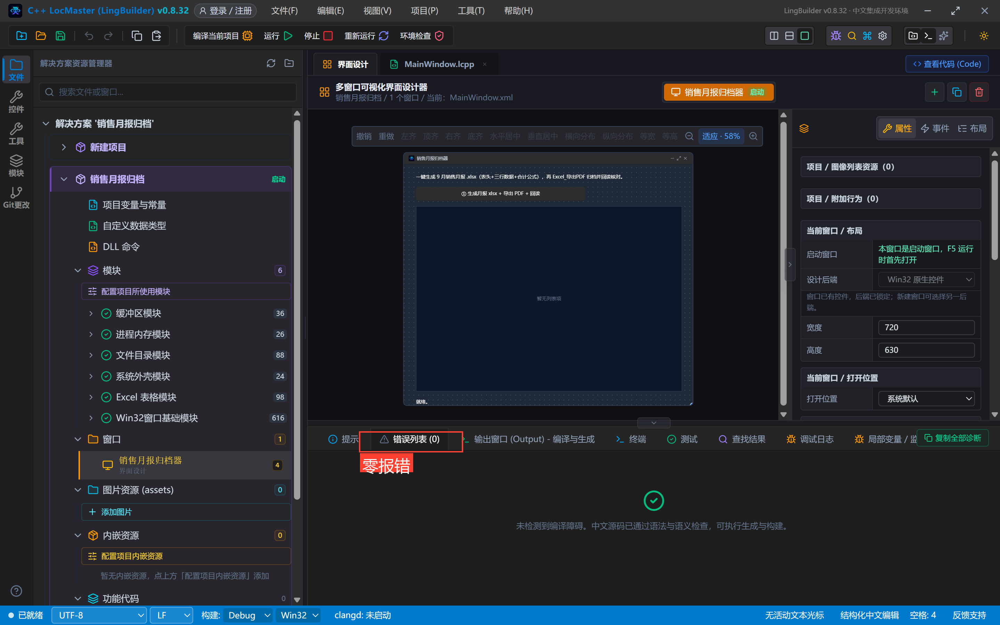
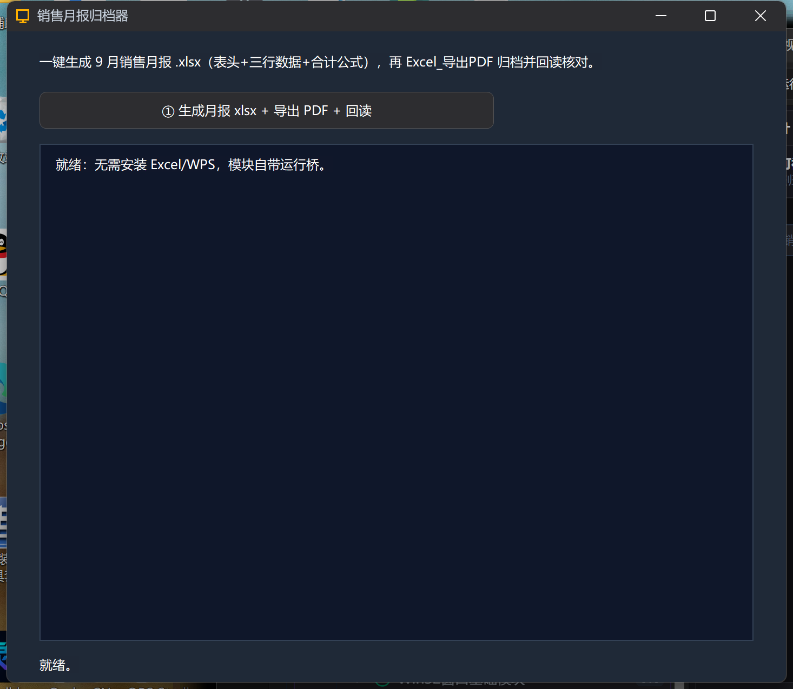
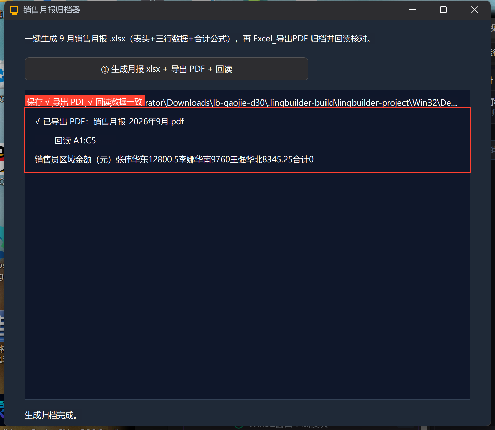

# 高阶实战 30 · Excel 报表归档：写表、算合计、一键导出 PDF

> 《LingBuilder 高阶实战系列》第 30 集。用 **Excel 表格模块**（`lingbuilder.data.excel` 1.1，自带运行桥，**无需安装 Excel/WPS**）做一个「销售月报归档器」：一键生成 9 月月报 .xlsx（表头加粗 + 三行数据 + SUM 合计公式），`Excel_导出PDF` 归档一份 PDF，最后回读 A1:C5 核对。约 30 分钟。

## 这一集你将学会

- `Excel_创建工作簿 → Excel_写一行/追加行 → Excel_置加粗 → Excel_写公式 → Excel_保存` 的创建模式五步
- `Excel_导出PDF(工作簿, 路径)`：**传的是工作簿句柄**（不是文件路径——本集真机踩过一次编译错）
- 创建模式公式**没有缓存值**：回读合计显示 0 是正常现象，Excel/WPS 打开时才计算
- `Excel_打开工作簿 + Excel_读区域` 回读核对

## 1. 项目与界面

新建窗口项目「销售月报归档」，启用 **Excel 表格模块**（顺带 文件目录 + 系统外壳）：





4 个控件：说明标签、生成按钮、结果列表、状态标签：



## 2. 生成五步 + 导出 + 回读

一个按钮做完所有事（完整源码见源码包）：



```lcpp
    事件 _生成按钮_被单击()
        局部 文本型 目录
        局部 文本型 文件路径
        局部 Excel工作簿 报表
        目录 = 系统_取运行目录() + "/输出"
        目录_创建(目录)
        文件路径 = 目录 + "/销售月报-2026年9月.xlsx"
        控件_清空项目(结果列表)
        报表 = Excel_创建工作簿(文件路径)
        如果 (报表 = 0)
            控件_添加项目(结果列表, "× 创建失败：" + Excel_取错误())
            返回
        如果结束
        Excel_写一行(报表, "A1", "销售员\t区域\t金额（元）", "\t")
        Excel_置加粗(报表, "A1:C1", 真)
        Excel_追加行(报表, "张伟\t华东\t12800.50", "\t")
        Excel_追加行(报表, "李娜\t华南\t9760.00", "\t")
        Excel_追加行(报表, "王强\t华北\t8345.25", "\t")
        Excel_写公式(报表, "B5", "=SUM(C2:C4)")
        Excel_写文本(报表, "A5", "合计")
        Excel_置加粗(报表, "A5:C5", 真)
        如果 (Excel_保存(报表))
            控件_添加项目(结果列表, "√ 已保存：" + 文件路径)
        否则
            控件_添加项目(结果列表, "× 保存失败：" + Excel_取错误())
        如果结束
```

> 两个细节：① 区域写法——`Excel_置加粗(报表, "A1:C1", 真)` 直接对整个区域生效；② 批量行用 `Excel_写一行/追加行` + 分隔符文本，纯数字片段自动写成数值，不用一格一格写。

导出 PDF + 回读（注意 `Excel_导出PDF` 第一个参数是**工作簿句柄**）：



```lcpp
        如果 (Excel_导出PDF(报表, 目录 + "/销售月报-2026年9月.pdf"))
            控件_添加项目(结果列表, "√ 已导出 PDF：销售月报-2026年9月.pdf")
        否则
            控件_添加项目(结果列表, "× 导出 PDF：" + Excel_取错误())
        如果结束
        Excel_关闭(报表)
        报表 = Excel_打开工作簿(文件路径)
        如果 (报表 != 0)
            控件_添加项目(结果列表, "—— 回读 A1:C5 ——")
            控件_添加项目(结果列表, Excel_读区域(报表, "A1:C5", "\t"))
            Excel_关闭(报表)
            控件_设置文本(状态标签, "生成归档完成。")
        如果结束
    结束
```

## 3. 真机结果

编译后错误列表零报错：



点「① 生成月报 xlsx + 导出 PDF + 回读」：





```text
√ 已保存：C:\...\输出\销售月报-2026年9月.xlsx
√ 已导出 PDF：销售月报-2026年9月.pdf
—— 回读 A1:C5 ——
销售员区域金额（元） 张伟华东12800.5李娜华南9760王强华北8345.25合计0
```

三行数据逐字一致。**合计显示 0**不是 bug——创建模式写的公式没有缓存值，Excel/WPS 打开文件时才会计算显示 30905.75；PDF 归档页同理在打开时呈现计算结果。这是模块文档写明的行为，程序里如果需要「立刻可读的合计」，就用代码算好直接 `Excel_写数值`。

## 4. 边界备忘

- **仅支持 .xlsx**；.xls 旧格式会得到中文诊断；
- **格式族命令仅创建模式可用**（置列宽/合并/冻结等），打开既有文件时这些命令明确失败并给中文原因；
- `Excel_导出PDF`：列宽自适应、首行加粗、跨页重复表头，区域上限 60 列 × 20000 行；
- 大区域读取上限 100000 行 × 4096 列。

## 下一集预告

31 集（专题收官）：OpenCV 视频抽帧——打开视频、逐帧分析、把关键帧存成图片。

## 源码包

本集完整项目已打包：[销售月报归档.lcpppkg](销售月报归档.lcpppkg)——「文件 → 打开 LCPP 源码包」一键导入。
